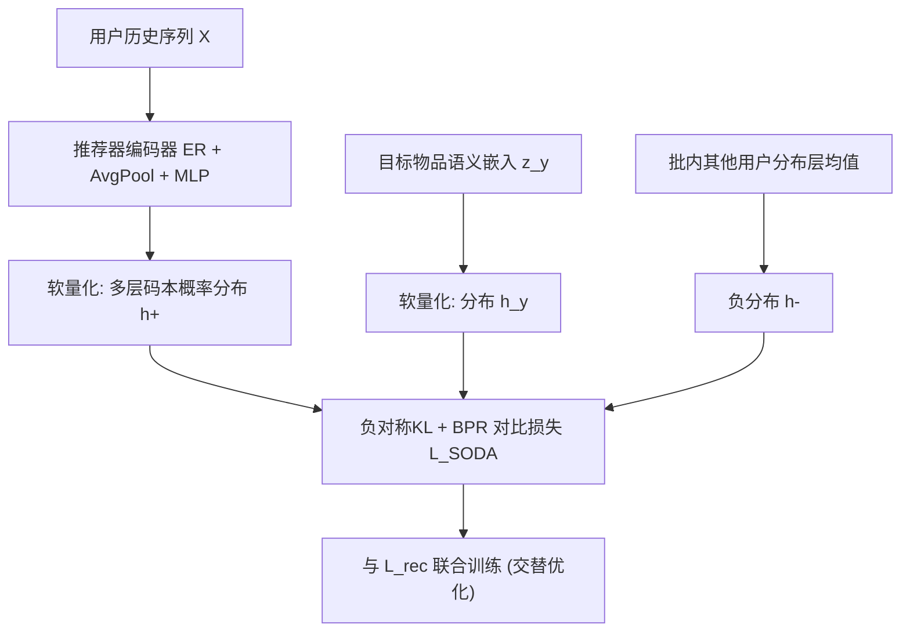
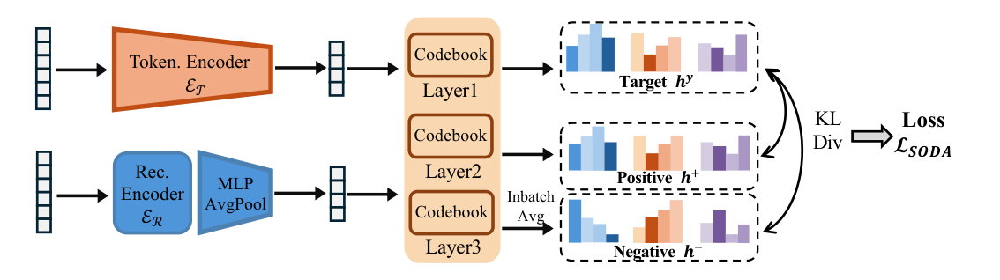

# Distribution-Level Contrastive Supervision for Generative Recommendation (面向生成式推荐的分布级对比监督)

- **会议/期刊**: RecSys 2026 (Short Paper)
- **作者与机构**: Ziqi Xue, Dingxian Wang, Yimeng Bai, Shuai Zhu, Jialei Li, Xiaoyan Zhao, Frank Yang, Andrew Rabinovich, Yang Zhang, Pablo N. Mendes (USTC / Upwork / CUHK / NUS)
- **推荐链路定位**: 端到端生成式召回
- **研究方向**: 生成式推荐与离散语义ID / 自监督对比学习
- **论文原文**: [https://arxiv.org/abs/2603.00700v2](https://arxiv.org/abs/2603.00700v2)
- **开源代码**: [https://github.com/freyasa/SODA](https://github.com/freyasa/SODA)

## TL;DR (1分钟核心速览)

生成式推荐用 RQ-VAE 把物品压成多层离散码，但推荐器训练信号仍只有硬码交叉熵，分词器天然产出的"软分配"信息被白白丢弃，两组件语义传递断裂。本文提出 SODA：把多层码本上的概率分布当作软语义目标，用负对称 KL 定义分布匹配分，套上 BPR 式对比损失做辅助监督，即插即用、不改解码。在 Beauty/Pet/Upwork 三数据集、Full-Ranking 协议下，SODA 对 TIGER/LETTER/ETEGRec 三个骨干一致增益，Beauty 上 Recall@10 最高相对提升约 17.5%。

## Background & Motivation (背景与核心矛盾)

- **主流范式**: 生成式推荐 = 分词器（RQ-VAE 多层码本量化）+ 自回归推荐器（T5 编解码），在紧凑 token 空间检索，规避全库打分。
- **前人局限**: ① 早期解耦训练先冻结分词器，码本无法适配推荐目标；② 即便交替优化（ETEGRec）缓解了耦合，推荐器仍只被**硬离散码**监督，分词器保留的软分配信息未显式传递，造成信息损失与次优优化。
- **核心洞察 (Key Insight)**: 码本概率分布是硬码的"软松弛"，携带细粒度语义差异；推荐本质是相对匹配问题，用户历史应比负样本更接近目标物品——这一 BPR 思想可直接搬到**分布层面**。
- **本文切入点**: 用负对称 KL 作为分布匹配分，构造分布级 BPR 对比辅助损失，让推荐器表征与分词器码本分布细粒度对齐。

## Method (核心方法设计)

### 1. 整体框架 (Overall Architecture)

输入用户交互序列 $x$，经分词器得到目标物品码序列$Y$；推荐器编码历史$X$得上下文表征，解码器自回归预测$Y$。SODA 在推荐器侧额外开一条支路：把编码器池化表征经 MLP 投影回分词器码本空间，软量化成多层概率分布$h^+$；目标物品语义嵌入同样软量化成$h_y$；批内其他用户分布层均值作$h^-$。三者代入负对称 KL 的 BPR 对比损失，与硬码交叉熵联合优化，解码阶段完全不变。

<figure class="paper-figure" markdown="span">
  <figcaption>图1：所提出的SODA框架概览。SODA利用分词器多层码本上的概率分布作为软语义表示进行辅助监督，从而实现分词器与推荐器之间的细粒度语义对齐与联合优化。</figcaption>
</figure>

### 2. 关键设计拆解 (Key Designs)

1. **分布级软语义表征（Soft Quantization）**：硬量化 $\arg\min_k\|\boldsymbol{v}^l-\boldsymbol{e}^l_k\|_2$ 丢弃了码字间亲和度。SODA 改为温度 softmax 归一化负距离，得到每层码本上的概率分布：
$$p_{l,k}=\frac{\exp(-\|\boldsymbol{v}^l-\boldsymbol{e}^l_k\|_2/\tau)}{\sum_{j=1}^{K}\exp(-\|\boldsymbol{v}^l-\boldsymbol{e}^l_j\|_2/\tau)}$$
直觉：距离近的码字获得相近概率质量，分布形状编码了"该物品在语义空间中偏向哪些码字"，比 one-hot 码信息量大得多。

2. **负对称 KL 的 BPR 对比监督**：匹配分定义为 $s(h_a,h_b)=-\big(\mathrm{KL}(h_a\|h_b)+\mathrm{KL}(h_b\|h_a)\big)/2$，损失为
$$\mathcal{L}_{\text{SODA}}=-\log\sigma\big(\beta\cdot(s(h^+,h_y)-s(h^-,h_y))\big)$$
关键细节：$h^-$不是单个批内用户分布，而是**批内其他用户分布的逐层平均**——作者指出这能提供更稳定的非目标参照，降低语义相近"假负样本"的干扰。$\beta$ 为缩放因子，控制 logit 尖锐度。

3. **训练目标、负采样与推理效率**：总损失 $\mathcal{L}=\mathcal{L}_{\text{rec}}+\lambda\mathcal{L}_{\text{SODA}}$（骨干若自带辅助损失可叠加）。负采样采用 In-batch 负样本（免额外采样器）；训练流程沿用交替优化：先预训练分词器，再交替更新推荐器与分词器。推理零额外开销，训练时间增加 <5%。

## Experimental Setup & Evaluation Protocol (实验设置与评估协议)

- **数据集与预处理**: 两个 Amazon 公开集 + Upwork 自有众包雇佣数据（雇主=用户，自由职业者=物品，交互为带时间戳的雇佣事件），均做 `5-core` 过滤，序列按最近交互截断/填充至长度 20。

| 数据集 | #Users | #Items | #Interactions | 稀疏度 | 特征/场景说明 |
| :--- | :---: | :---: | :---: | :---: | :--- |
| Beauty | 22,362 | 12,083 | 198,313 | 99.93% | Amazon 评论，AvgLen 8.87 |
| Pet | 19,855 | 8,498 | 157,747 | 99.91% | Amazon 评论，AvgLen 7.95 |
| Upwork | 15,542 | 33,508 | 139,217 | 99.97% | 雇佣事件，AvgLen 8.96 |

- **数据划分与防穿越**: `Leave-One-Out`（每用户最后一条交互作测试）。
- **排名评测协议**: 无偏 `Full-Ranking`（全物品集排序，不采样负例）；生成式方法统一用 beam size=30 的受限 beam search 解码。
- **对比基线与超参设置**: 传统方法 Caser/GRU4Rec/SASRec/BERT4Rec/HGN；生成式方法 TIGER/LETTER/ETEGRec，并分别套用 SODA 得 SODA-T/L/E。分词器 RQ-VAE，推荐器 T5，物品语义嵌入用 sentence-t5-base（768 维）；$\lambda\in\{10^{-2},\dots,10^{-6}\}$、$\tau\in\{1,\dots,10^{-5}\}$、$\beta\in\{1,\dots,1000\}$ 网格调参。指标 Recall@{10,20}、NDCG@{10,20}。

## Key Experimental Results (实验关键数据)

### 1. 主实验对比 (Main Results)

| 数据集 | 指标 | TIGER | SODA-T | LETTER | SODA-L | ETEGRec | SODA-E |
| :--- | :--- | :---: | :---: | :---: | :---: | :---: | :---: |
| Beauty | R@10 | 0.0594 | **0.0698** (+17.5%) | 0.0670 | **0.0741** (+10.6%) | 0.0775 | **0.0809** (+4.4%) |
| Beauty | NDCG@10 | 0.0320 | **0.0385** (+20.3%) | 0.0359 | **0.0414** (+15.3%) | 0.0426 | **0.0440** (+3.3%) |
| Pet | R@10 | 0.0541 | **0.0672** (+24.2%) | 0.0628 | **0.0682** (+8.6%) | 0.0686 | **0.0696** (+1.5%) |
| Pet | NDCG@10 | 0.0278 | **0.0357** (+28.4%) | 0.0323 | **0.0357** (+10.5%) | 0.0365 | **0.0369** (+1.1%) |
| Upwork | R@10 | 0.0885 | **0.1012** (+14.4%) | 0.0730 | **0.0811** (+11.1%) | 0.0934 | **0.0935** (+0.1%) |
| Upwork | NDCG@10 | 0.0441 | **0.0508** (+15.2%) | 0.0356 | **0.0403** (+13.2%) | 0.0465 | **0.0467** (+0.4%) |

（传统基线中 Beauty 上最强为 GRU4Rec R@10=0.0601，仍低于 SODA-T；Upwork 上 SASRec R@10=0.0872 接近 TIGER 但被 SODA-T 明显超越。）

### 2. 消融实验 (Ablation Study, Beauty)

| 变体 | R@10 | R@20 | NDCG@10 | NDCG@20 |
| :--- | :---: | :---: | :---: | :---: |
| SODA-T | **0.0698** | **0.1010** | **0.0385** | **0.0463** |
| w/o neg（去负样本，退化为 pointwise） | 0.0639 | 0.0959 | 0.0366 | 0.0447 |
| w/o loss（完全去掉 $\mathcal{L}_{\text{SODA}}$） | 0.0653 | 0.0978 | 0.0367 | 0.0449 |
| w/o alter（解耦训练，即原版 TIGER） | 0.0594 | 0.0896 | 0.0320 | 0.0396 |
| SODA-L | **0.0741** | **0.1046** | **0.0414** | **0.0491** |
| w/o neg | 0.0685 | 0.0979 | 0.0387 | 0.0461 |
| w/o loss | 0.0653 | 0.0969 | 0.0376 | 0.0456 |
| w/o alter（原版 LETTER） | 0.0670 | 0.1003 | 0.0359 | 0.0443 |

### 3. 关键实验发现 (Key Findings)

1. **分布监督是主增益来源**：SODA-T 去掉 $\mathcal{L}_{\text{SODA}}$ 后 R@10 从 0.0698 掉到 0.0653（-6.4%），说明软分布目标确实补回了硬码离散化的信息损失；而 w/o neg 仍高于 w/o loss，表明即便 pointwise 的分布对齐也有收益，负样本进一步拉开表征判别度。
2. **交替优化与分布监督互补且不可替代**：w/o alter 直接退回原版骨干（0.0594），是消融中跌幅最大项（-14.9%），说明码本需随推荐目标动态演化；SODA 的增益建立在交替训练之上而非替代它。
3. **骨干越弱、增益越大，强骨干上增益收敛**：TIGER 上相对提升 14%–28%，ETEGRec 上仅 0.1%–4.4%——ETEGRec 本身已含更强的分词器-推荐器耦合，SODA 的边际语义增量被部分吸收，提示该方法更适合作为轻量骨干的"免费增强"。

## Highlights & Limitations (亮点、对比与审稿批判)

- **与代表作对比 (vs. Prior Work)**: 相比 TIGER（解耦、硬码监督），SODA 引入分布级软目标；相比 LETTER（码本多样性正则），SODA 不改分词器损失而是对齐两侧表征；相比 ETEGRec（交替优化但仍是硬码），SODA 在同样的交替框架上补上分布级监督，属正交增强。
- **可迁移亮点**: ① "软量化分布 + 负对称 KL"可迁移到任何带 VQ/RQ 码本的生成式检索任务（如语义 ID 召回、多模态量化检索）；② 用批内分布层均值构造负样本，是缓解假负样本的轻量技巧，可移植到对比召回。
- **审稿级局限批判**: ① 仅在 3 个数据集、短序列（长度 20）上验证，Upwork 为自有数据不可复现，缺少大规模工业物品库的可扩展性证据（作者亦在结论中承认）；② 引入 $\lambda,\tau,\beta$ 三个敏感超参且需网格搜索，训练时间 +5%，论文未给出超参敏感性分析与显著性检验；③ 消融仅在 Beauty 单数据集、两骨干上报告，泛化性证据偏薄。

## Rating (四维评分)

- **方法创新性 (Novelty)**: ⭐⭐⭐⭐ （把 BPR 相对匹配思想提升到码本分布层面，负对称 KL + 批内均值负样本设计简洁且有物理直觉，但属"软标签+对比"的组合式创新）
- **评估协议与实验扎实度 (Protocol & Experiments)**: ⭐⭐⭐ （Full-Ranking + Leave-One-Out 协议规范、三骨干一致增益可信，但仅 3 数据集、消融单数据集、无显著性检验）
- **写作与数学规范度 (Clarity & Rigor)**: ⭐⭐⭐⭐ （5 页短文公式紧凑、软量化与 KL 匹配定义清晰，但 $\beta$ 的作用与负样本构造动机仅一句话带过）
- **工业落地与复现价值 (Industrial & Practical Value)**: ⭐⭐⭐⭐ （即插即用、推理零开销、训练 <5% 增量、代码已开源，工程友好；但超参调优成本与大规模验证缺失扣分）

