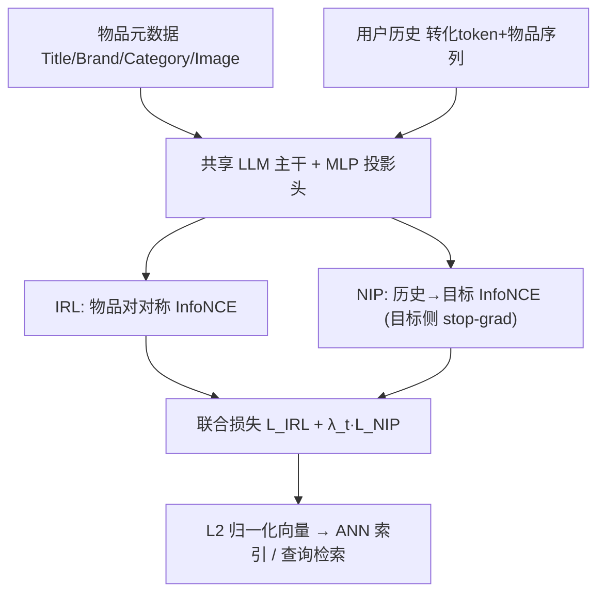
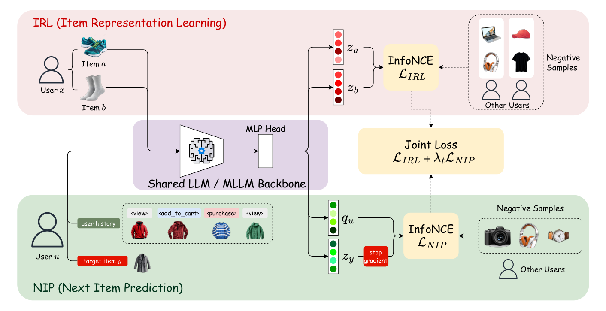

# EGR: Embedding-Native Generative Retrieval with a Shared LLM (嵌入原生生成式检索：共享 LLM 框架)

- **会议/期刊**: RecSys 2026
- **作者与机构**: Xiaodong Liu, Congfei Zhang, Hsiang-wei Chao 等（Snap Inc.）
- **推荐链路定位**: 召回（候选生成）
- **研究方向**: 生成式推荐与离散语义ID / 协同过滤与双塔召回
- **论文原文**: [https://arxiv.org/abs/2607.23038v1](https://arxiv.org/abs/2607.23038v1)
- **开源代码**: 暂未开源

## TL;DR (1分钟核心速览)

生成式检索（GR）现有两条路线各有硬伤：SID 路线依赖量化码本、可变 ID 词表与 token-to-item grounding，目录更新即需重分配 ID；embedding 路线则把物品编码器与查询生成器分开训练，索引空间在查询侧训练前就被冻结，用户-物品对齐沦为"事后补救"。EGR 提出**嵌入原生**框架：单一共享 LLM 主干 + 投影头，物品元数据与用户历史走同一套参数，输出同一空间的 L2 归一化向量，物品直接写入 ANN 索引，用户历史直接生成稠密查询向量，以「物品对对称 InfoNCE + 历史到目标 InfoNCE（目标侧 stop-gradient）」联合训练。Amazon Reviews 三个类目 R@10 全面领先（Toys 0.0807 vs. 次优 0.0626，相对 +28.9%），Snap DPA 线上 A/B 取得 **CVR +2.91%**。

## Background & Motivation (背景与核心矛盾)

- **主流范式**: 工业召回以双塔内积 + ANN 为主；GR 则用序列模型条件于用户历史直接产出下一目标，分 SID 生成式（TIGER/PLUM/OneRec）与 embedding 生成式（PinRec/TBGRecall）两族。
- **前人局限**: ① SID 族需物品编码器、量化器、生成器、grounding 四件套，词表随目录变动而"可变"，新物品上线必须重分配 ID 甚至重训生成器；② embedding 族（PinRec）物品编码器先训后冻，索引空间与查询侧割裂，对齐只能在冻结空间上做后验拟合。
- **核心洞察 (Key Insight)**: 若物品与用户历史共享同一 LLM 主干与同一投影头，则"索引空间"与"查询空间"在优化过程中天然同步演化，next-item 预测可退化为纯稠密最大内积检索，既保留 ANN 服务的工程简洁性，又消除离散 ID 层。
- **本文切入点**: 用**联合对比训练**（IRL 锚定物品空间 + NIP 拉齐查询与目标）替代"先冻物品、再训查询"的两阶段范式。

## Method (核心方法设计)

### 1. 整体框架 (Overall Architecture)

物品路径将元数据（Title/Brand/Category/Image）序列化为固定 prompt，经共享 LLM 主干 $f_\theta$ 与两层 MLP 投影头 $h_\phi$ 得到 L2 归一化向量 $z_i$，直接写入 ANN 索引；用户路径将按时间排序的 (转化类型 token, 物品文本) 事件序列编码为查询向量 $q_u$。两条路径共享全部参数，训练时 IRL 与 NIP 两个对比损失在同一主干上联合优化，推理时仅需一次查询编码 + 一次 ANN 搜索。

<figure class="paper-figure" markdown="span">
  <figcaption>图 2：EGR 的整体框架。带有投影头的共享 LLM 对物品和用户历史进行编码。IRL 在物品对 (𝑝𝑎, 𝑝𝑏) 上应用对称 InfoNCE，塑造被索引的物品空间。NIP 从以用户为条件的查询嵌入到目标物品嵌入应用历史到目标的 InfoNCE，并对目标侧使用 stop-gradient。联合训练将两个损失组合为 LIRL + 𝜆𝑡LNIP。</figcaption>
</figure>

### 2. 关键设计拆解 (Key Designs)

1. **嵌入原生物品表征 (IRL)**：SID 路线把物品压成离散码本，量化误差不可逆且新物品需重编码词表。EGR 改为对同一用户时序中**连续共参与物品对** $(p_a,p_b)$ 施加对称 InfoNCE：
$$\mathcal{L}_{\text{IRL}}=\tfrac12\big[\text{InfoNCE}(z_a,z_b)+\text{InfoNCE}(z_b,z_a)\big]$$
负样本为跨 DDP rank 汇聚的 in-batch 负样本。直觉：共参与结构直接塑造"将被索引"的物品空间，使相似物品在检索前就已聚拢，而非依赖量化码本的粗粒度语义。

2. **历史到目标预测 (NIP) + 目标侧 stop-gradient**：用户历史按"旧→新"序列化，每个事件前置 `<view>/<add_to_cart>/<purchase>` 意图 token，经同一主干得 $q_u$，再对目标物品做 InfoNCE：
$$\mathcal{L}_{\text{NIP}}=\text{InfoNCE}\big(q_u,\ \text{sg}(z_y)\big)$$
stop-gradient 阻止逐样本的目标拉拽扰动已索引的物品空间——这是"共享主干"能稳定工作的关键闸门；由于参数共享，NIP 梯度仍可经历史分支回传并间接影响未来物品嵌入。

3. **联合训练与调度**：总损失 $\mathcal{L}=\mathcal{L}_{\text{IRL}}+\lambda_t\mathcal{L}_{\text{NIP}}$。前 10% 步仅开 IRL（$\lambda_t=0$）为物品空间提供初始共参与结构，随后 $\lambda_t$ 从 0.1 线性升至 1.0。负采样全部为 in-batch（无 hard negative 挖掘、免采样器）；推理侧物品离线索引、查询向量按天预计算，单请求仅一次 ANN 检索，物品编码器加宽不增加每请求成本。

## Experimental Setup & Evaluation Protocol (实验设置与评估协议)

- **数据集与预处理**:

| 数据集 | #Users | #Items | #Interactions | 稀疏度/密度 | 特征/场景说明 |
| :--- | :---: | :---: | :---: | :---: | :--- |
| Amazon Beauty | 22.4K | 12.1K | 198.5K | 99.93% 稀疏 | 5-core 过滤，评论文本元数据 |
| Amazon Sports | 35.6K | 18.3K | 296.3K | 99.95% 稀疏 | 同上 |
| Amazon Toys | 19.4K | 11.9K | 167.6K | 99.93% 稀疏 | 同上 |
| Snap DPA | 10M 训练用户 | 工业级商品库 | 用户-商品参与事件 | — | 留出 1M 用户序列评测，含图像多模态 |

- **数据划分与防穿越**: Amazon 采用 `Leave-One-Out`（末位交互为测试、倒数第二为验证）；Snap DPA 按用户序列留出 1M 条做评测，其余训练。
- **排名评测协议**: 离线统一报告 `R@10`；Amazon 遵循 TIGER 设定的全库排序协议，Snap 数据按公司政策仅披露相对数值。
- **对比基线与超参**: 基线含 BERT4Rec、SASRec、TIGER、HSTU；主干 Qwen3-VL-Embedding 2B，last-token pooling，投影至 $d=512$，LoRA $r=128,\alpha=256$（约 41M 可训练参数），AdamW lr $2\times10^{-5}$，8×H100、per-GPU batch 64、最大历史长度 20（约 460 token）。

## Key Experimental Results (实验关键数据)

### 1. 主实验对比 (Main Results)

| Method | Beauty R@10 | Sports R@10 | Toys R@10 |
| :--- | :---: | :---: | :---: |
| BERT4Rec | 0.0396 | 0.0175 | 0.0332 |
| SASRec | 0.0607 | 0.0301 | 0.0626 |
| TIGER | 0.0623 | 0.0347 | 0.0547 |
| HSTU | 0.0652 | 0.0343 | 0.0566 |
| **EGR (ours)** | **0.0655** | **0.0362** | **0.0807** |
| Improv. vs. best baseline | +0.5% | +4.3% | **+28.9%** |

线上 A/B（两周，10%/10% 分流，候选配额固定）：

| Metric | Relative Lift |
| :--- | :---: |
| Impressions | +0.15% |
| CTR | +0.23% |
| CVR | **+2.91%** |

EGR 贡献了最终曝光的 5.3%，其来源级 CTR/CVR 分别为全部生产召回源（U2I、I2I、非个性化）均值的 **1.55× / 1.53×**。

### 2. 消融实验 (Ablation Study)

| 配置 | IRL | NIP | 联合训练 | Stop-Grad | rel R@10 |
| :--- | :---: | :---: | :---: | :---: | :---: |
| EGR (full) | ✓ | ✓ | ✓ | ✓ | **100.0%** |
| w/o stop-grad | ✓ | ✓ | ✓ | ✗ | 95.3% |
| NIP only | ✗ | ✓ | — | — | 93.7% |
| IRL only | ✓ | ✗ | — | — | 26.6% |
| Two models（冻物品+训查询） | ✓ | ✓ | ✗ | — | 86.2% |

损失调度消融：`Balanced`（IRL 权重 $1-\lambda_t$ 衰减）97.9%，`Sequential`（前后半程各开一个损失）仅 74.4%。

### 3. 关键实验发现 (Key Findings)

1. **联合训练是最大增益源，而非任一单损失**：两模型冻结范式仅 86.2%，比全量配方低 13.8 个点；而 IRL-only 只有 26.6%，说明共参与结构是必要的"物品空间锚点"但远不足以支撑 next-item 检索——二者必须重叠共训。
2. **stop-gradient 是共享主干的稳定器**：去掉后掉至 95.3%，印证逐样本目标拉拽会污染已索引物品空间；调度上 `Sequential` 暴跌 25.6%，证明 IRL 与 NIP 的**重叠期**不可省。
3. **冷启动几乎无损、多模态白捡**：目标物品在训练输入中频次为 0 的样本占测试集 31.3%，其 R@10 仍达头部桶的 94.9%（仅差 5.1%）；同主干下加入商品图像带来 +6.9% 相对提升，且训练数据从 10K 到 10M 用户 R@10 单调增长 27% 未见饱和。

## Highlights, Limitations & Rating (亮点、对比与审稿评价)

- **与代表作对比 (vs. Prior Work)**: 对比 TIGER/PLUM 等 SID 方法，EGR 彻底移除量化器、ID 词表与 grounding 层，新物品编码即可入库；对比 PinRec 的两模型设计，EGR 以共享主干 + 联合训练取代"先冻物品再训查询"，把对齐从后验问题变为联合优化问题；对比 SASRec/HSTU，物品表征来自内容编码器而非可学习 ID 参数，天然支持冷启与多模态。
- **可迁移亮点**: ① 目标侧 stop-gradient + 共享主干的组合，可迁移到任何"索引侧与查询侧共享参数"的对比检索场景；② 意图 token（view/cart/purchase）前置序列化，是低成本注入行为强度信号的通用技巧。
- **审稿级局限批判**: ① 主实验仅 4 个基线且 Beauty 上对 HSTU 仅 +0.5%（0.0655 vs. 0.0652），公共基准的说服力偏弱，工业结论主要依赖不可复现的 Snap 私有数据；② 查询向量按天预计算，会话内意图漂移无法响应，且 2B 主干 + 每日全量物品重编码的算力成本未做量化对比；③ 冷启动分层实验仅按目标频次切桶，作者亦承认未隔离混杂因素，94.9% 的结论应谨慎外推。
- **四维评分**: 创新性 ⭐⭐⭐⭐ | 实验扎实度 ⭐⭐⭐⭐ | 方法清晰度 ⭐⭐⭐⭐⭐ | 落地价值 ⭐⭐⭐⭐⭐

