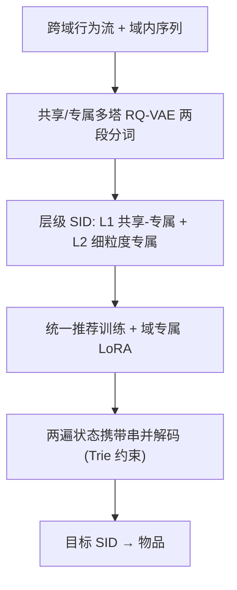
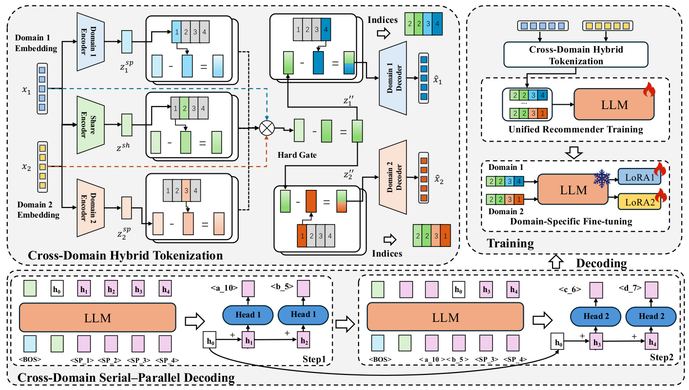

# Empowering Cross-Domain Sequential Recommendation with Hybrid Tokenization and Serial-Parallel Decoding (混合分词与串并解码驱动的跨域序列生成式推荐)

- **会议/期刊**: RecSys 2026
- **作者与机构**: Yuxuan Hu, Yuhao Wang, Tianbo Huang, Chao Zhang, Ziwei Liu, Lihua Zhang, Xiangyu Zhao（香港城市大学、字节跳动）
- **推荐链路定位**: 端到端生成式（召回/排序一体）
- **研究方向**: 生成式推荐与离散语义 ID / 跨域与多场景推荐
- **论文原文**: [https://arxiv.org/abs/2607.28659v1](https://arxiv.org/abs/2607.28659v1)
- **开源代码**: [https://github.com/Applied-Machine-Learning-Lab/RecSys2026_GenCDSR](https://github.com/Applied-Machine-Learning-Lab/RecSys2026_GenCDSR)

## TL;DR (1分钟核心速览)

跨域序列推荐（CDSR）直接套用 TIGER 式生成式推荐存在两处硬伤：分词阶段要么各域独立 RQ-VAE、要么全共享码本，跨域协同信号无法显式编码进 SID；解码阶段 Beam Search 逐 token 串行，时延随候选扩张爆炸，而 MTP/NEZHA 全并行又丢失前序 token 语义依赖。GenCDSR 提出「共享-专属多塔 RQ-VAE + 细粒度专属码本」的两段式混合分词，并配套「两遍状态携带」串并解码，在三个跨域数据集、Leave-One-Out 全库排序协议下平均精度 +1.5%，推理时延相对 Beam Search 平均降低 85.1%。

## Background & Motivation (背景与核心矛盾)

- **主流范式**: CDSR 主流做法是混合行为序列建模（TriCDR 的多粒度注意力 + 跨域对比学习）；生成式路线则以 RQ-VAE 学 SID、再用 seq2seq 自回归生成下一物品 SID（TIGER、GenCDR、MTCDR）。
- **前人局限一（分词）**: 现有方法要么每域单独训一个量化模型（TIGER 式），要么对所有域不加区分地共享一个量化器（MTCDR 式）。前者把语义空间切碎、削弱跨域泛化；后者抹平域间分布差异，离散化后信息损失大，SID 无法承载跨域协同相关性。
- **前人局限二（解码）**: Beam Search 逐 token 串行，时延随解码步数与候选扩张快速膨胀（实测 T5 上单样本 4.5–5.0 ms）；MTP/NEZHA 类全并行解码各位置独立预测，无法利用前序 token 的语义依赖，逐位置精度下降（Electronics 上 MTP 平均逐头 Hit@1 仅 0.0538，本文 0.0598）。
- **核心洞察 (Key Insight)**: 跨域物品既有稳定的高层共享语义与行为规律，又有低层强域依赖的细粒度差异——因此 SID 应当**分层**：高层共享锚定跨域对齐，低层专属刻画域内细节；而这一层级结构天然为「部分并行」解码提供了切分点。
- **本文切入点**: 用两段式层级 SID（$L_1$共享-专属段 +$L_2$ 细粒度专属段）同时解决分词表达力与解码效率，让解码策略与 SID 结构对齐。

## Method (核心方法设计)

### 1. 整体框架 (Overall Architecture)

输入为按时间戳合并的跨域行为流 $\bar{S}_u$与各域独立序列$S^A_u, S^B_u$；先用 LLaMA-7B/Qwen2.5-7B 提取物品文本语义向量，经「共享-专属多塔 RQ-VAE」两阶段量化为长度$L=L_1+L_2$ 的层级 SID；随后在 T5/Qwen3-0.6B 骨干上做统一推荐训练（跨域混合数据）+ 域专属 LoRA 微调；推理时以两遍前向的串并解码在 Trie 约束下生成目标 SID 并映射回物品。

<figure class="paper-figure" markdown="span">
  <figcaption>图1：所提出的GenCDSR框架概览。</figcaption>
</figure>

### 2. 关键设计拆解 (Key Designs)

1. **共享-专属分词 SST（Stage 1，跨域对齐锚点）**：痛点是不加区分的共享码本抹平域差异、独立码本割裂语义空间。做法是对域 $d$的语义向量$x_d$并行过共享编码器与域专属编码器得$z^{sh}, z^{sp}_d$，各自经$L_1$ 级残差量化后，用 Gumbel-Softmax 路由器做软融合：
$$g^{sh},g^{sp}_d=\text{GumbelSoftmax}(f(x_d);\tau),\quad z'_d=g^{sh}\cdot z'^{sh}+g^{sp}_d\cdot z'^{sp}_d$$
融合后的量化输出与融合连续潜变量之差 $z''_d=(g^{sh}z^{sh}+g^{sp}_dz^{sp}_d)-z'_d$ 作为 Stage 2 输入。直觉：路由器让模型按物品自适应决定「借多少跨域共性」，残差则保证 Stage 1 未捕获的信息不丢失。

2. **细粒度专属分词 FGST（Stage 2，域内精度补偿）**：低层表征若仍共享码本，域特有模式被过度约束甚至产生语义歧义。故对 $z''_d$施加$L_2$级**纯域专属** RQ 量化得$\hat{z}_d$，再由域解码器重建$\hat{x}_d=\text{Dec}_d(\hat{z}_d)$。分词总损失为重建项加三路 RQ 损失：
$$\mathcal{L}=\underbrace{\textstyle\sum_{d}\|x_d-\hat{x}_d\|_2^2}_{\mathcal{L}_{recon}}+\underbrace{\mathcal{L}^{sh}_{RQ}+\mathcal{L}^{sp,A}_{RQ}+\mathcal{L}^{sp,B}_{RQ}}_{\mathcal{L}_{RQ}}$$
即「高层共享、低层专属」的分工，与跨域数据的层次异质性对齐。

3. **串并解码与训练/推理**：目标 SID 的 $L$个位置先替换为占位符 `<SP_1..SP_L>`，一次前向预计算全部未来位置隐状态；Step 1 头串行解出前$L_1$个 token 并累积上下文状态$s_{l+1}=s_l+e_l$；第二次前向填入前$L_1$个占位符后，Step 2 头以携带状态$s_{L_1+1}$为条件**并行**预测剩余$L_2$个位置。训练目标为两段 token 级交叉熵之和（式 22），再冻结骨干、按域各训一个 rank=8 的 LoRA（式 23）；推理在 Trie 可行集$\mathcal{T}_d$ 内做约束解码（式 24）。全程**免负采样**（生成式全库 softmax），无 in-batch 负样本开销。

## Experimental Setup & Evaluation Protocol (实验设置与评估协议)

- **数据集与预处理**: 过滤交互数 <5 的用户与 <3 的物品（双域均施加），按时间戳合并跨域序列。

| 数据集 | #Users | #Items | 稀疏度 | 重叠用户 | 平均长度 |
| :--- | :---: | :---: | :---: | :---: | :---: |
| Clothing–Sports | 9,933 / 4,263 | 3,278 / 1,021 | 99.70% / 99.04% | 3,962 | 10.71 |
| Electronics–Phone | 20,728 / 11,762 | 10,492 / 2,246 | 99.93% / 99.88% | 11,698 | 8.30 |
| Book–Movie | 1,381 / 2,213 | 12,426 / 16,537 | 99.88% / 99.92% | 1,265 | 68.30 |

- **数据划分与防穿越**: `Leave-One-Out`——最后两次交互分别作验证/测试，严格按时间序，无未来信息泄漏。
- **排名评测协议**: 生成式全库解码 + Trie 约束，等价于无偏 `Full-Ranking`（非采样排序）；指标 H@{5,10}、N@{5,10}，效率指标为平均生成时延 LT(ms)。
- **对比基线与超参**: SDSR（GRU4Rec/BERT4Rec/SASRec/TIGER）与 CDSR（C2DSR/TriCDR/LLM4CDSR/GenCDR）共 8 个基线；SID 配置 $L_1=L_2=2$、每级 256 码字 × 128 维；T5 用 lr=5e-4/bs=256/LoRA r=8,α=32，Qwen3-0.6B 用 lr=1e-4/bs=128/LoRA r=8,α=16；Beam size=20；3 次运行取均值，双侧 t 检验$p<0.05$。

## Key Experimental Results (实验关键数据)

### 1. 主实验对比 (Main Results)

| 数据集 | 指标 | TIGER | TriCDR | LLM4CDSR | GenCDR | **GenCDSR** | Improv. |
| :--- | :--- | :---: | :---: | :---: | :---: | :---: | :---: |
| Clothing | H@10 | 0.5961 | 0.5778 | 0.5818 | 0.6076 | **0.6097** | +0.35% |
| Clothing | N@10 | 0.5269 | 0.5386 | 0.5428 | 0.5420 | **0.5447** | +0.35% |
| Sports | H@10 | 0.4667 | 0.4952 | 0.5038 | 0.5182 | **0.5207** | +0.48% |
| Sports | N@10 | 0.4513 | 0.3745 | 0.3826 | 0.4718 | **0.4735** | +0.36% |
| Electronics | H@10 | 0.0596 | 0.0535 | 0.0567 | 0.0648 | **0.0677** | +4.48% |
| Phone | H@10 | 0.0786 | 0.0653 | 0.0731 | 0.1045 | **0.1061** | +1.53% |
| Book | H@10 | 0.1390 | 0.0344 | 0.0745 | 0.1452 | **0.1469** | +1.17% |
| Movie | H@10 | 0.2473 | 0.2139 | 0.2216 | 0.2622 | **0.2671** | +1.87% |

### 2. 消融与效率实验 (Ablation & Efficiency)

| 变体 / 解码策略 | Book H@10 (T5) | Movie H@10 (T5) | Movie H@10 (Qwen3) | LT (Movie, T5) |
| :--- | :---: | :---: | :---: | :---: |
| w/o SST (Stage 1) | 明显下降（降幅最大） | 明显下降 | 明显下降 | — |
| w/o FGST (Stage 2) | 中等下降 | 中等下降 | 中等下降 | — |
| **GenCDSR (full)** | **最优** | **最优** | **最优** | — |
| MTP | 0.1062 | 0.1600 | 0.2131 | 0.2565 |
| NEZHA | 0.0585 | 0.1234 | 0.2454 | 0.4312 |
| Beam Search | 0.1420 | 0.2675 | 0.3336 | 5.0010 |
| **Ours 解码** | **0.1469** | **0.2671** | **0.3481** | **0.6045** |

### 3. 关键实验发现 (Key Findings)

1. **分词是主要增益来源，且两阶段互补**：移除 Stage 1（SST）的跌幅显著大于移除 Stage 2（FGST），说明跨域共享锚定是泛化的主因，FGST 主要负责域内精度补偿；特征保真度上本文在三个数据集均最高，Sh-RQ-VAE 在域间异质性大时信息损失最严重，Sp-RQ-VAE 则缺乏显式共享结构。
2. **串并解码在精度-时延上取得最优折中**：相对 MTP 平均精度 +21.9%、相对 NEZHA +37.9%，同时时延较 Beam Search 降 85.1%（T5 降 87.5%、Qwen3 降 82.7%）；Movie 域上甚至精度反超 Beam Search（0.2671 vs 0.2675 基本持平，Qwen3 上 0.3481 vs 0.3336 反超），证明部分保留串行依赖比全并行更利于逐位置精度。
3. **码本容量分配存在明确最优点**：总层数 $L=4$ 时，共享:专属 = 2:2 在所有数据集与指标上最优；0:4/1:3 削弱跨域对齐，3:1/4:0 压制细粒度精修并引入语义歧义，说明共享与专属容量需平衡而非越多越好。

## Highlights & Limitations (亮点、对比与审稿批判)

- **与代表作对比 (vs. Prior Work)**: 相比 TIGER（单域独立 RQ-VAE + 串行 Beam Search），本文把分词从「域内独立」升级为「共享-专属分层」，并把解码从「全串行」改为「两遍部分并行」；相比 GenCDR/MTCDR（统一共享量化 + 逐 token 生成），本文显式解耦共享与域专属因子，且解码时延低一个数量级；相比 NEZHA（全并行自投机），本文保留前 $L_1$ 步串行依赖，逐位置精度更高。
- **可迁移亮点**: ①「高层共享码本 + 低层专属码本 + Gumbel 路由」的分层量化范式可直接迁移到多场景/多业务线统一 SID 构建；②「占位符预填充 + 状态携带」的两遍解码可套用到任何层级 SID 的生成式召回，作为 Beam Search 的低时延替代。
- **审稿级局限批判**: ① 仅验证双域设定，三域及以上时路由器与码本分配的复杂度、以及 $L_1:L_2$ 的搜索成本未讨论；② 精度增益幅度偏小（平均 1.5%），部分数据集（Clothing N@10、Movie H@10 对 Beam Search）优势在统计上接近边界，且依赖 LLaMA-7B 语义嵌入，端到端时延统计是否含分词/嵌入开销未明确。

## Rating (四维评分)

- **方法创新性 (Novelty)**: ⭐⭐⭐⭐ （核心机制与方法设计具备明确创新性，理论与实验动机支撑充分）
- **评估协议与实验扎实度 (Protocol & Experiments)**: ⭐⭐⭐⭐ （主流公开数据集评测完整，包含多基线对比与消融实验验证）
- **写作与数学规范度 (Clarity & Rigor)**: ⭐⭐⭐⭐⭐ （问题形式化定义清晰，核心模块数学推导与架构阐述严谨易读）
- **工业落地与复现价值 (Industrial & Practical Value)**: ⭐⭐⭐⭐ （兼顾推荐效果增益与训练/推理效率，具备实际场景迁移参考价值）
