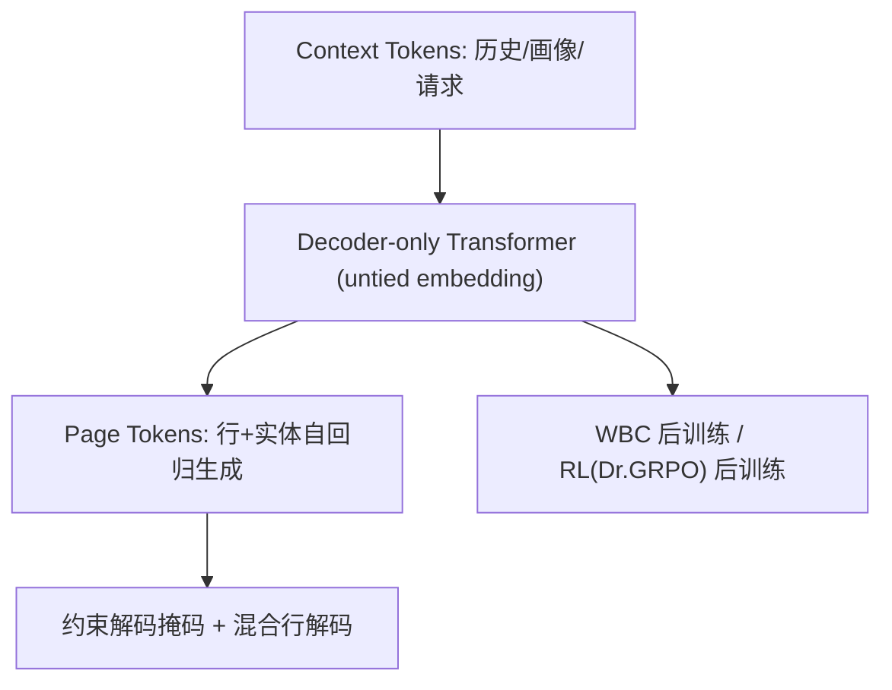
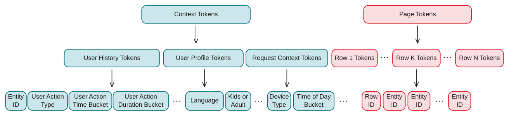

# GenPage: Towards End-to-End Generative Homepage Construction at Netflix (面向 Netflix 首页端到端生成式构建)

- **会议/期刊**: ACM RecSys 2026
- **作者与机构**: Lequn Wang, Jiangwei Pan, Fengdi Che, Linas Baltrunas (Netflix / University of Alberta)
- **推荐链路定位**: 端到端生成式（替代召回-排序-重排多级栈）
- **研究方向**: 生成式推荐与离散语义 ID / 列表级重排
- **论文原文**: [https://arxiv.org/abs/2606.31031v3](https://arxiv.org/abs/2606.31031v3)
- **开源代码**: 暂未开源

## TL;DR (1分钟核心速览)

传统首页构建依赖多级流水线（召回→排序→重排）加行/实体专用模型，级联目标错位且特征工程繁重。GenPage 把用户历史、画像、请求上下文 token 化为 prompt，用单个 decoder-only Transformer 自回归生成整页「行+实体」结构化布局，并以加权二分类 (WBC) 或 RL 做后训练。在 Netflix 生产 A/B（14 天）中，WBC 变体对成熟多级基线取得 +0.24% 核心参与度提升（$p<0.001$），端到端服务延迟反降 20%。

## Background & Motivation (背景与核心矛盾)

- **主流范式**: 首页由候选生成、排序、重排多级流水线拼装，行与实体分别由专用模型打分，输出是二维结构化布局而非单一排序列表。
- **前人局限**: ① 各级目标不一致，行/实体间交互（多样性、行的"停留力" stopping power）无法在实体级目标中建模；② 生成式推荐前人工作（TIGER 类）多只生成扁平 item 列表，未处理多行结构化页面与工业约束。
- **核心洞察 (Key Insight)**: 若把整页视为一条 token 序列，则"给定用户与请求，应生成什么首页"可被单个 Transformer 直接回答，且页面级奖励可用 RL 整体优化。
- **本文切入点**: 自定义领域 tokenizer（一实体/一行 = 一 token）+ LLM 式"预训练→后训练"配方，配合冷启动、保鲜、业务规则与延迟四类工程手段落地。

## Method (核心方法设计)

### 1. 整体框架 (Overall Architecture)

输入侧将用户行为历史（动作类型/实体 ID/时间桶/时长桶）、画像属性、请求上下文（时段、设备、语言）编码为 context tokens；输出侧按"从左到右、从上到下"布局顺序把行与实体各编码为单 token，构成 page tokens。模型为解耦输入/输出嵌入的 decoder-only Transformer（约 200M 参数上线），先以 next-token prediction 在生产正反馈页面上预训练，再以 WBC 或 RL 后训练对齐用户满意度；推理时逐 token 贪心解码，配合约束解码掩码与混合行解码降延迟。

<figure class="paper-figure" markdown="span">
  <figcaption>图 1：Netflix 首页构建数据的 token 化。上下文 token 充当提示，来源于多种数据源，包括用户历史、画像属性和请求上下文，并为每个数据源展示了示例 token。页面 token 表示生成的响应，编码了行和实体的结构化布局。</figcaption>
</figure>

### 2. 关键设计拆解 (Key Designs)

1. **领域 Tokenizer 与 WBC 后训练（把生成变成 token 级价值预测）**：通用文本 tokenizer 序列过长且无法映射产品概念；本文将"用户 30 天前看某剧 50 分钟"压缩为 4 个 token（实体/动作/时间桶/时长桶），使业务规则可直接映射为 token 掩码。WBC 对每个曝光实体/行 token 由奖励符号得二值标签、由幅值得权重，优化加权 BCE：
$$\mathcal{L}_{\text{WBC}}=-\sum_{t} w_t\big[y_t\log\sigma(z_t)+(1-y_t)\log(1-\sigma(z_t))\big]$$
   直觉：token 级标签天然完成信用分配，避免 RL 从页面级奖励反推每步贡献；随机负样本注入"轻度悲观"流行度先验，抑制长尾噪声实体被高估。推理仍逐 token 取 argmax 自回归生成。

2. **RL 整页优化（Dr. GRPO + KL 锚定）**：WBC 只优化实体级目标，无法建模行间交互。本文先训练一个以页面级奖励（实体奖励求和）为监督的 Transformer reward model，再用 Dr. GRPO 优化策略，并以 KL 惩罚锚定预训练 checkpoint，防止 reward hacking（reward model 仅在接近生产策略的页面上可靠）。奖励还叠加规则项（页面须呈行列表、关键行不得过低）。

3. **工业落地四件套**：冷启动用上下文注入 + ID 嵌入与内容语义嵌入融合，并以小概率将实体 token 替换为 fallback token 迫使模型仅凭内容嵌入推荐；多节奏增量训练（周期性大窗口重训 + 每日"今日数据+历史采样子集"增量后训练）保鲜且防灾难遗忘；约束解码按请求动态构造 token 掩码强制业务规则；混合行解码只自回归生成每行前几个实体，其余一次前向取 top-scoring，兼顾条件依赖与延迟。

## Experimental Setup & Evaluation Protocol (实验设置与评估协议)

- **数据集**: Netflix 内部生产首页曝光数据（每次曝光 = 一条 context-page-feedback 样本），实体/行词表每日更新；论文未披露用户/物品规模统计。

| 数据集 | #Users | #Items | #Interactions | 稀疏度/密度 | 特征/场景说明 |
| :--- | :---: | :---: | :---: | :---: | :--- |
| Netflix 内部生产数据 | 未披露 | 动态词表 | 未披露 | 未披露 | 首页曝光、行/实体布局、播放/点赞/放弃反馈 |

- **数据划分与防穿越**: 采用留出评估集（held-out evaluation set），未明确说明时间切分细节；各消融实验跨不同数据快照，仅报告同一研究内的相对比较。
- **排名评测协议**: 离线用 sample-weighted ROC-AUC（Row AUC / Entity AUC）与 WBC loss；线上用 14 天 A/B 的核心参与度指标（相对提升，95% CI，$p<0.001$）。
- **对比基线与超参**: 基线为 Netflix 成熟多级生产首页推荐栈；模型约 200M 参数（离线扫描 120M–900M），RL 用 verl + vLLM，算法为 Dr. GRPO。

## Key Experimental Results (实验关键数据)

### 1. 主实验对比 (Main Results)

线上 A/B（14 天，5 个 WBC 变体 vs 生产基线，核心参与度相对提升）：

| 变体 | 相对提升 | 显著性 |
| :--- | :---: | :---: |
| Cell 2（最佳） | **+0.24%** (95% CI [0.17%, 0.30%]) | $p<0.001$ |
| Cell 3–6 | 均显著为正，量级相近 | $p<0.001$ |
| 端到端服务延迟 | **−20%** | — |

离线实体级指标（WBC 模型 vs 生产 ranker）：在 weighted AUC 等关键实体级指标上**优于**生产多级排序器。

### 2. 消融实验 (Ablation Study)

| 配置 | Loss | Row AUC | Entity AUC |
| :--- | :---: | :---: | :---: |
| WBC + 预训练 | **0.321** | **0.884** | **0.920** |
| WBC 无预训练 | 0.333 | 0.879 | 0.910 |

| 扩展轴 | 幅度 | WBC Loss 变化 |
| :--- | :---: | :---: |
| 模型 120M→900M | ~7.5× | ≈ −1.3%（幂律下降） |
| 上下文逐步丰富 | 6 步 | ≈ **−6.9%** |

### 3. 关键实验发现 (Key Findings)

1. **预训练价值远超绝对值表象**：Entity AUC 0.910→0.920 意味着随机正负实体对的误排率从 9% 降到 8%，在成熟生产系统上属罕见单点增益，验证"先学首页语言再对齐"的 LLM 配方可迁移。
2. **上下文丰富度 > 模型容量**：容量扩 7.5× 仅降 loss 1.3%，而 prompt 丰富化累计降 6.9%，单次优质上下文增补即可超过全部容量扩展——当前瓶颈在信息与表征而非参数。
3. **RL 意外提升多样性**：多样性并非 RL 目标，但训练中页面实体两两嵌入距离显著上升，说明策略在整体优化页面而非逐 token 短视优化；同时线上观察到曝光实体结构（新老片、剧/影比例）漂移，作者归因于个性化更精准导致曝光效率提升。

## Highlights, Limitations & Rating (亮点、对比与审稿评价)

- **与代表作对比 (vs. Prior Work)**: 相较 TIGER 等生成式检索（扁平 item 列表、语义 ID 自回归），GenPage 生成的是含行结构的二维页面并处理工业约束；相较 DCN/MMoE 类多级精排栈，它以单模型端到端替代级联并降低延迟；相较传统页面级重排，它把整页构建统一进生成范式。
- **可迁移亮点**: ① 领域 tokenizer 使"业务规则→token 掩码"直接映射，约束解码实现极简；② fallback token 随机替换训练，让内容嵌入独立可用，是通用冷启动技巧。
- **审稿级局限批判**: ① RL 离线评估与策略优化共用同一 reward model，评估循环论证，线上尚未验证；② 长上下文仍依赖手工摘要，且线上仅验证 WBC 变体、模型仅 200M，扩展性与 RL 收益待证。
- **四维评分**: 创新性 ⭐⭐⭐⭐⭐ | 实验扎实度 ⭐⭐⭐⭐ | 方法清晰度 ⭐⭐⭐⭐⭐ | 落地价值 ⭐⭐⭐⭐⭐

