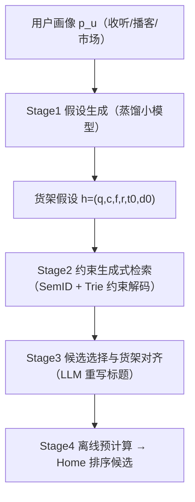
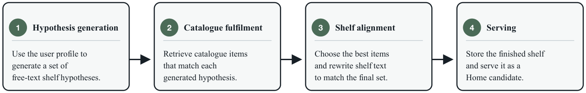

# Hypothesis-Driven Shelf Generation for Personalised Recommendation (面向个性化推荐的假设驱动货架生成)

- **会议/期刊**: ACM RecSys 2026 (Industry Track)
- **作者与机构**: Aleksandr V. Petrov, Tarun Chillara, Mounia Lalmas, Aloïs Gruson 等，Spotify
- **推荐链路定位**: 端到端生成式（离线批量生成货架候选，注入 Home 排序池）
- **研究方向**: 生成式推荐 / 大语言模型推荐
- **论文原文**: [arXiv:2607.25823v1](https://arxiv.org/abs/2607.25823v1)
- **开源代码**: 暂未开源

## TL;DR (1分钟核心速览)

Spotify Home 的货架长期依赖手工模板 + 专用召回逻辑，无法覆盖长尾个体品味。本文把货架生成重构为"生成自然语言货架假设 → 约束生成式检索履约 → LLM 货架对齐 → 离线预计算服务"四阶段流水线，用假设作为规划与召回的中间表示。离线 LLM-as-a-Judge 显示生成式检索履约全面超越 BM25/MiniLM/混合基线（Overall 0.71 vs 0.56），货架对齐使整体质量从 0.71 升至 1.27（+78%）；Home 均匀随机曝光下专辑池 30 秒流播放率相对最强经典货架 +36%。

## Background & Motivation (背景与核心矛盾)

- **主流范式**: 工业推荐界面以"货架"（横向主题行）组织内容，生产系统用有限的手工模板 + 专属召回逻辑实现，每个模板隐式耦合"满足什么需求 / 什么内容算合格 / 用哪套系统填充"三个决策。
- **前人局限**: ① 模板对广谱、复现性意图（最近收听、全球新发）有效，但对"流派×年代×场景×情绪×熟悉度×市场×媒介"的组合长尾不可维护；② 语言驱动推荐（Text2Tracks 等）均从**用户手写 prompt** 出发直接检索，缺少从行为画像自动推断货架概念、并把概念作为可评估中间表示的机制。
- **核心洞察 (Key Insight)**: 货架标题不只是 UI 标签，而是对"为何这些物品属于同一行"的**语义承诺**；因此货架质量是**集合级**而非逐点级的——单条物品合理，整行仍可能不连贯或标题过度承诺。
- **本文切入点**: 引入 `h=(q,c,f,r,t0,d0)` 货架假设作为规划与履约之间的"契约"，把"该有什么货架"与"用什么物品实现"彻底解耦，各自独立优化与独立评估。

## Method (核心方法设计)

### 1. 整体框架 (Overall Architecture)

系统对符合条件的用户做**每日离线批处理**：Stage 1 由用户画像 $p_u$（近期收听、长期偏好、市场、熟悉内容、播客行为）生成若干货架假设；Stage 2 仅以假设（不含完整画像）为条件，通过约束生成式检索产出候选 URI；Stage 3 由 LLM 选出最终$k$ 条并重写标题/副标题，使可见承诺与物品集合一致；Stage 4 将成品货架作为 Home 排序候选预计算落库，与既有货架在同一排序器中竞争，**服务时零额外延迟、无在线 LLM 推理**。该分解使每阶段产出稳定中间产物，可独立替换与消融。

<figure class="paper-figure" markdown="span">
  <figcaption>图2：概念流程。用户画像信息仅用于假设生成。下游的履行、对齐与服务均基于货架假设和候选目录实体运行。</figcaption>
</figure>

### 2. 关键设计拆解 (Key Designs)

1. **货架假设作为规划中间表示**：痛点在于模板把"意图—内容—召回"绑死。本文将假设定义为结构化契约 $h=(q,c,f,r,t_0,d_0)$，其中$q$为自由文本货架概念、$c$内容类型、$f$熟悉度、$r$ 路由约束（市场/新鲜度）。它既足够表达长尾品味（如"带管弦乐质感的冰川氛围后摇"），又足够结构化以约束检索与分阶段评估。生产上用前沿 LLM 批处理生成，再**蒸馏为紧凑开源 LLM** 部署于 GPU 批集群，800 用户画像上师生 Overall 评分 78.3% vs 78.2%，几乎无损。

2. **约束生成式检索履约**：痛点在于货架概念常通过风格联想、文化语境表达，词面/嵌入相似度无法恢复目录关联。履约模型在开源 LLM 词表上扩展 Spotify 目录的 **Semantic IDs**，直接**生成离散标识符**而非全库打分；解码时用按内容类型（专辑/艺人/编辑歌单/播客节目/单集）构建的 **Trie 索引做约束解码**，保证生成 ID 必为合法目录实体；熟悉货架则用用户已消费实体即时构建 Trie。生成 ID 再解析为 URI 并按类型一致性、历史收听、熟悉度过滤。

3. **货架对齐与训练/推理开销**：履约只保证单条相关，标题仍可能过度承诺。Stage 3 以假设、草稿标题、候选元数据为输入，由 LLM 联合选择最终 $k$条并重写$t,d$，目标为物品相关性、集合连贯性、多样性与标题承诺履约的平衡。全流程离线批处理，在线仅查表，故可用更大候选集与后处理；代价是货架更新粒度为天级，无法实时响应用户行为漂移。

## Experimental Setup & Evaluation Protocol (实验设置与评估协议)

- **评估范式**: 因任务无金标准离线目标（非对固定货架库排序），采用**分阶段 LLM-as-a-Judge**（0–2 三级量表，降低评分漂移、提升人机一致性），并以线上行为为最终判据。
- **数据规模与划分**: 履约对比使用 1,000 用户 cohort 上的 **10,000 条货架假设**；对齐分析为对齐前 10,000 条货架 vs 对齐后 16,000+ 条生产货架（**无共享 shelf ID**，故用双侧 Welch 独立样本 $t$检验 + Bonferroni 校正，8 维度，*** 表示校正后$p<0.001$）；履约对比对 24 个"方法×维度"比较做 Bonferroni 校正。
- **排名/打分协议**: 离线为**集合级 rubric 打分**（非 Full-Ranking / Sampled Ranking）；线上采用**均匀随机曝光（uniform random exploration）**，请求级随机化货架顺序以剥离生产排序器的位置偏置，报告 30 秒流播放率（百分点，95% bootstrap CI）。
- **对比基线**: 履约阶段为 BM25、MiniLM 稠密检索、BM25+MiniLM 等权线性插值（$\alpha=0.5$），均在假设指定内容类型内履约；线上为各内容类型 shuffle pool 中的经典生产货架族。

## Key Experimental Results (实验关键数据)

### 1. 主实验对比 (Main Results)

**表 1：目录履约质量（Hypothesis-to-Shelf Judge，0–2 分，10k 次 bootstrap 95% CI）**

| 方法 | Overall | Style | Relev. | Coher. | Coverag. | Compl. | Divers. | Title |
| :--- | :---: | :---: | :---: | :---: | :---: | :---: | :---: | :---: |
| BM25 | 0.56 | 0.87 | 0.84 | 0.93 | 0.92 | 0.75 | 1.06 | 0.54 |
| Dense (MiniLM) | 0.39 | 0.67 | 0.65 | 0.73 | 0.78 | 0.61 | 0.94 | 0.37 |
| Hybrid ($\alpha$=0.5) | 0.49 | 0.78 | 0.76 | 0.82 | 0.92 | 0.74 | 1.06 | 0.46 |
| **Generative Retrieval** | **0.71** | **0.99** | **1.04** | **1.05** | **1.15** | **1.28** | **1.39** | **0.66** |
| Improv. vs 最强基线 | +26.8% | +13.8% | +23.8% | +12.9% | +25.0% | +70.7% | +31.1% | +22.2% |

**表 2：Home 均匀随机曝光（30 秒流播放率 %，95% bootstrap CI）**

| 内容类型 | 假设驱动 (%) | 最强经典 (%) | 池内排名 | Δ(%) |
| :--- | :---: | :---: | :---: | :---: |
| Album | **1.20 ± 0.13** | 0.88 ± 0.09 | 1 / 10 | **+36%** |
| Artist | 0.82 ± 0.17 | 0.89 ± 0.06 | 2 / 9 | −8% |
| Playlist | 0.92 ± 0.09 | 1.07 ± 0.07 | 5 / 15 | −14% |
| Show | 0.92 ± 0.31 | 1.57 ± 0.11 | 2 / 6 | −41% |
| Episode | **0.63 ± 0.20** | 0.62 ± 0.08 | 1 / 7 | **+2%** |

### 2. 消融实验 (Ablation Study)

**表 3：Stage 3 货架对齐前后对比（Hypothesis-to-Shelf Judge，0–2 分）**

| 指标 | Pre-Alignment | Post-Alignment | Δ(%) |
| :--- | :---: | :---: | :---: |
| Overall | 0.71 ± 0.02 | **1.27 ± 0.01** | **+78%*** |
| Style Match | 0.99 ± 0.01 | **1.51 ± 0.01** | +52%*** |
| Item Relevance | 1.04 ± 0.01 | **1.58 ± 0.01** | +52%*** |
| Shelf Coherence | 1.05 ± 0.01 | **1.64 ± 0.01** | +56%*** |
| Hypothesis Coverage | 1.15 ± 0.01 | **1.37 ± 0.01** | +19%*** |
| Completeness | 1.28 ± 0.02 | **1.46 ± 0.01** | +14%*** |
| Diversity | 1.39 ± 0.01 | **1.74 ± 0.01** | +25%*** |
| Title Promise | 0.66 ± 0.02 | **1.31 ± 0.01** | **+99%*** |

**表 4：Stage 1 假设质量（User-to-Hypothesis Judge）与蒸馏一致性**

| 项目 | 分数 / 结果 |
| :--- | :---: |
| Overall | 1.59 ± 0.01 |
| Hypothesis Specificity | 1.99 ± 0.00 |
| Title Quality | 1.76 ± 0.01 |
| Personalisation Depth | 1.45 ± 0.01 |
| Discovery Potential | 1.31 ± 0.01 |
| 按内容类型：Album / Artist / Playlist | 1.90 / 1.98 / 1.86 |
| 按内容类型：Show / Episode | 0.66 / 0.51 |
| 蒸馏师生一致性（800 用户） | 78.3% vs 78.2% |

### 3. 关键实验发现 (Key Findings)

1. **履约瓶颈在"语义联想"而非"词面匹配"**：生成式检索在 Completeness（+70.7%）与 Diversity（+31.1%）上增益最大，说明货架概念常需目录中弱标注的关联知识；BM25 在元数据描述丰富、与假设措辞高度重合的内容类型上更具竞争力，一旦概念以风格/文化语境间接表达即迅速退化。
2. **对齐阶段是"标题承诺"的救命环节**：Title Promise 从 0.66 翻倍至 1.31（+99%），远超 Coverage（+19%）与 Completeness（+14%），证明检索质量本身不是货架成败的充分条件——集合级连贯与文本-物品一致性需单独优化，且该增益在全部内容类型上一致成立（图 3）。
3. **线上收益高度内容类型依赖**：专辑池排名第 1（+36%）、单集池第 1（+2%），但播客节目池落后最强经典货架 41%，与离线 Show/Episode 假设质量仅 0.66/0.51 相互印证——语音内容的假设生成是当前主要短板，而非履约或对齐。

## Highlights & Limitations (亮点、对比与审稿批判)

- **与代表作对比 (vs. Prior Work)**: 相较多列表推荐（固定货架集上做 bandit 个性化）与 Text2Tracks/Text2Playlist（用户手写 prompt 直接检索），本文**自动从画像推断货架概念**并以其为中间表示；相较 TIGER 类 SemID 生成式检索以完整用户画像为条件，本文履约**刻意剥离画像**，只解假设，从而获得可分解、可独立评估的工程优势。
- **可迁移亮点**: ① "结构化假设 + 约束 Trie 解码"可在任何需要可控生成式召回的品类（电商主题会场、短视频合集）复用；② 分阶段 LLM-as-a-Judge rubric 与"中间产物即评估边界"的设计，为无金标准生成式推荐提供了可操作的离线评估范式。
- **审稿级局限批判**: ① 离线结论完全建立在 LLM 评审之上，缺少人评一致性量化与评审偏置分析，且对齐前后为**非配对独立样本**，+78% 的效应量含队列差异风险；② 线上仅报告池内描述性比较而非合并因果效应，且天级离线预计算无法响应用户实时兴趣漂移，Show 池 −41% 也暴露了语音场景的实质性缺口。

## Rating (四维评分)

- **方法创新性 (Novelty)**: ⭐⭐⭐⭐ （"货架假设"作为规划-履约契约的分解思路在工业界新颖且自洽，但各组件技术均为已有范式组合）
- **评估协议与实验扎实度 (Protocol & Experiments)**: ⭐⭐⭐ （分阶段评估设计精巧、统计校正到位，但缺人评校验、对齐对比非配对、线上仅描述性池内比较）
- **写作与数学规范度 (Clarity & Rigor)**: ⭐⭐⭐⭐ （四阶段职责/失败模式/评估钩子表格化清晰，公式极简；代价是核心机制缺少定量建模细节）
- **工业落地与复现价值 (Industrial & Practical Value)**: ⭐⭐⭐⭐ （真实生产部署、零在线延迟、蒸馏保 parity，工程价值高；但未开源且强依赖 Spotify 目录与 SemID 基建）
