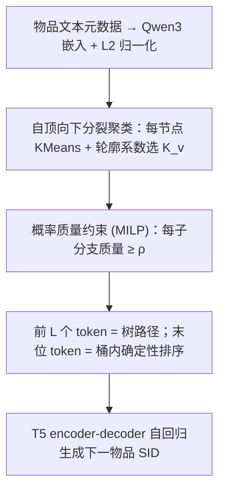
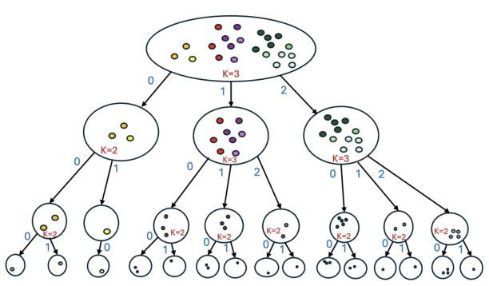

# Not All Branches Are Equal: Adaptive Semantic ID Construction for Generative Recommendation (并非所有分支生而平等：面向生成式推荐的自适应语义 ID 构建)

- **会议/期刊**: RecSys 2026
- **作者与机构**: Guy Hadad, Haggai Roitman, Bracha Shapira (Ben-Gurion University of the Negev)
- **推荐链路定位**: 端到端生成式（语义 ID 分词层，服务于自回归生成式检索）
- **研究方向**: 生成式推荐与离散语义 ID / 冷启动与长尾推荐
- **论文原文**: [https://arxiv.org/abs/2611.11549v1](https://arxiv.org/abs/2611.11549v1)
- **开源代码**: 暂未开源

## TL;DR (1分钟核心速览)

现有生成式推荐（TIGER 系）用 RQ-VAE 残差量化构造语义 ID，隐含假设各层 token 语义独立、码本全局共享，导致"共享前缀≠几何邻近"、码本坍缩与海量幻觉序列。本文论证语义 ID 本质是**树路径**（token 含义由前缀条件化），提出 AST：自顶向下分裂聚类，每个节点用轮廓系数**自适应选择分支数**，并引入最小概率质量约束（MILP 求解）保障长尾前缀监督。在 5 个 Amazon 域、Leave-Last-Out + Full-Ranking 协议下，AST-V2 相对最强基线平均提升 **13.08%**（R@10 +13.55%）。

## Background & Motivation (背景与核心矛盾)

- **主流范式**: 生成式推荐把物品编码为离散语义 ID 序列，由自回归模型在用户历史条件下逐 token 生成；分词器几乎清一色沿用 RQ-VAE / RVQ / RQ-KMeans 等残差量化方案（TIGER、LETTER、CoST、HiGR 等）。
- **前人局限一（结构错配）**: 残差量化的码本在**各层全局共享**并作用于残差向量，两个物品在某层共享同一码字并不意味着原始嵌入空间邻近；而生成式解码天然是"前缀条件化"的粗到细分路由，二者结构不匹配。
- **前人局限二（固定分支 + 码本坍缩）**: 树方法（如 SEATER）使用固定分支因子，无法适配非均匀物品密度；RQ-VAE 还存在码本坍缩与笛卡尔积码空间，幻觉序列占比可达 $1-N/B^m > 99.9\%$，白白消耗 beam search 预算。
- **核心洞察 (Key Insight)**: 在 Beauty 上做前缀掩码相似度分析：共享前缀 1/2/3 个 token 的平均余弦相似度为 0.758 / 0.874 / 0.920（全局基线 0.554），单调递增；而仅共享首 token（0.740）远高于仅共享后三 token（0.582，接近基线 0.570）——**token 无独立语义，其含义由前缀决定**。
- **本文切入点**: 既然语义 ID 是树路径，就应**直接优化树结构本身**，而非优化量化目标后"指望"路径结构自然涌现。

## Method (核心方法设计)

### 1. 整体框架 (Overall Architecture)

输入为物品文本元数据（title + categories + description）经 Qwen3-Embedding-0.6B 编码并 L2 归一化的嵌入 $\tilde{\mathbf{e}}_i$。AST 在该归一化空间中做自顶向下分裂聚类：根节点起，每层对节点内物品跑 KMeans，在候选分支数$K_v$上以轮廓系数选最优切分，递归$L=m-1$层得到前$L$个 token；同前缀桶内按物品 ID 确定性排序分配末位 token 保证唯一性。可选的概率质量约束变体（V1/V2）在分裂时强制每个子分支至少继承父节点$\rho$ 比例的交互质量。构造完成后，语义 ID 序列送入统一的 T5 encoder-decoder 做自回归下一物品生成。

<figure class="paper-figure" markdown="span">
  <figcaption>图 1：自适应轮廓树（AST）方法（𝐿= 3）</figcaption>
</figure>

### 2. 关键设计拆解 (Key Designs)

1. **自适应分支因子 (Adaptive Branching)**：固定分支在稠密异质区切分不足、在同质稀疏区过度切分。AST 对节点 $v$在$K_v \in [K_{\min}(n_v,\ell), K_{\max}(n_v)]$ 上搜索，以轮廓系数打分并取最优：
$$\mathrm{Sil}(S_v,K_v)=\frac{1}{|S_v|}\sum_{i\in S_v}\frac{b_i-a_i}{\max(a_i,b_i)}$$
其中 $a_i$为簇内平均距离、$b_i$为最近异簇平均距离；下界$K_{\min}=\max(2,\lceil n_v/B^{L-\ell}\rceil)$保证叶桶不超过$B$个物品从而 SID 唯一。理论上自适应树的簇内方差上界不劣于任何固定分支树（固定分支是自适应树的特例），且分裂收益可望远镜分解$\sum_i\|\tilde{\mathbf{e}}_i-\boldsymbol{\mu}_{\text{leaf}(i)}\|^2=\sum_\ell\sum_{v}\Delta_v$，每项均在原始空间可解释——这是相对 RQ-VAE 残差空间不可解释的关键优势。

2. **概率质量约束变体 (AST-V1 / AST-V2)**：交互分布高度倾斜，无约束聚类会把大部分交互质量塞进少数分支，其余前缀监督极稀薄。约束为每个子簇 $C_j$满足$\sum_{i\in C_j}\pi_i\ge\rho$（$\pi_i$为节点内归一化质量）。**V1** 保留 KMeans 中心，仅在违约时求解 MILP 重分配（固定中心下的全局最优可行解，畸变惩罚最小）；**V2** 将质量贯穿始终：用加权轮廓$\mathrm{WSil}(S_v,K_v)=\sum_{i\in S_v}\pi_i\,\mathrm{Sil}(\{i\},K_v)$打分，并交替执行「MILP 最优分配 → 质量加权均值更新中心$\boldsymbol{\mu}_j\leftarrow\sum_{i:z_{ij}=1}\pi_i\tilde{\mathbf{e}}_i/\sum_{i:z_{ij}=1}\pi_i$」，畸变单调不增，构成约束版 Lloyd 收敛保证。直觉：高频物品获得更忠实的表征，索引目标与下游损失对齐。

3. **训练目标、负采样与推理效率**：下游为 T5 的标准 token 级交叉熵（teacher forcing），**无显式负采样**（生成式范式以全库 softmax 隐式竞争）。冷启动物品按最近质心贪心遍历树，代价 $O(BdL)$与目录规模$N$ 无关；相比 RQ-VAE 的残差贪心，AST 每层决策都在原始空间，误差不跨层复合放大。

## Experimental Setup & Evaluation Protocol (实验设置与评估协议)

- **数据集与预处理**: 5 个 Amazon Review 域，均 `5-core` 过滤，序列截断至长度 20。

| 数据集 | #Users | #Items | 稀疏度 | 平均序列长 |
| :--- | :---: | :---: | :---: | :---: |
| Beauty | 22,363 | 12,101 | 99.93% | 8.88 |
| Sports | 35,598 | 18,357 | 99.95% | 8.32 |
| Toys | 19,412 | 11,924 | 99.93% | 8.63 |
| Health | 38,609 | 18,534 | 99.95% | 8.97 |
| Home | 66,519 | 28,237 | 99.97% | 8.29 |

- **数据划分与防穿越**: `Leave-Last-Out`（最后一条测试、倒数第二条验证、其余训练）。
- **排名评测协议**: 无偏 `Full-Ranking`（全库未交互物品排序），指标 Recall@5/10、NDCG@5/10。
- **对比基线与超参设置**: 10 个分词基线（RQ-VAE、RQ-VAE-L、Qinco2、RVQ、CoST、RQ-Means、RQ-Means-B、RRS、SEATER、CRVQAE），全部共享同一 Qwen3-Embedding-0.6B 嵌入与同一 T5（6+6 层，$d$由骨干决定，batch 256，lr$10^{-3}$，weight decay$10^{-4}$，patience 5）以隔离分词效应；显著性$p<0.05$。

## Key Experimental Results (实验关键数据)

### 1. 主实验对比 (Main Results)

| 数据集 | 指标 | RQ-VAE | Qinco2 | RVQ | CoST | RQ-Means | SEATER | CRVQAE | **AST-V2** | Improv. |
| :--- | :--- | :---: | :---: | :---: | :---: | :---: | :---: | :---: | :---: | :---: |
| Beauty | R@10 | 6.09 | 6.91 | 6.77 | 6.61 | 6.98 | 6.65 | 6.64 | **7.51** | +7.6% |
| Beauty | N@10 | 3.56 | 3.82 | 3.67 | 3.76 | 3.86 | 3.69 | 3.65 | **4.28** | +10.9% |
| Toys | R@10 | 6.01 | 6.01 | 7.07 | 6.42 | 6.67 | 6.44 | 6.58 | **7.94** | +12.3% |
| Toys | N@10 | 3.23 | 3.23 | 3.72 | 3.58 | 3.52 | 3.72 | 3.64 | **4.31** | +15.9% |
| Sports | R@10 | 3.48 | 4.08 | 4.09 | 4.02 | 4.08 | 3.73 | 4.01 | **4.62** | +13.0% |
| Health | R@10 | 5.85 | 6.06 | 5.86 | 6.30 | 5.70 | 5.39 | 5.99 | **6.64** | +5.4% |
| Home | R@10 | 2.28 | 2.59 | 2.40 | 2.63 | 2.46 | 2.26 | 2.61 | **3.02** | +14.8% |
| Home | N@10 | 1.28 | 1.41 | 1.32 | 1.51 | 1.31 | 1.24 | 1.46 | **1.67** | +10.6% |

AST-V2 在全部 20 个「数据集×指标」组合上最优或并列最优，四指标平均相对增益 12.68% / 13.55% / 12.66% / 13.45%。

### 2. 消融实验 (Ablation Study)

| 数据集 | AST (R@10) | w/o 质量约束 ($\rho=0$) | w/ 固定分支（调优后） |
| :--- | :---: | :---: | :---: |
| Beauty | **7.51** | 7.33 | 7.01 |
| Toys | **7.94** | 7.73 | 7.36 |
| Sports | **4.62** | 4.54 | 4.56 |
| Health | **6.64** | 6.40 | 6.48 |
| Home | **3.02** | 2.98 | 2.95 |

### 3. 关键实验发现 (Key Findings)

1. **自适应分支是主贡献项，且在稀疏域更关键**：固定分支即便逐数据集调优仍全面落后（Beauty 7.01 vs 7.51，Toys 7.36 vs 7.94），差距在 Home/Health 等大而稀疏域收窄（3.02 vs 2.95），说明交互充足时监督可部分弥补结构刚性，而小域上"按局部几何分配容量"不可替代。
2. **质量约束是长尾稳定器而非普适增益**：$\rho=0$在五域一致下降（Beauty −0.18、Health −0.24），但$\rho$ 从 0.001 扫到 0.05 时无统一最优值——约束过强会把语义不相似物品强行并簇，牺牲簇内一致性，属数据集相关超参。
3. **头尾均衡而非此消彼长**：AST-V2 同时取得平均 Head R@10/N@10 最优与平均 Tail R@10 最优，在 Pareto 前沿上不被支配；方向性指标上 AST 接近零点（SEATER 强尾偏、RRS 强头偏），且换用 M3 / Qwen3-0.6B / Qwen3-4B 三种骨干时 AST 波动仅约 1.7% 相对范围，显著低于次优基线。

## Highlights & Limitations (亮点、对比与审稿批判)

- **与代表作对比 (vs. Prior Work)**: 与 TIGER/RQ-VAE 系的本质区别是**优化目标换了**——不再最小化残差量化误差，而是直接优化原始空间中的层次划分畸变，因此前缀共享 ⇔ 几何邻近，且码空间无幻觉（有效序列集恰为真实物品集）；与 SEATER 的区别在于分支因子由轮廓系数局部决定而非固定，且不额外耦合对比学习目标，分词质量与模型架构解耦、可比性更强。
- **可迁移亮点**: (1) 用轮廓系数做"容量分配"的自适应分裂准则可迁移到任何需要层次码本的场景（多模态 tokenizer、层次化召回索引）；(2) 用 MILP 在固定中心下做最小畸变可行重分配，是给任意聚类加"最小质量/公平性约束"的通用轻量补丁。
- **审稿级局限批判**: (1) 每节点需在多个 $K_v$ 上重复 KMeans（10 次随机初始化、50 轮迭代），V2 还需交替求解 MILP，百万级目录下的构造开销与可扩展性未给出实测；(2) 语义 ID 质量完全继承文本嵌入，元数据噪声或缺失时退化，且冷启动物品虽能贪心挂树，但下游生成模型未见过该 token 序列，冷启动收益未被单独量化验证。

## Rating (四维评分)

- **方法创新性 (Novelty)**: ⭐⭐⭐⭐ （"语义 ID = 树路径"的实证论证扎实，自适应分支 + 质量约束组合简洁，但层次聚类本身非全新，创新在准则与约束设计）
- **评估协议与实验扎实度 (Protocol & Experiments)**: ⭐⭐⭐⭐ （五域 Full-Ranking + 统一骨干与下游模型隔离分词效应、$p<0.05$ 显著性、头尾 Pareto 与方向性分析完整；缺线上或大规模效率实验）
- **写作与数学规范度 (Clarity & Rigor)**: ⭐⭐⭐⭐ （前缀掩码相似度的动机实验极具说服力，望远镜方差分解与 V2 单调收敛性论证严谨；MILP 求解器与近似程度细节略简）
- **工业落地与复现价值 (Industrial & Practical Value)**: ⭐⭐⭐ （分词层与模型解耦、冷启动 $O(BdL)$ 挂载友好，但 MILP 与多候选 KMeans 的构造成本是大规模部署的主要门槛，且暂未开源）
