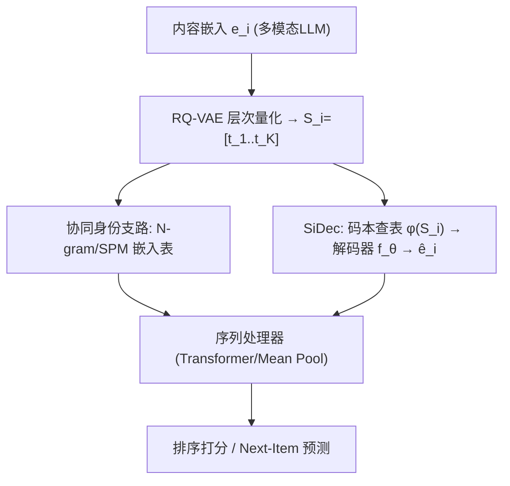
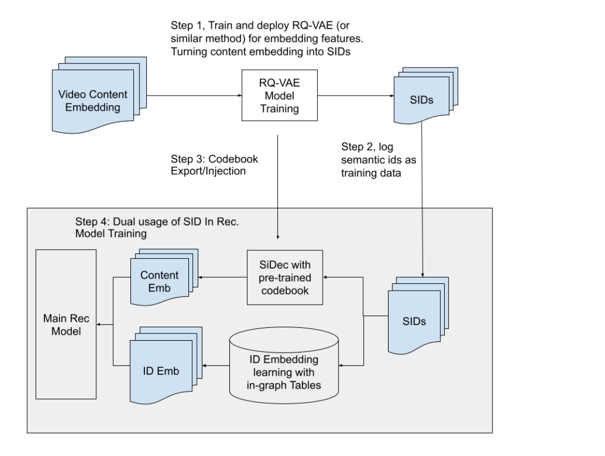

# Tokens are All You Need: Dual-purpose Semantic IDs for Achieving LLM-Level I/O Efficiency in Recommendation Systems (令牌即一切：双用途语义ID实现LLM级I/O效率的推荐系统)

- **会议/期刊**: RecSys 2026
- **作者与机构**: Baolei Li, Yiping Yuan, Yilin Zheng, Likang Yin, Ling Liu, Fabio Soldo, Romer Rosales (YouTube)；Xinyang Yi, Lichan Hong (Google DeepMind)
- **推荐链路定位**: 召回 + 精排（双链路统一框架）
- **研究方向**: 生成式推荐与离散语义ID / 冷启动与长尾推荐
- **论文原文**: [https://arxiv.org/abs/2607.24865v1](https://arxiv.org/abs/2607.24865v1)
- **开源代码**: 暂未开源

## TL;DR (1分钟核心速览)

大规模推荐系统受"内存墙"制约：用户历史中每条物品的稠密内容嵌入（如 $L{=}200$、$d{=}256$ 即每样本 200KB FP32）在训练日志存储与在线 join 时成为吞吐瓶颈。本文提出**双用途语义ID**：RQ-VAE 量化的离散 token 既作为可学习嵌入表的协同身份（记忆），又通过轻量 Semantic Decoder (SiDec) 在模型图内**在线重建**内容嵌入（泛化），从而以 $K\times\log_2 V$ bit 替代 $d\times 32$ bit（50–100× 压缩）。离线固定步数训练下检索 HitRate@100 达 0.2910（超原始稠密嵌入 Arm 1 的 0.2844），吞吐 14.53 vs 12.07 steps/s（+20.4%）；线上 Watchpage 排序 Satisfied Engagement +0.80%。

## Background & Motivation (背景与核心矛盾)

- **主流范式**: 现代推荐模型依赖海量稠密浮点嵌入表表示用户、物品与高维连续特征；生成式检索虽已用离散 token 替代原子物品 ID，但高维上下文（内容嵌入、历史参与密度）仍以稠密格式流转。
- **前人局限**: ① 稠密内容嵌入的日志存储与 join 是 I/O 瓶颈，序列长度达 $10^4$ 量级时不可承受；② 纯 ID 嵌入依赖共现统计，对新用户/长尾内容严重稀疏且受流行度偏置；直接灌入预训练稠密嵌入虽鲁棒但内存带宽代价过高。
- **核心洞察 (Key Insight)**: 借鉴 CV 中 VQ-VAE/VQGAN 的经验——高维连续分布无需以原生浮点格式处理即可保留预测力；语义ID 的码本潜空间本身就是一个可复用的"内容压缩通道"。
- **本文切入点**: 让同一串语义ID 同时承担"协同身份"与"内容重建"两个角色，把磁盘受限的稠密向量检索转为加速器内计算受限的在线重建。

## Method (核心方法设计)

### 1. 整体框架 (Overall Architecture)

物品 $i$ 的高维内容嵌入 $e_i\in\mathbb{R}^d$（多模态 LLM 产出）经 RQ-VAE 层次量化压缩为 $K$ 个离散 token $S_i=[t_{i,1},\dots,t_{i,K}]$，$t_{i,k}\in\{1,\dots,V\}$。模型内该序列走两条并行支路：**(a) 协同身份支路**将 token 视为类别特征查表学习（Unigram / Overlapping Bigram / Nested N-gram / SPM 四种策略）；**(b) SiDec 支路**先做静态码本查表求和 $\phi(S_i)$，再经轻量 MLP/浅层 Transformer 解码器 $f_\theta$ 在线重建 $\hat e_i$。重建嵌入与候选解码嵌入一同送入序列处理器（Transformer 相对注意力 / Mean Pooling）做上下文聚合，最终输出排序分或自回归 next-item 预测。训练日志中稠密向量被 $K$ 个整数 token 取代，join 操作被码本查表替代。

<figure class="paper-figure" markdown="span">
  <figcaption>图1：语义ID作为传递语义嵌入的高速通道</figcaption>
</figure>

### 2. 关键设计拆解 (Key Designs)

1. **双用途语义ID（Dual-purpose SID）**：痛点在于 ID 与内容特征长期割裂、稠密内容嵌入 I/O 昂贵。核心是把 $S_i$ 同时喂给两条支路，重建式为 $\hat e_i = f_\theta(\phi(S_i))$，其中 $\phi$ 为冻结码本查表求和。直觉：协同支路负责"记忆"物品级偏好，SiDec 支路提供与流行度无关的"纯内容"信号，二者互补覆盖冷启动物品。

2. **四种协同身份嵌入策略与容量权衡**：Unigram $\mathbf{x}^{uni}_i=\text{Agg}(\{\text{Emb}_k(t_{i,k})\})$ 内存最省但丢失层级依赖；Overlapping Bigram 用滑窗捕获跨子簇语义邻域、对量化噪声更鲁棒；Nested N-gram $\mathbf{x}^{nest}_i=\text{Agg}(\{\text{Emb}_{1:k}(t_{i,1..k})\})$ 显式建模前缀层级，共享前缀使长尾物品可借用父簇行为，但嵌入表更大（$k>2$ 时用随机哈希限表）；SPM 按经验分布自适应组合。实践中排序侧偏好 Nested/SPM，召回侧偏好 Unigram/Bigram 以保 I/O 效率。

3. **训练目标、负采样与推理效率**：量化阶段最小化重建 MSE $\mathcal{L}_{rec}=\sum_{i}\|e_i-f_\theta(\phi(S_i))\|^2$；推荐主模型训练时冻结解码器（或以极小学习率微调），保证 $\hat e_i$ 为稳定、与流行度解耦的内容信号。检索侧为全库 softmax 交叉熵（无显式负采样描述），排序侧为 CTR 多任务损失。推理时 token 已在基线服务中缓存，在线重建开销"不超过增加一个普通稀疏嵌入特征"，且稀疏参数量低数个量级。

## Experimental Setup & Evaluation Protocol (实验设置与评估协议)

- **数据集与预处理**: 论文未公开离线数据集统计（工业内部 YouTube 数据），实验以生产检索/排序模型为载体，内容嵌入来自预训练多模态模型，经 RQ-VAE 生成码本 v0（64 维潜空间）与 v1（256 维潜空间）。

| 数据集 | #Users | #Items | #Interactions | 稀疏度/密度 | 特征/场景说明 |
| :--- | :---: | :---: | :---: | :---: | :--- |
| YouTube 生产检索/排序日志 | 未披露 | 未披露 | 十亿级样本 | 未披露 | 超长观看历史（$L$ 可达 $10^4$），Watchpage/Homepage 双场景 |

- **数据划分与防穿越 (Splitting Strategy)**: 未明确披露；离线采用**固定步数训练（Fixed-Step Training）**而非时间受限训练，以消除不同 I/O 需求导致的梯度更新量差异，保证各实验臂计算预算严格一致。
- **排名评测协议 (Ranking Protocol)**: 检索侧为 next-item 预测的 **Hit Rate @100**（候选检索准确率）与收敛交叉熵 Loss；排序侧为 **CTR AUC**；效率指标为 **Training Speed (steps/s)**；线上为专有复合指标 Online Satisfied Engagement（观看时长 + 点赞/收藏等正向交互）。
- **对比基线与超参设置**: 五臂对照——Control（纯 ID + 轻量上下文）、Arm 1（原始 64 维稠密内容嵌入）、Arm 2（码本 v0 解码）、Arm 3（码本 v1 解码 256 维）、Arm 4（码本 v1 + Transformer 扩容）。消融另设 SSL 对比损失、Cross-Attention、多模态内容三组移除实验。

## Key Experimental Results (实验关键数据)

### 1. 主实验对比 (Main Results)

检索模型五臂对照（表 2）：

| 实验臂 | 内容表示 | Loss@收敛 | HitRate@100 | 吞吐 (steps/s) |
| :--- | :--- | :---: | :---: | :---: |
| Control | 无 | 2.766 | 0.2811 | **16.80** |
| Arm 1 | 原始 64 维稠密嵌入 | 2.723 | 0.2844 | 12.07 |
| Arm 2 (SID v0) | 码本 v0 解码 | 2.764 | 0.2816 | 15.41 |
| Arm 3 (SID v1) | 码本 v1 解码 | 2.758 | 0.2870 | 15.26 |
| **Arm 4 (SID v1+Scaling)** | 码本 v1 + 扩容 | **2.681** | **0.2910** | 14.53 |

线上生产部署（表 1，Satisfied Engagement 相对提升）：

| 应用 | 语义ID 特征 | 线上增益 |
| :--- | :--- | :--- |
| Watchpage 排序 | Watch + Candidate + Watch History SIDs | +0.09% Sitewide / **+0.80% Watchpage** |
| Homepage 排序 | Candidate + Watch History SIDs | +0.08% Sitewide / +0.22% Homepage |
| 检索模型 | Watch History SIDs | +0.06% Sitewide / +0.13% Homepage / +0.09% Watchpage |

### 2. 消融实验 (Ablation Study)

排序模型 CTR AUC 绝对百分点变化（表 3、表 4）：

| 消融配置 | CTR AUC 变化 |
| :--- | :---: |
| 仅 Candidate & Watch SIDs（去历史重建） | −0.04% |
| 仅 Watch History SIDs（去候选重建） | −0.03% |
| 移除轻量解码器 $f_\theta$ | −0.01% |
| 移除 SSL 对比损失 | −0.05% |
| 移除 Cross-Attention | **−0.08%** |
| 移除多模态内容 | −0.06% |

### 3. 关键实验发现 (Key Findings)

1. **量化几乎无损、I/O 大幅回血**：Arm 3 以 256 维码本潜空间将 HitRate@100 从 Arm 1 的 0.2844 反超至 0.2870，同时吞吐从 12.07 回升至 15.26 steps/s（较 Arm 1 +26.4%），证明离散 token 化把 I/O 瓶颈转化为计算足迹，且高分辨率码本可完全赎回量化损失。
2. **离散化解锁"扩容红利"**：Arm 4 在增加 Transformer 参数后仍保持 14.53 steps/s（较 Arm 1 +20.4%），并取得最低 Loss 2.681 与最高 HitRate 0.2910——稠密嵌入路径下这种"深度+精度"同步扩张因 I/O 受限而不可行。
3. **增益主要来自历史序列而非候选**：消融中去掉 Watch History 重建（−0.03%）与去掉 Candidate 重建（−0.04%）量级相当但历史侧承载更多视频、更充分兑现 I/O 收益；而移除 Cross-Attention 的 −0.08% 表明 SiDec 需与内容学习架构深度耦合才能释放全部潜力，单独解码器贡献仅 −0.01%。

## Highlights, Limitations & Rating (亮点、对比与审稿评价)

- **与代表作对比 (vs. Prior Work)**: 相较 TIGER 类工作仅把语义ID 当离散标识 token，本文额外挖掘其作为"内容压缩通道"的第二用途；相较 SIDE 的三值码字 + n-gram 哈希，本文沿用社区原生 RQ-VAE 码本潜空间做高保真重建而非从零投影；相较 HiSAC 的静态码本 + Soft-Routing 压缩用户兴趣代理，SiDec 是应用无关的通用输入特征且解码器可端到端任务对齐。
- **可迁移亮点**: ① 把"训练日志中的稠密特征列"整体替换为整数 token 列，是任何超长序列推荐系统都可直接套用的 I/O 优化手段；② 冻结解码器以保证重建信号与流行度解耦，可作为冷启动特征工程的标准做法。
- **审稿级局限批判**: ① 离线数据集与统计完全未披露，五臂对照缺乏多数据集复现性，HitRate 差异（0.2870 vs 0.2844）幅度较小且无显著性检验；② 线上增益为 0.06%–0.80% 量级，虽称统计显著但缺少置信区间与长期留存观察；码本漂移需全量重训下游模型的问题仅列为未来工作。
- **四维评分**: 创新性 ⭐⭐⭐⭐ | 实验扎实度 ⭐⭐⭐⭐ | 方法清晰度 ⭐⭐⭐⭐⭐ | 落地价值 ⭐⭐⭐⭐⭐

