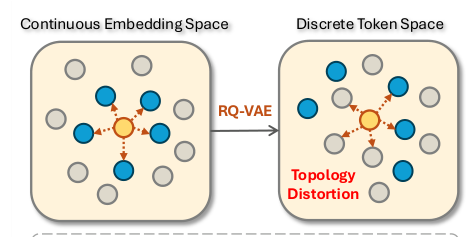
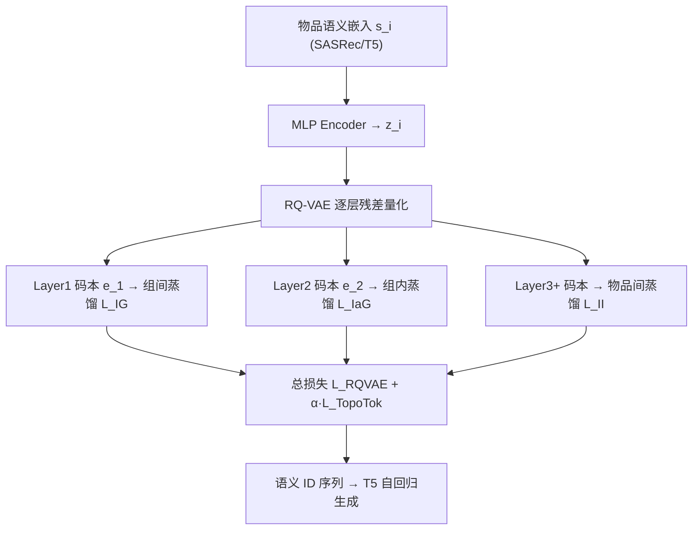
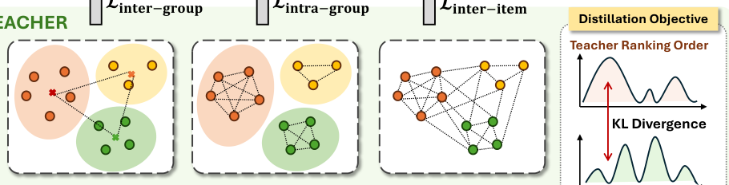

# Topology-Aware Tokenization for Generative Recommendation (面向生成式推荐的拓扑感知标记化)

- **会议/期刊**: RecSys 2026
- **作者与机构**: Yaokun Liu, Yifan Liu, Zhenrui Yue, Gyuseok Lee, Zelin Li, Ruichen Yao, Dong Wang（University of Illinois Urbana-Champaign）
- **推荐链路定位**: 端到端生成式（物品标记化阶段）
- **研究方向**: 生成式推荐与离散语义 ID / 序列推荐
- **论文原文**: [https://arxiv.org/abs/2607.18600v1](https://arxiv.org/abs/2607.18600v1)
- **开源代码**: 暂未开源

## TL;DR (1分钟核心速览)

生成式推荐用 RQ-VAE 把物品连续语义嵌入量化成离散语义 ID，但本文发现量化过程会严重破坏物品间的邻接拓扑：连续空间中 top-20 邻居在 layer 1 仅保留 63%，到 layer 3 骤降至 27%，这种"拓扑噪声"误导 LLM 对物品相似度的感知。作者提出 TopoTok，将拓扑蒸馏分解为组间（全局簇关系）、组内（簇内局部结构）、物品间（细粒度点对点）三级监督，并分别锚定到 RQ-VAE 由粗到细的残差层。在 Amazon 三数据集、Leave-One-Out + Full-Ranking 协议下，TIGER-TopoTok 的 Recall@5 最高相对提升 9.42%，且推理零额外开销。

## Background & Motivation (背景与核心矛盾)

- **主流范式**: 语义 ID 标记化以 RQ-VAE 为主干，用多层码本对残差逐层量化，把物品编码为 `<c1,c2,c3>` 形式的离散 token 序列，再由 T5 类模型自回归生成下一物品的 token。
- **前人局限**: ① 伪 ID 方法（P5-CID）高效但无语义；文本 ID 方法语义丰富却推理昂贵且易幻觉；② 语义 ID 方法（TIGER/LETTER/CoST）虽折中，但量化本身是有损压缩——CoST 仅在最终输出施加单体对比监督，忽略残差层级语义递进，导致监督纠缠（浅层欠训练、深层过拟合补偿）。
- **核心洞察 (Key Insight)**: 作者用 top-20 邻居重叠率量化"拓扑失真"：连续嵌入空间与离散 token 空间的邻居一致性随量化深度单调衰减（63%→32%→27%），说明失真在层级间累积传播，而非单层局部问题。
- **本文切入点**: 把拓扑保持建模为**相似度排序对齐**（而非距离值对齐，因量化压缩使跨空间距离不可比），并将监督粒度与每层码本的语义角色一一绑定。

<figure class="paper-figure" markdown="span">
  <figcaption>图 1：物品标记化中的拓扑失真示意图。左：连续嵌入空间中的物品邻接关系在 RQ-VAE 量化后受到破坏。右：连续空间与离散空间之间的 Top-20 邻居重叠率随量化深度增加而下降。</figcaption>
</figure>

## Method (核心方法设计)

### 1. 整体框架 (Overall Architecture)

TopoTok 嵌入在标准 RQ-VAE 标记化流程中：物品经预训练编码器（SASRec 或 Sentence-T5）得到语义嵌入 $s_i$，MLP 编码为潜变量 $z_i$，再由 $L$ 层码本递归残差量化得到语义 ID 与逐层累积重构 $\hat{z}_i^{(l)}=\sum_{m=1}^{l} e_{m,c_{i,m}}$。核心创新在于训练阶段额外注入三级拓扑蒸馏损失：layer 1 施加组间蒸馏锚定全局簇结构，layer 2 施加组内蒸馏细化簇内局部流形，更深层施加物品间蒸馏保证点对点邻域一致性。蒸馏仅作用于训练，不改变推理时的标记化与生成管线。

<figure class="paper-figure" markdown="span">
  <figcaption>图 2：TopoTok 示意图。TopoTok 通过在残差量化层间施加分层、由粗到细的拓扑蒸馏，在基于语义 ID 的标记化中保持拓扑关系。图中以三层 RQ-VAE 为例，而 TopoTok 可推广至任意深度。</figcaption>
</figure>

### 2. 关键设计拆解 (Key Designs)

1. **排序对齐式拓扑蒸馏（Topology Distillation Formulation）**：痛点在于量化压缩破坏跨空间距离可比性，直接对齐距离矩阵是病态的。作者改为对齐**邻居排序分布**：对教师/学生距离矩阵按行取负后 softmax 得相似度分布 $P_t[i,:]=\text{softmax}(-D_t[i,:])$、$P_s[i,:]=\text{softmax}(-D_s[i,:])$，再最小化 KL 散度
$$\mathcal{L}_{TD}=\frac{1}{M}\sum_{i=1}^{M}\text{KL}\big(P_t[i,:]\,\|\,P_s[i,:]\big)$$
只约束相对邻域排名而非绝对距离，使异构空间间的拓扑比较成为良定义问题。

2. **三级由粗到细监督（Multi-Granularity Supervision）**：针对监督纠缠与粒度错配两个挑战，定义三种"拓扑单元"：
   - **组间 (IG)**：以码本 $j$ 对应的物品组 $\mathcal{G}_{l,j}$ 为单位，教师表征为组内语义质心 $\frac{1}{|\mathcal{G}_{l,j}|}\sum_{i\in\mathcal{G}_{l,j}} s_i$，学生表征为码本嵌入 $e_{l,j}$，对齐全局簇间排布；
   - **组内 (IaG)**：以物品为单位，但距离矩阵仅在同组（$c_{i,l-1}=c_{j,l-1}$）物品对间计算，异组置 $\infty$，学生表征为累积重构 $\sum_{m=1}^{l}e_{m,c_{i,m}}$，专注局部流形；
   - **物品间 (II)**：在深层以全体物品对构建距离矩阵，学生表征为深层累积重构，恢复全局点对点邻域一致性。
   层级部署规则：IG 锚定 $l=1$（粗语义簇），IaG 锚定 $l=2$（簇内分化），II 锚定 $2<l\le L$；两层 RQ-VAE 时退化为 IG+II 组合。作者进一步建议以**码本利用率**作为粒度指示器（低利用率→粗语义→IG，高利用率→细残差→II），使方法对任意深度架构无关。

3. **训练目标与推理效率**：总损失 $\mathcal{L}_{total}=\mathcal{L}_{RQ\text{-}VAE}+\alpha\cdot(\mathcal{L}_{IG}+\mathcal{L}_{IaG}+\mathcal{L}_{II})$，其中 $\mathcal{L}_{RQ\text{-}VAE}$ 为重构+承诺损失。蒸馏全部为 batch 内可并行计算，仅带来适度训练开销；**推理阶段零额外计算**，不改变标记化与推荐管线，对实时部署友好。$\alpha$ 在验证集上从 $\{0.01,0.1,0.3,0.5,1\}$ 选取。

## Experimental Setup & Evaluation Protocol (实验设置与评估协议)

- **数据集与预处理**: Amazon Review 三个子集，均做 `5-core` 过滤，按时间顺序构建序列，最大长度 20。

| 数据集 | #Users | #Items | #Interactions | 稀疏度/密度 | 特征/场景说明 |
| :--- | :---: | :---: | :---: | :---: | :--- |
| Scientific | 原文未列 | 原文未列 | 原文未列 | 高稀疏 | 工业科学品类，长尾显著 |
| Instrument | 原文未列 | 原文未列 | 原文未列 | 高稀疏 | 乐器品类，语义层次清晰 |
| Game | 原文未列 | 原文未列 | 原文未列 | 相对稠密 | 视频游戏，交互最丰富 |

- **数据划分与防穿越 (Splitting Strategy)**: 标准 `Leave-One-Out`——每用户最后一条交互测试、倒数第二条验证、其余训练。
- **排名评测协议 (Ranking Protocol)**: 无偏 `Full-Ranking`（全候选物品集排序，不采样），指标 Recall@{5,10} 与 NDCG@{5,10}。
- **对比基线与超参设置**: 三类基线——传统序列（Caser/GRU4Rec/SASRec/BERT4Rec/FDSA/S3Rec）、生成式（P5-CID/P5-SID/TIGER/ETEGRec）、语义 ID 增强（LETTER/CoST，均建于 TIGER）。RQ-VAE 用 3 层码本、每层 256 码、维度 128；AdamW（lr=1e-3, batch=2048），训练 10k epochs；单卡 A40；报告验证集 NDCG@10 最优模型，5 次独立运行配对 t 检验（$p<0.05$）。

## Key Experimental Results (实验关键数据)

### 1. 主实验对比 (Main Results)

| Model | Scientific R@5 | R@10 | N@10 | Instrument R@5 | R@10 | N@10 | Game R@5 | R@10 | N@10 |
| :--- | :---: | :---: | :---: | :---: | :---: | :---: | :---: | :---: | :---: |
| SASRec | 0.0256 | 0.0406 | 0.0195 | 0.0341 | 0.0530 | 0.0277 | 0.0517 | 0.0821 | 0.0426 |
| FDSA | 0.0261 | 0.0391 | 0.0216 | 0.0364 | 0.0557 | 0.0295 | 0.0548 | 0.0857 | 0.0453 |
| P5-SID | 0.0155 | 0.0234 | 0.0129 | 0.0319 | 0.0438 | 0.0275 | 0.0480 | 0.0693 | 0.0401 |
| TIGER | 0.0275 | 0.0431 | 0.0231 | 0.0368 | 0.0574 | 0.0308 | 0.0570 | 0.0895 | 0.0471 |
| LETTER | 0.0276 | 0.0433 | 0.0230 | 0.0372 | 0.0581 | 0.0310 | 0.0576 | 0.0901 | 0.0475 |
| CoST | 0.0270 | 0.0426 | 0.0229 | 0.0366 | 0.0570 | 0.0306 | 0.0569 | 0.0897 | 0.0472 |
| **TIGER-TopoTok** | **0.0302** | **0.0465** | **0.0248** | **0.0402** | **0.0613** | **0.0331** | **0.0608** | **0.0939** | **0.0509** |
| Improv. vs TIGER | +9.42% | +7.39% | +7.36% | +8.06% | +5.51% | +6.77% | +5.56% | +4.22% | +7.84% |
| ETEGRec | 0.0294 | 0.0455 | 0.0241 | 0.0402 | 0.0624 | 0.0331 | 0.0616 | 0.0947 | 0.0507 |
| **ETEGRec-TopoTok** | **0.0307** | **0.0481** | **0.0255** | **0.0426** | **0.0657** | **0.0349** | **0.0635** | **0.0975** | **0.0525** |
| Improv. vs ETEGRec | +4.42% | +5.71% | +5.81% | +5.97% | +5.29% | +5.44% | +3.08% | +2.96% | +3.55% |

### 2. 消融实验 (Ablation Study)

以 Scientific 数据集（TIGER 主干）为例，IG/IaG/II 逐级叠加：

| 变体 | R@5 | R@10 | N@10 | Top-20 重叠 l1 | l2 | l3 |
| :--- | :---: | :---: | :---: | :---: | :---: | :---: |
| Base (无蒸馏) | 0.0275 | 0.0431 | 0.0231 | 62.90% | 30.29% | 27.55% |
| +IG | 0.0288 | 0.0450 | 0.0239 | 72.47% | 35.99% | 31.43% |
| +IaG | 0.0280 | 0.0439 | 0.0234 | 66.12% | 32.88% | 32.05% |
| +II | 0.0285 | 0.0443 | 0.0240 | 66.29% | 31.54% | 32.94% |
| +IG+IaG | 0.0293 | 0.0461 | 0.0243 | 73.46% | 39.05% | 32.56% |
| **Full TopoTok** | **0.0302** | **0.0465** | **0.0248** | **73.70%** | **41.26%** | **36.75%** |

量化深度鲁棒性（Recall@10，TIGER 主干）：

| 数据集 | L=2 Base → +TopoTok | L=3 Base → +TopoTok | L=4 Base → +TopoTok |
| :--- | :---: | :---: | :---: |
| Scientific | 0.0400 → 0.0445 (+11.25%) | 0.0431 → 0.0465 (+7.89%) | 0.0457 → 0.0468 (+2.41%) |
| Instrument | 0.0569 → 0.0595 (+4.57%) | 0.0574 → 0.0613 (+6.79%) | 0.0601 → 0.0617 (+2.66%) |

### 3. 关键实验发现 (Key Findings)

1. **三级蒸馏互补且跨层互惠**：单独加 IG 即使 layer 3 重叠率从 27.55% 升至 31.43%，说明浅层粗粒度监督能抑制失真向深层累积；反之深层监督也回馈浅层（+IaG 使 l1 从 62.90% 升至 66.12%）。全量 TopoTok 将 l3 重叠率从 27.55% 拉至 36.75%，对应 R@5 从 0.0275 升至 0.0302，拓扑保持度与推荐精度强正相关。
2. **浅层 RQ-VAE 收益更大**：$L=2$ 时 Scientific 相对提升达 +11.25%，而 $L=4$ 仅 +2.41%——量化层级越浅、信息损失越严重，拓扑监督的补偿价值越高；深层架构本身已捕获更细语义，边际收益递减。
3. **单体监督不如层级对齐**：CoST 在 Game 上 N@5（0.0379）甚至略高于 TIGER-TopoTok 的对照基线，但在 Scientific 上反降（0.0270 vs TIGER 0.0275），呈现跨数据集不一致；作者归因于仅在最终层施加对比监督会干扰重构学习，而 TopoTok 的层级对齐在三个数据集上均稳定领先 LETTER/CoST。

## Highlights, Limitations & Rating (亮点、对比与审稿评价)

- **与代表作对比 (vs. Prior Work)**: 与 TIGER 的本质区别在于 TIGER 只做重构监督、完全无视量化中的关系结构；与 CoST 的区别在于 CoST 用单体对比损失只监督最终输出，而 TopoTok 把监督按语义粒度拆到每一残差层；与 LETTER 的区别在于 LETTER 引入协同信号与多样性正则但无显式拓扑目标。TopoTok 是首个把"拓扑失真"作为独立问题提出并给出层级化诊断-修复方案的工作。
- **可迁移亮点**: ① "排序对齐替代距离对齐"的蒸馏范式可迁移到任何跨异构空间（连续↔离散、稠密↔稀疏）的表征对齐任务；② 用码本利用率自动决定监督粒度的启发式，可复用于 VQ 类模型的层级正则设计。
- **审稿级局限批判**: ① 三级蒸馏需对 batch 内构建 $M\times M$ 距离矩阵并做行 softmax，物品数大时训练显存与算力开销上升，论文仅称"适度"而未给定量 profiling；② 层级部署规则（IG@1、IaG@2、II@深层）在 $L=2$ 时需特判退化，且 $\alpha$ 最优值数据集相关（0.1 vs 0.3），超参敏感度未充分讨论；③ 实验仅限 Amazon 三子集与 T5 主干，未验证工业级千万物品规模与 OneRec 类 RQ-KMeans 非参数量化场景。
- **四维评分**: 创新性 ⭐⭐⭐⭐ | 实验扎实度 ⭐⭐⭐⭐ | 方法清晰度 ⭐⭐⭐⭐⭐ | 落地价值 ⭐⭐⭐⭐

