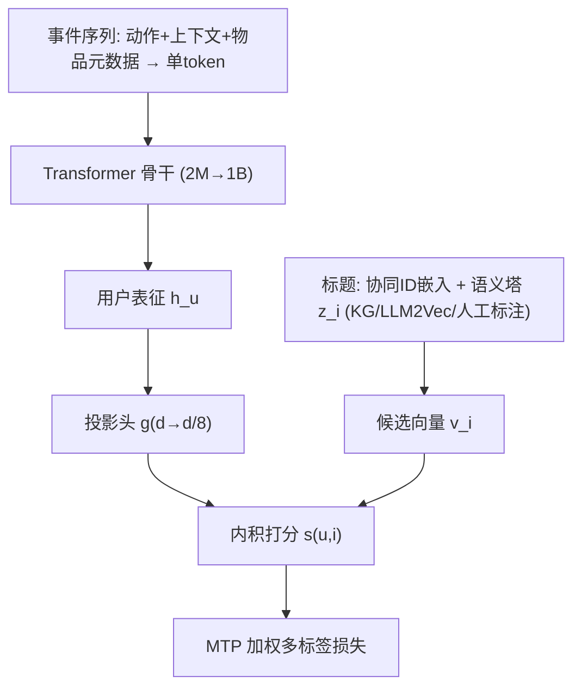

# Towards Generalizable and Efficient Large-Scale Generative Recommenders (面向可泛化与高效的大规模生成式推荐器)

- **会议/期刊**: RecSys '26 (20th ACM Conference on Recommender Systems)
- **作者与机构**: Qiuling Xu, Ko-Jen Hsiao, Moumita Bhattacharya (Netflix Research)
- **推荐链路定位**: 端到端生成式（共享骨干同时服务召回、排序特征、用户表征与冷启动打分）
- **研究方向**: 生成式推荐与离散语义ID / 冷启动与长尾推荐
- **论文原文**: [https://arxiv.org/abs/2605.23312v2](https://arxiv.org/abs/2605.23312v2)
- **开源代码**: 暂未开源

## TL;DR (1分钟核心速览)

本文是一篇工业级 case study：把 Netflix 生成式推荐骨干从 2M 扩到 1B 参数（不含嵌入与解码层），发现缩放收益**任务依赖**——长时程品味任务（Task A）仍有天花板空间，短时程参与（Task B）与时间/供给驱动（Task C）已接近饱和。作者用**偏移幂律** $P(N)=P_0-(N/N_0)^{-a}$拟合出任务级饱和值$P_0$作为"是否值得继续扩"的诊断工具；再用**多Token预测 (MTP)** 对齐缓存服务的时延错配、**采样 softmax +$d/8$ 投影头**降低重复训练成本、**语义物品塔 + 协同嵌入掩码**解决新片上架冷启动。在 1M 用户一周生产影子评估中，1B 骨干在全部任务上 MRR 超过 2M 基线，Task A 相对提升 22.5%，冷启动提升 28.1%。

## Background & Motivation (背景与核心矛盾)

- **主流范式**: 生成式推荐（TIGER/HSTU 一脉）把用户行为序列化为事件 token，用单一 Transformer 骨干预测下一事件，理论上一个骨干可支撑多下游任务。
- **前人局限**: ① 已有缩放律工作（HSTU 等）只证明"质量随算力可预测提升"，却未回答**哪些生产任务还有余量**；② 对数线性拟合 $P=a\log N+b$ 无法表达有界指标（MRR 上界为 1）趋近任务天花板的行为。
- **核心洞察 (Key Insight)**: 生产环境里"预训练增益 $\neq$下游增益"，瓶颈可能不在容量，而在**目标函数、服务路径或物品表征**。作者用拟合饱和值$P_0$ 区分"该加容量"与"该改目标/改表征"。
- **本文切入点**: 把缩放律从"预测曲线"升级为"干预决策诊断器"，并逐一拆解三个落地约束：重复训练成本、缓存服务导致的标签陈旧、新片 ID 证据缺失。

## Method (核心方法设计)

### 1. 整体框架 (Overall Architecture)

输入侧把动作、曝光上下文与物品元数据压缩为**单一 token 级事件表征**（而非分离的多流建模），经 Transformer 编码为用户表征 $h_u$；解码侧用共享投影头对候选标题向量$v_i$做内积打分。训练目标从 NTP 换成带时间衰减权重的**集合值 MTP**；解码侧用 1% 均匀负采样 +$d/8$ 降维投影压缩词表相关矩阵乘；物品侧为每个标题维护"协同 ID 嵌入 + 语义塔表征"双通道，并以 OOV 掩码训练解码器在 ID 缺失时依赖语义证据。推理时仍为**单次解码打分**，无需迭代生成。

### 2. 关键设计拆解 (Key Designs)

1. **偏移幂律缩放律诊断（Offset Power Law）**：痛点是对数线性拟合无法刻画有界指标的饱和。作者改为
$$P(N)=P_0-\left(\frac{N}{N_0}\right)^{-a},\quad a>0$$
其中 $P_0$为任务级饱和水平。物理直觉：$P_0$ 越接近当前最优观测值，说明该任务"加容量"的边际收益越小，应转向改目标或改服务路径。拟合仅统计骨干参数，排除嵌入与解码层。

2. **多Token预测 MTP（服务时延对齐）**：缓存服务下，即时下一 token 标签在输出被消费时可能已过期（图 3）。MTP 把监督目标换成未来高价值目标的加权集合：
$$\mathcal{L}=-\sum_{y_i\in\mathcal{Y}} w_i \log p_\theta(y_i\mid x),\quad w_i=r_i\exp\!\left(-\frac{\ln 2\,(t_i-t_{\text{context}})}{\beta}\right)$$
$r_i$可编码观看时长、完播、新鲜度等效用信号，$\beta=1$ 小时半衰期。直觉：让模型对未来多个合法结局分配概率质量，既缓解标签陈旧，也缓解推荐中"多目标顺序任意"的集合性。

3. **语义物品塔 + 协同嵌入掩码（冷启动）**：成熟标题用协同 ID 嵌入 $e_i^{ID}$，新片不在词表$\mathcal{V}$ 内则替换为可学习 OOV 嵌入：
$$z_i=\phi_{\text{sem}}(e_i^{\text{graph}},e_i^{\text{lang}},e_i^{\text{ann}}),\quad \tilde{e}_i^{ID}=\begin{cases}e_i^{ID}, & i\in\mathcal{V}\\ e_{\text{OOV}}, & i\notin\mathcal{V}\end{cases},\quad s(u,i)=g_\theta(h_u)^\top\psi_\theta(\tilde{e}_i^{ID},z_i)$$
预训练时按实测线上冷启动率随机掩码输入侧或输出侧 ID 嵌入，迫使解码器学会"ID 缺失时靠语义塔"，而非单靠任一通道。

4. **训练目标、负采样与推理效率**：总损失即上述 MTP 加权多标签交叉熵；负采样为 **1% 均匀采样**（剔除与目标相同的负例，未做 LogQ 校正）；解码头共享且从 $d$投影到$d/8$（线上 4096→512）。在输出规模$10^6$时，每 token 训练 FLOPs 从$1.26\times10^{10}$降至$3.56\times10^{8}$（约 35.5×），$10^7$ 规模约 249×（解析估计，非端到端吞吐实测）。

## Experimental Setup & Evaluation Protocol (实验设置与评估协议)

- **数据集与预处理**: 预训练语料为**每轮 2 万亿行为 token**（与主流 LLM 预训练语料同量级），按固定刷新节奏重复训练。任务被粗粒度匿名化为三类（表 1）：

| 任务类别 | 可预测性 | 场景说明 |
| :--- | :---: | :--- |
| Task A | 低 | 长时程品味，正例稀疏，目标可跨会话 |
| Task B | 中 | 短时程参与，近期上下文与 session 意图信息量大 |
| Task C | 高 | 时间/片库可用性/上架动态/人群需求驱动 |

- **数据划分与防穿越 (Splitting Strategy)**: **全局时间戳切分**——每个样本的用户历史截止于某 cutoff 时间，模型推理对 cutoff 之后的未来行为标签评估；跨模型规模固定训练数据、测试窗口、物品词表、嵌入维度与解码配置，仅变骨干大小。
- **排名评测协议 (Ranking Protocol)**: 主指标为 **MRR**（连续、有界于 1，便于建模任务天花板；作者称 test loss / HitRate / NDCG 呈同质趋势）。生产影子评估为 1M 用户、一周窗口的**影子流量**，下游系统走与生产一致的集成路径但不影响用户体验，用同窗口下游标签评估。
- **对比基线与超参设置**: 主对比为 2M 骨干基线 vs 1B 骨干（表 3 差异：全 softmax→采样 softmax+投影头；NTP→MTP；ID 嵌入→语义塔+ID 掩码）。缩放律拟合对比对象为 HSTU 式对数线性形式。

## Key Experimental Results (实验关键数据)

### 1. 主实验对比 (Main Results)

生产影子评估（1M 用户、一周，MRR，图 7）：

| 切片 | 2M 基线 | 1B 模型 | 相对提升 |
| :--- | :---: | :---: | :---: |
| Task A（低可预测） | 基线 | **最优** | **+22.5%** |
| Task B（中可预测） | 基线 | **最优** | **+11.3%** |
| Task C（高可预测） | 基线 | **最优** | **+7.4%** |
| 冷启动（词表外新片） | 基线 | **最优** | **+28.1%** |

缩放律拟合误差对比（表 2，RMSE，$10^{-3}$）：

| 任务 | 偏移幂律 | 对数线性 | 误差下降 |
| :--- | :---: | :---: | :---: |
| Task A | **2.80** | 5.43 | 48.4% |
| Task B | **8.16** | 21.34 | 61.8% |
| Task C | **9.33** | 10.97 | 14.9% |

MTP 在不同服务场景下的相对 MRR 变化（图 5，5-token 窗口）：48 小时缓存服务下 Task A/B/C 分别 **+22.1% / +27.8% / +27.9%**；在线服务（p95 < 1s）下 Task A **+19.6%**，但 Task B/C 随窗口增大而下降。

### 2. 消融实验 (Ablation Study)

论文未提供传统逐组件消融表，但给出了等价的分项对照（缓存时延重放 + MTP 窗口扫描 + 拟合形式对比）：

| 配置 | Task A | Task B | Task C | 说明 |
| :--- | :---: | :---: | :---: | :--- |
| 在线服务（无时延） | 0% | 0% | 0% | 参照基准 |
| 缓存 24h | −4% | **−31%** | −10% | 短时程任务最敏感 |
| 缓存 48h | −4% | **−41%** | −18% | 陈旧标签伤害放大 |
| MTP 5-token @48h | **+22.1%** | **+27.8%** | **+27.9%** | 与缓存场景对齐 |
| MTP 5-token @在线 | **+19.6%** | 下降 | 下降 | 在线场景应保守使用 |

### 3. 关键实验发现 (Key Findings)

1. **缩放收益高度任务依赖，且与拟合 $P_0$一致**：Task C 拟合$P_0=1.075$已贴近 MRR 上界 1，实际影子增益仅 +7.4%；Task A 的$P_0=0.311$ 绝对水平最低但相对余量最大，对应 +22.5% 的最大增益——说明"绝对 MRR 低"不等于"没救"，要看相对天花板。
2. **MTP 的收益由服务时延与任务类型共同决定**：48h 缓存下三任务全面 +22%~28%，但在线场景下 Task B/C 反而退化，因为加宽目标集会抹平对新鲜上下文与时效性最敏感的信号；MTP 应作为"缓存/集合型目标"的专用对齐手段而非通用替换。
3. **冷启动增益最大（+28.1%）验证语义塔与 ID 掩码的必要性**：纯扩容量无法解决新片 ID 证据缺失，语义塔（KG 消息传递 + LLM2Vec + 人工标注）在 OOV 路径上承担了标题特异性证据，是四类切片中提升幅度最高的一项。

## Highlights & Limitations (亮点、对比与审稿批判)

- **与代表作对比 (vs. Prior Work)**: 相比 TIGER（语义 ID 生成式检索）与 HSTU（高基数流式数据上的算力缩放），本文不追求新架构或新 tokenization，而是把缩放律当作**干预决策工具**，并首次系统处理"缓存服务使 NTP 标签陈旧"这一被忽视的工业错配；相比 RADAR（延迟异步检索缓存候选），本文从**训练目标侧**（MTP）而非系统侧对齐时延。
- **可迁移亮点**: ① 用有界指标的偏移幂律拟合 $P_0$ 作为"加容量 vs 改目标"的决策依据，可直接迁移到任何有饱和趋势的排序指标；② 按线上冷启动率设定 ID 掩码概率，使训练分布与推理分布对齐，是低成本高收益的冷启动训练技巧。
- **审稿级局限批判**: ① 效率收益（35.5×/249×）为**解析 FLOPs 估计**，缺少端到端训练吞吐与线上 p95 延迟实测；② 任务被匿名化为三类粗粒度类别，外部无法复现具体数据与基线，且 1B vs 2M 的对比混合了 MTP、采样 softmax、语义塔多个变量，无法干净归因单一组件的贡献；③ 负采样仅 1% 均匀采样且未做 LogQ 校正，可能引入采样偏差，作者亦承认这是待探索方向。

## Rating (四维评分)

- **方法创新性 (Novelty)**: ⭐⭐⭐ （MTP 与语义塔均为已有思路的工程化组合，核心新颖点在于把偏移幂律缩放律用作生产干预诊断器）
- **评估协议与实验扎实度 (Protocol & Experiments)**: ⭐⭐⭐ （1M 用户一周影子评估具工业说服力，但缺逐组件消融、任务匿名化、效率仅为解析估计）
- **写作与数学规范度 (Clarity & Rigor)**: ⭐⭐⭐⭐ （公式精简、$P_0$ 语义与拟合误差表交代清楚，MTP 与冷启动打分式定义完整）
- **工业落地与复现价值 (Industrial & Practical Value)**: ⭐⭐⭐⭐ （重复训练成本、缓存时延、新片冷启动三大痛点均给出可落地配方，但未开源、数据不可复现）
