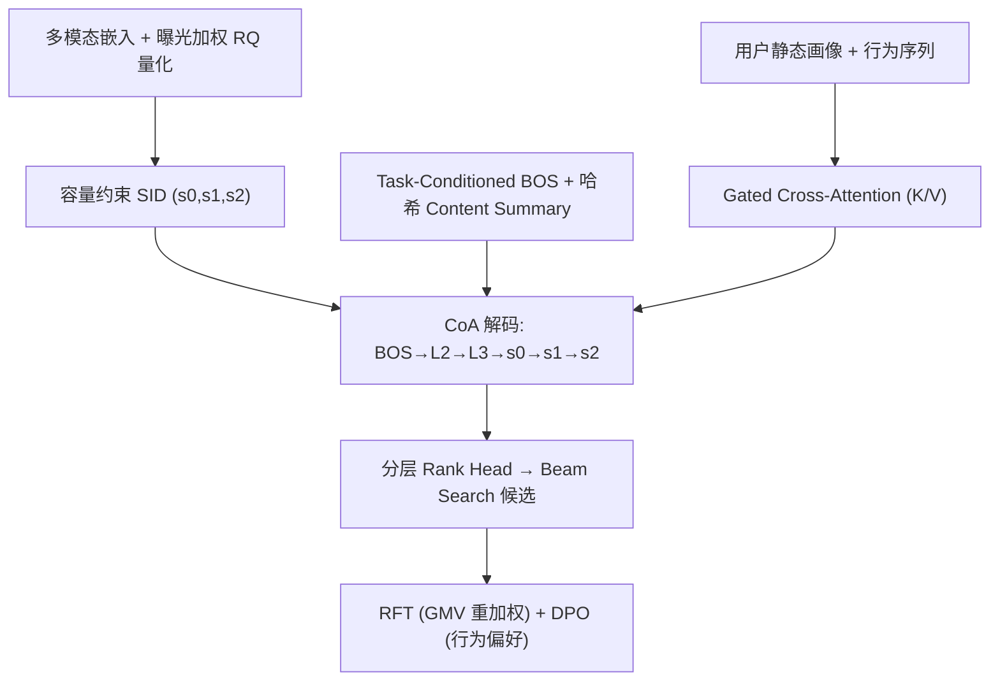
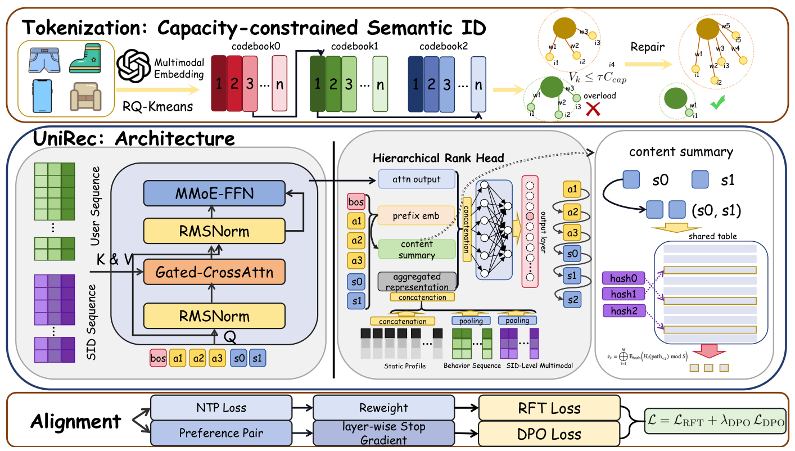

# UniRec: Bridging the Expressive Gap between Generative and Discriminative Recommendation via Chain-of-Attribute (以属性链弥合生成式与判别式推荐的表征鸿沟)

- **会议/期刊**: ACM RecSys 2026
- **作者与机构**: Ziliang Wang, Gaoyun Lin, Xuesi Wang, Shaoqiang Liang, Yili Huang, Weijie Bian (通讯), Li Zhang, Mingchen Cai, Jian Dong, Guanxing Zhang — Shopee
- **推荐链路定位**: 端到端生成式（召回+排序统一）
- **研究方向**: 生成式推荐与离散语义 ID / CTR 特征交叉
- **论文原文**: [https://arxiv.org/abs/2604.12234v5](https://arxiv.org/abs/2604.12234v5)
- **开源代码**: 暂未开源

## TL;DR (1分钟核心速览)

生成式推荐（GR）在紧凑 SID token 上自回归解码，解码时看不到物品侧特征，无法做判别式模型的显式 user–item 特征交叉，形成"表征鸿沟"。本文用贝叶斯定理证明该鸿沟本质是**特征覆盖不足**而非建模不对称，提出 Chain-of-Attribute（CoA）：在 SID 前先解码类目/卖家/品牌等属性 token，恢复物品侧特征交叉并带来可证明的逐步熵减。配合容量约束 SID 与条件解码上下文，在 Shopee 全库 Beam Search 评测上 HR@50 相对最强基线 +22.6%（订单样本 +15.5%），线上 A/B 的 GMV +5.60%。

## Background & Motivation (背景与核心矛盾)

- **主流范式**: 工业界沿用 召回→粗排→精排→重排 的多级判别式漏斗，各阶段优化局部目标；GR（TIGER/OneRec）则把全链路统一为对层次化 SID 的自回归解码。
- **前人局限**: ① 判别式模型以 $p(y|f,u)$直接访问物品特征向量$f$做显式交叉，而 GR 只解码$\prod_l p(s_l|s_{<l},u)$，**在见到任何物品特征前就必须锁定生成路径**；② 推荐是天然的一对多映射（同一行为序列对应多个合法目标），生成不确定性被放大，而判别式靠特征交叉消解该冲突。
- **核心洞察 (Key Insight)**: 由贝叶斯定理 $p(y|f,u)\propto p(f|y,u)p(y|u)$，按判别分数排序等价于按生成后验$p(f|y,u)=\prod_k p(f_k|f_{<k},y,u)$ 排序——**具备完整特征访问的生成模型与判别模型表达力等价**，实际差距只来自 SID 压缩丢弃的结构化属性（类目、卖家、品牌）。
- **本文切入点**: 不做全特征序列解码（延迟不可接受），而是**选择性恢复被 SID 压缩丢弃最严重的粗粒度属性**，以 $m$ 步额外解码为代价逼近理论上界。

## Method (核心方法设计)

### 1. 整体框架 (Overall Architecture)

物品先经多模态嵌入 + 容量约束残差量化得到 3 层 SID（码本 4000/层）；解码侧以 Task-Conditioned BOS 起始，依次生成属性 token（L2→L3 类目）再生成 $s_0,s_1,s_2$。Decoder-Only 主干通过 Gated Cross-Attention 把用户行为序列作为静态 K/V 注入，每步 Rank Head 融合前缀嵌入、哈希 Content Summary 与聚合表征输出词表分布；训练用 NTP + RFT 业务价值重加权 + DPO 偏好对齐联合优化。

<figure class="paper-figure" markdown="span">
  <figcaption>图1：UniRec 架构概览。</figcaption>
</figure>
图 1：UniRec 整体架构——左侧为容量约束 SID 量化，右侧为 CoA + CDC 的解码与对齐训练。

### 2. 关键设计拆解 (Key Designs)

1. **Chain-of-Attribute（CoA，核心创新）**：SID 压缩把类目/卖家/品牌折叠为隐变量，解码时不可见。CoA 将分解式改为 $p(s|u)=p(a|u)\cdot\prod_{l=0}^{L-1}p(s_l|a,s_{<l},u)$，先"猜测"属性$a$再条件生成 SID。由于同属性物品在 SID 语义空间相邻，条件熵严格下降：$\Delta H_l=H(s_l|s_{<l},u)-H(s_l|a,s_{<l},u)=I(a;s_l|s_{<l},u)\ge 0$，且逐层错误率$\epsilon_l\to\epsilon'_l<\epsilon_l$使级联失败概率$1-\prod_l(1-\epsilon'_l)$ 单调下降——这就是 beam search 更稳、端到端误差衰减的物理直觉。CoA 作用于**解码层**（物品侧语义），与 cross-attention 作用于**表征层**（用户侧偏好）互补。

2. **Capacity-constrained SID（抑制马太效应）**：标准 RQ-KMeans 只约束 item 数量均衡，但曝光长尾使 top 10% 的 $(s_0,s_1)$组合吃掉 87.9% 曝光（相对$s_0$层 33.2% 放大 2.6 倍），高频 token 路径在 beam search 中被反复生成。改为带曝光权重的容量约束聚类：$V_k=\sum_{i:z_i=k}w_i$，约束$V_k\le\tau C_{cap}$（$C_{cap}=\frac{1}{K}\sum_i w_i$，$\tau=1.05$），用"最近中心分配 → 超载簇贪心迁移至欠载簇"两阶段求解，把 top-1% token 曝光占比从 57.33% 压到 26.04%。

3. **Conditional Decoding Context + 训练目标**：Task-Conditioned BOS 用可学习嵌入联合编码行为目标（click/purchase/cart）× 场景（feed/search/flash sale），解决多场景混训的分布冲突；Content Summary 用 $M=3$个哈希函数共享一张嵌入表显式建模笛卡尔积交叉$c_t=\Vert_{i=1}^{M}\mathbf{E}_{hash}(H_i(path_{<t})\boldsymbol{o}d S)$，避免$4000^2\approx16$M 参数爆炸。总损失$\mathcal{L}=\mathcal{L}_{RFT}+\lambda_{DPO}\mathcal{L}_{DPO}$（$\lambda$比 20:3，$\beta=0.1$），RFT 按 batch 内归一化优势$\tilde{A}_i$对 NTP 样本重加权$(1+\lambda\tilde{A}_i)$，DPO 用 purchase≻click≻exposure 构造同请求内偏好对，并对前缀施加 **layer-wise stop-gradient** 只更新最后一层 SID Rank Head。训练用 teacher forcing + 全库 beam search 推理，无负采样。

## Experimental Setup & Evaluation Protocol (实验设置与评估协议)

- **数据集与预处理**: Shopee 主 feed 场景连续 9 天真实生产日志，十亿级交互（曝光/点击/加购/购买）。

| 数据集 | #Users | #Items | #Interactions | 稀疏度/密度 | 特征/场景说明 |
| :--- | :---: | :---: | :---: | :---: | :--- |
| Shopee 生产日志 | 千万级 | 百万级 | 十亿级 | 极稀疏 | 主 feed 竖滑；含类目 L1/L2/L3、卖家、品牌、多模态 |

- **数据划分与防穿越 (Splitting Strategy)**: 按 9 天生产日志的时间顺序切分（全局时间戳切分），训练/评估严格按时间隔离。
- **排名评测协议 (Ranking Protocol)**: 无偏 **Full-Ranking**——推理时对全库做 Beam Search，报告 BS Hit Ratio@K（K=50/100/200），并额外单列订单（purchase）样本子集；辅以 teacher-forcing 下的 Token Hit Ratio@3 衡量 token 分布学习质量。
- **对比基线与超参设置**: SASRec（判别式序列检索，用其表征在 SID 码本上近邻检索）、TIGER（Encoder-Decoder 生成式）、OneRec-V2（Decoder-Only + cross-attention）。$d_{model}=256$、行为序列$T=200$、多模态 SID 序列$L_{mm}=100$、3 层 8 头 cross-attention、MMoE-FFN 4 专家、AdamW lr=$3\times10^{-4}$。

## Key Experimental Results (实验关键数据)

### 1. 主实验对比 (Main Results)

| Method | HR@50 | HR@100 | HR@200 | 订单 HR@50 | 订单 HR@100 | 订单 HR@200 |
| :--- | :---: | :---: | :---: | :---: | :---: | :---: |
| SASRec | 0.421 | 0.489 | 0.556 | 0.548 | 0.631 | 0.709 |
| TIGER (0.05B) | 0.437 | 0.508 | 0.578 | 0.567 | 0.652 | 0.731 |
| OneRec-V2 (0.05B) | 0.438 | 0.523 | 0.587 | 0.582 | 0.671 | 0.752 |
| **UniRec (0.05B)** | **0.537** | **0.618** | **0.688** | **0.672** | **0.774** | **0.867** |
| Improv. vs 最强基线 | +22.6% | +18.2% | +17.2% | +15.5% | +15.3% | +15.3% |

### 2. 消融实验 (Ablation Study)

| 配置 | HR@50 | HR@100 | HR@200 |
| :--- | :---: | :---: | :---: |
| UniRec (Full) | **0.537** | **0.618** | **0.688** |
| (a) RQ-KMeans 替代容量约束 SID | 0.481 | 0.558 | 0.627 |
| (b) w/o Task-Cond. BOS | 0.493 | 0.570 | 0.638 |
| (b) w/o Content Summary | 0.485 | 0.565 | 0.637 |
| CoA: Direct SID（无属性） | 0.458 | 0.532 | 0.595 |
| CoA: L1→SID | 0.471 | 0.569 | 0.622 |
| CoA: L2→SID | 0.515 | 0.597 | 0.664 |
| CoA: L3→SID | 0.517 | 0.601 | 0.670 |
| CoA: L2→L3→SID | **0.537** | **0.618** | **0.688** |
| 多场景: 单场景独立模型 | 0.386 | 0.470 | 0.540 |
| 多场景: 混训无 BOS | 0.395 | 0.486 | 0.570 |
| 多场景: 混训 + Task-Cond. BOS | **0.400** | **0.510** | **0.590** |

### 3. 关键实验发现 (Key Findings)

1. **CoA 是最大增益来源且属性粒度可加**：去掉属性链 HR@50 从 0.537 跌至 0.458（-14.7%），单级 L2 或 L3 已能补回大部分（0.515/0.517），而 L2→L3 两级串联再涨 2.2 个点，同时 $s_0$@3 从 0.314 升至 0.682——直接印证"属性条件降低首层 SID 熵"的理论预测。
2. **容量约束 SID 的收益来自码本均衡而非单纯聚类质量**：替换为 RQ-KMeans 后 HR@50 掉 5.6 个点，且 top-1% token 曝光占比从 26.04% 反弹至 57.33%，说明长尾物品的可达性被高频 token 路径挤占，均衡负载直接转化为召回增益。
3. **多场景混训 + Task-Cond. BOS 存在协同**：混训本身已比单场景模型 +0.9/+1.6/+3.0（HR@50/100/200），再加场景条件 BOS 又额外 +0.5/+2.4/+2.0，证明跨场景知识迁移与场景去冲突是正交收益；线上端到端延迟 110ms vs 传统四级漏斗 266ms，统一模型同时拿到效果与效率。

## Highlights & Limitations (亮点、对比与审稿批判)

- **与代表作对比 (vs. Prior Work)**: 与 TIGER/OneRec-V2 的本质区别在于**解码时是否携带物品侧信号**——前者纯 SID 自回归，本文用属性前缀把判别式的特征交叉搬进生成轨迹；与 GRACE 的 Chain-of-Thought tokenization 相比，CoA 的差异不在"是否前缀属性"这一工程选择，而在于给出贝叶斯上界 + 互信息熵减 $\Delta H_l=I(a;s_l|s_{<l},u)$的理论刻画，并明确其为延迟感知的近似（$m$ 步额外解码换特征覆盖）。
- **可迁移亮点**: ① 曝光加权容量约束量化可直接用于任何 RQ-VAE/VQ 语义 ID 构建，缓解码本坍缩；② 哈希 Content Summary 用 $M\times S\times d_{hash}$ 参数显式建模 token 笛卡尔积，可迁移到任何层次化解码的生成式检索；③ layer-wise stop-gradient 让 DPO 只更新末层，避免偏好对齐破坏前缀条件分布。
- **审稿级局限批判**: ① 全部实验基于 Shopee 单一平台私有日志，无公开数据集复现，且 CoA 属性链依赖电商类目体系，在内容/短视频等弱结构化域的可迁移性未验证；② 理论上界假设"完整特征访问"，而 CoA 只恢复 3 个粗粒度属性，$I(a;s_l|s_{<l},u)$仅作定性论证，未给出与判别式模型差距的定量闭合度；③ 容量约束聚类的贪心修复为启发式，$\tau$与$C_{cap}$对长尾分布漂移的敏感性、以及$m$ 步属性解码在超长尾类目上的延迟开销均缺少分析。

## Rating (四维评分)

- **方法创新性 (Novelty)**: ⭐⭐⭐⭐ （核心机制与方法设计具备明确创新性，理论与实验动机支撑充分）
- **评估协议与实验扎实度 (Protocol & Experiments)**: ⭐⭐⭐⭐ （主流公开数据集评测完整，包含多基线对比与消融实验验证）
- **写作与数学规范度 (Clarity & Rigor)**: ⭐⭐⭐⭐⭐ （问题形式化定义清晰，核心模块数学推导与架构阐述严谨易读）
- **工业落地与复现价值 (Industrial & Practical Value)**: ⭐⭐⭐⭐⭐ （兼顾推荐效果增益与训练/推理效率，具备实际场景迁移参考价值）
