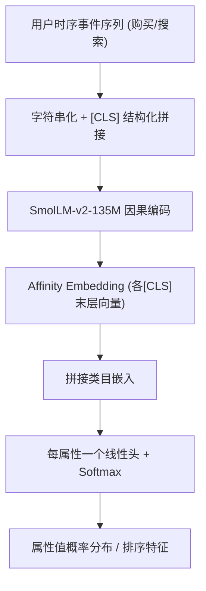
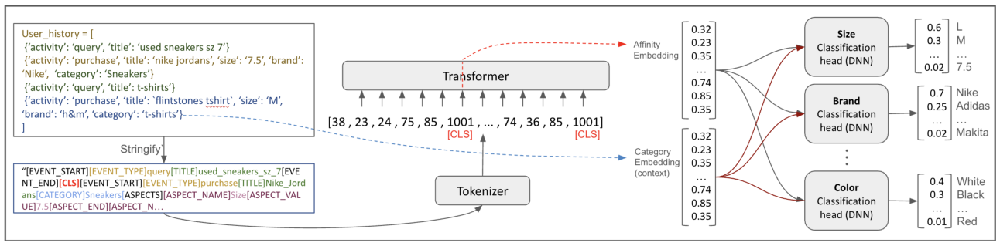

# DeepAffinity: Long-Term Aspect Preference Prediction in eCommerce using Small Language Models (基于小语言模型的电商长期属性偏好预测)

- **会议/期刊**: RecSys 2026 (RecTemp Workshop)
- **作者与机构**: Yotam Eshel, Guy Hadad, Guy Feigenblat, Yuri M. Brovman, Matt Gearhart, Bracha Shapira (eBay Inc. / Ben-Gurion University)
- **推荐链路定位**: 召回/排序特征增强（离线属性偏好预测 → 在线特征注入）
- **研究方向**: 大语言模型推荐 / 序列推荐
- **论文原文**: [https://arxiv.org/abs/2609.02468v2](https://arxiv.org/abs/2609.02468v2)
- **开源代码**: 暂未开源

## TL;DR (1分钟核心速览)

本文定义电商 **Aspect Affinity（属性亲和度）** 任务：从用户时序行为序列预测其未来购买在品牌、尺码、颜色等属性上的取值，本质是多任务多分类的长期偏好预测。作者提出 DeepAffinity，用 135M 的 SmolLM-v2 骨干 + 结构化字符串化输入 + 每属性一个线性预测头，在严格时间切分、Micro-F1 评估下，Fashion 数据集均值 0.34 显著超过 Gemini 1.5 Flash 零样本（0.26）与 3B 生成式 SFT（0.30），并在生产排序器上带来 Recall@1 相对 +0.6% 的线上增益。

## Background & Motivation (背景与核心矛盾)

- **主流范式**: 电商个性化从 item 级协同过滤演进到属性级建模；尺码/合身预测已有专门工作，序列推荐（SASRec/BERT4Rec）则预测下一个 item。
- **前人局限**: ① 现有属性研究多局限于时尚尺码单一场景，无法覆盖跨类目的任意属性及其交互；② 通用 LLM 零样本虽具备世界知识，但对"某用户未来会买什么尺码"这类细粒度、个体化统计规律推理能力弱。
- **核心洞察 (Key Insight)**: 属性偏好是**缓慢演化**的长期信号——MRV（最近值）与 PMCV（个性化众数）表现接近，说明近期会话意图与长期属性偏好应当解耦；因此预测目标须设定在距历史末尾至少 24 小时的未来购买上。
- **本文切入点**: 不做生成式文本输出，而是把 SLM 当作**序列编码器**，用结构化字符串化 + 多任务分类头直接输出属性分布，以极小参数量换取统计学习优势。

## Method (核心方法设计)

### 1. 整体框架 (Overall Architecture)

输入为用户按时间排序的活动事件序列（购买 + 搜索），每个事件被字符串化为含事件类型、标题/查询串、属性、类目的结构化文本，并以 `[CLS]` 结尾。整条序列拼接后送入 SmolLM-v2-135M（因果 Transformer），取各 `[CLS]` 位置末层隐向量作为 **Affinity Embedding**；该向量与目标类目的可学习类目嵌入拼接，送入每个属性一个的线性分类头，softmax 得到属性值分布。训练时整条历史一次前向、在所有 `[CLS]` 位置并行计算交叉熵，利用因果掩码天然防止未来信息泄漏；线上则离线预计算 Affinity Embedding，运行时仅跑轻量头。

<figure class="paper-figure" markdown="span">
  <figcaption>图1：基于DeepAffinity SLM的架构</figcaption>
</figure>

### 2. 关键设计拆解 (Key Designs)

1. **结构化字符串化 (Stringification)**：痛点在于 LLM 输入若用自然语言描述历史，会引入大量无关 token 且属性边界模糊。本文用 `[ITEM_START/_END]`、`[TITLE_START/_END]`、`[ASPECT_START/_END]` 等特殊 token 显式切分字段，并在**每个事件末尾**追加 `[CLS]`，使一个序列同时承载多个"截至该时刻"的训练样本。直觉：把"预测时点"编码进位置结构，等价于对每个前缀做一次监督，样本效率提升一个数量级。
2. **多任务属性头 + 类目条件化**：痛点在于同一属性值在不同类目下语义不同（鞋码 vs 电视尺寸）。本文令 $\hat{y}_{a,u,k} = \text{softmax}(W_a [\mathbf{h}_{[CLS]}^{(k)}; \mathbf{e}_{c}])$，即 Affinity Embedding 与类目嵌入拼接后经属性专属线性层。直觉：类目嵌入充当"任务上下文开关"，让共享骨干在不同类目下复用同一属性头而不互相干扰。
3. **训练目标与效率**：总损失为各属性交叉熵之和 $\mathcal{L} = \sum_{a,u,k} \text{CE}(\hat{y}_{a,u,k}, y_{a,u,k})$；无负采样（多分类 softmax 天然全库归一）。上下文长度 2048，约 15% 用户需截断；Fashion 训练 200K 步、batch 64，全类目 380K 步、batch 128，学习率 5e-4 + cosine + 1K warmup。线上推理仅需轻量头，规避 LLM 实时推理延迟。

## Experimental Setup & Evaluation Protocol (实验设置与评估协议)

- **数据集与预处理**: 自建美国电商平台 6 个月行为日志（购买 + 查询），无公开数据集含属性标注。过滤购买数 < 3 的用户（去冷启动）与活动量 Top 1% 用户（去 bot/异常）；属性值仅保留出现 ≥ 2K 次者，每属性上限 10K 标签。

| 数据集 | #Users | #Items | #Interactions | 稀疏度/密度 | 特征/场景说明 |
| :--- | :---: | :---: | :---: | :---: | :--- |
| Fashion | 千万级 | 百万级 | 数亿（购买+查询） | 极稀疏 | 服饰鞋包及子类目，测试采样 1K |
| All-Category | 千万级 | 千万级 | 数亿 | 极稀疏 | 全类目（电子/收藏品/二手），测试采样 20K |

- **数据划分与防穿越 (Splitting Strategy)**: **严格全局时间戳切分**——6 个月训练 + 后续 1 周测试；标签取历史末尾至少 24 小时之后的购买，显式隔离短期会话意图。
- **排名评测协议 (Ranking Protocol)**: 属性预测用 **Micro-F1**（多分类全标签空间，非采样）；外延排序实验用生产曝光日志的 slate 内 Recall@k，且排序数据时段晚于 DeepAffinity 训练期以防泄漏。
- **对比基线与超参设置**: 启发式 MCV / PMCV / MRV；零样本 Gemini 1.5 Flash；生成式 SFT（Qwen2.5 0.5B–7B、Llama 3.1 8B、Llama 3.2 3B，QLoRA + 1M 样本，输出 JSON）；零样本 LLM 提示策略含 Zero-shot / Few-shot / Enhanced Prompting / CoT。骨干 135M，头为单线性层。

## Key Experimental Results (实验关键数据)

### 1. 主实验对比 (Main Results)

Fashion 数据集（Micro-F1，1K 测试样本）：

| Aspect | MCV | PMCV | Gemini 零样本 | **DeepAffinity** | Improv. (vs 最优基线) |
| :--- | :---: | :---: | :---: | :---: | :---: |
| Brand | 0.08 | 0.27 | 0.23 | **0.30** | +11.1% |
| Size | 0.21 | 0.33 | 0.31 | **0.38** | +15.2% |
| Color | 0.26 | 0.23 | 0.25 | **0.33** | +26.9% |
| **Mean** | 0.18 | 0.28 | 0.26 | **0.34** | +21.4% |

All-Category 数据集（Micro-F1，20K 测试样本，节选）：

| Aspect | MCV | PMCV | SFT 3B | **DeepAffinity** |
| :--- | :---: | :---: | :---: | :---: |
| Size | 0.17 | 0.26 | 0.25 | **0.32** |
| Brand | 0.20 | 0.29 | 0.33 | **0.35** |
| Color | 0.31 | 0.27 | 0.26 | **0.38** |
| Style | 0.26 | 0.28 | 0.38 | **0.44** |
| Theme | 0.20 | 0.21 | 0.18 | **0.29** |
| League | 0.32 | 0.66 | 0.72 | **0.72** |
| **Mean** | 0.20 | 0.28 | 0.30 | **0.35** |

外延排序（生产排序器 + 2 个亲和度特征）：Recall@1 **+0.6%**、Recall@3 **+0.4%**、Recall@5 **+0.3%**（相对提升）。

### 2. 消融实验 (Ablation Study)

原文未设标准组件消融，以下为等价对照（Fashion Mean Micro-F1）：

| 配置 | Mean F1 | 说明 |
| :--- | :---: | :--- |
| MCV（全局众数） | 0.18 | 无个性化 |
| PMCV（个性化众数） | 0.28 | 仅统计，无序列建模 |
| Gemini 1.5 Flash 零样本 | 0.26 | 通用 LLM 无任务微调 |
| 生成式 SFT 3B（JSON 输出） | 0.30 | 大 22 倍参数，生成式微调 |
| **DeepAffinity (135M + 分类头)** | **0.34** | 结构化输入 + 多任务头 |

### 3. 关键实验发现 (Key Findings)

1. **参数量不是瓶颈，输入输出设计才是**：135M 的 DeepAffinity 均值 0.34 反超 3B 生成式 SFT 的 0.30，且后者在小模型上甚至无法稳定输出可解析 JSON——说明"分类头 + 结构化字符串"比"自由文本生成"更适配属性预测。
2. **零样本 LLM 的推理能力被高估**：Gemini 零样本均值仅 0.26，低于纯统计的 PMCV（0.28）；即便在零样本 LLM 上叠加 Enhanced Prompting（注入属性统计）能稳定涨点，仍显著落后微调模型，印证"用户行为统计学习 > 活动推理"。
3. **属性偏好缓慢演化而非近期主导**：MRV 与 PMCV 表现相近，且 24 小时预测间隔的设定使模型学到长期漂移而非会话意图；All-Category 上 10 个属性中 7 个最优，League 类属性因高度集中（PMCV 已达 0.66）天花板明显。

## Highlights, Limitations & Rating (亮点、对比与审稿评价)

- **与代表作对比 (vs. Prior Work)**: 相比尺码/合身预测专作（仅时尚单属性、依赖品牌尺码表），本文覆盖跨类目任意属性并建模属性间交互；相比 SASRec/BERT4Rec 预测下一 item，本文预测**长期horizon 的细粒度属性值**；相比生成式 LLM4Rec，本文放弃文本生成、改用编码器 + 分类头，以 1/22 参数量取胜。
- **可迁移亮点**: ① "每事件末尾插 `[CLS]` + 整序列一次前向并行算损失"的前缀监督技巧，可直接迁移到任意序列推荐的高效训练；② 离线预计算 embedding + 在线轻量头的部署范式，是 LLM 类模型落地低延迟推荐系统的通用解法。
- **审稿级局限批判**: ① 输入表示未编码显式时间戳、事件间隔与季节性，仅靠事件顺序隐式表达时间，对"偏好漂移速度"的建模偏弱；② 全部实验基于单一公司私有数据、无公开基准与开源代码，可复现性受限；③ 属性标签截断至 10K 且过滤低频值，长尾属性（如小众品牌）被系统性排除，评估存在乐观偏差。
- **四维评分**: 创新性 ⭐⭐⭐ | 实验扎实度 ⭐⭐⭐ | 方法清晰度 ⭐⭐⭐⭐ | 落地价值 ⭐⭐⭐⭐

