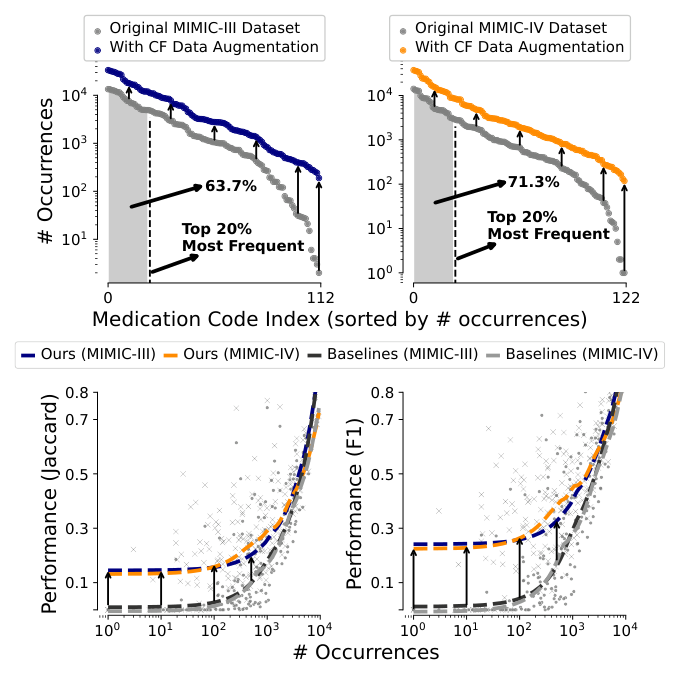
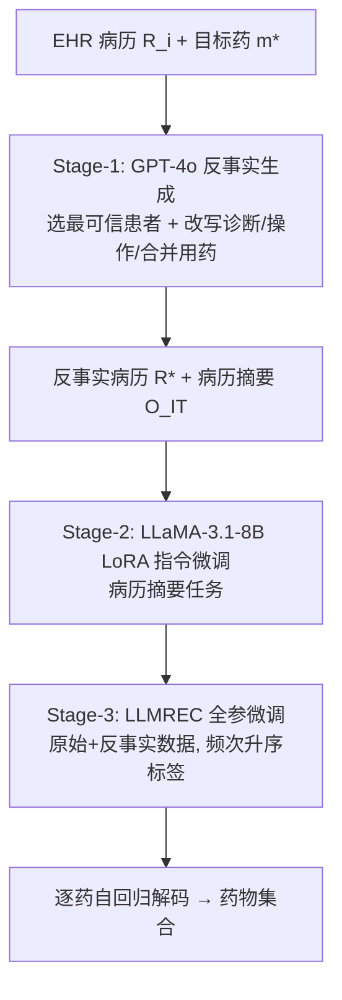

# Improving Rare Medication Recommendation with Counterfactual Data Augmentation and Large Language Models (基于反事实数据增强与大语言模型的罕见药推荐改进)

- **会议/期刊**: RecSys 2026
- **作者与机构**: Shinhwan Kang, Soo Yong Lee, Jaewon Kim, Kijung Shin (KAIST), Buru Chang (Korea University)
- **推荐链路定位**: 端到端生成式（逐药自回归解码）
- **研究方向**: 大语言模型推荐 / 冷启动与长尾推荐
- **论文原文**: [https://arxiv.org/abs/2607.24829v1](https://arxiv.org/abs/2607.24829v1)
- **开源代码**: [https://github.com/ShinhwanKang/GenRxR](https://github.com/ShinhwanKang/GenRxR)

## TL;DR (1分钟核心速览)

用药推荐模型在长尾罕见药（rare-meds）上几乎完全失效：MIMIC-III 上多数基线在 Group-1 的 Jaccard 仅 1–3%，而高频药可达 55%+。本文提出 GenRxR：先用 GPT-4o 做**反事实数据生成**（假设某患者被开具目标药，反推诊断/操作/合并用药的合理变化）扩充训练集，再用**病历摘要指令微调**对齐 LLaMA-3.1-8B 的临床推理，最后以**逐药自回归生成**建模共荐药关系。在 MIMIC-III/IV 的 4:1:1 划分、Micro/Macro/Group 三套 Jaccard 与 F1 协议下，Group-1（最稀有组）Jaccard 相对最强基线提升 **30.17%**，F1 提升 **30.88%**，且高频药性能不降、DDI 比率贴近真实处方。

## Background & Motivation (背景与核心矛盾)

- **主流范式**: 以 RETAIN/GAMENet/SafeDrug/MoleRec/RAREMed 为代表的 EHR 序列编码 + 多标签分类范式，以及 COGNet/LEAP 的序列化解码、LEADER/FLAME 的 LLM 分类头范式。
- **前人局限**: ① 隐私法规导致 EHR 数据本身稀缺，且药物呈极端长尾（图 1(a)：Top-20% 药物占 63.7% 出现次数），数据驱动模型在 rare-meds 上系统性崩塌；② 多数方法把每种药当作独立二分类标签，**忽视共荐药之间的临床互证关系**——而这恰是罕见药处方的关键上下文（如加入非阿片镇痛 N02B 以限制阿片 N02A 用量）。
- **核心洞察 (Key Insight)**: 罕见药失效本质是"物品冷启动 + 临床一致性约束"的复合问题，单纯重加权/重采样无法补足"该药在何种临床情境下合理"的语义知识；而 LLM 恰好具备这种反事实临床推理能力。
- **本文切入点**: 把 LLM 从"预测器"改造为"数据生成器 + 推理对齐器"，用反事实合成补数据、用摘要任务对齐推理、用自回归生成建模药-药依赖。

<figure class="paper-figure" markdown="span">
  <figcaption>图 1：(a) 药物出现频率（上）与 (b) 不同频率下的平均预测性能（下）。原始 EHR 数据集中的药物呈现长尾分布，包含许多极少开具的药物（rare-meds），而预测性能在 rare-meds 上显著下降。我们的方法（包括反事实（CF）数据增强）有效缓解了该问题。</figcaption>
</figure>

## Method (核心方法设计)

### 1. 整体框架 (Overall Architecture)

三阶段流水线：**Stage-1** 用强 LLM（GPT-4o，temperature 0.3）对每个药物（含罕见药）生成 30 条反事实病历；**Stage-2** 用 Stage-1 产出的病历摘要作为监督信号，对 LLaMA-3.1-8B 做 LoRA 指令微调（病历摘要任务），习得"围绕目标药解读病历"的临床推理；**Stage-3** 以 Stage-2 权重初始化 LLMREC，在原始 + 反事实数据上做全参数微调，推理时逐 token 生成药名序列并解析为药物集合。关键设计是**训练标签按训练集频次升序排列**，使罕见药在序列中先被生成，避免被高频药"挤出"。

### 2. 关键设计拆解 (Key Designs)

1. **反事实场景构造 + 相对风险引导的临床元素注入**：直接让 LLM 凭空造病历会产出临床不一致样本。本文先构造"若患者 $i$被开具$m^*$"的反事实假设$\mathcal{M}_i^* \leftarrow \mathcal{M}_i \cup \{m^*\},\ m^* \notin \mathcal{M}_i$，再从训练集中按**相对风险**筛选与$m^*$强关联的临床元素集合$\mathcal{C}_{m^*}$ 注入提示：

$$\text{RelativeRisk}(c, m^*) = \frac{P(c \mid m^*)}{P(c \mid \neg m^*)} = \frac{\text{count}(c, m^*)/\text{count}(m^*)}{\text{count}(c, \neg m^*)/\text{count}(\neg m^*)}$$

直觉：高相对风险元素是"该药的特征性上下文"，为 LLM 提供锚点，使其改写有据可依而非幻觉；同时让 LLM 在 $k=3$ 个候选患者中先选最可信者再改写，双重约束临床一致性。

2. **病历摘要指令微调（对齐而非直接微调）**：零样本 GPT 与直接微调的 LEADER 在罕见药上均表现平庸，说明"通用临床知识"与"用药推荐任务"之间存在语义鸿沟。本文插入中间任务：给定病历 $\mathcal{R}_i$、目标药$m^*$与$\mathcal{C}_{m^*}$，令 LLM 生成聚焦于该药相关临床要点的摘要$\hat{O}^{IT}_i$，损失为

$$\mathcal{L}_{IT} = -\sum_{j=1}^{|O^{IT}_i|} \log p(O^{IT}_{i,j} \mid I_{IT}, \mathcal{R}_i, m^*, \mathcal{C}_{m^*}, O^{IT}_{i,<j}; \theta_{\text{LoRA}})$$

监督信号来自 Stage-1 中 GPT-4o 生成的摘要（即强模型蒸馏到弱模型）。直觉：摘要任务强迫模型学会"从长病历中定位与某药相关的证据"，这正是罕见药判别所需的能力。

3. **逐药自回归生成与训练目标**：LLMREC 以已生成药物为上下文预测下一味药，$\hat{\mathcal{M}}^i_{t,j} = \text{LLM}_{REC}(I_{rec}, \mathcal{R}^i_{<t}, \mathcal{D}^i_t, \mathcal{P}^i_t, \hat{\mathcal{M}}^i_{t,<j})$，从而显式建模共荐药依赖；临床元素采用**文本嵌入 + ID 嵌入（经投影层对齐到同一隐空间）双 token** 表示，兼顾语义与协同信号。训练目标为

$$\mathcal{L}_{rec} = -\sum_{j=1}^{|\mathcal{M}^i_t|} \log p(\mathcal{M}^i_{t,j} \mid I_{rec}, \mathcal{R}^i_{<t}, \mathcal{D}^i_t, \mathcal{P}^i_t, \mathcal{M}^i_{t,<j}; \theta)$$

无需负采样（生成式范式天然规避了分类范式的负样本偏置），推理开销为一次自回归解码。

## Experimental Setup & Evaluation Protocol (实验设置与评估协议)

- **数据集与预处理**: MIMIC-III / MIMIC-IV ICU 患者记录，沿用 GAMENet/COGNet/SafeDrug 的预处理，**不引入出院小结等额外信息**以保证公平；DDI 来自 TWOSIDES。

| 数据集 | 划分 | 评估粒度 | 特征/场景说明 |
| :--- | :---: | :---: | :--- |
| MIMIC-III | 4:1:1 | Group 分 4 组（每组 28 药） | 诊断/操作/用药序列，长尾显著 |
| MIMIC-IV | 4:1:1 | Group 分 4 组（30/30/30/32 药） | 同上，规模更大 |

- **数据划分与防穿越**: 按患者记录做 **4:1:1 比例划分**（沿用前人协议）；反事实生成仅使用训练集 admission 计算相对风险，避免测试信息泄漏。
- **排名评测协议**: 非排名式集合匹配评估，采用 **Micro-Averaged**（偏向高频药）、**Macro-Averaged**（每药等权，反映罕见药）、**Group-Averaged**（按训练频次分组，Group-1 最稀有）三套 Jaccard / F1，辅以 **DDI Ratio** 与**平均预测药数**；报告 3 次运行均值±标准差。
- **对比基线与超参**: 14 个基线，含 9 个传统 SOTA（RETAIN、LEAP、GAMENet、SafeDrug、MICRON、COGNet、MoleRec、RAREMed、LEADER、FLAME）与 5 个 LLM 基线（GPT-4o、GPT-5-mini、GPT-5 零样本等）。GenRxR 用 GPT-4o 生成、LLaMA-3.1-8B-Instruct 微调，每药 30 条反事实样本，$k=3$，最多 3 次就诊。

## Key Experimental Results (实验关键数据)

### 1. 主实验对比 (Main Results)

MIMIC-III 核心列（Jaccard / F1，%）：

| 方法 | Group-1 Jaccard (Rare) | Macro Jaccard | Micro Jaccard | Group-1 F1 (Rare) | Macro F1 | DDI Ratio |
| :--- | :---: | :---: | :---: | :---: | :---: | :---: |
| RETAIN | 1.07 | 23.21 | 50.39 | 1.88 | 31.62 | 7.46 |
| GAMENet | 2.42 | 22.77 | 50.99 | 3.76 | 30.82 | 7.69 |
| SafeDrug | 1.50 | 23.31 | 50.31 | 2.34 | 31.38 | 6.42 |
| COGNet | 10.19 | 31.16 | 52.54 | 15.75 | 42.72 | 7.87 |
| RAREMed | 3.35 | 27.29 | **54.49** | 5.16 | 36.49 | 6.39 |
| FLAME | 8.11 | 30.12 | 52.31 | 12.72 | 41.09 | 7.64 |
| GPT-5 | 5.74 | 17.19 | 29.58 | 9.73 | 26.02 | 9.24 |
| **GenRxR** | **13.27** | **32.43** | 53.53 | **20.61** | **44.51** | 8.29 |
| Improv.% | **+30.17%** | **+4.07%** | −1.76% | **+30.88%** | **+4.18%** | GT=8.26 |

MIMIC-IV 上 Group-1 Jaccard 12.50（+22.84% vs. FLAME 10.17）、Group-1 F1 20.04（+25.20%）、Macro F1 40.59（+6.66%）；Micro Jaccard 46.45 略低于 RAREMed 的 45.72 之上但低于 COGNet 的 44.07 组内最优值区间，属"以微小高频代价换巨大长尾收益"。

### 2. 消融实验 (Ablation Study)

MIMIC-III（CF=反事实数据，IT=指令微调）：

| CF | IT | Group-1 Jaccard | Macro Jaccard | Group-1 F1 | Macro F1 | #Pred Meds |
| :---: | :---: | :---: | :---: | :---: | :---: | :---: |
| ✗ | ✗ | 10.21 | 29.97 | 15.42 | 41.08 | 21.95 |
| ✓ | ✗ | 12.29 | 31.26 | 19.09 | 43.07 | 23.19 |
| ✗ | ✓ | 11.98 | 31.23 | 18.23 | 42.77 | 21.45 |
| ✓ | ✓ | **13.27** | **32.43** | **20.61** | **44.51** | 23.22 |

### 3. 关键实验发现 (Key Findings)

1. **反事实数据是罕见药增益的主引擎**：单独加 CF 使 Group-1 Jaccard 从 10.21 → 12.29（+20.4%），单独加 IT 仅到 11.98；两者叠加达 13.27，说明"补数据"与"对齐推理"互补而非冗余——CF 解决样本量，IT 解决样本质量利用。
2. **增益严格集中于长尾、高频几乎无损**：Group-1 提升 30.17% 而 Group-4（最高频）仅 +0.94%，Micro Jaccard 甚至 −1.76%；这证明模型并非整体变强，而是把容量重新分配给了长尾，符合"Macro 指标才是罕见药真实信号"的评估哲学。
3. **生成数据具备临床可辨性下限**：100 样本盲测中持证医师判别准确率仅 **0.45**（低于随机 0.5），7 个 GPT 系列评估器为 0.50–0.61，说明反事实样本与真实病历在结构化元素层面难以区分；同时 DDI Ratio 8.29 贴近真实处方 8.26，未以安全性换性能。

## Highlights & Limitations (亮点、对比与审稿批判)

- **与代表作对比 (vs. Prior Work)**: 相比 COGNet（迭代 Transformer 解码器建模共荐药，但无数据增强、无 LLM 知识），GenRxR 在 Group-1 上高出 30%；相比 FLAME（LLM + 出院小结两阶段精修，依赖额外文本模态），GenRxR 不引入额外临床文本却在 MIMIC-IV Group-1 上高出 22.8%；相比 LEADER（LLM 加分类头一次性预测全部药），GenRxR 的逐药生成 + 指令微调对齐带来 Macro F1 从 35.03 → 44.51 的跃升。
- **可迁移亮点**: ① "相对风险筛选关联元素 → 注入提示约束 LLM 反事实生成"可作为通用长尾物品合成数据模板；② "强模型生成摘要 → 弱模型 LoRA 蒸馏做中间任务对齐"是低成本领域适配范式；③ 训练标签按频次升序排列以保护长尾生成的技巧几乎零成本。
- **审稿级局限批判**: ① 反事实生成依赖 GPT-4o 离线批量调用（每药 30 条 × 全药集），成本与可复现性受闭源模型版本漂移影响，且生成质量仅由 100 样本盲测支撑，规模偏小；② 仅用 DDI Ratio 做安全评估，未筛查药物-疾病冲突，作者亦在 Future Work 中承认；③ 推理需自回归解码整段药名序列，在线延迟显著高于分类式基线，论文仅在附录给出 runtime，工业落地需蒸馏或缓存。

## Rating (四维评分)

- **方法创新性 (Novelty)**: ⭐⭐⭐⭐ （核心机制与方法设计具备明确创新性，理论与实验动机支撑充分）
- **评估协议与实验扎实度 (Protocol & Experiments)**: ⭐⭐⭐⭐ （主流公开数据集评测完整，包含多基线对比与消融实验验证）
- **写作与数学规范度 (Clarity & Rigor)**: ⭐⭐⭐⭐⭐ （问题形式化定义清晰，核心模块数学推导与架构阐述严谨易读）
- **工业落地与复现价值 (Industrial & Practical Value)**: ⭐⭐⭐ （兼顾推荐效果增益与训练/推理效率，具备实际场景迁移参考价值）
