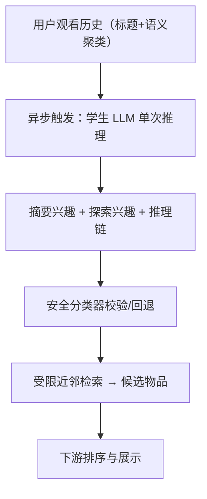
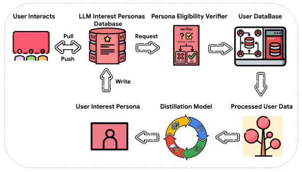

# LLM-Based User Personas for Recommendations at Scale (面向大规模推荐的 LLM 用户画像)

- **会议/期刊**: RecSys 2026 (Industry Track)
- **作者与机构**: Haoting Wang, Haokai Lu, Minmin Chen, Konstantina Christakopoulou, Ed Chi 等（Google / Google DeepMind）
- **推荐链路定位**: 召回（画像驱动的受限近邻检索）
- **研究方向**: 大语言模型推荐 / 强化学习与动态探索推荐
- **论文原文**: [https://arxiv.org/abs/2606.12198v2](https://arxiv.org/abs/2606.12198v2)
- **开源代码**: 暂未开源

## TL;DR (1分钟核心速览)

现有 LLM4Rec 依赖结构化 ID 或离线批处理，牺牲语义丰富度与实时性，且无法面向用户解释。本文在十亿级商业视频平台上，于**在线服务路径**中实时生成自然语言用户兴趣画像：单次推理同时产出「已有兴趣摘要（利用）」与「新颖探索主题（探索）」，并以知识蒸馏（Gemini 1.5 Pro → Nano/Flash）+ 异步推理 + 语义聚类输入压缩解决成本与延迟。离线 BLEURT、数千人用户调研与 30 天线上 A/B 测试共同验证：观看时长 +0.04%、活跃用户 +0.03%（$p<0.05$），探索兴趣点击率较摘要兴趣高 13.6%。

## Background & Motivation (背景与核心矛盾)

- **主流范式**: 工业 LLM4Rec 多将 LLM 用于离线生成内容/簇 ID 嵌入（如 TIGER 式语义 ID），或微调 LLM 做排序/二分类预测；用户表征仍以 ID 序列为主。
- **前人局限**: 其一，结构化 ID 输出牺牲了自然语言的细粒度语义，无法用于面向用户的兴趣解释；其二，同步式 LLM 推理在十亿用户规模下成本与延迟不可承受，故现有工作几乎全部离线预计算，无法响应用户即时意图。
- **核心洞察 (Key Insight)**: 用户历史经**语义聚类 + 标题结构化**后输入 LLM，可显著提升摘要具体度（顺序输入只输出 "bengali tv shows"，聚类输入则给出具体剧名）；且模型规模在 Pro→Ultra 间出现性能饱和，说明蒸馏到小模型可行。
- **本文切入点**: 把 LLM 画像生成从"离线数据处理器"改造为"在线实时推理引擎"，用蒸馏小模型 + 异步流水线嵌入核心服务路径，同时以探索兴趣打破反馈回路。

## Method (核心方法设计)

### 1. 整体框架 (Overall Architecture)

系统采用分层规划范式：高层由 LLM 生成语言策略（兴趣画像），低层由序列 Transformer + 受限近邻检索将文本兴趣落地到物品空间。线上请求先查画像库，命中即用；缺失或过期则触发异步后台任务重生成，当前请求不等待。后台任务完成历史过滤、语义聚类、标题采样、学生模型推理、安全分类器校验后写回库。画像中的摘要兴趣与探索兴趣各随机采样一条，经受限近邻检索映射为候选物品，进入下游排序。

<figure class="paper-figure" markdown="span">
  <figcaption>图2：异步在线推理示意图</figcaption>
</figure>

### 2. 关键设计拆解 (Key Designs)

1. **双目标单次推理画像生成（利用+探索）**：痛点在于传统画像只做兴趣归纳，强化既有反馈回路。本文用统一 Prompt 让 LLM 在一次调用中同时输出摘要兴趣与每个摘要对应的 3 个探索兴趣，探索项由 LLM 世界知识推理得到而非历史共现。直觉上，探索兴趣提供了系统排序模型"看不见"的高亲和主题，从而在源头注入新颖性。

2. **多步推理教师数据 + 知识蒸馏**：小模型直接做双任务时指令遵循率近乎为零（epoch 0 时 Nano 仅 0.07%）。作者将服务端统一 Prompt 拆解为多步 Chain-of-Thought 流程，由 Gemini 1.5 Pro 分别生成并精炼摘要与探索兴趣，仅保留格式与数量合规的响应（80/20 划分），再蒸馏至 Gemini Nano/Flash。蒸馏目标可写为最小化学生与教师在合规样本上的语义偏差：
$\mathcal{L}_{\text{distill}} = -\sum_{i \in \mathcal{D}_{\text{valid}}} \log p_{\theta_s}(y_i \mid x_i)$其中$y_i$为教师多步推理产出，$\mathcal{D}_{\text{valid}}$ 为通过格式质检的子集。有效性直觉：格式能力早饱和、语义质量持续爬升，说明蒸馏主要传递的是推理与语义归纳能力而非模板记忆。

3. **成本高效在线架构与输入优化**：异步解耦使生成频率与流量解耦，配合学生模型量化；输入侧用语义聚类（Infinite Concept Personalized Clustering，基于 salient term 余弦相似度增量聚类并剪枝小簇）压缩长历史，每簇采样少量标题代表。该设计将 prompt 长度从全序列降至簇级采样，直接降低 TPU 推理开销，同时聚类结构本身提升了输出具体度。

## Experimental Setup & Evaluation Protocol (实验设置与评估协议)

- **数据集与预处理**: 工业私有数据，未公开统计量。训练数据从数万合规用户采样，过滤不安全/敏感视频与负反馈项，按 80/20 划分训练/评估。

| 数据集 | #Users | #Items | #Interactions | 稀疏度/密度 | 特征/场景说明 |
| :--- | :---: | :---: | :---: | :---: | :--- |
| 工业视频平台（私有） | 数万采样用户 | 十亿级视频库 | 长观看序列 | 未披露 | 标题/描述/salient terms + 音视频嵌入 |
| 用户调研集 | 数千美国活跃用户 | — | — | — | 5 点 Likert 问卷 |
| 线上 A/B | 等量非重叠流量 | — | 30+ 天 | — | 十亿级真实服务 |

- **数据划分与防穿越 (Splitting Strategy)**: 教师响应按 `比例划分`（80% 训练 / 20% 评估）；线上实验为流量级随机分流，控制组与实验组用户不重叠。
- **排名评测协议 (Ranking Protocol)**: 非传统 Top-K 排序评测。离线用 BLEURT（以教师摘要为参考）、指令遵循率 IFR、LLM autorater 创造力评分；线上用观看时长、活跃用户数、参与主题数等业务指标，显著性 $p<0.05$。
- **对比基线与超参设置**: 离线对比 Gemini Flash / Nano 各 epoch checkpoint 与 Gemini Pro / Ultra 教师；用户调研对比知识图谱实体抽取式基线；线上对比现有生产推荐栈。学生模型选用 Gemini Nano（epoch 26.20）以满足延迟与成本约束。

## Key Experimental Results (实验关键数据)

### 1. 主实验对比 (Main Results)

离线蒸馏性能（节选关键 checkpoint）：

| 模型 | Epoch | IFR (%) | BLEURT | Creativity |
| :--- | :---: | :---: | :---: | :---: |
| Nano | 0.00 | 0.07 | N/A | N/A |
| Flash | 0.00 | 1.82 | 0.286 | -0.588 |
| Nano | 10.92 | 98.97 | 0.321 | -0.012 |
| Flash | 10.92 | 99.75 | 0.338 | 0.016 |
| Nano | 26.20 | 99.08 | 0.328 | -0.018 |
| **Flash** | **26.20** | **99.68** | **0.345** | **0.023** |

线上 A/B（30+ 天，$p<0.05$）：

| 指标 | 提升幅度 | 说明 |
| :--- | :---: | :--- |
| 观看时长 | **+0.04%** | 十亿级规模下绝对增量巨大 |
| 活跃用户数 | **+0.03%** | 留存侧正向 |
| 参与主题数 | **+0.04%** | 探索行为增加 |
| 多主题持续参与用户 | **+0.03%** | 偶发发现转为长期兴趣 |

用户调研：>80% 认为画像"非常/极其贴近"观看历史；71% 表示强烈想看更多相关视频；对比 KG 实体基线，57% 严格偏好 LLM 画像、20% 认为持平。

### 2. 消融实验 (Ablation Study)

| 配置 | 关键结果 | 结论 |
| :--- | :--- | :--- |
| 顺序输入（Prompt A.1） | 输出 "bengali tv shows"（过泛） | 无结构输入粒度粗 |
| 聚类输入（Prompt A.2） | 输出具体剧名列表 | 结构化显著提升具体度 |
| 嵌入聚类 vs 语义聚类 | 语义聚类画像质量更高（图 3a） | 语义簇优于感知簇 |
| 标题 vs 描述 vs salient terms | 标题最优 | 描述噪声大、salient 过泛 |
| Gemini Flash vs Pro vs Ultra | Pro/Ultra 显著优于 Flash，Pro→Ultra 饱和 | 蒸馏可行且必要 |

### 3. 关键实验发现 (Key Findings)

1. **蒸馏的"格式早饱和、语义慢爬升"规律**：IFR 在 epoch 10.92 即达 98.97%/99.75%，而 BLEURT 持续升至 26.20 的 0.328/0.345，说明格式能力可快速习得，语义归纳需长训练；Nano 最终 BLEURT 已接近大模型初始水平。
2. **探索兴趣是增益主来源但被排序压制**：探索兴趣检索物品曝光比摘要兴趣少 40.91%，但被展示后观看概率高 13.6%，证明下游排序模型存在新颖性偏见，探索价值需在召回侧强制注入。
3. **增益集中于休闲用户**：观看时长提升主要来自低活跃用户，归因于 LLM 画像在稀疏数据上推断更强、且休闲用户兴趣更集中，采样覆盖更充分。

## Highlights & Limitations (亮点、对比与审稿批判)

- **与代表作对比 (vs. Prior Work)**: 相较 TALLRec/PALR 等同步微调 LLM 做排序的工作，本文把 LLM 放在召回侧生成可解释画像并异步服务；相较 Fabbri 等仅 47 用户的离线画像验证，本文实现十亿级在线部署；相较依赖最近两个视频簇标签的工业方案，本文处理长历史并输出开放式自由文本。
- **可迁移亮点**: ①"语义聚类 + 标题采样"作为 LLM 长历史输入的压缩范式，可直接迁移到任意序列推荐 prompt 构造；②异步画像库 + 安全回退的工程模式，为 LLM 在线服务提供低延迟模板。
- **审稿级局限批判**: ①异步更新与瞬时兴趣存在固有滞后，论文仅称"可配置更新频率"而未量化滞后损失；②线上增益仅 +0.03%~0.04%，缺乏置信区间与多周稳定性曲线，且未报告推理成本/TPU 占用的绝对数字，工业可复现性受限。

## Rating (四维评分)

- **方法创新性 (Novelty)**: ⭐⭐⭐⭐ （双目标单次推理画像 + 蒸馏异步在线服务组合新颖，但单点技术多为工程集成）
- **评估协议与实验扎实度 (Protocol & Experiments)**: ⭐⭐⭐⭐ （离线+调研+30 天 A/B 三层验证完整，但缺传统排序指标与成本量化）
- **写作与数学规范度 (Clarity & Rigor)**: ⭐⭐⭐ （工程叙述清晰，但几乎无形式化定义与复杂度分析）
- **工业落地与复现价值 (Industrial & Practical Value)**: ⭐⭐⭐⭐⭐ （十亿级真实部署与完整架构描述，工业参考价值极高，可惜未开源）

