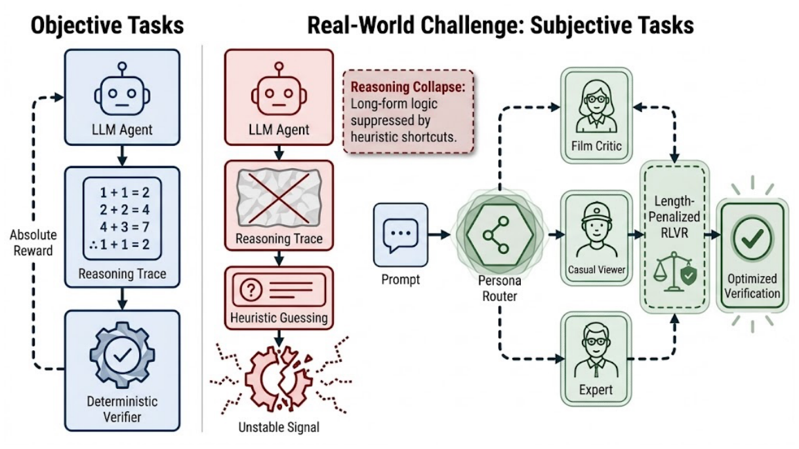
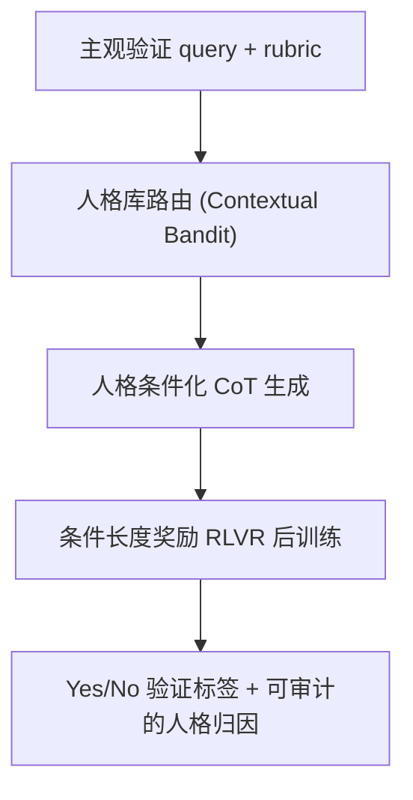

# LLM Reasoning for Subjective Tasks: Failure Modes, Mitigation, and Dynamic Reasoning Routing (面向主观任务的 LLM 推理：失效模式、缓解与动态推理路由)

- **会议/期刊**: RecSys 2026
- **作者与机构**: Juncheng Dong (Duke University)、Ding Tong、Ishan Gupta、Yuyan Wang (Netflix)
- **推荐链路定位**: 精排后置验证 / LLM-as-a-Judge 内容安全与质量审核
- **研究方向**: 大语言模型推荐 / 强化学习与动态探索推荐
- **论文原文**: [https://arxiv.org/abs/2608.08889v1](https://arxiv.org/abs/2608.08889v1)
- **开源代码**: 暂未开源

## TL;DR (1分钟核心速览)

推荐系统中的"正确性"是主观偏好而非二元真值，但业界正把 LLM 当作安全/质量规则的自主验证器。本文基于 Netflix 生产环境四个真实主观验证任务（对话查询敏感性、生成回复敏感性、文本/ID 回复质量）做大规模实证：显式 CoT 与专用推理模型在多数任务上**反而降低** macro-F1（如 Frontier-LLM 在 Query Sensitivity 上 0.901→0.887），标准 GRPO/Dr.GRPO/GSPO 会触发"推理崩溃"（约 70 步后平均生成长度骤降、退化为启发式猜测）。作者提出**条件长度惩罚奖励**（仅答对且未超长才给长度奖励），将 Qwen2.5-7B 从崩溃的 0.749 拉回 0.851；并发现 1500 个人格导致 macro-F1 波动近 0.38，据此提出人格路由的中训练蓝图。

## Background & Motivation (背景与核心矛盾)

- **主流范式**: RLVR（以 GRPO 为代表）在数学/代码等**客观可验证**任务上通过结果监督让 LLM 自学习长链推理，已成为后训练标配；RecSys 侧则大规模采用 "LLM-as-a-Judge" 做内容审核与查询验证。
- **前人局限**: ① 主观规则（文化敏感性、对话语气）缺乏确定性验证器，也没有"标准正确推理轨迹"，奖励信号无法干净归因到中间思考；② 数学预训练赋予模型的**刚性 monolithic 推理链**与人类中心 rubric 存在 socio-linguistic 错配，强行推理引入噪声与幻觉。
- **核心洞察 (Key Insight)**: 在主观域中，"不推理直接猜"的期望奖励上升快于"长推理"，策略会主动**压制长 CoT**——作者称之为 **reasoning collapse**（图 2：约 70 步后平均终止长度断崖式下跌）。这与数学 RLVR 中"长度与准确率同步上升"的成功签名恰好相反。
- **本文切入点**: 用**条件化长度奖励**在机械层面锁住推理预算，再用**人格路由**在语义层面解决推理风格错配。

<figure class="paper-figure" markdown="span">
  <figcaption>图1：（左）当预训练包含相关推理轨迹且验证器可靠时，RLVR 能增强推理。（中）推荐系统则面临没有正确轨迹或可靠验证器的主观任务，直接应用 RLVR 会引发严重的推理崩溃。（右）我们提出一种长度惩罚的 RLVR 算法来解决推理崩溃，并加入人格驱动推理，其中 LLM 首先从不同人格中学习多样化的推理偏差，然后针对每个主观任务在上下文中选择合适的偏差。</figcaption>
</figure>

## Method (核心方法设计)

### 1. 整体框架 (Overall Architecture)

论文是"诊断—修补—蓝图"三段式：先在三类提示（直接 JSON / 隐式解释 / 显式 `<reason>`+`<answer>`）与两档 effort 下量化推理对主观验证的伤害；再以 GRPO 系算法后训练复现崩溃，并用条件长度奖励修复；最后用 1500 人格合成实验证明推理风格是误差主因，给出"合成→SFT 中训练→RL 路由"的三步架构。推理解码阶段，路由器把主观 query 分派到最匹配的人格节点（如"共情版主"vs"严格政策执行者"），等价于一个上下文多臂老虎机。

### 2. 关键设计拆解 (Key Designs)

1. **条件长度奖励 (Conditional Length Rewarding)**：痛点是无约束长度奖励会被策略利用生成 8192 token 的重复乱码（F1 崩到 0.210），而目标约束惩罚只产出"连贯但无用的填充文本"（0.760）。本文把长度奖励**严格门控在答对之上**：

$$r_{total}=\begin{cases} r_{base}+\lambda L, & r_{base}=1,\ L<L_{target}\\ r_{base}, & \text{otherwise}\end{cases}$$

直觉：只有"答对"才配享有推理预算，且预算在 $L_{target}$ 处截断，既防上下文滥用又迫使长窗口被**功能性使用**。

2. **人格驱动推理与路由 (Persona-Driven Reasoning Routing)**：痛点是单一数学式推理链无法覆盖多元人类判断。作者从 roleplay 数据集合成 1500 个人格的推理轨迹，观察到同一任务上 macro-F1 从 0.416 到 0.792（跨度 0.38），说明大量"验证错误"实为**推理风格错配**。蓝图分三步：合成多样化 CoT → SFT 内化非数学推理模式 → 用 GRPO 教模型"**选哪种**推理偏置"而非"如何推理"。副产品是可解释性：路由选择本身即审计依据，人格库可随规则演进而重加权而无需全量重训。

3. **训练目标、负采样与推理效率**：奖励为二值正确性 $r_{base}\in\{0,1\}$ 加条件长度项，采用 GRPO 组内相对优势（无 critic、无独立负采样）；对比 Dr.GRPO（去长度/标准差归一化）与 GSPO（序列级重要性比）。推理侧条件奖励将生成长度稳定在约 960–990 token，相比崩溃后的 ~150 token 显著增加在线开销，但换来 F1 的净增益。

## Experimental Setup & Evaluation Protocol (实验设置与评估协议)

- **数据集与预处理**: 四个 Netflix 生产环境二分类（Yes/No）验证任务，均由内部安全与质量指南定义，人工标注为金标准；专有数据不可公开，仅报告协议与相对趋势。

| 数据集 | 任务类型 | 标签 | 说明 |
| :--- | :---: | :---: | :--- |
| Query Sensitivity | 对话查询敏感性 | 二分类 | 用户 query 是否触碰敏感规则 |
| Response Sensitivity | 生成回复敏感性 | 二分类 | 模型生成文本的安全性 |
| Text: Response Quality | 文本回复质量 | 二分类 | 基于 rubric 的质量判定 |
| ID: Response Quality | ID 回复质量 | 二分类 | 更难的评分标准，绝对值最低 |

- **数据划分与防穿越 (Splitting Strategy)**: 论文正文未披露具体划分比例，仅说明每任务采集 query 与人工验证标签，完整评测/训练协议见附录 A；属工业内部划分，非 LOO 或全局时间戳切分。
- **排名评测协议 (Ranking Protocol)**: 非排序任务，采用 **macro-F1**（5 次独立运行平均）作为主指标，辅以平均终止长度 (Len.) 监控崩溃；另设 Self-Consistency (K=8) 多数投票作为推理时扩展基线。
- **对比基线与超参设置**: 专有侧为 Frontier-LLM 与 Frontier-Reasoner（low/high effort）；开源侧为 Mistral-7B-Instruct（数学推理较弱）与 Qwen2.5-7B-Instruct（数学对齐强）；RL 算法含 GRPO、Dr.GRPO、GSPO；$L_{target}$ 约 1000 token，$\lambda$ 为缩放常数。

## Key Experimental Results (实验关键数据)

### 1. 主实验对比 (Main Results)

专有模型提示式验证（macro-F1，5 次平均）：

| Task | Frontier-LLM w/o Rea | Imp Rea | Exp Rea | Reasoner-low | Reasoner-high |
| :--- | :---: | :---: | :---: | :---: | :---: |
| Query Sensitivity | **0.901** | 0.893 | 0.887 | 0.895 | 0.874 |
| Response Sensitivity | **0.622** | 0.605 | 0.619 | 0.564 | 0.580 |
| Self-Consistency (K=8) | **0.690** | 0.593 | 0.574 | 0.615 | 0.623 |
| Text: Response Quality | **0.892** | 0.884 | 0.876 | 0.882 | 0.863 |
| ID: Response Quality | 0.513 | 0.517 | **0.520** | 0.503 | 0.502 |

开源模型与后训练（节选，macro-F1）：

| Task | Model | Base(Reason) | GRPO | Dr.GRPO | GSPO |
| :--- | :--- | :---: | :---: | :---: | :---: |
| Query Sensitivity | Mistral | 0.724 | 0.765 | 0.781 | **0.802** |
| Query Sensitivity | Qwen | **0.805** | 0.749 | 0.758 | 0.762 |
| Response Sensitivity | Mistral | 0.646 | 0.672 | 0.688 | **0.705** |
| Response Sensitivity | Qwen | **0.520** | 0.493 | 0.498 | 0.504 |
| Text: Resp. Quality | Qwen | 0.512 | 0.558 | 0.561 | **0.565** |
| ID: Resp. Quality | Mistral | 0.518 | 0.535 | 0.542 | **0.550** |

### 2. 消融实验 (Ablation Study)

奖励塑形消融（Qwen2.5-7B-Instruct，macro-F1 / 平均长度）：

| Configuration | Query Sens. F1 | Len. | ID: Resp. Qual. F1 | Len. |
| :--- | :---: | :---: | :---: | :---: |
| Base (no RLVR) | 0.805 | ~300 | 0.539 | ~280 |
| GRPO (collapse) | 0.749 | ~170 | 0.519 | ~150 |
| Unconstrained (I) | 0.210 | 8192 | 0.185 | 8192 |
| Target-constrained (II) | 0.760 | ~990 | 0.525 | ~950 |
| **Conditional (III, ours)** | **0.851** | ~980 | **0.572** | ~960 |

### 3. 关键实验发现 (Key Findings)

1. **推理在主观域是"可调项"而非"默认项"**：Frontier-LLM 去掉推理在 4/5 个设置上最优（Query Sensitivity 0.901 vs 显式推理 0.887），且推理时扩展（K=8 投票）把差距从 0.068 放大到 0.116，说明投票会强化无益推理。
2. **崩溃与模型数学先验强相关**：Qwen 在 GRPO 下 Query Sensitivity 从 0.805 跌至 0.749，Dr.GRPO/GSPO 仅微调至 0.758/0.762，无法救回；而数学较弱的 Mistral 在所有算法下单调增益（0.724→0.802），印证"monolithic 数学推理链"是负资产。
3. **条件奖励是唯一同时保住长度与精度的方案**：无约束奖励 F1 崩至 0.210（8192 token 乱码），目标约束仅 0.760（填充文本），条件奖励达 0.851，甚至在推理本无益的 ID: Response Quality 上从 0.539 提升到 0.572，反超无推理基线。

## Highlights, Limitations & Rating (亮点、对比与审稿评价)

- **与代表作对比 (vs. Prior Work)**: 相较 GRPO/Dr.GRPO/GSPO 等只修"优化偏置与方差"的 RLVR 变体，本文指出主观域的瓶颈是**奖励归因缺失 + 推理风格错配**，属问题定义层面的推进；相较常规 LLM-as-a-Judge 工作只报告"推理有/无"的粗粒度对比，本文给出了崩溃的训练动力学证据（长度曲线）与人格方差量化（0.38 F1）。
- **可迁移亮点**: ① "正确性门控 + 上限截断"的长度奖励可直接迁移到任何缺乏可靠验证器的生成式推荐/解释生成任务；② 把 RLVR 从"教如何推理"改写为"教选哪种推理偏置"，等价于上下文 bandit，可复用到多场景/多人群的推荐理由生成。
- **审稿级局限批判**: ① 人格路由仅为蓝图，未训练也未部署，1500 人格实验只是推理时提示合成，缺乏路由器的可行性验证与最坏情况评估；② 数据全部来自 Netflix 单一生产环境且不可公开，专有模型经 API 访问、供应商侧更新会使绝对值漂移，结论只能停留在相对趋势；③ 条件奖励把在线生成长度从 ~150 抬到 ~980 token，验证吞吐成本上升约 6 倍，论文未给出延迟/成本分析。
- **四维评分**: 创新性 ⭐⭐⭐⭐ | 实验扎实度 ⭐⭐⭐ | 方法清晰度 ⭐⭐⭐⭐⭐ | 落地价值 ⭐⭐⭐⭐

