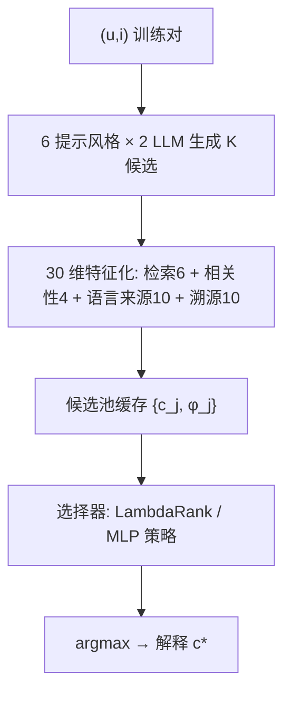

# Pairwise Ranking Outperforms Single-Action RL for Offline Explanation Selection: A Practical Lesson (成对排序优于单动作强化学习：离线解释选择的一条实践教训)

- **会议/期刊**: RecSys 2026 (Research and Practice Notes track 扩展版)
- **作者与机构**: Tanay Chowdhury, Saeideh Shahrokh Esfahani (Amazon)
- **推荐链路定位**: 重排（解释候选选择，位于推荐列表生成之后）
- **研究方向**: 大语言模型推荐 / 多任务学习与列表级重排
- **论文原文**: [https://arxiv.org/abs/2608.18531v2](https://arxiv.org/abs/2608.18531v2)
- **开源代码**: [https://github.com/amazon-science/XplainRecommendation](https://github.com/amazon-science/XplainRecommendation)

## TL;DR (1分钟核心速览)

工业可解释推荐若每请求调用 LLM 生成解释，延迟数百毫秒且成本随流量线性增长。本文把生成搬到离线：六种提示风格 × 两个商用 LLM 预生成冻结候选池，请求时由 CPU 端小选择器（LightGBM LambdaRank 或 ~1M 参数 MLP 策略）从 K 个候选中选一，无 GPU、p99 < 100ms。在 2,958 对 XRec Google Local 子集上，LambdaRank 取得 BERTScore-F1 = 0.500，较 G-Refer 8B 提升 +0.041、较 XRec 提升 +0.069；五种 RL/蒸馏变体（PPO/GRPO/DPO/蒸馏 A/A+B）全部落后，五种子方差 ≤ 0.003，排序统计显著。

## Background & Motivation (背景与核心矛盾)

- **主流范式**: XRec（GNN 偏好编码 + LLM 头）与 G-Refer（CF 邻居检索 + 8B LLM 合成）在公开基准上 F1 领先，但二者都在**请求路径上**调用 LLM，延迟数百毫秒、成本随 QPS 线性膨胀。
- **前人局限**: ① 生产级数万 QPS 下，内联 LLM 调用是系统复杂度的错误放置；② 端到端 RL 微调生成器（3B 模型、以 F1 为奖励）在数百步内即出现**奖励黑客**——策略收敛为重复输出 "user enjoys" 五次，因为该短语在参考文本中高频出现。
- **核心洞察 (Key Insight)**: 一旦候选池冻结，每个候选都携带稠密的 BERTScore-F1 标签，选择问题退化为**稠密标签的单步 bandit**；此时单动作 RL 每次 rollout 只用一个标签、丢弃其余 K−1 个，而 pairwise LTR 能消费全部监督信号。
- **本文切入点**: 解耦"生成"与"选择"，把 LLM 移出请求路径，用成对排序学习直接对齐部署目标（组内 argmax）。

## Method (核心方法设计)

### 1. 整体框架 (Overall Architecture)

离线阶段：对每个 $(u,i)$ 训练对，用六种提示风格（A 检索式复述、B 检索式综合、C 2-shot kNN 检索、D 评论 CoT、E 对抗精炼、F 长度调优 25–33 词）× 两个 Bedrock 商用 LLM（Nova Lite、Claude Haiku）交叉生成 $K$ 个候选（Google Local $K=40$，MovieLens 因无评论数据去掉 C/D/E 后 $K=18$）；每个候选映射为 30 维特征向量并按 $(u,i)$ 缓存。在线阶段：选择器对缓存候选打分取 argmax，LambdaRank 为一次 LightGBM 前向（<1ms），MLP 策略为 4096→256→40 网络前向（<20ms），端到端 p99 < 100ms。

<figure class="paper-figure" markdown="span">
  <figcaption>图1：端到端可解释推荐流水线。离线阶段（上）：每个训练对（𝑢,𝑖）通过将六种提示风格（A–F）与两种商用 Bedrock 大语言模型（Amazon Nova Lite、Claude Haiku）交叉组合，扩展为 𝐾 个候选解释；每个候选解释映射为 30 维特征向量，分为参考侧检索特征（6）、查询–候选相关性特征（4）、语言与来源侧特征（10）以及溯源信号特征（10）；𝐾 个候选解释及其特征按训练对缓存。在线阶段（下）：请求时，选择器（LightGBM LambdaRank，或基于 MLP 的强化学习变体之一）对候选解释打分。</figcaption>
</figure>

### 2. 关键设计拆解 (Key Designs)

1. **30 维四组特征化（让选择器"看见"生成来源）**：痛点在于选择器无法区分候选来自哪种风格/模型。四组特征为：参考侧检索 6 维（到训练参考质心与高 F1 范例的余弦、到 top-5 SBERT 邻居的最大余弦及邻居 BERTScore 的均值/最大/标准差）、查询–候选相关性 4 维（到用户/物品画像余弦 + cross-encoder 对模板化 $(u,i)$ 提示的 logits，**唯一直接看到 $(u,i)$ 的特征组**）、语言与来源 10 维（词数、模板开头标志、数字/泛化正词计数、NER 标志、源评论评分与长度、池内检索排名）、溯源 10 维（六种风格与两个生成器的 one-hot + 源评论到用户画像/历史参考的余弦）。溯源 one-hot 使选择器能从数据中学到"某些风格/生成器系统性得分更高"，而非靠人工调提示。

2. **LambdaRank 成对排序（核心增量）**：将每候选 F1 分位分桶为标签，LightGBM `lambdarank` 目标（500 树、31 叶、lr=0.05）在约 130k 候选、5,000 个查询组上训练，推理取组内 argmax。其 $\Delta$NDCG 成对目标直接作用于组内序关系，与部署目标（选 top-1）完全一致，且**每个候选的标签都进入梯度**——这正是单动作 RL 的结构性缺口。

3. **单动作 RL 家族与稠密化尝试**：PPO 将选择建模为单步 MDP，状态 $s\in\mathbb{R}^{1536+64K}$（768 维用户 + 768 维物品 + K 个零填充 64 维候选槽），奖励 $r=\alpha R_{\text{struct}}+(1-\alpha)R_{\text{sem}}$，$\alpha=0.1$，配自适应熵系数（停滞 ×1.5、快学 ×0.7、熵 <0.5 再 ×1.3）。GRPO 去掉价值网络，改用组内 z-score 优势：
$$A(s,a)=\frac{R_{\text{sem}}[i,a]-\mu_a R_{\text{sem}}[i]}{\sigma_a R_{\text{sem}}[i]+\epsilon}$$
消融证实增益来自归一化而非去掉 value net（+0.01 F1 相同）。DPO 在单步 bandit 上采样至多 80 个满足 $F1(a^+)>F1(a^-)+\delta$（$\delta=2.0$）的偏好对，损失为带 F1 间隔加权的 $-\log\sigma(\beta_{\text{dpo}}[r_\theta(a^+|s)-r_\theta(a^-|s)])$，$\beta_{\text{dpo}}=0.1$。蒸馏 Stage A 用 LambdaRank 教师 softmax 软标签（$T=1.0$）以 KL 散度训练 MLP 学生 200 epoch；Stage A+B 再叠加 500 回合 GRPO 微调。

4. **训练目标与推理效率**：LambdaRank 无显式负采样——组内全部 K 个候选互为相对负例，监督天然稠密；RL 变体为 on-policy 单样本 rollout。推理侧 LambdaRank 模型仅 ~1.7MB，单核 <1ms，请求路径为 KV 缓存查找 + 一次 GBDT 前向，按公开 Bedrock/EC2 定价估算每查询成本比内联 8B LLM 低约三个数量级。

## Experimental Setup & Evaluation Protocol (实验设置与评估协议)

- **数据集与预处理**:

| 数据集 | #Users/Pairs | #Items | #Interactions | 稀疏度/密度 | 特征/场景说明 |
| :--- | :---: | :---: | :---: | :---: | :--- |
| Google Local (XRec split) | 94,663 训练对 / 2,958 测试对 | 2,495 有评论商户 | ~130k 训练候选 | — | 训练取 5,000 对（有评论覆盖）；测试 3,000 对剔除 42 个无覆盖对 |
| MovieLens-1M (内部校验) | 600 训练 / 300 测试 | — | 2,000 条 Sonnet-4.5 参考 | — | 位置切分（seed-42 打乱后），$K=18$ |

- **数据划分与防穿越**: Google Local 直接沿用 XRec 发布的 `trn.pkl`/`tst.pkl`，**无重划分**，并逐字节校验测试对 $(uid,iid)$ 与参考解释同 G-Refer 的 `google_pred.jsonl` 一致；MovieLens 为 seed-42 打乱后的位置切分。
- **排名评测协议**: 非全库排序，而是**组内 K 候选 argmax 选择**（closed-set selection）；指标为 BERTScore-F1（roberta-large、baseline rescale，与 XRec/G-Refer 评测代码逐字节一致）、BARTScore（`facebook/bart-large-cnn` 对数似然）、USR（唯一句比例，检测模板坍缩）。所有方法五种子平均。
- **对比基线与超参**: 三类共 9 个变体——KG 路径族 3 个（温度偏置随机游走 $\tau=1.5$、Menger 式边不相交枚举、MMR 重排 $\lambda=0.7$ + 双风格生成）、离线池族 6 个（结构启发式、LambdaRank、PPO、GRPO、DPO、蒸馏 A/A+B）；另与 XRec、G-Refer 8B 的发布数值及缓存预测重打分对比。RL 策略约 1.08M 参数，训练 500 回合。

## Key Experimental Results (实验关键数据)

### 1. 主实验对比 (Main Results)

| 方法 | Google Local F1↑ | Google Local BART↑ | Google Local USR↑ | MovieLens F1↑ | MovieLens USR↑ |
| :--- | :---: | :---: | :---: | :---: | :---: |
| XRec (发布值) | 0.4311 | −4.1647 | 0.9993 | – | – |
| G-Refer 8B (发布值) | 0.4592 | −3.3235 | 1.0000 | – | – |
| KG: 温度偏置随机游走 | 0.3258 | −3.576 | 1.000 | 0.2690 | 1.000 |
| KG: 边不相交枚举 | 0.3265 | −3.577 | 1.000 | 0.2703 | 1.000 |
| KG: MMR + 双风格 | 0.3252 | −3.577 | 1.000 | 0.2621 | 0.997 |
| 池内结构启发式 | 0.4444 | – | – | 0.2634 | – |
| PPO | 0.4581 | −3.354 | 0.976 | 0.2816 | 0.999 |
| GRPO | 0.4703 | −3.354 | 0.951 | 0.2830 | 0.999 |
| DPO | 0.4749 | −3.374 | 0.909 | 0.2936 | 0.999 |
| 蒸馏 A+B | 0.4767 | −3.356 | 0.925 | 0.2831 | 0.999 |
| 蒸馏 A | 0.4817 | −3.375 | 0.865 | 0.2887 | 1.000 |
| **LambdaRank** | **0.5003** | **−3.327** | 0.808 | **0.3291** | 0.987 |
| Improv. vs G-Refer | **+0.041** | — | — | — | — |
| Improv. vs XRec | **+0.069** | — | — | — | — |

### 2. 消融实验 (Ablation Study)

| 消融/变体 | Google Local F1 | Δ vs 完整方法 | 说明 |
| :--- | :---: | :---: | :--- |
| LambdaRank（完整） | 0.5003 | — | 成对排序 + 全候选标签 |
| w/o 学习（结构启发式） | 0.4444 | −0.0559 | 无监督下界，证明特征化有效 |
| 蒸馏 A（软标签压缩） | 0.4817 | −0.0186 | softmax 压缩丢失 argmax 锐度 |
| 蒸馏 A+B（+GRPO 微调） | 0.4767 | −0.0236 | 熵奖励把近收敛策略推回探索，>10σ 退化 |
| PPO → GRPO（z-score 替代 value baseline） | 0.4581 → 0.4703 | +0.0122 | 增益来自组内归一化稠密化 |
| 生成器池换 Haiku 4.5（LambdaRank） | 0.5003 → 0.4983 | −0.0020 | 排序保持，绝对 F1 非生成器不变 |

### 3. 关键实验发现 (Key Findings)

1. **稠密监督是胜负手，而非算法优劣**：LambdaRank 在 Google Local 领先最强 RL 变体（蒸馏 A）0.019 F1、领先 PPO 0.042；在 MovieLens 领先 DPO 0.036。机制是结构性的——每组 40 个候选全部带 F1 标签，pairwise 目标全部消费，而 PPO/GRPO/DPO 每次 rollout 只看 1 个奖励、其余 39 个标签对梯度不可见。
2. **五种子协议下 0.002 F1 即可显著**：各 RL 方法跨种子标准差 ≤ 0.0030，GRPO 与 DPO 的 0.0046 差距超过十倍标准差；DPO 换生成器后 −0.006 约 6σ、蒸馏 A 的 −0.004 约 13σ，说明单种子比较在该文献中不可靠。
3. **KG 路径族的 F1 天花板由图拓扑而非选择器决定**：三个 KG 变体在 Google Local（39k 节点、12+ 实体类型）均落在 0.325–0.327，在 MovieLens（仅 18 个 genre 枢纽节点）跌至 0.262–0.270，约 0.06 的落差归因于可达路径多样性；但其 USR 达 1.000/0.997–1.000，以 F1 换取了输出多样性与图边可溯源。

## Highlights, Limitations & Rating (亮点、对比与审稿评价)

- **与代表作对比 (vs. Prior Work)**: XRec 与 G-Refer 均把 LLM 放在请求路径上，本文将其完全移出；与 PGPR 等图 RL 遍历方法不同，本文不做排序遍历而是在预生成池上选择；与标准 RLHF/DPO 应用不同，本文指出在稠密标签单步 bandit 中 pairwise LTR 应作为 RL 之前的必测基线。
- **可迁移亮点**: ① "冻结候选池 + 轻量 CPU 选择器"可迁移到任何 LLM 生成式重排/文案选择场景，把生成成本摊薄为离线批任务；② 溯源 one-hot 特征让选择器自动学到生成器/提示风格偏好，免去提示工程迭代；③ 五种子 + 跨生成器池的鲁棒性检验范式值得在 LLM4Rec 评测中推广。
- **审稿级局限批判**: ① MovieLens 仅 300 对测试且参考文本由 Claude-Sonnet-4.5 生成，作者自认只是"文内一致性证据"而非第二基准，泛化性证据偏弱；② 成本与延迟均为离线缓存池上的单进程合成负载测量，未做线上 A/B 或影子流量，三个数量级的成本比来自公开定价推算；③ 候选池需随物品元数据变更刷新，选择器漂移未在生产中验证。
- **四维评分**: 创新性 ⭐⭐⭐ | 实验扎实度 ⭐⭐⭐⭐ | 方法清晰度 ⭐⭐⭐⭐⭐ | 落地价值 ⭐⭐⭐⭐⭐

