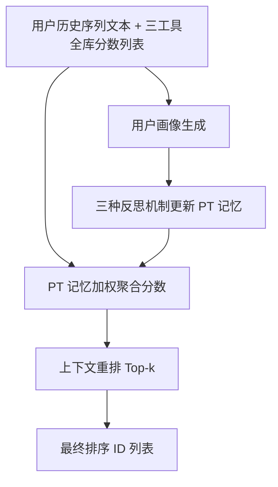
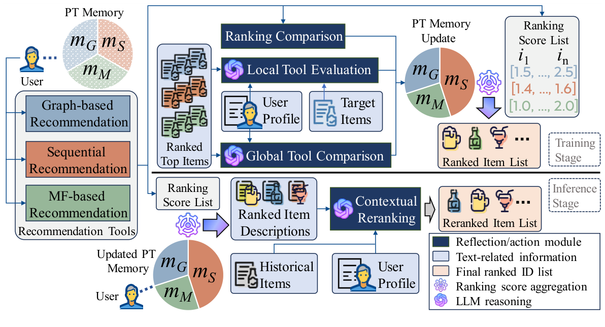

# Personalized Recommendation Tool Learning via Autonomous Language Agents (基于自主语言智能体的个性化推荐工具学习)

- **会议/期刊**: RecSys 2026 (Short Paper)
- **作者与机构**: Mingdai Yang, Zhiwei Liu, Weizhi Zhang, Yibo Wang, Hao Peng, Philip Yu (UIC / Microsoft / 北航)
- **推荐链路定位**: 重排（多路召回结果聚合 + 上下文重排）
- **研究方向**: 大语言模型推荐 / 列表级重排
- **论文原文**: [https://arxiv.org/abs/2607.19739v1](https://arxiv.org/abs/2607.19739v1)
- **开源代码**: [https://github.com/mdyfrank/RecToolAgent](https://github.com/mdyfrank/RecToolAgent)

## TL;DR (1分钟核心速览)

LLM 直接做推荐存在幻觉（生成不存在的物品 ID）与上下文长度限制，无法在全库上排序，已有 agent 工作只能做"目标物品 vs 少量采样负例"的伪评估。本文提出 PRTA：把 LightGCN / SASRec / SimpleX 三个传统推荐模型当作"工具"，由 LLM 智能体通过局部工具评估、全局工具比较、排序比较三种反思机制为每个用户学习一组工具权重（PT 记忆），推理时加权聚合分数并对 Top 项做上下文重排。在 Amazon / Yelp / Goodreads 三个数据集的无偏 Full-Ranking 协议下，R@10 相对最优基线提升 60.0% / 30.8% / 68.8%。

## Background & Motivation (背景与核心矛盾)

- **主流范式**: 一条线是把 LLM 当推荐器（指令微调或 zero-shot 排序），另一条线是把 LLM 当推理型 agent，配合记忆模块注入用户历史与协同信号。
- **前人局限**: 其一，LLM 会生成目录中不存在的物品或无法映射回合法 ID，靠 prompt 约束高度依赖指令遵循能力；其二，token 上限使其无法对全库排序，因此现有 agent 工作普遍退化为"目标物品 vs 采样负例"的评估，与真实推荐场景脱节。
- **核心洞察 (Key Insight)**: 幻觉与长度限制是 LLM 的固有属性，与其在模型内部（微调、精巧 prompt、外部校验器）硬解，不如在**架构层面绕开**——让擅长行为建模的传统模型负责全库打分，让擅长语义理解的 LLM 只负责"选哪个工具、怎么融合"。
- **本文切入点**: 将多范式推荐模型编排为工具集，用可解释的 per-user 权重向量（PT 记忆）承载个性化工具选择，并用三种反思信号在线优化该记忆。

## Method (核心方法设计)

### 1. 整体框架 (Overall Architecture)

输入是用户历史行为序列的文本描述与三个预训练推荐工具输出的全库分数列表。训练阶段，LLM 先由历史物品描述生成用户画像 $y_{\text{prof}}$，再通过局部工具评估、全局工具比较、排序比较三条反思路径更新该用户的 PT 记忆$\mathbf{m}\in\mathbb{R}^{1\times d}$（$d=3$）。推理阶段，按 PT 记忆对三路分数加权求和得到聚合排序$\hat{\mathbf{r}}$，再由 LLM 结合画像与近期行为对 Top-$k'_{\text{rank}}$ 项做上下文重排，输出最终 ID 列表。整个流程中 LLM 从不直接生成物品 ID，幻觉被架构性消除。

<figure class="paper-figure" markdown="span">
  <figcaption>图1：PRTA 的框架。每个用户智能体配备一个 PT 记忆，用于存储个性化工具偏好，并通过本地工具评估、全局工具比较和排序比较进行优化。推理时，基于 PT 记忆聚合多个工具的排序分数，并由上下文重排序模块对排名靠前的项目进行精炼。</figcaption>
</figure>

### 2. 关键设计拆解 (Key Designs)

1. **PT 记忆与加权分数聚合（可解释的个性化工具选择）**：痛点是不存在一个对所有用户都最优的推荐范式。做法是为每个用户维护一个工具权重向量，最终排序为加权和 $\hat{\mathbf{r}}=\sum_{t\in\mathcal{T}}m_t\hat{\mathbf{r}}_t$。权重本身即决策解释，且聚合发生在分数空间而非 ID 空间，天然规避幻觉。

2. **三重反思机制（把"哪个工具更懂这个用户"变成可优化信号）**：
   - *局部工具评估*：让 LLM 判断某工具 Top-$k_{\text{eval}}$列表与用户最近$k$个未见物品的相关性，输出$y^t_{\text{eval}}\in\{-1,0,1\}$，更新$m_t\leftarrow m_t+\alpha\cdot y^t_{\text{eval}}$。
   - *全局工具比较*：在三个工具的候选列表间做横向选择，输出二值指示 $y^t_{\text{comp}}\in\{0,1\}$，更新$m_t\leftarrow m_t+\beta\cdot y^t_{\text{comp}}$，弥补局部评估缺乏权衡的缺陷。
   - *排序比较*：用近期物品在各工具下的真实排名做无 LLM 的客观校正，$m_t\leftarrow m_t+\sum_{j}\frac{(r^j_t)^{-1}}{\sum_{t'}(r^j_{t'})^{-1}}$，抑制 LLM 文本判断的偏差。

3. **训练目标、负采样与推理效率**：本文无梯度训练，PT 记忆以"LLM 反思 + 排名倒数加权"的在线加性规则更新，$\alpha,\beta$初始 0.1、每 epoch 衰减 0.5；三个工具本身按常规序列推荐目标（如 BPR/CE）在**全量用户**上预训练，不参与联合优化。LLM 调用总数为$4nt+2n$（$n$用户数、$t$ 训练轮数），单用户生成最终列表在 V100-32GB 上 < 0.5 秒，适合离线排序或二级重排。

## Experimental Setup & Evaluation Protocol (实验设置与评估协议)

- **数据集与预处理**: 按时间戳组织交互序列，采用 leave-one-out 构造序列任务。

| 数据集 | #Users | #Items | #Interactions | 场景说明 |
| :--- | :---: | :---: | :---: | :--- |
| Amazon | 1,054 | 1,839 | 35,492 | Movies & CDs，文本语义一致性强 |
| Yelp | 4,303 | 3,429 | 258,486 | 本地商户，文本信息对偏好指示弱 |
| Goodreads | 3,204 | 2,167 | 246,034 | 图书，系列作品连续消费明显 |

- **数据划分与防穿越 (Splitting Strategy)**: `Leave-One-Out`；工具预训练时屏蔽最近 $k$ 个交互，反思与重排只使用这部分"工具不可见"的近期物品，防止信息泄漏。
- **排名评测协议 (Ranking Protocol)**: 无偏 `Full-Ranking`，对全物品目录排序，指标 R@10/20、N@10/20。这是本文相对既有 LLM-agent 工作（采样排序）最关键的协议升级。
- **对比基线与超参设置**: 基线含三个工具本身、RecBole 系（ENMF、DiffRec、FEARec）、语言类（BM25、LLMRanker）以及三个 RAG 变体（LightGCN$_{RAG}$等，LLM 重排单工具 Top-50）。骨干 LLM 为量化版 Phi-4，vLLM 本地部署，temperature=0；$k_{\text{eval}}=k_{\text{comp}}=k'_{\text{rank}}=20$；每数据集随机采样 160 个 agent 仅用于控制 LLM 调用成本（该阶段按用户 embarrassingly parallel，可线性扩展）。

## Key Experimental Results (实验关键数据)

### 1. 主实验对比 (Main Results)

| 方法 | Amazon R@10 | Amazon N@10 | Yelp R@10 | Yelp N@10 | Goodreads R@10 | Goodreads N@10 |
| :--- | :---: | :---: | :---: | :---: | :---: | :---: |
| LightGCN | 0.0250 | 0.0111 | 0.0438 | 0.0216 | 0.0625 | 0.0244 |
| SASRec | 0.0438 | 0.0206 | 0.0688 | 0.0413 | 0.1000 | 0.0539 |
| SimpleX | 0.0188 | 0.0147 | 0.0500 | 0.0232 | 0.0438 | 0.0227 |
| DiffRec | 0.0438 | 0.0199 | 0.0813 | 0.0480 | 0.0688 | 0.0331 |
| FEARec | 0.0500 | 0.0189 | 0.0688 | 0.0305 | 0.0563 | 0.0283 |
| LLMRank | 0.0125 | 0.0089 | 0.0000 | 0.0000 | 0.0125 | 0.0044 |
| SASRec$_{RAG}$ | 0.0625 | 0.0322 | 0.0625 | 0.0282 | 0.0188 | 0.0108 |
| **PRTA** | **0.1000** | **0.0535** | **0.1063** | **0.0598** | **0.1688** | **0.0809** |
| Improv.% | +60.00% | +66.15% | +30.75% | +24.58% | +68.80% | +50.09% |

### 2. 消融实验 (Ablation Study)

| 配置 | Amazon N@10 | Yelp N@10 | Goodreads N@10 | 说明 |
| :--- | :---: | :---: | :---: | :--- |
| w/o LLM | ≈单工具水平 | ≈单工具水平 | ≈单工具水平 | 仅排序比较，无推理重排 |
| w/o LTE | 下降 | 下降明显 | 下降 | 去掉局部工具评估 |
| w/o GTC | 小幅下降 | 小幅下降 | 小幅下降 | 去掉全局工具比较 |
| w/o CR | 下降最大 | 下降较小 | 下降 | 去掉上下文重排 |
| **PRTA** | **0.0535** | **0.0598** | **0.0809** | 完整模型 |

### 3. 关键实验发现 (Key Findings)

1. **架构解耦是主要增益来源**：去掉全部 LLM 模块后性能回落到单工具水平（Amazon N@10 从 0.0535 跌至约 0.02–0.03 量级），说明收益并非来自 LLM 的世界知识，而是来自"多工具聚合 + 个性化权重"这一架构本身。
2. **上下文重排的收益与文本信息量强相关**：Amazon 上 CR 贡献最大（物品描述与用户行为语义一致），Yelp 上 CR 收益反而小于局部工具评估——商户文本对偏好指示弱，LLM 的语义精修空间有限。这提示该模块应按域启用而非无脑堆叠。
3. **PT 记忆学到了符合直觉的范式偏好**：KDE 图显示 SASRec 权重集中在 1 附近、SimpleX 集中在 0 附近，Goodreads 上尤为明显（系列图书连续消费），说明序列范式与用户真实行为最一致，而 MF 范式语义一致性最差，被智能体系统性降权。

## Highlights & Limitations (亮点、对比与审稿批判)

- **与代表作对比 (vs. Prior Work)**: 相比 LLMRank 这类 zero-shot 排序器，PRTA 不在 ID 空间生成、不做全库比较，因而在 Full-Ranking 下不会崩到接近 0；相比 SASRec$_{RAG}$ 这类单检索器 + LLM 重排，PRTA 重排的是多工具聚合后的高置信候选，避免了单一检索器偏差被 LLM 放大（RAG 变体在 Goodreads 上甚至低于基模型）；相比其他 LLM-agent 推荐工作，本文是少数敢于报告全库排序结果的。
- **可迁移亮点**: (1) "分数空间聚合 + ID 空间不生成"是抑制 LLM 幻觉的通用工程范式，可直接迁移到生成式推荐的合法性约束；(2) 用真实排名倒数做权重更新，是一种零成本的客观信号，可替代昂贵的 LLM 自评。
- **审稿级局限批判**: 其一，仅 160 个用户 agent 参与 LLM 阶段，虽作者辩称可线性扩展，但实验覆盖度与统计显著性检验缺失，$p<0.05$ 未报告；其二，工具集固定为三个且均为 ID-based 模型，未验证对生成式检索器、多模态工具的可扩展性，且每用户 < 0.5s 的延迟对在线精排仍偏重，实际定位只能是离线或二级重排。

## Rating (四维评分)

- **方法创新性 (Novelty)**: ⭐⭐⭐⭐ （"LLM 只做规划、传统模型做全库打分"的解耦思路清晰且切中幻觉痛点，但工具学习与记忆反思的组合在 agent 文献中已有较多先例，属稳健工程创新而非理论突破）
- **评估协议与实验扎实度 (Protocol & Experiments)**: ⭐⭐⭐⭐ （坚持 Full-Ranking 无偏评估并明确剔除无法全库排序的 agent 基线，态度严谨；扣分在于用户采样规模小、缺显著性检验与更多数据集）
- **写作与数学规范度 (Clarity & Rigor)**: ⭐⭐⭐⭐ （六页短文公式紧凑、三种反思机制的更新规则一目了然，但 PT 记忆更新的收敛性、$\alpha/\beta$ 敏感性均未做理论或实验分析）
- **工业落地与复现价值 (Industrial & Practical Value)**: ⭐⭐⭐⭐ （代码开源、工具可插拔、聚合在分数空间实现简单，天然适配现有召回-重排级联；主要障碍是 LLM 调用成本与延迟）

