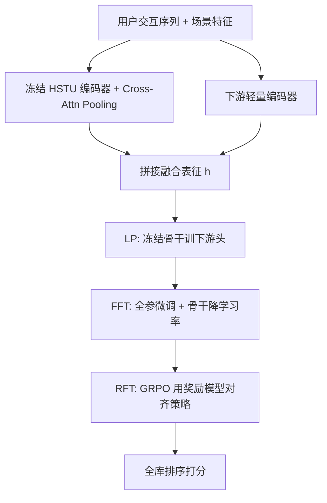
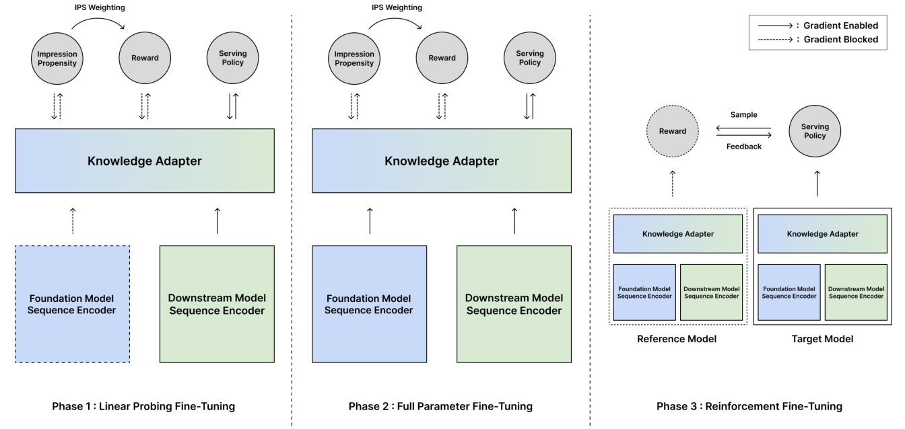

# Progressive Alignment of Recommender Foundation Model through Multi-Phase Post-Training (推荐基础模型的多阶段渐进式后训练对齐)

- **会议/期刊**: RecSys 2026 (Industry Track)
- **作者与机构**: Oseong Choi, Hoeinn Kim, Jihoon Lee, Byungsoo Kang, Taeyeong Jang (NAVER WEBTOON)
- **推荐链路定位**: 精排（内容发现场景的排序策略）
- **研究方向**: 大语言模型推荐 / 强化学习与动态探索推荐
- **论文原文**: [https://arxiv.org/abs/2608.06792v1](https://arxiv.org/abs/2608.06792v1)
- **开源代码**: [https://github.com/webtoon/rec-fm-progressive-alignment](https://github.com/webtoon/rec-fm-progressive-alignment)

## TL;DR (1分钟核心速览)

推荐基础模型（FM）经 SFT 适配下游任务时，任务目标（点击/点赞）与真实业务指标（付费完读）并不一致，而直接用稀疏业务标签监督又难以泛化。本文提出 LP→FFT→RFT 三阶段渐进式后训练：先用冻结骨干的线性探测稳定随机初始化的下游头，再全参微调（骨干学习率降一个量级），最后以业务漏斗序数回归学得的奖励模型驱动 GRPO 对齐策略。离线全库 Rank NDCG 从 0.437 提升至 0.463，Funnel NDCG 0.625→0.637；线上 A/B 中所有 FM 变体全面优于非 FM 的 CTR/CVR 乘积基线，GRPO w/ RM 在深层漏斗指标上增益最大。

## Background & Motivation (背景与核心矛盾)

- **主流范式**: 大规模自回归序列推荐已呈现 scaling law，工业界以「基础模型–专家」框架（共享 FM 表征 + 轻量任务模块）通过 SFT 适配多个服务场景。
- **前人局限**: 其一，单步 SFT 中随机初始化的下游模块产生高方差梯度，在学到有效表征前就扰动骨干，引发灾难性遗忘；其二，SFT 优化的点击/点赞目标与决定推荐质量的业务指标（留存、付费转化）存在系统性错位，而业务标签本身稀疏且延迟。
- **核心洞察 (Key Insight)**: 稠密隐式反馈能训练出判别力强的服务策略，稀疏业务监督则更适合训练「效用估计器」。二者角色应当分离——业务指标不该直接当排序分，而应作为对齐信号。
- **本文切入点**: 把「知识适配」与「业务对齐」显式拆成三个阶段，奖励模型只负责提供稠密标量奖励，策略仍在稠密反馈上训练。

## Method (核心方法设计)

### 1. 整体框架 (Overall Architecture)

输入为用户交互序列与场景侧特征：冻结的 HSTU 序列编码器（约 7M 参数）产出序列嵌入，经可学习 query 的 cross-attention pooling 压缩为 $h_{\text{fm}}$，与下游轻量编码器输出的$h_{\text{ds}}$拼接成$h=[h_{\text{fm}};h_{\text{ds}}]$，送入策略头、序数奖励头与曝光倾向头。训练分三阶段：LP 阶段冻结骨干只训下游组件；FFT 阶段解冻全部参数并以 0.1 倍学习率约束骨干；RFT 阶段冻结奖励/倾向模型，用 GRPO（或 DPO）在 top-32 候选组内对齐策略。推理时策略头输出全库排序分。

<figure class="paper-figure" markdown="span">
  <figcaption>图2：基础推荐模型的三阶段渐进式后训练流程。实线表示梯度流，虚线表示冻结或分离的参数。</figcaption>
</figure>

### 2. 关键设计拆解 (Key Designs)

1. **序数奖励模型 + 曝光倾向去偏（IPS-SNIPS）**：业务漏斗是六级有序阶段（曝光→点击→首集→免费完读→进入付费→付费完读），直接用回归会丢失序关系。作者对 $C=5$个切点构造序数目标$t_{u,v,c}=\mathbb{I}(f>c)$，奖励头输出各切点 logit$\hat{z}_{u,v,c}$，并以倾向头估计的曝光概率做自归一化逆倾向加权：
$$\tilde{w}_{u,v}=\frac{s_{u,v}}{\sum_{(u',v')\in\mathcal{D}_r}s_{u',v'}},\quad s_{u,v}=\min\!\left(\frac{1}{\hat{p}_{u,v}},\tau_{\text{IPS}}\right)$$
损失为 $\mathcal{L}_{\text{reward}}=\sum\tilde{w}_{u,v}\sum_c \text{BCE}(\hat{z}_{u,v,c},t_{u,v,c})$，推理时聚合为连续奖励$R_\phi(u,v)=\sum_c\sigma(\hat{z}_{u,v,c})$。直觉：序数回归保留漏斗深度的单调性，IPS 修正历史曝光策略造成的选择偏差，使低频曝光物品的奖励估计仍然可信。

2. **LP→FFT 渐进适配 + 判别式学习率**：单步 FFT 时下游头梯度方差大，会先污染骨干。LP 阶段冻结骨干、仅优化 $\mathcal{L}_{\text{SFT}}=\mathcal{L}_{\text{policy}}+\mathcal{L}_{\text{reward}}+\mathcal{L}_{\text{prop}}$中的下游参数，让随机初始化的头先在稳定表征空间中收敛；FFT 阶段解冻全部参数，但骨干学习率取下游的$1/10$（$10^{-5}$vs$10^{-4}$）。直觉：先「对齐语义空间」再「联合特化」，优化条件数更好，骨干只需保守共适应。

3. **GRPO 对齐与训练目标**：以 FFT 末快照为冻结参考策略 $\pi_{\text{ref}}$，对每个用户状态贪心取 top-$K$（$K=32$）候选，组内归一化优势$A_k=(R_\phi(a_k)-\bar{R})/\sigma_R$，裁剪代理目标加 KL 正则：
$$\mathcal{L}(\theta)=-\mathbb{E}_k\Big[\min\big(\rho_k(\theta)A_k,\ \text{clip}(\rho_k(\theta),1-\epsilon,1+\epsilon)A_k\big)\Big]+\beta D_{\text{KL}}\big(\pi_\theta\|\pi_{\text{ref}}\big)$$
其中 $\rho_k=\pi_\theta(a_k)/\pi_{\text{ref}}(a_k)$，$\epsilon=0.1$，$\beta=0.001$。无需负采样（组内相对比较即隐式负例），也无需 value 网络。另给出 DPO 变体：由奖励模型构造偏好对$\mathcal{P}=\{(a_i,a_j)\mid R_\phi(a_i)>R_\phi(a_j)\}$，优化$-\mathbb{E}\log\sigma(\beta(\Delta_i-\Delta_j))$。

## Experimental Setup & Evaluation Protocol (实验设置与评估协议)

- **数据集与预处理**: 韩国 Webtoon 生产平台最近三周交互日志，随机抽 10% 用户构造测试集，评估其窗口内会话。下游任务为「内容发现」（推荐用户未消费过的作品），额外引入免费集/付费集消费与追更等长周期行为统计特征。

| 数据集 | #Users | #Items | #Interactions | 稀疏度/密度 | 特征/场景说明 |
| :--- | :---: | :---: | :---: | :---: | :--- |
| Webtoon 生产日志（近 3 周） | 10% 用户为测试集（原文未披露绝对值） | 全库作品目录 | 原文未披露 | 原文未披露 | 六级参与漏斗标签 + 曝光日志 + 长周期行为统计 |

- **数据划分与防穿越 (Splitting Strategy)**: 按最近三周时间窗口切分，测试用户会话取自评估窗口，属时间切分 + 用户留出混合协议。
- **排名评测协议 (Ranking Protocol)**: 双指标互补。**Rank NDCG** 为无偏 Full-Ranking——对全库作品打分，点击为二值相关；**Funnel NDCG** 仅在会话内实际曝光作品集合 $\mathcal{S}$上排序，以漏斗最深阶段为分级相关度$r_v\in\{0,\dots,L\}$。
- **对比基线与超参设置**: 骨干为 HSTU 编码器（约 7M 参数）。1-phase 基线训 100 epoch；2-phase 各 50 epoch（LP lr $10^{-3}$，FFT lr$10^{-4}$，骨干$10^{-5}$）；RFT 从 2-phase checkpoint 再训 50 epoch（策略 lr$10^{-5}$，骨干$10^{-6}$）。线上对比 CTRL（非 FM 的 CTR×CVR 多任务基线）、SFT、GRPO w/ RM、DPO w/o RM，显著性$p<0.001$。

## Key Experimental Results (实验关键数据)

### 1. 主实验对比 (Main Results)

原文离线主表即消融表（表 1），线上结果以图 3 的相对提升呈现，此处合并关键数值：

| 模型配置 | Rank NDCG | Funnel NDCG | 相对 2-Phase SFT 的 Rank 提升 |
| :--- | :---: | :---: | :---: |
| 1-Phase SFT (Only FFT) | 0.429 | 0.620 | −1.8% |
| 1-Phase SFT (Only LP) | 0.426 | 0.620 | −2.5% |
| 2-Phase SFT (LP→FFT, w/o LR Control) | 0.434 | 0.622 | −0.7% |
| 2-Phase SFT (LP→FFT, w/ LR Control) | 0.437 | 0.625 | 基线 |
| Reward Model-Based Policy（直接当排序器） | 0.394 | **0.637** | −9.8% |
| GRPO w/o RM（观测漏斗偏好） | 0.441 | 0.627 | +0.9% |
| DPO w/ RM | 0.423 | 0.630 | −3.2% |
| DPO w/o RM（观测漏斗偏好） | 0.453 | **0.637** | +3.7% |
| **GRPO w/ RM（本文完整框架）** | **0.463** | **0.637** | **+5.9%** |

线上 A/B（图 3，相对 CTRL 的差分中的差分）：所有 FM 变体在 Click/Imp、Engaged/Imp、LastFree/Imp、LastPaid/Imp 上均显著为正（$p<0.001$）；GRPO w/ RM 在 Engaged/Imp 与 LastFree/Imp 上增益最大，LastPaid/Imp 上持续领先；DPO w/o RM 在 Click/Imp 上增益最大。

### 2. 消融实验 (Ablation Study)

| 消融维度 | 移除/替换内容 | Rank NDCG | Funnel NDCG | 结论 |
| :--- | :--- | :---: | :---: | :--- |
| 阶段数 | 2-Phase → 1-Phase (FFT) | 0.437→0.429 | 0.625→0.620 | LP 预热不可省 |
| 学习率控制 | 去掉骨干降 lr | 0.437→0.434 | 0.625→0.622 | 骨干保守更新有效 |
| 对齐信号 | GRPO w/ RM → w/o RM | 0.463→0.441 | 0.637→0.627 | 学得奖励优于原始漏斗标签 |
| 对齐算法 | GRPO → DPO (w/ RM) | 0.463→0.423 | 0.637→0.630 | 连续奖励转成对偏好损失信息 |
| 角色分离 | 策略 → 直接用奖励模型排序 | 0.463→0.394 | 0.637→0.637 | 奖励模型判别力不足 |

### 3. 关键实验发现 (Key Findings)

1. **奖励模型「会看不会排」**：直接以奖励模型排序，Funnel NDCG 达 0.637（与最佳对齐策略持平），但 Rank NDCG 仅 0.394，比 SFT 基线低 9.8%——证明稀疏业务标签学到的分数只捕捉效用方向，缺乏全库判别力，必须作为对齐信号而非服务分。
2. **对齐算法决定漏斗侧重**：GRPO w/ RM 把 Rank NDCG 从 0.437 推到 0.463（+5.9%）且 Funnel 持平 0.637；DPO w/ RM 反而掉到 0.423，说明把连续奖励压成二值偏好对会丢弃奖励幅度信息并放大噪声，而 DPO 改用观测漏斗偏好则回升至 0.453。
3. **线上增益随时间收敛但排序稳定**：所有 FM 变体上线初期提升明显、数日内回落，随后稳定在显著正水平；LastPaid/Imp 上 GRPO w/ RM > DPO w/o RM > SFT 的相对次序在整个一个月实验窗口内保持不变，说明深层漏斗增益具有持续性而非新奇效应。

## Highlights & Limitations (亮点、对比与审稿批判)

- **与代表作对比 (vs. Prior Work)**: 相比 LP-FT 两阶段范式（Kumar et al.），本文增加 RFT 阶段把业务指标引入对齐；相比 LLM 中的 RLHF/GRPO 直接以人类偏好为奖励，本文将奖励源替换为带 IPS 去偏的序数漏斗模型，解决推荐场景曝光偏差；相比直接用奖励模型做排序的工业做法，本文用实验证明「对齐信号 ≠ 服务策略」。
- **可迁移亮点**: ①「稠密信号训策略、稀疏信号训奖励」的角色分离原则可迁移到任何长周期业务指标（留存、LTV）的排序系统；②序数回归 + SNIPS 去偏的奖励建模可直接复用于多级漏斗场景。
- **审稿级局限批判**: ①离线评估仅用单一平台三周日志，且未披露用户/物品绝对规模与稀疏度，Rank NDCG 的全库候选规模未知，跨平台泛化性存疑；②RFT 阶段需对每个用户状态贪心取 top-32 候选并前向奖励模型，训练开销显著高于 SFT，论文未给出推理延迟与训练成本的量化对比；③DPO w/ RM 的失败仅给出定性解释，缺少对奖励噪声水平的直接测量。

## Rating (四维评分)

- **方法创新性 (Novelty)**: ⭐⭐⭐⭐ （三阶段角色分离思路清晰，序数奖励 + IPS 去偏与 GRPO 组合在推荐场景属首次系统验证，但各组件本身均为已有技术的工程化重组）
- **评估协议与实验扎实度 (Protocol & Experiments)**: ⭐⭐⭐⭐ （Full-Ranking 与 Funnel 双指标互补、离线消融覆盖全部设计选择、线上一个月 A/B 带显著性检验，但仅单平台且数据统计披露不足）
- **写作与数学规范度 (Clarity & Rigor)**: ⭐⭐⭐⭐ （公式与算法伪代码完整、三阶段梯度流图示清晰，奖励模型与策略的符号区分严谨，缺少复杂度分析）
- **工业落地与复现价值 (Industrial & Practical Value)**: ⭐⭐⭐⭐⭐ （来自 NAVER WEBTOON 真实生产系统，开源参考实现，线上指标全面正向，对工业界部署 FM 排序有直接参考价值）

