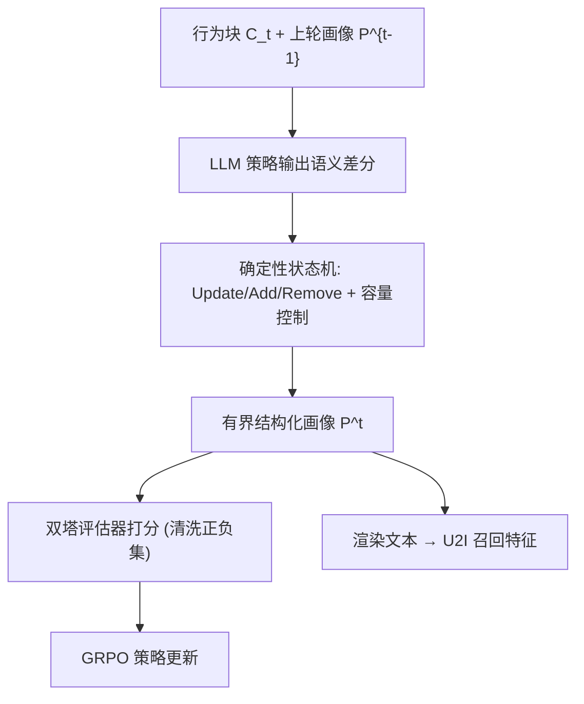
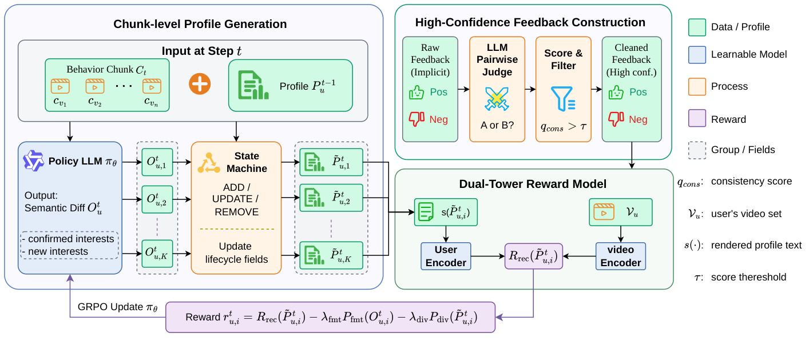
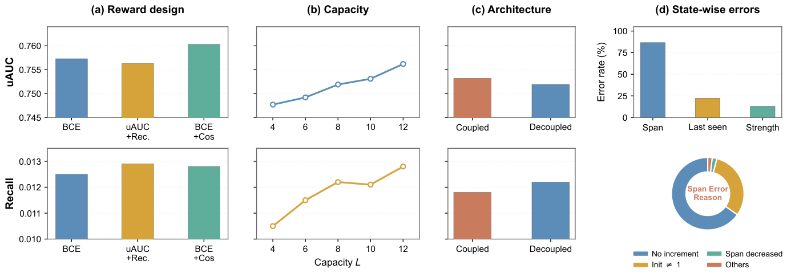

# RECAP: Feedback-Driven Streaming Semantic User Profiles for Short-Video Recommendation (反馈驱动的流式语义用户画像用于短视频推荐)

- **会议/期刊**: RecSys 2026
- **作者与机构**: Ziyi Zhao, Xiaoyou Zhou, Xiao Lv, Chongming Gao, Fuli Feng, Ruiming Tang 等（中国科学技术大学、快手科技、中国网络空间研究院）
- **推荐链路定位**: 召回（画像作为 U2I 检索的额外用户侧特征）
- **研究方向**: 大语言模型推荐 / 序列与会话推荐
- **论文原文**: [https://arxiv.org/abs/2607.15730v1](https://arxiv.org/abs/2607.15730v1)
- **开源代码**: 暂未开源

## TL;DR (1分钟核心速览)

现有语言化用户画像生成器是"开环"的：能流畅总结历史，却未被训练去提升未来推荐。RECAP 把画像建模为**有界结构化记忆**（最多 $L$ 个兴趣槽位），用 LLM 只输出语义差分、由确定性状态机负责生命周期与容量控制；再用 LLM 判官过滤隐式反馈得到高置信行为对，训练双塔语义评估器，其匹配分作为 GRPO 奖励闭环优化画像更新策略。在快手 10K 用户留出集上，uAUC 从 0.7519 提升至 0.7603（+0.0084），Recall@2000 相对提升约 4.9%；七天线上 A/B 人均使用时长显著提升 0.139%。

## Background & Motivation (背景与核心矛盾)

- **主流范式**: 语言化画像用 LLM 把长行为历史压缩为可解释兴趣描述（LIBER、HiT-LBM、LangPTune、LettinGo），作为用户侧语义特征增强推荐。
- **前人局限**: ① 画像多为一次性生成或自由文本摘要，无法在行为流式到达时保持**一致的有界状态**（兴趣演化、容量有限、需跨轮继承与局部修订）；② 优化信号要么缺失（开环生成），要么直接复用工业排序器分数——后者混杂 ID、上下文、流行度等特征，稀释了画像-物品的语义对齐信号。
- **核心洞察 (Key Insight)**: 隐式日志（有效观看 vs. 曝光未看）并非显式语义偏好，其标签受内容形式、曝光情境与用户惰性污染；但若用 LLM 判官做**成对一致性过滤**，可从中提炼出高置信的语义反馈，作为画像质量的代理监督。
- **本文切入点**: 把"画像更新器"当作可训练策略，用清洗后的语义奖励做离线闭环 GRPO 优化，同时将语义生成与状态簿记解耦以保证流式可靠性。

## Method (核心方法设计)

### 1. 整体框架 (Overall Architecture)

输入为用户按时间切分的视频字幕块 $C_t$（每块至多$B=50$条，历史至多$N=500$条有效观看）。LLM 策略$\pi_\theta$读取上一轮画像的$(topic, desc)$对与当前块，输出最小**语义差分**（confirmed_interests / new_interests，并附支撑视频下标）；确定性状态机执行 Update/Add/Remove 并维护 span、recency、strength 等生命周期字段，得到有界画像$P_u^t$。画像渲染为文本后，由冻结的双塔评估器对清洗后的正负视频集打分，构成 GRPO 奖励，反向优化策略。推理时仅需流式前向，画像文本经 Qwen3-Embedding-0.6B 编码后注入生产 U2I 召回模型。

<figure class="paper-figure" markdown="span">
  <figcaption>图1：RECAP框架概览。</figcaption>
</figure>

### 2. 关键设计拆解 (Key Designs)

1. **结构化用户记忆与语义/状态解耦**：自由文本画像在反复更新下易漂移且 token 预算不可控。RECAP 将画像定义为至多 $L$个槽位，每槽含语义对$(topic_l, desc_l)$与仅由状态机管理的生命周期字段；LLM 只输出语义差分，状态机负责强度衰减、stable/recent 归类与低优先级淘汰，即$P_u^t = \mathrm{SM}(\mathrm{LLM}_\theta(C_t, P_u^{t-1}), P_u^{t-1})$。直觉：LLM 擅长语义抽象但不擅长维护紧凑数值状态，直接让其生成 span/recency 会产生大量状态转移错误（图 2(d) 显示耦合式更新在 span 字段错误率极高）。新兴趣须由至少 2 条视频支撑才允许插入，因为插入消耗稀缺容量。

2. **高置信反馈构建与双塔语义奖励**：原始隐式标签噪声大。先用 LLM 判官在随机正负视频对中判断"用户更可能有效观看哪个"，聚合多次成对比较得到标签一致性分 $q_{cons}$；先锁定高置信负例，再仅对确认负例重估正例一致性，保留$q_{cons}>\tau$（$\tau=0.45$）的样本。双塔评估器以 BCE 排序头 + InfoNCE 对比头联合训练：$\mathcal{L}_{eval}=w_{bce}\mathcal{L}_{bce}+w_{nce}\mathcal{L}_{nce}$。奖励为
$$R_{rec}(\tilde{P}_{u,i}^t)=\exp(-\mathcal{L}_{bce}(s(\tilde{P}_{u,i}^t),\mathcal{V}_u))+w_{rec}\cdot\Delta_{cos}(s(\tilde{P}_{u,i}^t),\mathcal{V}_u)$$
其中 $\Delta_{cos}$ 为正负视频平均余弦相似度之差。第一项保证标签判别力，第二项提供检索式语义间隔，二者缺一都会削弱奖励稳定性（图 2(a)）。

3. **GRPO 训练、负采样与推理效率**：为避免对全部 $M$块做串行 rollout，用 SFT 模型预计算前缀画像$\bar{P}_u^{t-1}$，将每个块级更新独立并行优化。每实例采样$K=8$个差分，经状态机得到候选画像，奖励叠加格式惩罚与冗余惩罚：$r_{u,i}^t=R_{rec}-\lambda_{fmt}P_{fmt}-\lambda_{div}P_{div}$，其中$P_{div}$惩罚支撑视频下标高度重叠的兴趣对（局部行为块常被同一主导内容占据）。组内归一化得优势$\hat{A}$，采用带 KL 约束的裁剪代理目标$\mathcal{L}_{GRPO}$。训练用 LoRA rank 32、学习率$2.5\times10^{-5}$、KL 系数 0.01、80 步；评估器与判官均冻结，**无需在线负采样**，推理仅一次流式前向。

## Experimental Setup & Evaluation Protocol (实验设置与评估协议)

- **数据集与预处理**: 快手内部短视频数据，两个不相交的 10K 用户集（策略集用于奖励计算与 GRPO，留出集仅用于最终评估）。有效观看定义为播放 >7 秒或完播；负例为单列曝光但未有效观看。视频字幕由 Qwen3-VL-8B 离线生成（25 类闭集 tag + 自由描述）。

| 数据集 | #Users | #Items | #Train | #Target | 稀疏度/密度 | 特征/场景说明 |
| :--- | :---: | :---: | :---: | :---: | :---: | :--- |
| Policy Raw | 10K | 1,639,176 | 2,000,000 | 5,558,911 | 极稀疏 | 原始隐式反馈 |
| Policy Cleaned | 10K | 1,288,972 | 1,298,655 | 3,609,485 | 极稀疏 | LLM 判官过滤后 |
| Held-out Raw | 10K | 1,643,388 | 2,000,000 | 5,644,058 | 极稀疏 | 原始隐式反馈 |
| Held-out Cleaned | 10K | 1,290,175 | 1,295,564 | 3,659,622 | 极稀疏 | LLM 判官过滤后 |

- **数据划分与防穿越 (Splitting Strategy)**: **全局时间戳切分**为画像窗口（最近 500 条有效观看，均值 463）、训练窗口（每用户至多最近 200 条交互）与更晚的目标/奖励窗口，严格防穿越。
- **排名评测协议 (Ranking Protocol)**: 采用**双塔离线评估**（非全库 Full-Ranking），报告 uAUC 与 Recall@2000；评估器在留出集上独立训练，所有变体共享相同用户、切分、字幕、架构与超参，仅画像生成器不同。同时在 cleaned 与 raw 两种评估数据上报告，避免只在清洗子集上自证。
- **对比基线与超参设置**: 五个受控变体——Base（原始生成器）、GRPO-raw、GRPO-clean、SFT、RECAP(SFT+GRPO)。生成器初始化自 Qwen3-4B-Instruct-2507，SFT 用 Claude Sonnet 4.5 生成的 8K 示范；评估器编码器为 Qwen3-Embedding-0.6B，$w_{bce}=1$、$w_{nce}=0.1$、$w_{rec}=1$；判官为 Qwen3-30B-A3B-Instruct-2507。

## Key Experimental Results (实验关键数据)

### 1. 主实验对比 (Main Results)

| Method | Cleaned uAUC | Cleaned Recall | Raw uAUC | Raw Recall |
| :--- | :---: | :---: | :---: | :---: |
| Base | 0.7519 | 0.0122 | 0.5871 | 0.0088 |
| GRPO-raw | 0.7539 | 0.0119 | 0.5874 | 0.0087 |
| GRPO-clean | 0.7572 | 0.0121 | 0.5883 | 0.0087 |
| SFT | 0.7564 | 0.0127 | 0.5866 | **0.0091** |
| **RECAP (SFT+GRPO)** | **0.7603** | **0.0128** | **0.5886** | 0.0089 |
| Improv. vs Base | +0.0084 | +4.9% | +0.0015 | +1.1% |

### 2. 消融实验 (Ablation Study)

| 配置 | 关键观察 |
| :--- | :--- |
| 奖励 = 仅 BCE | uAUC 下降，检索式语义信号缺失 |
| 奖励 = BCE + Cos（完整） | 离线双塔指标最优 |
| 容量 $L=4/6/8/10/12$|$L=8$ 在兴趣多样性与生成/编码/维护开销间取得平衡 |
| 耦合式全状态更新 vs. 解耦 | 双塔指标相近，但耦合式 span 字段错误率显著更高 |
| GRPO-raw vs. GRPO-clean | 前者更新率低、空兴趣多；后者做有据可依的细化 |

<figure class="paper-figure" markdown="span">
  <figcaption>图2：RECAP的消融研究。(a) 比较不同奖励公式。(b) 评估不同画像容量𝐿。(c) 研究将语义更新与状态管理解耦的效果。(d) 分析耦合设计中的状态字段错误，包括字段级错误率和跨度错误原因。</figcaption>
</figure>

### 3. 关键实验发现 (Key Findings)

1. **清洗奖励是收益主源**：GRPO-clean 在 cleaned 评估上 uAUC 达 0.7572，高于 GRPO-raw 的 0.7539，且 raw 评估 uAUC 也同步提升（0.5883 vs. 0.5874），说明过滤并非只对清洗子集过拟合，而是提供了更干净的优化方向。
2. **SFT 与 GRPO 互补**：SFT+GRPO 取得最高历史覆盖率与最低重复分配率（图 4(a)(b)），SFT 改善画像组织与覆盖，GRPO 改善更新与抽象方式；SFT 单独在 raw Recall 上最高（0.0091），说明二者作用维度不同。
3. **奖励质量决定语义深度**：LLM 判官标注显示 GRPO-clean 有 67.1% 兴趣为动机聚焦（raw 仅 26.9%），而 raw 画像 63.9% 提及命名实体、46.9% 提及格式线索，表明原始奖励诱导表面特征匹配，清洗奖励促成更深层的用户意图抽象。

## Highlights & Limitations (亮点、对比与审稿批判)

- **与代表作对比 (vs. Prior Work)**: LangPTune 训练画像编码器对齐下游排序，LettinGo 用下游 LLM 预测器构造偏好对做对齐，二者优化的是**文本画像表示**；LIBER/HiT-LBM 聚焦长历史分段压缩与兴趣路径选择。RECAP 的差异在于把画像视为**有界结构化状态**，优化对象是"增量更新策略"本身，且奖励来自经一致性过滤的工业隐式日志而非排序器原始分。
- **可迁移亮点**: ① "LLM 出语义差分 + 确定性状态机管簿记"的解耦范式可迁移到任何需要长期有界记忆的 Agent 记忆系统；② 用 LLM 判官做成对比较、先锁高置信负例再重估正例的两阶段清洗，可复用于其他隐式反馈去噪场景。
- **审稿级局限批判**: ① 离线评估依赖双塔代理指标而非真实全库排序或线上排序链路，uAUC/Recall 的绝对增益幅度较小（Recall 仅 0.0122→0.0128），统计显著性未在离线表中给出；② 流程重度依赖多个大模型（Qwen3-VL-8B 字幕、Qwen3-30B 判官、Claude 教师、Qwen3-4B 策略），训练与维护成本高，且 $L$、$\tau$、$w_{rec}$ 等超参敏感性仅部分讨论；线上 A/B 仅报告单一指标 0.139%，缺少留存、多样性等长期指标。

## Rating (四维评分)

- **方法创新性 (Novelty)**: ⭐⭐⭐⭐ （将流式画像更新器作为 GRPO 策略、语义/状态解耦的有界记忆设计新颖，但各组件单独看均有先例）
- **评估协议与实验扎实度 (Protocol & Experiments)**: ⭐⭐⭐⭐ （双数据视图 + 五变体受控对比 + 画像行为诊断 + 线上 A/B 较完整，但离线为代理评估、缺显著性检验）
- **写作与数学规范度 (Clarity & Rigor)**: ⭐⭐⭐⭐ （问题分解清晰、公式紧凑，奖励与状态机定义明确；部分实现细节如 $P_{fmt}$ 具体形式略简）
- **工业落地与复现价值 (Industrial & Practical Value)**: ⭐⭐⭐⭐ （已在快手海外业务上线并获显著正向收益，流式推理开销可控；但未开源且依赖多模型栈，复现门槛较高）
