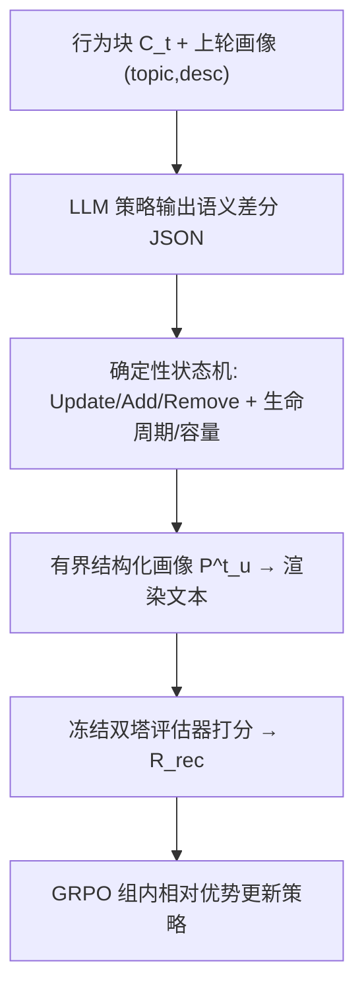
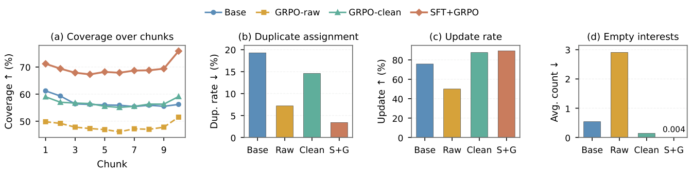

# RECAP: Feedback-Driven Streaming Semantic User Profiles for Short-Video Recommendation (反馈驱动的流式语义用户画像)

- **会议/期刊**: RecSys 2026
- **作者与机构**: Ziyi Zhao, Chongming Gao, Fuli Feng 等（中国科学技术大学、快手科技、中国网络空间研究院）
- **推荐链路定位**: 召回（画像作为 U2I 召回模型的额外语义特征）
- **研究方向**: 大语言模型推荐 / 序列与会话推荐
- **论文原文**: [https://arxiv.org/abs/2607.15730v1](https://arxiv.org/abs/2607.15730v1)
- **开源代码**: 暂未开源

## TL;DR (1分钟核心速览)

现有语言化用户画像生成器是"开环"的：能流畅总结历史，却从未被训练去提升未来推荐效果。RECAP 把画像建模为**有界结构化记忆**（最多 $L$ 个兴趣槽位），用 LLM 只输出语义差分、由确定性状态机负责生命周期与容量控制；再用 LLM 判官过滤隐式反馈得到高置信行为对，训练双塔语义评估器，其匹配分作为 GRPO 奖励闭环优化画像更新策略。在快手 10K 用户留出集上，cleaned 评估 uAUC 从 0.7519 升至 0.7603、Recall@2000 相对提升约 4.9%；七天线上 A/B 人均使用时长显著提升 0.139%。

## Background & Motivation (背景与核心矛盾)

- **主流范式**: 语言化画像分两支——长历史构建（LLM-TRSR、LIBER、HiT-LBM 分段摘要/兴趣路径选择）与反馈驱动优化（LangPTune 用推荐解码器训练画像编码器、LettinGo 用下游 LLM 构造偏好对做对齐）。
- **前人局限**: ① 这些工作把画像当作一次性生成的文本/摘要输出，而非**跨轮继承、可局部修订的有界状态**，在行为持续流入的短视频场景下无法增量维护；② 直接用冻结工业排序器分数或原始 watch/skip 标签做反馈，信号被 ID、上下文、流行度、曝光位等特征稀释，且隐式标签受内容形态与用户惯性污染，与"画像-视频语义对齐"并不等价。
- **核心洞察 (Key Insight)**: LLM 擅长语义抽象但**不擅长维护紧凑且合法的数值状态**（直接让它更新 span/recency/strength 会产生不一致）；而隐式反馈中只有一部分与用户近期语义偏好"标签一致"，需先清洗再作为奖励参照。
- **本文切入点**: 把"语义更新"与"状态记账"解耦，并用清洗后的画像定向语义奖励对更新策略做 GRPO 闭环优化。

## Method (核心方法设计)

### 1. 整体框架 (Overall Architecture)

输入为用户按时间切分的 $M$ 个行为块（每块至多 $B=50$ 条视频 caption，历史至多 $N=500$ 条有效观看）。每轮：LLM 策略 $\pi_\theta$ 读取当前块 $C_t$ 与上一轮画像的 $(topic, desc)$ 对，输出最小语义差分 JSON（`confirmed_interests` / `new_interests`，各带 `video_indices` 证据锚点）；确定性状态机执行 Update/Add/Remove 并刷新生命周期字段，得到 $P^t_u$；渲染为文本 $s(P^t_u)$ 后送入冻结的双塔评估器计算奖励，配合格式与多样性惩罚组成 rollout 奖励，用 GRPO 更新策略。推理时仅需流式前向，画像文本编码后作为召回模型附加特征。

<figure class="paper-figure" markdown="span">
  <figcaption>图1：RECAP框架概览。</figcaption>
</figure>

### 2. 关键设计拆解 (Key Designs)

1. **有界结构化记忆 + 语义/状态解耦**：痛点是一次性自由文本摘要反复重写会漂移、token 预算不可控。画像被定义为至多 $L$ 个槽位，每槽含语义对 $(topic_l, desc_l)$ 与仅由状态机维护的 `span/recency/strength` 生命周期字段（LLM 不可见），并区分 stable/recent 两类。更新式为
$$P^t_u = \mathrm{SM}\big(\mathrm{LLM}_\theta(C_t, P^{t-1}_u),\, P^{t-1}_u\big)$$
新兴趣须由**至少 2 条视频**支撑才允许插入（插入消耗稀缺容量，需更强证据）。直觉：LLM 只做它擅长的语义归纳，数值记账交给规则，从而在长程多轮更新下保持状态可追溯、不漂移。

2. **高置信反馈构建 + 双塔语义评估器**：痛点是原始 watch/skip 不等于语义偏好。先用 LLM 判官在随机正负视频对上做 pairwise 选择，聚合多次比较得标签一致分 $q_{cons}$；先锁定高置信负例，再仅对确认负例重估正例一致性，保留 $q_{cons}>\tau$（$\tau=0.45$）的样本。评估器以 Qwen3-Embedding-0.6B 编码画像文本与视频 caption，含排序头（BCE 预测有效观看）与对比头（InfoNCE + in-batch 负例），$\mathcal{L}_{eval}=w_{bce}\mathcal{L}_{bce}+w_{nce}\mathcal{L}_{nce}$。奖励为
$$R_{rec}=\exp(-\mathcal{L}_{bce}(s(\tilde P), \mathcal{V}_u)) + w_{rec}\cdot\Delta_{cos}(s(\tilde P), \mathcal{V}_u)$$
其中 $\Delta_{cos}$ 为正负视频平均余弦相似度之差。直觉：BCE 项给标签级判别，余弦边际项给检索式语义分离，二者互补；评估器训练一次后冻结，避免奖励漂移。

3. **GRPO 训练与并行 rollout**：顺序展开全部 $M$ 块代价过高，故用 SFT 模型预计算前缀画像 $\bar P^{t-1}_u$，把每个块级更新独立成训练实例，实现跨用户跨块并行采样 $K=8$ 个候选差分。奖励含格式惩罚 $P_{fmt}$（非法 JSON、引用错配、描述超长）与多样性惩罚 $P_{div}$（兴趣条目支撑视频索引高度重叠视为冗余）。组内归一化得优势 $\hat A$，采用带 KL 惩罚的裁剪代理目标 $\mathcal{L}_{GRPO}$。总损失即 GRPO 目标，**无需负采样**（奖励来自评估器对固定反馈集的打分）；SFT 用 Claude Sonnet 4.5 生成的 8K 示范热启动，LoRA rank 32、学习率 $2.5\times10^{-5}$、KL 系数 0.01、训练 80 步。

## Experimental Setup & Evaluation Protocol (实验设置与评估协议)

- **数据集与预处理**: 快手内部短视频数据，两个不相交的 10K 用户集（policy 集用于奖励计算与 GRPO，held-out 集仅用于最终评估）。有效观看定义为播放 >7 秒或完播；负例为单列曝光但未有效观看。每用户画像窗口取最近至多 500 条有效观看（平均 463），训练/目标窗口每用户至多 200 条交互。

| 数据集 | #Users | #Items | #Interactions | 稀疏度/密度 | 特征/场景说明 |
| :--- | :---: | :---: | :---: | :---: | :--- |
| Policy Raw | 10K | 1,639,176 | 2,000,000 | 极稀疏 | 原始隐式反馈，用于奖励与训练 |
| Policy Cleaned | 10K | 1,288,972 | 1,298,655 | 极稀疏 | LLM 判官一致性过滤后 |
| Held-out Raw | 10K | 1,643,388 | 2,000,000 | 极稀疏 | 仅最终评估 |
| Held-out Cleaned | 10K | 1,290,175 | 1,295,564 | 极稀疏 | 仅最终评估（高置信视图） |

- **数据划分与防穿越 (Splitting Strategy)**: **全局时间戳切分**——每用户交互按时间划分为画像窗口、训练窗口与更晚的目标窗口；目标窗口在 policy 集作奖励窗口、在 held-out 集作评估窗口，严格晚于画像窗口，杜绝未来行为泄漏。
- **排名评测协议 (Ranking Protocol)**: 离线采用**双塔评估器打分**（非全库 Full-Ranking，也非传统负采样排序），在 held-out 用户上以 uAUC 与 Recall@2000 衡量画像-视频对齐；cleaned 与 raw 两套评估数据分别对应高置信语义视图与原始分布视图。所有变体共享同一批用户、时间切分、caption、评估器架构与超参，仅画像生成器不同。
- **对比基线与超参设置**: 五个受控变体 Base / GRPO-raw / GRPO-clean / SFT / RECAP(SFT+GRPO)；画像生成器初始化自 Qwen3-4B-Instruct-2507，评估器编码器 Qwen3-Embedding-0.6B，判官 Qwen3-30B-A3B-Instruct-2507，$w_{bce}=1$、$w_{nce}=0.1$、$w_{rec}=1$、容量 $L=8$。

## Key Experimental Results (实验关键数据)

### 1. 主实验对比 (Main Results)

| Method | Cleaned uAUC | Cleaned Recall@2000 | Raw uAUC | Raw Recall@2000 |
| :--- | :---: | :---: | :---: | :---: |
| Base | 0.7519 | 0.0122 | 0.5871 | 0.0088 |
| GRPO-raw | 0.7539 | 0.0119 | 0.5874 | 0.0087 |
| GRPO-clean | 0.7572 | 0.0121 | 0.5883 | 0.0087 |
| SFT | 0.7564 | 0.0127 | 0.5866 | **0.0091** |
| **RECAP (SFT+GRPO)** | **0.7603** | **0.0128** | **0.5886** | 0.0089 |
| Improv. vs Base | +0.0084 | +4.9% | +0.0015 | — |

### 2. 消融实验 (Ablation Study)

| 配置 | 关键观察 |
| :--- | :--- |
| 奖励 = 仅 BCE | uAUC 约 0.750 档，弱于 BCE+余弦边际（约 0.760） |
| 奖励 = BCE + 余弦边际 | 最优，标签判别与语义分离互补 |
| 容量 $L$: 4/6/8/10/12 | 性能随 $L$ 上升但生成/rollout/编码成本同步增长，$L=8$ 为性价比拐点 |
| 耦合式全状态更新（LLM 直出生命周期字段） | 离线指标与解耦版相当，但 span 等字段错误率极高（跨块 span 更新尤甚） |
| 解耦式（本文） | 状态可追溯、错误率显著下降 |

<figure class="paper-figure" markdown="span">
  <figcaption>图2：RECAP的消融研究。(a) 比较不同奖励公式。(b) 评估不同画像容量𝐿。(c) 研究将语义更新与状态管理解耦的效果。(d) 分析耦合设计中的状态字段错误，包括字段级错误率和跨度错误原因。</figcaption>
</figure>

### 3. 关键实验发现 (Key Findings)

1. **清洗奖励是收益主源，而非过拟合清洗子集**：GRPO-clean 在 cleaned 评估上 uAUC 0.7572 高于 GRPO-raw 的 0.7539，同时在 raw 评估 uAUC 上也从 0.5871 提升到 0.5883，说明过滤模糊隐式反馈提供的是更干净的优化方向而非分布偏移。
2. **SFT 与 GRPO 分工互补**：SFT+GRPO 取得最高历史覆盖率与最低重复分配率（SFT 改善画像组织），而 GRPO 在清洗奖励下显著提升"更新率"、压低"空兴趣"数量（GRPO-raw 更新率低且空兴趣多，属"不敢改+乱提议"的低风险退化），说明奖励质量决定模型是做有据可依的精修还是表面化改动。
3. **清洗奖励带来更深层语义抽象**：LLM-as-judge 标注显示 GRPO-clean 画像中动机聚焦描述占 67.1%、内容特征聚焦仅 6.0%，而 GRPO-raw 为 25.0% / 70.8%；raw 画像更频繁提及命名实体与视频格式线索（63.9% vs 10.8%），即原始奖励诱导表面特征匹配，清洗奖励诱导"为什么看"的用户级抽象。

<figure class="paper-figure" markdown="span">
  <figcaption>图4：不同训练信号下的画像行为诊断。(a) 覆盖率是LLM判定的每个历史块中视频被最终生成画像覆盖的比例。(b) 重复分配率衡量同一历史视频被分配到多个兴趣条目的频率。(c) 更新率衡量现有兴趣描述被细化的频率。(d) 空兴趣是生成的无支持视频的条目。在柱状图中，Raw、Clean和S+G分别缩写为GRPO-raw、GRPO-clean和SFT+GRPO。</figcaption>
</figure>

## Highlights, Limitations & Rating (亮点、对比与审稿评价)

- **与代表作对比 (vs. Prior Work)**: 相比 LangPTune（训练画像编码器对齐下游排序）与 LettinGo（多份自由文本画像做偏好对齐），RECAP 优化对象是**有界结构化状态的增量更新策略**而非一次性文本表征；相比 LIBER/HiT-LBM 只做长历史兴趣抽取，RECAP 首次把工业隐式反馈经一致性清洗后闭环回灌到流式画像更新器。
- **可迁移亮点**: ① "LLM 出语义差分 + 规则状态机管记账"的解耦范式可迁移到任何需要长程有界状态的 Agent 记忆/会话画像任务；② "先锁高置信负例、再重估正例一致性"的 LLM 判官清洗流程，是低成本提升隐式反馈质量的通用技巧。
- **审稿级局限批判**: ① 离线评估依赖与奖励同源的双塔评估器（虽在不相交用户集上训练），存在评估与优化目标同构的自证风险，缺乏全库 Full-Ranking 或人工评测佐证；② 线上收益 0.139% 虽显著但幅度有限，且 GRPO 需 $K=8$ 候选 rollout 与 LLM 判官离线批处理，训练与画像刷新成本未做量化；容量 $L$、阈值 $\tau$、$w_{rec}$ 等超参敏感性仅做了单点分析。
- **四维评分**: 创新性 ⭐⭐⭐⭐ | 实验扎实度 ⭐⭐⭐⭐ | 方法清晰度 ⭐⭐⭐⭐⭐ | 落地价值 ⭐⭐⭐⭐

