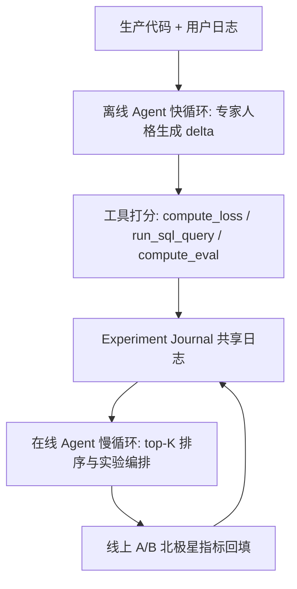
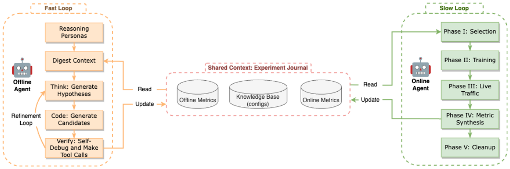

# Self-Evolving Recommendation System: End-To-End Autonomous Model Optimization With LLM Agents (自演化推荐系统：基于 LLM 智能体的端到端自主模型优化)

- **会议/期刊**: RecSys 2026
- **作者与机构**: Haochen Wang, Yi Wu, Daryl Chang, Li Wei, Lukasz Heldt（Google / YouTube）
- **推荐链路定位**: 精排（RL 排序模型）的模型研发与上线全流程自动化
- **研究方向**: 大语言模型推荐 / 强化学习与动态探索推荐
- **论文原文**: [https://arxiv.org/abs/2602.10226v3](https://arxiv.org/abs/2602.10226v3)
- **开源代码**: 暂未开源

## TL;DR (1分钟核心速览)

工业级 RL 推荐模型的优化器、网络架构与奖励函数设计长期依赖人工试错，传统 AutoML 只能在固定搜索空间内调数值超参，无法"发明"新结构或新奖励逻辑。本文在 YouTube 视频排序模型上部署双智能体自演化系统：离线 Agent（快循环）以 Gemini 2.5 Pro 扮演专家 MLE，基于共享 Experiment Journal 生成代码级 delta 并用离线代理指标打分；在线 Agent（慢循环）按北极星业务指标对候选排序并管理 A/B 实验生命周期。线上 A/B 显示多项发现带来统计显著提升（如奖励多目标合成 +0.05% YouTube 级 / +0.17% 表面级），实验吞吐从 Θ(1–10)/周 提升至 Θ(100)/周，且 64%/73% 的自动上线优于过去半年人工上线。

## Background & Motivation (背景与核心矛盾)

- **主流范式**: 现代推荐系统被建模为 RL 问题，下层用 SGD 最小化可微代理损失 $\mathcal{L}_{proxy}$ 训练排序模型 $Q_\theta(s,a)$，上层则需人工寻找最优系统配置 $\Phi$（优化器、架构、奖励定义）以最大化不可微、延迟数天至数周的北极星指标 $\mathcal{M}$。
- **前人局限**: ① 传统 HPO/NAS（Vizier、DARTS、进化搜索）只能在预定义算子菜单内选择或重组，缺乏"读懂代码、假设某用户切片服务不足、再写出修复逻辑"的语义推理能力；② 奖励工程需在 Θ(100) 个信号组合中搜索，人工常在次优区域耗费数月，且代理损失与真实满意度之间存在对齐鸿沟。
- **核心洞察 (Key Insight)**: 成熟系统中收益最高的不是数值调参，而是**结构与语义变异**（新拓扑、新奖励逻辑）；而 LLM 智能体恰好具备在非结构化上下文上推理并直接编辑源码的能力，可把"自动调参"升级为"自主科学发现"。
- **本文切入点**: 将发现过程解耦为高频离线提名（廉价代理信号）与低频在线验证（昂贵延迟业务指标）两个同步推理环，用共享实验日志把两者闭环。

## Method (核心方法设计)

### 1. 整体框架 (Overall Architecture)

系统以 **Experiment Journal**（持久化知识库，记录全部历史配置、离线分数与可得在线指标）为中心。离线 Agent 每日唤醒、每 5 分钟轮询，实例化优化器/架构/奖励三类专家人格，读取生产代码与历史日志，生成"相对当前配置的 delta"并调用工具（`compute_loss` / `run_sql_query` / `compute_eval`）打分，写入日志；在线 Agent 每日运行一次，对候选池重排序选出 top-$K$，驱动训练、上线 A/B、回填指标与资源回收五个阶段。人类只负责提出初始研究想法与审阅最终指标。

<figure class="paper-figure" markdown="span">
  <figcaption>图1：自演化系统架构。该框架作为一个双环自演化系统运行，核心是共享的实验日志，其中包含持久化知识库、历史试验及其结果指标。离线智能体（快循环）作为高频提名引擎，调用LLM实例化专门的推理角色，将假设生成并精炼为可执行代码。通过工具调用为候选分配离线分数。在线智能体（慢循环）作为低频排序引擎，选择高潜力候选。</figcaption>
</figure>

### 2. 关键设计拆解 (Key Designs)

1. **双层优化的问题形式化（把"研发"写成可优化的上层目标）**：痛点是把在线指标直接当损失不可行（稀疏、延迟、有噪）。作者显式写成 $\Phi^*=\arg\max_{\Phi}\mathcal{M}(\theta^*(\Phi))\ \text{s.t.}\ G(\Phi)\le C$，其中 $\theta^*(\Phi)=\arg\min_\theta \mathcal{L}_{proxy}(\mathcal{D};\theta,\Phi)$。直觉：下层保证模型在给定配置下被充分训练，上层只搜索配置空间，从而把"人肉科研"转化为一个有约束的黑箱搜索问题，且约束 $G$ 显式控制训练成本。

2. **专家人格拆分 + Delta 式代码生成（解决长上下文幻觉与上下文预算）**：单一全知人格在约 400k token 时开始幻觉，且要求输出完整配置文件会漏参数、出语法错。作者按组件拆成 Optimizer / Architecture / Reward 三个人格，每个只改 Θ(10) 行、聚焦 Θ(1000) 行模型定义中的局部；输出统一为 `{explanation, delta}` 二元组。因为 delta 紧凑，单条 prompt 可挂载 Θ(100) 条历史记录作为上下文（AlphaEvolve 类方法因整文件过大必须激进裁剪历史），这是迭代发现质量的关键。

3. **奖励人格的"免损失"评分与训练目标**：修改奖励会改变优化景观，跨奖励比较 $\mathcal{L}_{proxy}$ 无意义（"仅点击"奖励的损失天然低于"点击+满意度"）。因此奖励人格先用 `run_sql_query` 在用户日志上做开放式分析（如发现"被分享视频的观看时长更高"），再用 `compute_eval` 计算与长观看、留存、复访的相关性作为替代分数。总训练目标仍是下层 $\min_\theta \mathcal{L}_{proxy}$，但 $\mathcal{L}_{proxy}$ 的标签逻辑本身成为被搜索对象；推理侧零额外开销（上线的是演化后的普通 DNN 排序模型，LLM 只在研发环内消耗 token，半年约 $20,000）。

## Experimental Setup & Evaluation Protocol (实验设置与评估协议)

- **数据集与场景**: 无公开学术数据集，评估完全基于 YouTube 生产环境。底层模型为基于 DNN 的价值型 RL 排序模型（优化 $Q_\theta(s,a)$），训练耗时 Θ(hours)，服务于视频观看页主表面及另一独立推荐表面（特征 schema、训练数据、模型配置均不同，用于验证可迁移性）。

| 场景 | 用户/物品规模 | 交互规模 | 反馈特性 | 说明 |
| :--- | :---: | :---: | :---: | :--- |
| YouTube 主表面 | 十亿级用户 | 十亿级视频 | 延迟 Θ(days)–Θ(weeks) | 主部署场景，RL 排序 |
| YouTube 第二表面 | 未披露 | 未披露 | 同上 | 异构 schema，验证泛化 |

- **数据划分与防穿越**: 非离线数据集划分范式；采用**离线代理验证（快循环）+ 线上 A/B 实验（慢循环）**两阶段，线上指标为唯一最终判据，天然避免离线-在线穿越。
- **排名评测协议**: 不做 Full-Ranking / Sampled Ranking 的学术式排序评测，而是以**线上 A/B 的北极星业务指标层级**（YouTube 级指标 + 表面级指标）为准，报告 95% 置信区间，显著结果加粗。
- **对比基线与超参**: 基线为人工工程流程（过去 6 个月该表面全部人工上线）与消融变体；LLM 主用 Gemini 2.5 Pro，对照 Gemini 2.5 Flash；消融每次 6 次独立运行、每次探索 70 个想法，以归一化 z-score 报告损失。

## Key Experimental Results (实验关键数据)

### 1. 主实验对比 (Main Results)

线上 A/B 相对人工基线的指标增益（括号为 95% CI，加粗为统计显著）：

| 组件 | 智能体发现 | YouTube 级指标 | 表面级指标 |
| :--- | :--- | :---: | :---: |
| Optimizer | 切换至 RMSprop | **+0.06%** [+0.03, +0.09] | **+0.12%** [+0.05, +0.19] |
| Optimizer | 训练效率 4× 提升 | −0.01% [−0.05, +0.03] | +0.06% [−0.02, +0.13] |
| Optimizer | 训练效率 2× 提升 | +0.01% [−0.03, +0.05] | **+0.09%** [+0.04, +0.15] |
| Architecture | Gated Path (GLU) | **+0.06%** [+0.02, +0.11] | **+0.14%** [+0.08, +0.21] |
| Architecture | 激活函数精修 (GELU+LN) | −0.02% [−0.05, +0.01] | **+0.12%** [+0.05, +0.19] |
| Reward | 多目标奖励合成 | **+0.05%** [+0.02, +0.08] | **+0.17%** [+0.13, +0.22] |
| Reward | 奖励超参调优 | **+0.05%** [+0.01, +0.08] | **+0.21%** [+0.13, +0.29] |

第二表面（泛化验证）：

| 组件 | 智能体发现 | YouTube 级指标 | 表面级指标 |
| :--- | :--- | :---: | :---: |
| Optimizer | 切换至 FTRL | **+0.03%** [+0.01, +0.05] | **+0.16%** [+0.06, +0.26] |
| Architecture | Wide & Deep 结构 | **+0.08%** [+0.04, +0.13] | **+1.10%** [+0.98, +1.22] |

### 2. 消融实验 (Ablation Study)

优化器组件上的智能体配置消融（归一化 $\mathcal{L}_{proxy}$，越低越好，6 次运行均值）：

| 配置 | 归一化损失 | 说明 |
| :--- | :---: | :--- |
| opt_2p5（完整） | **−0.84** [−1.70, −0.01] | Gemini 2.5 Pro + 专家人格 + 全量按损失排序历史 |
| opt_top_5 | −0.72 [−1.49, 0.05] | 仅保留 top-5 历史 |
| opt_no_role | −0.52 [−1.43, 0.38] | 去掉专家 MLE 人格 |
| opt_no_sort | 0.06 [−0.93, 1.05] | 历史按时间而非损失排序 |
| opt_top_1 | 0.11 [−0.76, 0.98] | 仅保留 top-1 历史 |
| opt_flash | 0.85 [0.66, 1.05] | 换用 Gemini 2.5 Flash |
| opt_no_context | 1.05 [0.94, 1.16] | 无任何历史 |

### 3. 关键实验发现 (Key Findings)

1. **奖励工程是收益最高的杠杆**：奖励超参调优在表面级指标上达 +0.21%，多目标合成达 +0.17%，均高于优化器与架构类发现；且该调优完全依赖慢循环在线反馈、无离线指标可用，两周内找到同时改善两级指标的配置，而人工数月未果——说明 LLM 的语义推理在 Θ(100) 信号组合空间中具有人工不可替代的搜索效率。
2. **上下文质量比模型规模更"可操作"**：去掉全部历史（opt_no_context）损失飙至 +1.05，按时间乱序（opt_no_sort）退化到 +0.06，而仅换小模型（opt_flash）为 +0.85；完整按损失排序历史（−0.84）显著优于 top-5（−0.72）与 top-1（+0.11），证明"全量+有序"的实验日志是迭代发现的第一性资源。
3. **发现可跨表面迁移，且结构变异收益随表面而异**：同一双智能体架构在异构 schema 的第二表面首轮即产出有效假设，Wide & Deep 结构带来 +1.10% 表面级提升（远大于主表面的 +0.14%），说明框架优化的是"发现过程"而非记忆特定数据集；同时训练效率优化（4×/2×）对 YouTube 级指标不显著甚至微负，提示系统效率与业务收益需分开度量。

## Highlights, Limitations & Rating (亮点、对比与审稿评价)

- **与代表作对比 (vs. Prior Work)**: 相比 Vizier/DARTS 等 HPO/NAS，本文突破固定算子菜单，可写出搜索空间外的新代码；相比 AlphaEvolve / AI Scientist / MLE-STAR，本文面向的是有噪声反馈、严格安全护栏、需真实 A/B 的工业生产生态，而非静态学术基准；相比 Eureka 类 LLM 奖励设计，本文面对的是无明确 oracle、反馈延迟以天/周计且稀疏的推荐场景，必须靠离线代理+在线慢循环双重把关。
- **可迁移亮点**: ① **Delta 式生成 + 紧凑上下文**：让智能体只输出相对生产文件的差异，既降幻觉又使单 prompt 可携带上百条历史，可直接迁移到任何代码演化型 Agent；② **按组件拆分专家人格**：把千行级模型定义切成 Θ(10) 行局部编辑任务，是控制长上下文幻觉的通用工程手段。
- **审稿级局限批判**: ① 评估完全绑定 YouTube 内部生产环境，无公开数据集与可复现代码，指标增益量级（0.0x%–1%）虽显著但外部无法独立验证，且缺少与 AutoML 基线在同一协议下的受控对比；② 系统对 prompt 工程高度敏感（需显式要求"平衡探索/利用/创新"以防坍缩为微调学习率、需 warm start 注入前一日最优 K 条），超参（唤醒频率、top-K、历史长度）缺乏敏感性分析，LLM token 成本与延迟在更大规模下的可扩展性亦未讨论。
- **四维评分**: 创新性 ⭐⭐⭐⭐ | 实验扎实度 ⭐⭐⭐⭐ | 方法清晰度 ⭐⭐⭐⭐ | 落地价值 ⭐⭐⭐⭐⭐

