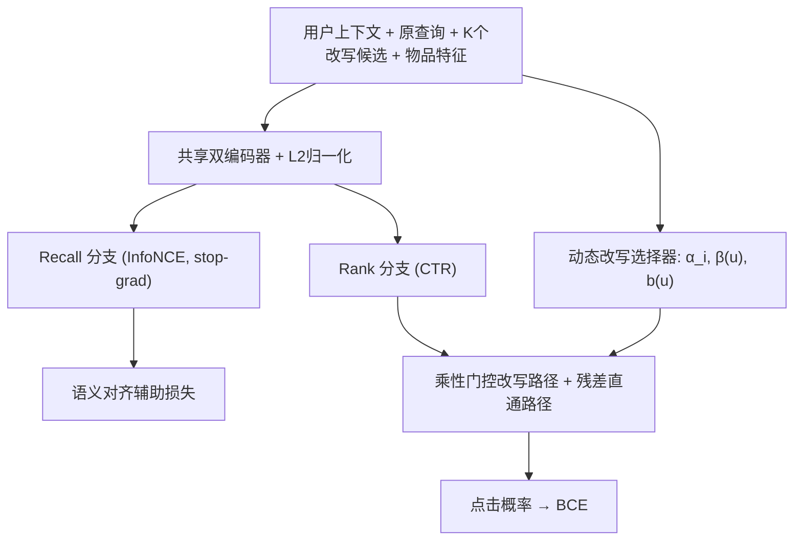

# SPEAR: Selection-aware Personalized End-to-end Adaptive Rewriting and Retrieval for Community Search (选择感知的个性化端到端自适应改写与检索)

- **会议/期刊**: RecSys 2026 (Main Track)
- **作者与机构**: Wenbin Wu, Yuzhong Wu, Yufan Xu, Kuan Fang, Xing Xu, Cheng Ye, Xiaobin Hu（新加坡国立大学 & 得物）
- **推荐链路定位**: 召回（查询理解 + 改写选择 + 稠密检索）
- **研究方向**: 大语言模型推荐 / 协同过滤与双塔召回
- **论文原文**: [https://arxiv.org/abs/2608.01738v1](https://arxiv.org/abs/2608.01738v1)
- **开源代码**: [https://github.com/mallocagi1-cell/spear](https://github.com/mallocagi1-cell/spear)

## TL;DR (1分钟核心速览)

工业搜索中查询改写与检索分阶段优化导致目标错位；直接移植推荐领域的路径式网络（PDN）会学到"泛词主导"捷径——高频泛化改写靠选择置信度刷分却偏离原查询意图。SPEAR 用三个组件对症下药：梯度隔离的双嵌入骨干保护召回侧语义、乘性门控聚合要求置信度与物品相关性同时高才得分、动态改写选择器按请求生成改写权重与个性化缩放偏置。在得物 100K 留出会话上，点击召回@10 相对生产基线提升 99.5%，语义相似度@10 提升 18.2%，线上 QVCTR +0.259%、阅读深度 +0.733%。

## Background & Motivation (背景与核心矛盾)

- **主流范式**: 工业搜索采用两阶段流水线——改写模块生成/选择候选（优化语义相似度），下游检索模型消费改写（优化点击互动），二者目标分离。
- **前人局限**: 路径式深度网络（PDN）虽能端到端联合优化触发选择与匹配，但其诞生于推荐场景，相关性并非显式约束。移植到搜索后出现两类失效：(1) **泛词主导效应**——加性路径聚合下，"手机壳""女装"等高频泛词仅凭选择置信度即可抬高总分，即便与目标物品语义匹配很弱；(2) **CTR 梯度侵蚀召回几何**——共享嵌入空间被点击优化扭曲，召回侧语义结构退化。
- **核心洞察**: 泛词捷径在聚合 CTR 指标上难以察觉（泛词确实带来点击，只是不是最相关的点击）；且 t-SNE 与量化分析显示共享空间几乎抹平类目边界（Purity@10 仅 0.229），而召回空间类目分离最清晰（0.740）。
- **本文切入点**: 改写选择应作为受下游点击直接监督的**隐变量**，同时通过架构解耦与乘性聚合强制"意图保真"与"互动提升"并存。

## Method (核心方法设计)

### 1. 整体框架 (Overall Architecture)

输入为元组 $(u,q_o,\mathcal{R},d,y)$：用户上下文、原查询、$K$个改写候选、物品与点击标签。共享双编码器将查询/改写/物品映射到同一潜空间并做$\ell_2$归一化；随后分叉为 Recall 与 Rank 两个投影 MLP，Recall 分支仅受 InfoNCE 监督、Rank 分支受 CTR 监督且二者间设 stop-gradient。动态改写选择器基于用户-原查询交互表示输出掩码感知的 softmax 权重$\alpha_i$及请求级缩放$\beta(u)$、偏置$b(u)$；最终得分由乘性门控的改写路径与残差直通路径相加，经单调映射转为点击概率，端到端反传至改写选择。

### 2. 关键设计拆解 (Key Designs)

1. **双嵌入隔离 (Dual-Embedding Isolation)**：痛点在于检索偏好广覆盖语义、CTR 偏好短期判别信号，共享空间互相干扰。做法是将共享表示经两个轻量 MLP 投影为 $\mathbf{q}^{rec}=h^{rec}_q(\mathbf{q}^{emb})$与$\mathbf{q}^{rank}=h^{rank}_q(\mathbf{q}^{emb})$，并对召回专属参数施加$\nabla_{\theta_{rec}}\mathcal{L}_{main}=0$。直觉：切断 CTR 梯度对召回几何的污染，使长尾/歧义查询的类目邻域保持紧致（Purity@10 从共享空间 0.229 升至 0.740）。

2. **乘性门控聚合 (Multiplicative Gating)**：加性聚合让泛词靠 $\alpha_i$单项刷分。改为先算校准相关性$r_i(u,d)=\text{softplus}(\beta(u)\cdot\text{sim}(\mathbf{q}^{rank}_i,\mathbf{d}^{rank})+b(u))$，再令$s_{rw}=\sum_{i=1}^{K}\alpha_i r_i$。softplus 保证非负，使$\alpha_i$与$r_i$ 真正乘性耦合——置信度高但相关性弱（或反之）的改写贡献趋近于零，从算子层面消灭泛词捷径。

3. **动态改写选择器与训练目标**：交互表示 $\mathbf{c}_i=h_{int}([\mathbf{h}_u;\mathbf{q}^{emb}_o])\odot\mathbf{q}^{emb}_i$融合"谁在搜"与"搜什么"，logit$z_i=g([\mathbf{c}_i;SG(s^{sel}_i)])$经掩码 softmax 得$\alpha_i$；同时由$\mathbf{h}_u,\mathbf{q}^{emb}_o$生成$\beta(u),b(u)$实现请求级校准。总损失$\mathcal{L}=\mathcal{L}_{main}+\lambda_{align}\mathcal{L}_{NCE}+\lambda_{reg}\mathcal{L}_{reg}$，其中$\mathcal{L}_{NCE}$作用于原查询视图与改写混合视图$\mathbf{q}^{rw}_{rec}=\sum_i SG(\alpha_i)\mathbf{q}^i_{rec}$，负样本来自批内物品；$\lambda_{align}=0.1$、$\tau_{NCE}=0.07$。推理仅增 25ms/请求，与既有查询理解模块并行，端到端延迟零增长。

## Experimental Setup & Evaluation Protocol (实验设置与评估协议)

- **数据集与预处理**: 得物社区搜索工业数据，基于 180 天搜索点击日志构建查询-物品二部图，每日约 9.6 亿 query-query 对（swing 相似度挖掘）+ 1.08 亿对（语义 ANN 检索）。训练集 2026-03-08 至 03-14，评估集为 03-15 的 100K 留出会话。

| 数据集 | #Users | #Items | #Interactions | 稀疏度/密度 | 特征/场景说明 |
| :--- | :---: | :---: | :---: | :---: | :--- |
| Dewu Community Search | 未披露 | 未披露 | 100K 留出会话 | 工业级稀疏 | 查询+用户偏好+商品意图联合检索 |

- **数据划分与防穿越**: 按**全局时间戳切分**（训练周 vs. 次日留出会话），严格防穿越。
- **排名评测协议**: 采用 **Exposure Recall@K / Click Recall@K**（$K\in\{5,10,30\}$）衡量曝光与点击物品的召回覆盖率，辅以 **Semantic Similarity@K**（原查询与 top-K 改写嵌入的平均余弦相似度，由人工相关性标注训练的离线模型计算）作为意图保真代理指标。
- **对比基线与超参设置**: 主基线为线上生产 PDN 系统；消融为三个组件的独立叠加。$\lambda_{align}=0.1$、$\tau_{NCE}=0.07$、$\lambda_{reg}=10^{-6}$，选择器温度$\tau_{init}=0.8$、下界$\tau_{floor}=0.6$；线上 A/B 采用双侧检验，$p<0.05$ 为显著。

## Key Experimental Results (实验关键数据)

### 1. 主实验对比 (Main Results)

原文以生产 PDN 为唯一主基线（作者论证其他方法仅覆盖部分对齐组件、可比性弱），核心对比体现在组件消融与线上 A/B：

| 模型 | Click R@5 | Click R@10 | Click R@30 | Sim@10 |
| :--- | :---: | :---: | :---: | :---: |
| Baseline (PDN) | 0.0958 | 0.1694 | 0.3699 | 0.6986 |
| + Multiplicative Gating | 0.1132 | 0.1972 | 0.4572 | 0.7822 |
| + Dual-Embedding Isolation | 0.1490 | 0.2286 | 0.4371 | 0.7518 |
| + Dynamic Rewrite Selector | 0.2035 | 0.3167 | 0.5415 | 0.6949 |
| **SPEAR (full)** | **0.2223** | **0.3380** | **0.5519** | **0.8258** |
| Improv. (R@10) | +132.0% | **+99.5%** | +49.2% | +18.2% |

线上 A/B（六项指标，四项显著）：QVCTR **+0.259%**★、UVCTR **+0.337%**★、ReadVV **+0.733%**★、TabDur **+0.467%**★、D1 Ret +0.328%、D7 Ret +0.216%。人工 GSB（150 条 diff 查询）：满意度 DCG +0.67pp、相关性 DCG +0.38pp、相关性坏例率 −0.46pp、满意度提升 **+4.6%**★。

### 2. 消融实验 (Ablation Study)

| 变体 | Exp@10 | Δ vs. Baseline | 说明 |
| :--- | :---: | :---: | :--- |
| Baseline | 0.1403 | — | 生产 PDN |
| + MG | 0.1635 | +16.5% | 消除泛词捷径 |
| + DEI | 0.1922 | +37.0% | 保护召回几何 |
| + DRS | 0.2714 | +93.4% | 端任务监督选择 |
| **SPEAR** | **0.2949** | **+110.2%** | 三者协同最优 |

嵌入空间量化（表 4）：Recall 空间 Purity@10 = 0.740、Inter/Intra = 1.753；Rank 空间 Eff. Rank Ratio = 0.442（最高）；Shared 空间 Purity@10 仅 0.229、Inter/Intra = 1.039，近乎随机。

### 3. 关键实验发现 (Key Findings)

1. **动态改写选择器是召回增益主引擎**：单独加入即带来 Click R@10 +86.9%、Exp@10 +93.4%，远超另两个组件，证明"改写选择受下游点击直接监督"是覆盖度提升的核心来源；但其单独使用时 Sim@10 微降 0.5%，说明纯点击监督会牺牲表层语义邻近。
2. **乘性门控与双嵌入隔离负责"纠偏"**：MG 单独带来 Sim@10 +11.9%、DEI 带来 +7.6%，二者与 DRS 组合后 SPEAR 同时拿下最高召回（0.3380）与最高相似度（0.8258），验证"覆盖扩张"与"意图保真"可通过架构分工而非权衡实现。
3. **曝光召回增益（+110.2%）超过点击召回（+99.5%）**：说明 SPEAR 扩展了仅靠点击信号无法触达的可检索物品池；线上 CTR 与阅读深度同向上升（而非点击升、时长降的标题党模式），佐证增益来自真实相关性而非表层行为偏移。

## Highlights & Limitations (亮点、对比与审稿批判)

- **与代表作对比 (vs. Prior Work)**: 相较 PDN/MOPPR 的加性路径聚合，SPEAR 以乘性门控从算子层面阻断泛词刷分；相较 PCGrad/MMoE/PLE 等通用多任务梯度调和，其 stop-gradient 专门针对"检索-排序不对称性"设计；相较 Query2doc/HyDE/BEQUE 等 LLM 改写方案，SPEAR 将改写选择纳入检索训练闭环，LLM 改写可作为编码器骨干的即插即用替换。
- **可迁移亮点**: (1) 用 softplus 保证非负后做 $\alpha_i \cdot r_i$乘性耦合，可迁移至任何"多路召回加权融合"场景以抑制单侧刷分；(2) 请求级动态生成$\beta(u),b(u)$ 的校准头，可低成本移植到多场景打分校准。
- **审稿级局限批判**: (1) 主实验仅对比单一生产基线 PDN，缺少与 BM25、SBERT 稠密检索、LLM 改写方案的离线横向对比，外部有效性受限；(2) 全部结论基于得物单一平台数据，且改写候选集由既有系统产生，未评估候选生成质量对上限的约束；线上留存指标未达显著，长期收益仍待更长窗口验证。

## Rating (四维评分)

- **方法创新性 (Novelty)**: ⭐⭐⭐⭐ （乘性门控消除泛词捷径的算子设计简洁有力，梯度隔离针对检索-排序不对称性有 t-SNE 与 Purity 量化支撑，但各组件均为已知技术的针对性组合）
- **评估协议与实验扎实度 (Protocol & Experiments)**: ⭐⭐⭐⭐ （离线消融+线上 A/B+人工 GSB 三层验证完整、时间戳切分严谨，但缺外部基线横向对比与多平台复现）
- **写作与数学规范度 (Clarity & Rigor)**: ⭐⭐⭐⭐ （三组件与三类失效模式一一对应，公式与梯度路由交代清晰，复杂度与延迟开销有量化说明）
- **工业落地与复现价值 (Industrial & Practical Value)**: ⭐⭐⭐⭐⭐ （已全量上线得物，仅增 25ms 且零端到端延迟增长，代码开源，工程可复现性极强）

