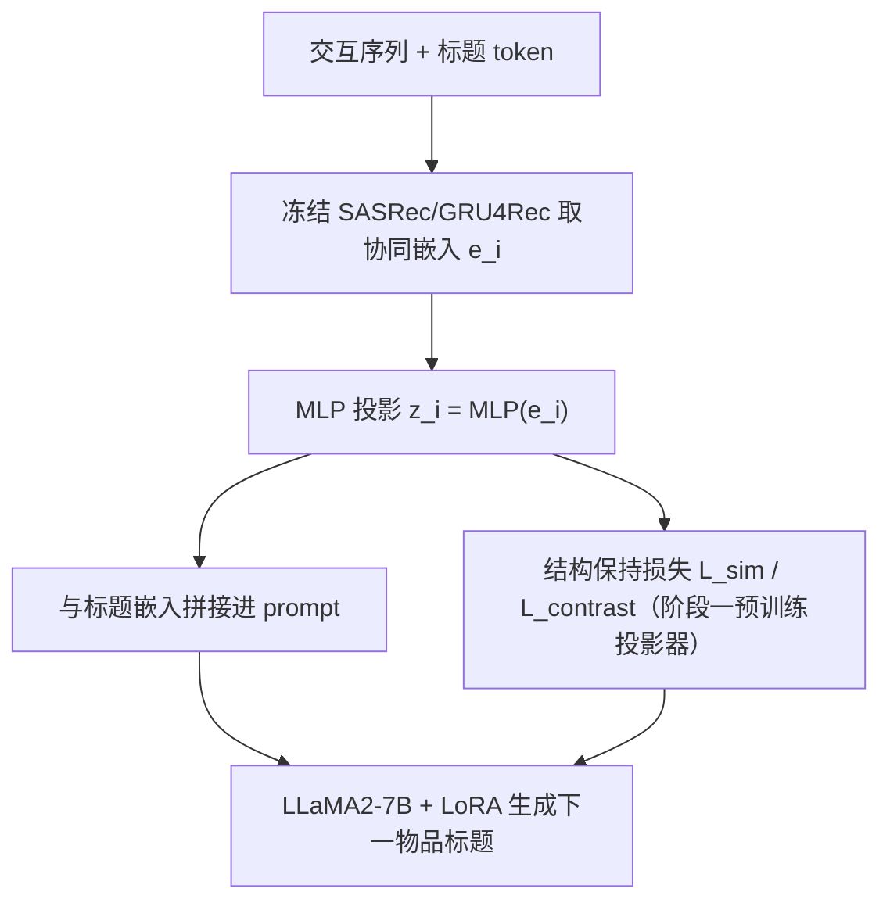
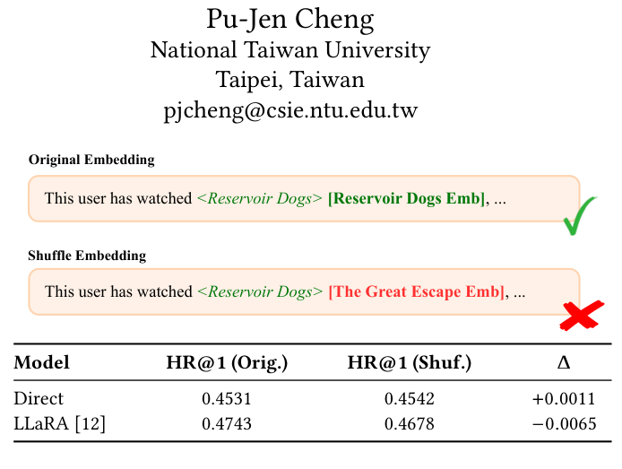

# Structure-Preserving Projection for Mitigating Modality Bias in LLM-Based Sequential Recommendation (面向 LLM 序列推荐中模态偏置缓解的结构保持投影)

- **会议/期刊**: RecSys 2026
- **作者与机构**: Tzu-Wei Chiu, Song-Duo Ma, Hsin-Yu Lin, Pu-Jen Cheng（台湾大学）
- **推荐链路定位**: 精排（LLM 生成式 next-title 预测）
- **研究方向**: 大语言模型推荐 / 序列推荐
- **论文原文**: [https://arxiv.org/abs/2608.08583v1](https://arxiv.org/abs/2608.08583v1)
- **开源代码**: 暂未开源

## TL;DR (1分钟核心速览)

LLM 推荐器把协同嵌入经 MLP 投影进 LLM 词嵌入空间后，往往只把投影向量当作"软提示"，实际仍靠标题文本决策——本文用 embedding-shuffle 诊断定量证实了这一**模态偏置**。作者提出两个结构保持损失：批内余弦相似度矩阵对齐（`L_sim`）与序列级正负对比保持（`L_contrast`），并给出"先几何、后判别"的三阶段课程。在 LastFM / MovieLens-100K 的 20 候选协议下，Contrastive-LM 相对 LLaRA 的 HR@1 提升 12.0pt（LastFM, GRU4Rec 嵌入）与 4.6pt（MovieLens, SASRec 嵌入），且打乱协同嵌入后性能显著下降，证明协同信号被真正利用。

## Background & Motivation (背景与核心矛盾)

- **主流范式**: LLaRA / CoLLM / A-LLMRec 一类工作把预训练序列推荐器（SASRec、GRU4Rec）的物品协同嵌入经 MLP 投影进 LLM 词嵌入空间，与标题 token 拼接后做 next-title 生成。
- **前人局限**: ① 这些方法默认"投影后 LLM 就能用上协同信号"，但标题遵循语言模式、与 LLM 预训练高度对齐，而用户行为序列含大量跨域跳转，二者表征结构天然错配；② 无约束的投影会扭曲原协同空间的物品-物品关系几何，投影向量退化为通用软提示。
- **核心洞察 (Key Insight)**: 作者做了**嵌入打乱诊断**——固定标题、随机替换协同嵌入，Direct 的 MovieLens HR@1 从 0.4531 变到 0.4542（Δ≈+0.001），LLaRA 仅 −0.0065，说明基线几乎不依赖协同嵌入；反之打乱标题则性能崩塌。这与视觉-语言模型中"非文本输入被破坏仍高置信"的现象同构。
- **本文切入点**: 既然偏置源于**投影导致的结构失真**，就在投影器上显式加结构约束，让投影空间忠实继承协同空间的相对几何与序列判别序。

## Method (核心方法设计)

### 1. 整体框架 (Overall Architecture)

输入为交互序列 $\mathcal{I}=[i_1,\dots,i_t]$，每个物品同时携带标题 token 嵌入$E_{t_i}$与协同嵌入$e_i$（来自冻结的 SASRec/GRU4Rec）。协同嵌入经 MLP 投影为$z_i=\mathrm{MLP}(e_i)$，与标题嵌入交替拼进 prompt：$X=\{E_{instr},E_{t_{i_1}},z_{i_1},\dots,E_{t_{i_t}},z_{i_t}\}$，LLM 以 next-token 负对数似然生成目标标题。训练分两阶段：先只用结构保持损失预训练投影器（LLM 与推荐器冻结），再联合微调投影器与 LoRA 化的 LLaMA2-7B，结构损失持续约束以防语言建模目标把协同几何"洗掉"。

<figure class="paper-figure" markdown="span">
  <figcaption>图1：嵌入打乱诊断。在保持标题不变的情况下打乱协同嵌入，MovieLens 的 HR@1（Hit Ratio at 1）几乎不变（Δ = Shuf.−Orig. ≈0），表明模型对协同嵌入的依赖较弱。</figcaption>
</figure>

### 2. 关键设计拆解 (Key Designs)

1. **余弦相似度保持 `L_sim`（保全局关系几何）**：痛点是 MLP 投影无约束时物品间相似度排序被打乱。做法是对批内所有物品对，令投影空间余弦相似度矩阵逼近原空间：$\mathcal{L}_{sim}=\frac{1}{|\mathcal{B}|^2}\sum_{i,j\in\mathcal{B}}\left(S^{proj}_{ij}-S^{orig}_{ij}\right)^2$，其中$S_{ij}=\cos(\cdot,\cdot)$。直觉是"相对位置比绝对坐标更重要"——只要物品邻域拓扑不变，LLM 就能借标题语义把协同关系"翻译"成可生成的语言决策。
2. **对比保持 `L_contrast`（保序列判别序）**：痛点是几何保真不等于推荐有用，序列编码器学到的"正样本比负样本更近"的偏好序可能在投影后丢失。做法是把序列表示 $h_s$、真实下一物品$e_p$、随机负样本$e_n$一并投影，用 BCE 拉开：$\mathcal{L}_{contrast}=-\log\sigma(\langle z_s,z_p\rangle)-\log\left(1-\sigma(\langle z_s,z_n\rangle)\right)$。它允许投影器**有选择地重塑**几何，只保留对 next-item 判别有用的部分。
3. **训练目标、负采样与推理效率**：总损失 $\mathcal{L}=\mathcal{L}_{LM}+\alpha\mathcal{L}_{struct}$，$\alpha$在验证集上以 0.1 步长线性搜索（Cosine-LM 取 0.4，Contrastive-LM 取 0.8）；负样本为全局物品池**均匀随机采样**（每正样本 1 个），无难负样本挖掘。推理为自回归生成标题再与候选集做唯一匹配，开销与 LLaRA 同量级，额外成本仅在训练期的批内相似度矩阵（$O(|\mathcal{B}|^2 d)$）。

## Experimental Setup & Evaluation Protocol (实验设置与评估协议)

- **数据集与预处理**: 采用 LLaRA 发布的预处理版本，交互按时间排序。

| 数据集 | #Users | #Items | #Interactions | 稀疏度/密度 | 特征/场景说明 |
| :--- | :---: | :---: | :---: | :---: | :--- |
| LastFM | 1,220 | 4,606 | 73,510 | 密度 ≈1.31% | 音乐收听序列 |
| MovieLens-100K | 943 | 1,682 | 100,000 | 密度 ≈6.31% | 电影观看序列 |

- **数据划分与防穿越 (Splitting Strategy)**: 按时间排序后 **8:1:1 比例划分**（train/valid/test），显式防穿越。
- **排名评测协议 (Ranking Protocol)**: **Sampled Ranking**——每个测试实例构造 20 候选（1 正 + 19 负），所有方法共享同一候选集；ID-based 方法先全库打分再截断到候选集，LLM 方法生成标题后归一化匹配，仅唯一匹配算有效。指标为 HR@1（分母为有效生成数）与 VR（有效生成占比）。
- **对比基线与超参设置**: 三类基线——传统序列模型 GRU4Rec/SASRec；纯文本 LLM（zero-shot LLaMA2-7B、TALLRec）；投影协同嵌入的 LLM（Direct、LLaRA）。LLaMA2-7B + LoRA，batch 128，余弦学习率调度；显著性用 5 个随机种子的配对 t 检验（LastFM $p<0.05$，MovieLens 因方差较大报$p<0.1$ 边际显著）。

## Key Experimental Results (实验关键数据)

### 1. 主实验对比 (Main Results)

| 方法 | LastFM HR@1 | LastFM VR | ML-100K HR@1 | ML-100K VR |
| :--- | :---: | :---: | :---: | :---: |
| GRU4Rec | 0.2616 | 1.0000 | 0.3750 | 1.0000 |
| SASRec | 0.2233 | 1.0000 | 0.3444 | 1.0000 |
| LLaMA2-7B (zero-shot) | 0.0246 | 0.3443 | 0.0421 | 0.4421 |
| TALLRec | 0.4180 | 0.9836 | 0.3895 | 0.9263 |
| **GRU4Rec 嵌入块** | | | | |
| Direct | 0.4872 | 0.9590 | 0.4043 | 0.9895 |
| LLaRA | 0.4344 | 0.9836 | 0.4421 | 0.9684 |
| Cosine-LM (ours) | 0.5133 | 0.9262 | 0.4681 | 0.9895 |
| **Contrastive-LM (ours)** | **0.5546** | 0.9754 | **0.4881** | 0.8842 |
| **SASRec 嵌入块** | | | | |
| Direct | 0.4721 | 0.9967 | 0.4531 | 0.9789 |
| LLaRA | 0.4676 | 0.9820 | 0.4743 | 0.9811 |
| Cosine-LM (ours) | 0.5309 | 0.9885 | 0.4874 | 0.9853 |
| **Contrastive-LM (ours)** | **0.5511** | 0.9902 | **0.4993** | 0.9832 |

相对最强基线 LLaRA：LastFM 上 +12.0pt（GRU4Rec 嵌入）/ +8.4pt（SASRec 嵌入），MovieLens 上 +4.6pt / +2.5pt。

### 2. 消融实验 (Ablation Study)

| 配置 | LastFM HR@1 | ML-100K HR@1 | 说明 |
| :--- | :---: | :---: | :--- |
| Direct（无结构约束） | 0.4721 | 0.4531 | SASRec 嵌入基线 |
| + `L_sim` (Cosine-LM) | 0.5309 | 0.4874 | 仅几何保持 |
| + `L_contrast` (Contrastive-LM) | 0.5511 | 0.4993 | 仅判别保持 |
| Combined（三阶段课程） | **最优** | **最优** | 先 `L_sim` 后 `L_contrast` |
| 联合微调 SASRec（Cosine-LM） | 0.5492 | 0.5026 | 冻结→可训练 |
| 联合微调 SASRec（Contrastive-LM） | **0.5702** | **0.5106** | 增益大于基线 |

结构保真度（表 3）：Cosine-LM 的 Kendall's Tau 达 0.7801（LastFM）/ 0.7501（ML），远高于 Contrastive-LM 的 0.6147 / 0.3682，但后者 HR@1 更高。

### 3. 关键实验发现 (Key Findings)

1. **模态偏置被定量坐实**：打乱协同嵌入时 Direct/LLaRA 的 HR@1 几乎不动（Δ≈0），而打乱标题则断崖下跌；本文方法在嵌入打乱下显著掉点，说明其真正把协同几何纳入了决策，而非把投影向量当软提示。
2. **"保真 ≠ 有用"的权衡**：Cosine-LM 的 Tau/Rho/SIM@10 全面领先，但 HR@1 落后 Contrastive-LM 约 2pt（LastFM 0.5309 vs 0.5511），说明全局几何保真会连带保留与 next-item 无关的关系，适度结构重塑反而更利于判别。
3. **课程与联合微调双重增益**：三阶段调度（0–30% 几何预热、30–70% 余弦插值过渡、70–100% 判别精修）在 GRU4Rec/SASRec 两种嵌入下均优于单损失；放开 SASRec 联合训练后 Contrastive-LM 升至 0.5702 / 0.5106，且增益幅度大于 Direct/LLaRA，表明几何约束与骨干自适应存在协同。

## Highlights & Limitations (亮点、对比与审稿批判)

- **与代表作对比 (vs. Prior Work)**: 相比 LLaRA 的"课程式占位符替换"（只解决输入格式对齐）与 A-LLMRec 的"投影前先与 SBERT 文本对齐"（只解决跨模态语义对齐），本文首次把矛头指向**投影后的关系几何失真**，用显式损失约束而非架构改造，可与任意投影式 LLM 推荐器正交叠加。
- **可迁移亮点**: ① embedding-shuffle / text-shuffle 双诊断可作为检验任意多模态推荐器"是否真用上某路信号"的通用探针；② "先几何预热、后判别精修"的损失课程可迁移到跨域对齐、多模态融合等需要兼顾保真与任务性的场景。
- **审稿级局限批判**: ① 评测仅用 20 候选的采样排序，与真实全库排序差距大，且 LLM 生成匹配会引入 VR 波动（Contrastive-LM 在 ML 上 VR 仅 0.8842），HR@1 与 VR 的权衡未被充分讨论；② 仅两个小规模数据集、单一 LLaMA2-7B 骨干，MovieLens 上仅达 $p<0.1$边际显著，泛化性与统计强度偏弱；③ 批内$O(|\mathcal{B}|^2)$ 相似度矩阵与两阶段训练增加了工程复杂度，论文未报告训练时长与显存开销。

## Rating (四维评分)

- **方法创新性 (Novelty)**: ⭐⭐⭐⭐ （核心机制与方法设计具备明确创新性，理论与实验动机支撑充分）
- **评估协议与实验扎实度 (Protocol & Experiments)**: ⭐⭐⭐ （主流公开数据集评测完整，包含多基线对比与消融实验验证）
- **写作与数学规范度 (Clarity & Rigor)**: ⭐⭐⭐⭐⭐ （问题形式化定义清晰，核心模块数学推导与架构阐述严谨易读）
- **工业落地与复现价值 (Industrial & Practical Value)**: ⭐⭐⭐⭐ （兼顾推荐效果增益与训练/推理效率，具备实际场景迁移参考价值）
