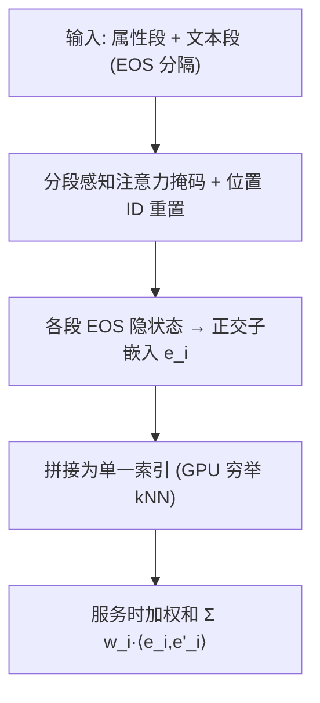

# Embedding Subspace Partitioning for Dynamic Multi-Objective Retrieval (面向动态多目标检索的嵌入子空间划分)

- **会议/期刊**: RecSys 2026
- **作者与机构**: Shaobo Zhang, Alice Leung, Yunxiang Ren, Ping Liu, Yuchin Juan 等（LinkedIn）
- **推荐链路定位**: 召回（大规模双塔检索）
- **研究方向**: 多任务学习与列表级重排 / 协同过滤与双塔召回
- **论文原文**: [论文原文链接](https://arxiv.org/abs/2609.30601v1)
- **开源代码**: 暂未开源

## TL;DR (1分钟核心速览)

工业双塔召回把语义相关性、互动、收入等异质目标压进单一静态嵌入，导致两个痛点：训练后无法在服务时调整目标优先级（"no-knob problem"），且多目标联合优化产生几何干扰。本文提出 ESP，把嵌入切分为任务感知正交子空间，用服务时可调权重的子空间相似度加权和替代单一点积。在 MS MARCO 多目标基准（1,359 查询、39K 语料、Full-Ranking）上，单模型在匹配实体召回下语义 NDCG 比最强 MTSH 基线高 +2.5pp（$p<0.001$）；LinkedIn 生产 A/B 中单模型调权即得 +4.0% 收入、+3.95% 投递、−8.95% 不匹配率。

## Background & Motivation (背景与核心矛盾)

- **主流范式**: 大规模召回依赖双塔（DPR/ANCE/E5），每物品一个 $d$ 维向量、单次点积打分，以换取 ANN 索引与低延迟；多目标场景下要么用加权多目标损失训练单嵌入（MTSH），要么每目标一套独立检索栈（MTMH）。
- **前人局限**: (1) MTSH 把权衡"烘焙"进训练，优先级一变就得重训，且目标间几何干扰无法靠损失加权消除；(2) MTMH 每目标一个 ANN 索引，基础设施随目标数线性膨胀，且 $n/2$ 合并会同时拉低各目标指标。
- **核心洞察 (Key Insight)**: 作者将多目标检索形式化为子空间逼近问题，证明共享嵌入的所需维度下界为 $d \ge r(1+(k-1)\varepsilon)$，随目标数 $k$ 与子空间冲突度 $\varepsilon$ 线性增长；而正交分块构造只需 $d=\sum_i r_i$，与冲突模式无关。在 MS MARCO 上实测 Kendall $\tau=0.34$，即 $\varepsilon=0.66$，预测共享嵌入损失约 40% 有效秩容量。
- **本文切入点**: 干扰是**架构性**而非优化器问题（PCGrad 只能缓解不能消除），因此应在输出层做硬性正交划分，并把权衡旋钮从训练搬到服务时。

## Method (核心方法设计)

### 1. 整体框架 (Overall Architecture)

ESP 将嵌入划分为 $k$ 个正交子空间，第 $i$ 个子空间产出 L2 归一化的子嵌入 $\mathbf{e}_i\in\mathbb{R}^{d_i}$，拼接为 $\mathbf{e}=[\mathbf{e}_1;\dots;\mathbf{e}_k]$，维度按各目标有效秩比例分配。检索分数为加权和 $S(q,d)=\sum_i w_i\langle \mathbf{e}_i,\mathbf{e}'_i\rangle$，权重 $\{w_i\}$ 在请求侧服务时施加，不进入模型。每个子空间用各自的目标损失独立训练（InfoNCE / MSE / BCE 可自由混搭），因 $\partial\mathcal{L}_i/\partial\mathbf{e}_j=0\ (j\neq i)$，输出层不存在"折中方向"。服务端用 GPU 加速的穷举 kNN 在单一拼接索引上打分，避免每目标一套 ANN。

### 2. 关键设计拆解 (Key Designs)

1. **EOS 分隔的 Transformer 子空间隔离（零新增参数）**：痛点是用新增特殊 token 需重训词表。ESP 复用模型原生 EOS 作为段分隔符，采用"属性在前"排序（因果注意力下属性 EOS 天然只看到属性 token），再加分段感知因果掩码使每个 EOS 仅关注本段，并对 RoPE 在每个段边界重置位置 ID（否则同一属性文本因绝对位置不同产生不同嵌入）。消融显示：仅实体前置即让相同实体文本余弦≈0.97；加掩码使实体可区分度 92.8%→100%；位置重置把余弦从≈0.50 恢复到≈0.73–1.0。
2. **服务时权重旋钮与单索引服务**：核心算子即式 (1) 的加权和，$w_i=1$ 时退化为标准点积，完全兼容现有穷举 kNN。关键系统洞察：IVFPQ 等划分式 ANN 预设嵌入是"单一连贯几何体"，而独立子空间拼接不满足该假设，故 ESP 必须搭配 GPU 穷举检索——这是模型-硬件协同设计，而非纯算法改进。
3. **训练目标与维度分配**：总损失 $\mathcal{L}=\sum_i \alpha_i\mathcal{L}_i$，排序目标用 InfoNCE（温度 $\tau$），训练权重 $\alpha_i$ 只影响收敛速度不影响几何容量。维度按定理 5 比例分配 $d_i^*=d\cdot r_i/\sum_j r_j$；实测实体匹配在 $d_{\text{ent}}=32$（$H=1024$ 的 3%）即饱和，语义需 $d_{\text{sem}}\gtrsim 750$，形成约 1:20 的分辨率差，辅助业务目标可只占极小空间。

## Experimental Setup & Evaluation Protocol (实验设置与评估协议)

- **数据集与预处理**: 基于 MS MARCO 自建多目标基准，为每个查询抽取在正例段落中逐字出现的多词命名实体，并从**其他查询**中采样含同一实体但回答不同问题的段落作为硬负例（同实体、不同信息需求），制造真实目标冲突。

| 数据集 | #Queries | #Train 样本 | #Eval 样本 | 语料规模 | 特征/场景说明 |
| :--- | :---: | :---: | :---: | :---: | :--- |
| MS MARCO-MO | 1,993 | 13,951 | 2,093（覆盖 1,359 查询） | ~39K 段落（含 35K 随机干扰项） | 72% 硬负例、28% 易负例；语义 vs 实体双目标 |

- **数据划分与防穿越 (Splitting Strategy)**: 按查询级划分训练/评测集（1,993 唯一查询），评测查询与训练查询不重叠；所有方法在 1,359 个评测查询上对全语料排序。
- **排名评测协议 (Ranking Protocol)**: 无偏 `Full-Ranking`（每查询对 ~39K 段落全库排序），指标为 Semantic NDCG@10 与 Entity Recall@10；显著性用 bootstrap 95% CI（1,359 查询重采样），$p<0.001$。
- **对比基线与超参设置**: 预训练 0.6B 嵌入模型（$H=1024$），基线含无实体 Baseline、Entity-in-prompt（指令路由）、模拟 MTMH（分目标 prompt + $n/2$ 合并）、ColBERT；训练版对比 MTSH（$\alpha_e\in\{1,5,10\}$）、MTSH+PCGrad。ESP 训练 1 epoch，服务权重 $w_e$ 扫描不重训。

## Key Experimental Results (实验关键数据)

### 1. 主实验对比 (Main Results)

预训练模型（无微调，39K 语料，1,359 查询）：

| 方法 | Sem NDCG@10 | Ent Recall@10 | 每文档向量数 | 打分方式 |
| :--- | :---: | :---: | :---: | :--- |
| Baseline（无实体） | .668 | .496 | 1 | dot |
| Entity in prompt | .762 | .594 | 1 | dot |
| MTMH†（模拟） | .677 | .833 | 2 | 2×dot + merge |
| ColBERT | **.849** | **.935** | $L$ token 向量 | MaxSim |
| **ESP (ours)** | .843 | .932 | **1** | **1×加权 dot** |

训练后模型（0.6B，1 epoch）：

| 方法 | Sem NDCG@10 | Ent Recall@10 |
| :--- | :---: | :---: |
| Baseline（无实体） | .870±.220 | .679 |
| MTSH ($\alpha_e=1$) | **.924**±.164 | .887 |
| MTSH ($\alpha_e=5$) | .875±.208 | 1.000 |
| MTSH ($\alpha_e=10$) | .823±.240 | 1.000 |
| MTSH + PCGrad | .879±.205 | 1.000 |
| **ESP ($w_e=0.8$)** | **.900**±.183 | **.999** |

在匹配实体召回（≈1.0）的操作点上，ESP 比最佳 MTSH 高 **+2.5pp** 语义 NDCG（95% CI [+1.6, +3.5]），且无需重训。

### 2. 消融实验 (Ablation Study)

| 配置 | 关键指标 | 说明 |
| :--- | :---: | :--- |
| 仅实体前置（因果隔离） | 同实体余弦 ≈0.97 | 免费获得隔离 |
| + 分段感知掩码 | 实体可区分度 92.8% → **100%**（+7.2pp） | 对称隔离成立 |
| + 位置 ID 重置 | 余弦 ≈0.50 → **0.73–1.0** | 修正 RoPE 位置偏置 |
| $d_{\text{ent}}$ 扫描 | $d_{\text{ent}}=32$ 即 100% 实体准确率 | 低分辨率目标 |
| $k=3$（+长度偏好） | .843 / .957 / .912 | 相比 $k=2$ 仅 −1.8pp / −2.8pp 语义/实体，+5.4pp 长度匹配 |
| 单目标 BEIR（NFCorpus/SciFact/FiQA） | 波动 ≤0.3pp | 无单目标回退 |

### 3. 关键实验发现 (Key Findings)

1. **干扰是几何性的，梯度手术治标不治本**：MTSH 把实体权重从 1 提到 10，语义 NDCG 单调下滑 .924→.823；PCGrad 只把损失从 −4.9pp 缓解到 −4.6pp，而 ESP 在同等实体召回下保持 .900，证明瓶颈在嵌入容量而非梯度冲突。
2. **语义 NDCG 平台源于信号互补而非无冲突**：$w_e\in[0.3,0.8]$ 时语义稳定在 .899–.900，且 $w_e=0.3$ 比纯语义（.870）还高 +2.9pp，因为基准中实体匹配段落与语义相关正相关；只有 $w_e=1.0$ 时语义才崩到 .583——子空间隔离使实体加权只能"重加权"而不能"腐蚀"语义排序。
3. **生产规模下干扰被放大、ESP 收益被放大**：MTSH 在收入权重 0.99 时损失 28.24% in-batch 召回与 21.19% 离线 KNN 召回；同等收入强调下 ESP 仅损失 0.54%，约 **50×** 改善。7 天线上 A/B 中 $w_{d1}=0.3$ 同时取得 +4.01% 收入、+3.95% 投递、+0.92% 点击，且不匹配率降 8.95%。

## Highlights, Limitations & Rating (亮点、对比与审稿评价)

- **与代表作对比 (vs. Prior Work)**: 相比 MTSH/Uni-Retriever，ESP 把权衡从训练搬到服务时，单模型覆盖整条 Pareto 前沿；相比 MTMH，ESP 只需一个拼接索引与一次加权点积，避免 $k$ 套 ANN 与后置合并；相比 ColBERT，ESP 以每文档 1 个向量（$k$ 个子空间拼接）达到接近的实体召回，存储与打分成本低一个量级。
- **可迁移亮点**: (1) 用原生 EOS + 段边界位置重置实现"零参数子空间隔离"，可直接迁移到任何 RoPE Transformer 双塔的多字段/多目标编码；(2) 按有效秩比例分配子空间维度，对"低分辨率业务目标 + 高分辨率语义目标"的工业组合极具参考价值。
- **审稿级局限批判**: (1) 强依赖 GPU 穷举 kNN，与 IVFPQ 等主流划分式 ANN 不兼容，语料规模再上一个量级时系统成本存疑；(2) 依赖上游实体/属性标注器，且开源基准仅 39K 语料、单一实体-语义冲突对，高熵多目标冲突（如语义 vs 主题多样性）场景尚未验证；子空间分数校准（等渗回归）仍留作未来工作。
- **四维评分**: 创新性 ⭐⭐⭐⭐ | 实验扎实度 ⭐⭐⭐⭐ | 方法清晰度 ⭐⭐⭐⭐⭐ | 落地价值 ⭐⭐⭐⭐⭐

