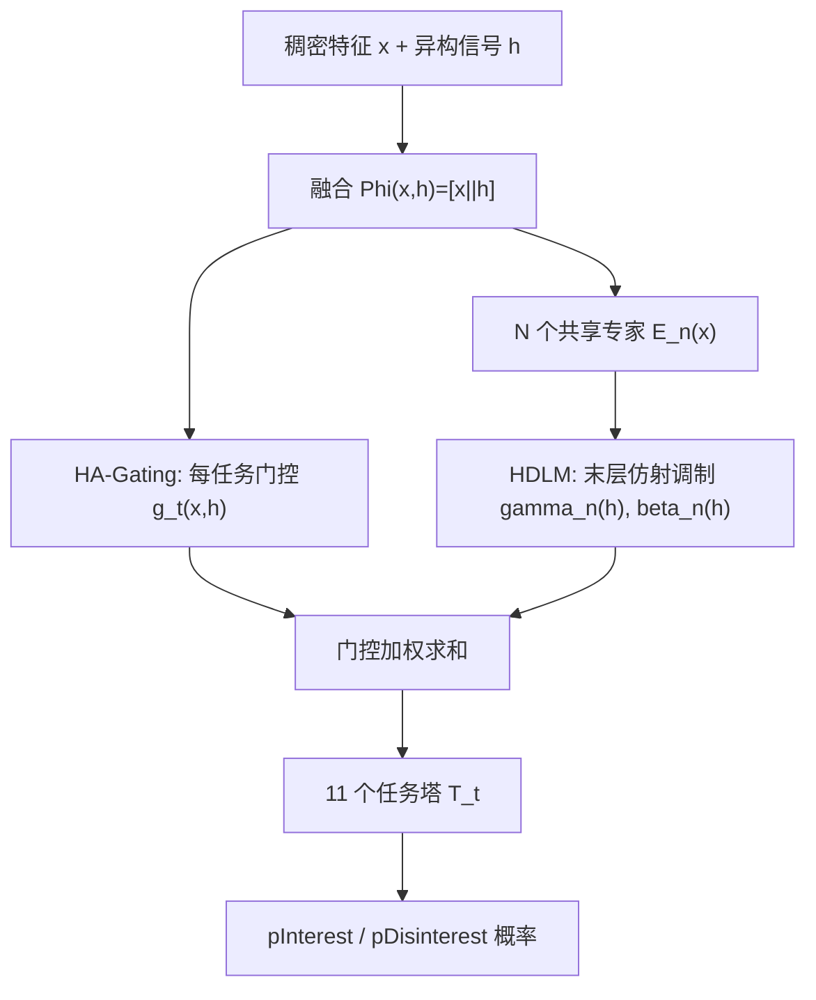
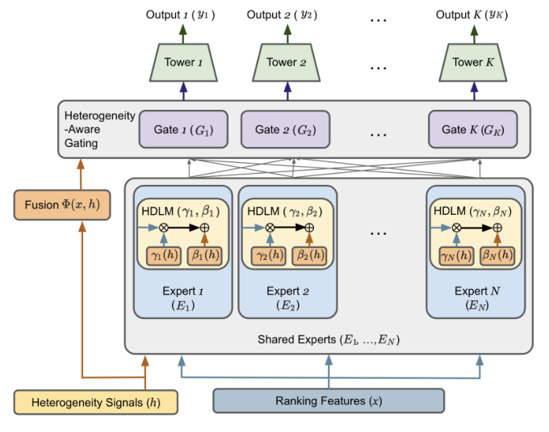

# Heterogeneous Ranking in Industrial-Scale Recommender Systems: A Case Study (工业级推荐系统中的异构排序：一项案例研究)

- **会议/期刊**: ACM RecSys 2026 (Industry Track)
- **作者与机构**: Di Bai, Jintao Liu, Zhenwei Tang, Peifan Wu, Nada Al-Thawr, Luoshu Wang (Google LLC)
- **推荐链路定位**: 精排（统一多任务排序）
- **研究方向**: 多任务学习与列表级重排 / 去偏公平与工业架构
- **论文原文**: [https://arxiv.org/abs/2607.27577v1](https://arxiv.org/abs/2607.27577v1)
- **开源代码**: 暂未开源

## TL;DR (1分钟核心速览)

Google Discover 用单一排序模型统一处理开放网络中的文章、长短视频、UGC、赛事卡片与 AI 摘要等异构内容，面临特征密度不均、交互模式分化、多数类偏置与负迁移四大痛点。本文提出 HA-MoE：把显式异构信号 $h$ 同时注入门控网络（HA-Gating）与专家表示（HDLM 仿射调制），在模型规模增长 <5%、端到端延迟增加 <0.5% 的约束下实现内容类型特化；并配套 LENS 可观测性框架（激活切片 + PIEM 置换不变匹配）与 DL-AUC 双层评估指标。离线 7 天千万级样本上 pInterest/pDisinterest DL-AUC 达 0.691/0.949，线上 1% 流量 A/B 中 DAU +0.22%、多样互动率 +0.54%。

## Background & Motivation (背景与核心矛盾)

- **主流范式**: 工业界多任务精排以 Shared-Bottom MLP 或 MMoE/PLE 为主，异构内容（如自然结果与广告）通常走"分模型排序 + 后置重排融合"的两段式路线。
- **前人局限**: ① 开放网络内容缺乏统一上游特征标准化，特征密度与信号可得性天然不对称，单一共享表征被迫服务所有分布；② 全局 CTR 优化会系统性抬高低质文章（标题党）而压制高价值视频/UGC，形成多数类坍缩与跨类型排序错位。
- **核心洞察 (Key Insight)**: 异构信号 $h$（content_type、是否关注创作者、可购物内容、AI 卡片等）本就存在于特征管线中，问题不是"缺信号"，而是"信号未被结构化地用于路由与表征调制"——因此无需扩参即可换取特化能力。
- **本文切入点**: 在稠密 MMoE 骨架上做两处轻量改造（门控输入拼接 $h$、专家末层仿射调制），并用可观测性与双层指标为持续重训提供部署护栏。

## Method (核心方法设计)

### 1. 整体框架 (Overall Architecture)

输入为稠密特征 $x\in\mathbb{R}^d$与显式异构信号$h\in\mathbb{R}^{d_h}$，二者经轻量融合$\Phi(x,h)=[x\parallel h]$后进入$N$个共享专家与$K=11$个任务门控；每个专家的末层输出被$h$驱动的仿射变换重标定，门控加权求和后送入任务塔$T_t$ 输出 11 路概率。训练采用 BCE 逐点损失与 RankNet 成对损失的加权组合，线上以稠密（非稀疏）路由保证训练速度与推理延迟可控。

<figure class="paper-figure" markdown="span">
  <figcaption>图2：HA-MoE 概览。将显式异构信号注入多任务门控网络与专家表示中，以自适应处理不同内容分布，而无需大规模参数扩展。</figcaption>
</figure>

### 2. 关键设计拆解 (Key Designs)

1. **HA-Gating（异构感知门控）**：痛点在于标准 MMoE 门控只看 $x$，无法按内容类型分流专家。本文将$h$拼入门控输入：$g_t(x,h)=\mathrm{Softmax}(W_t\Phi(x,h)+b_t)$。直觉上，门控从"用户-物品语义"升级为"用户-物品-内容形态"三元决策，使少数类型（视频、UGC）能稳定绑定专属专家，从结构上抵抗多数类淹没。

2. **HDLM（异构驱动线性调制）**：痛点在于专家参数被所有分布共享，容量与分布偏置耦合。本文用 $h$生成逐专家的缩放/平移向量：$\gamma_n(h)=W_{\gamma,n}h+b_{\gamma,n}$，$\beta_n(h)=W_{\beta,n}h+b_{\beta,n}$，并施加于专家末层：$\tilde{E}_n(x,h)=\gamma_n(h)\odot E_n(x)+\beta_n(h)$。这相当于让同一专家在不同内容语境下"切换工作模式"——视频场景偏向视觉消费模式，关注创作者内容则从全局流行度先验转向用户-创作者亲和度。仅作用于末层是为保住训练速度与稳定性。

3. **训练目标、负采样与推理效率**：总损失 $\mathcal{L}=\alpha\mathcal{L}_p+(1-\alpha)\mathcal{L}_r$，其中$\mathcal{L}_p$为 11 头加权 BCE，$\mathcal{L}_r$为同会话共曝光物品上按任务构造的 RankNet 成对损失（仅保留正负对并过滤噪声组合，logit margin 缩放、按批内有效对数动态归一）。负样本来自真实曝光日志的正采样/负降采样，非随机负采样。推理侧专家数$N=4$（网格搜索自$\{2,4,8,16\}$），模型规模 +<5%、p50/p95 端到端延迟 +<0.5%。

## Experimental Setup & Evaluation Protocol (实验设置与评估协议)

- **数据集与预处理**: 仅用 Google Discover 自研工业日志（作者明确指出公开数据集缺乏所需异构性），训练语料跨较长时窗以覆盖短中期趋势，正样本上采样、负样本降采样缓解类别不平衡。

| 数据集 | #Users | #Items | #Interactions | 稀疏度/密度 | 特征/场景说明 |
| :--- | :---: | :---: | :---: | :---: | :--- |
| Discover 离线留出集 | 未披露（十亿级 MAU 平台） | 未披露 | ≈10M 全局样本 | 未披露 | 7 天留出；11 任务；含文章/长短视频/UGC/赛事卡/AI 摘要 |

- **数据划分与防穿越 (Splitting Strategy)**: 全局时间切分的 7 天 holdout（时间留出），非 Leave-One-Out。
- **排名评测协议 (Ranking Protocol)**: 全库未交互排序的 AUC 类指标（非采样排序），并额外报告跨内容类型的 xAUC 矩阵；核心指标 DL-AUC $=\lambda\cdot\text{Micro-AUC}+(1-\lambda)\cdot\text{Macro-xAUC}$，$\lambda=0.8$（全局效用权重为跨类型正确性的 4 倍，跨类型作为安全下限）。
- **对比基线与超参设置**: 基线为 Shared MLP（生产现状）与 Standard MMoE；专家为 ReLU 激活 FFN，专家网络采用正交初始化以鼓励多样化利用；所有模型继承同一套生产超参（含 $\alpha$ 与 11 个任务权重初值，训练中按梯度范数动态调整），保证公平对比。

## Key Experimental Results (实验关键数据)

### 1. 主实验对比 (Main Results)

| 模型 | pInterest DL-AUC | pDisinterest DL-AUC |
| :--- | :---: | :---: |
| Shared MLP（生产基线） | 0.679 | 0.939 |
| Standard MMoE | 0.686 | 0.934 |
| HA-MoE w/o HA-Gating | 0.689 | **0.949** |
| HA-MoE w/o HDLM | 0.690 | 0.945 |
| **HA-MoE（完整）** | **0.691** | **0.949** |

跨类型 xAUC（pDisinterest，Web 文章 vs 视频）：

| 模型 | Web+ vs Vid− | Vid+ vs Web− | ΔGap (↓) |
| :--- | :---: | :---: | :---: |
| Shared MLP | **0.971** | 0.830 | 0.141 |
| HA-MoE | 0.960 | **0.900** | **0.060** |

线上 A/B（1% 流量，7 天，相对生产基线 ±95% CI）：

| 指标组 | 指标 | Lift |
| :--- | :--- | :---: |
| Feed Activity | DAU | +0.22% ±0.11% |
| Feed Activity | Viewed Impressions | +0.48% ±0.34% |
| Exploration | Scroll Depth | +0.34% ±0.25% |
| Exploration | Diverse Feed Rate | +0.36% ±0.03% |
| Exploration | Diverse Engagement Rate | +0.54% ±0.07% |

### 2. 消融实验 (Ablation Study)

| 配置 | pInterest | pDisinterest | 说明 |
| :--- | :---: | :---: | :--- |
| w/o HA-Gating | 0.689 | 0.949 | 门控退化为仅看 $x$，正任务掉 0.002 |
| w/o HDLM | 0.690 | 0.945 | 专家无调制，负任务掉 0.004 |
| Full HA-MoE | **0.691** | **0.949** | 两组件互补，正负任务同时最优 |

### 3. 关键实验发现 (Key Findings)

1. **打破多任务跷跷板**：Standard MMoE 相对 Shared MLP 在 pInterest 上 +0.007，却在 pDisinterest 上 −0.005，典型负迁移；HA-MoE 同时取得 0.691/0.949，说明异构信号注入是把"冲突目标"解耦为"按内容类型分工"的关键，而非简单扩参。
2. **全局 AUC 掩盖结构性失败**：Shared MLP 的 Web+ vs Vid− 高达 0.971 但 Vid+ vs Web− 仅 0.830，ΔGap 0.141；HA-MoE 主动牺牲 0.011 的多数类优势换取少数类 +0.070，ΔGap 收窄至 0.060——这正是 DL-AUC 中 Macro-xAUC 项存在的意义，也解释了为何线上"历史上被低估的流量被有效释放"。
3. **特化模式与任务语义强相关**：LENS 激活切片显示，全类型通用的稠密动作（如点赞）由单一共享专家主导，稀疏通用动作（如问卷反馈）分配两个共享专家，而格式依赖动作（详情页点击、文本展开）呈现高度分化的专家激活；PIEM 进一步区分"健康的多解重参数化"（快照 B/C 高 PIEM）与"功能性坍缩"（快照 A 低 PIEM 且离线指标更差），为持续重训提供免标签早期预警。

## Highlights & Limitations (亮点、对比与审稿批判)

- **与代表作对比 (vs. Prior Work)**: 相较 MMoE/PLE 仅做任务级门控，本文将"内容形态"作为一等公民注入门控与专家两层；相较 STAR/PEPNet 等 MDR 的域条件调制，本文不引入域专属参数塔，而是复用已有 $h$ 做轻量仿射，因而在固定显存/延迟预算下可落地；相较两段式"分模型 + 后置融合"，本文坚持单模型统一排序，避免级联打分尺度不可比。
- **可迁移亮点**: ① DL-AUC 的 $\lambda$ 加权"全局效用 + 跨段正确性"可作为任何异构/多来源信息流的模型准入门禁指标；② PIEM 用行为画像向量 + 匈牙利匹配 + JSD 做跨快照专家对齐，成本极低，可直接移植到任何 MoE 推荐系统的训练监控。
- **审稿级局限批判**: ① 完全依赖自研工业数据，无公开数据集与开源代码，可复现性与结论外推性受限；② 门控融合仅用简单拼接 $[x\parallel h]$，作者自认表达力不足，且$\lambda=0.8$、$N=4$ 等关键超参缺乏敏感性分析；③ PIEM 在独立重训间低分可能仅代表"等价局部最优"而非退化，作者亦承认其与线上性能非直接因果，诊断信号存在误报风险。

## Rating (四维评分)

- **方法创新性 (Novelty)**: ⭐⭐⭐ （HA-Gating 与 HDLM 均为对既有 FiLM/MMoE 的务实组合，单点新颖度有限，但"异构信号双注入 + 零扩参"的工程取舍有清晰物理直觉）
- **评估协议与实验扎实度 (Protocol & Experiments)**: ⭐⭐⭐⭐ （离线千万级样本 + 跨类型 xAUC 细粒度拆解 + 1% 流量线上 A/B 带置信区间，闭环完整；扣分在于无公开数据与超参敏感性分析）
- **写作与数学规范度 (Clarity & Rigor)**: ⭐⭐⭐⭐ （公式简洁、符号自洽，DL-AUC 三种工业场景的推演清晰；但部分模块（如 LENS 可视化）偏定性描述，缺定量阈值）
- **工业落地与复现价值 (Industrial & Practical Value)**: ⭐⭐⭐⭐ （模型 +<5%、延迟 +<0.5%、DAU 正向且无核心指标回退，是罕见的完整生产案例；但闭源使其复现价值打折）

