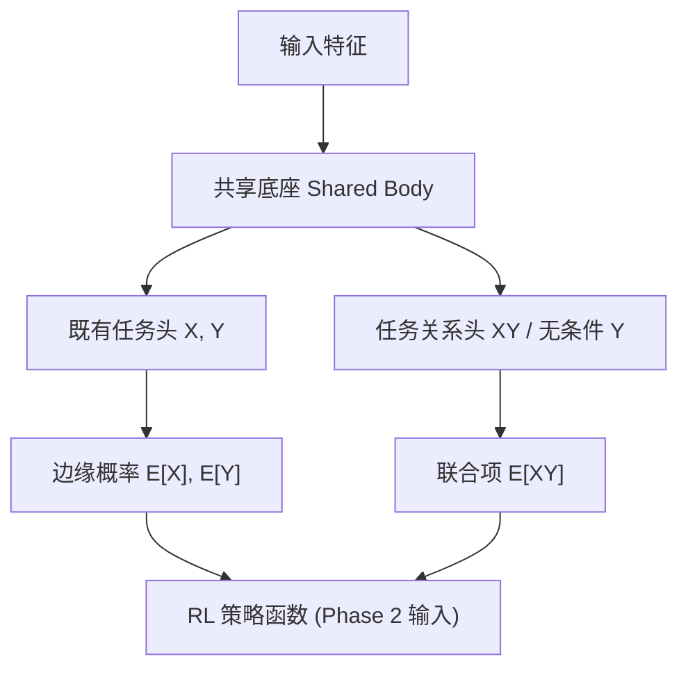
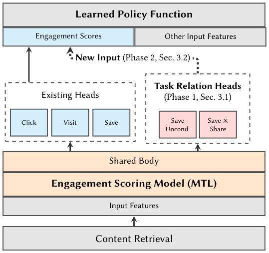

# Learned Cross-Task Relationships in Multi-Task Models (多任务模型中的跨任务关系学习)

- **会议/期刊**: RecSys 2026 (20th ACM Conference on Recommender Systems)
- **作者与机构**: Victor Zhang, Yiping Yuan, Florian Raudies, Bosun Adeoti, Brian Y. C. Leung, Sanjay Surendranath Girija, Naijing Zhang (Google / YouTube)
- **推荐链路定位**: 精排（用户参与度多任务打分模型，作为 RL 策略的状态输入）
- **研究方向**: 多任务学习与列表级重排 / 强化学习与动态探索推荐
- **论文原文**: [https://arxiv.org/abs/2609.28776v2](https://arxiv.org/abs/2609.28776v2)
- **开源代码**: 暂未开源

## TL;DR (1分钟核心速览)

标准 MTL 只优化各任务的边缘损失 $\sum\lambda_i \mathcal{L}_{\text{BCE}}(y_i,\hat p_i)$，共享表征虽隐式含跨任务信息，但输出端仅剩$O(N)$的边缘概率，丢弃了$O(2^N)$联合结构。本文提出**按需添加辅助头**：对无条件任务对加交叉标签头$E[XY]$，对条件任务对加无条件头$E[Y]$，用至多$O(N^2)$个头即可解析还原完整两两联合分布（协方差$=\mathbb{E}[XY]-\mathbb{E}[X]\mathbb{E}[Y]$）。在 YouTube Notifications / Homepage / Watch Next 三个十亿级场景的线上 A/B 中，Notifications 组合臂取得 DAU +0.17%、CTR +7.67%、退订 −1.05% 的显著收益。

## Background & Motivation (背景与核心矛盾)

- **主流范式**: 工业推荐普遍采用共享底座 + 多任务头的 MTL（MMoE/PLE 类门控），以加权和边缘损失训练，输出各行为的独立概率作为 RL 策略的状态特征。
- **前人局限**: ① 辅助头工作（如 YouTube 分位数多头）只预测**补充任务的边缘概率**，用于隐式丰富共享表征，从不显式量化任务间关系；② ESMM/AITM 用概率链式法则处理**嵌套/序贯**任务，但未覆盖非嵌套任务对的协方差结构；③ 梯度手术类方法（PCGrad 等）在反传后干预梯度，属"事后修补"。
- **核心洞察 (Key Insight)**: 训练标签采样自联合分布，模型却只输出边缘分布——两者之差恰是协方差。只要凑齐 $\mathbb{E}[X],\mathbb{E}[Y],\mathbb{E}[XY]$三项，即可由线性期望解析出全部四种联合状态，无需$O(2^N)$ 全联合建模。
- **本文切入点**: 不改标签定义、不动主干，仅**策略性增补辅助头**把缺失的那一项补上，让共享表征被迫编码任务交互特征。

## Method (核心方法设计)

### 1. 整体框架 (Overall Architecture)

输入特征经共享底座（shared body）产出隐表征，分发给既有任务头（click/save/like 等）与新增的任务关系头（交叉标签头 $XY$或无条件头$Y$）。关系头与既有头**同时训练、共享梯度通路**，其输出在 Phase 1 被抑制（仅测迁移），在 Phase 2 作为 RL 策略函数的额外输入特征。整个流程配套"任务对筛选 → 离线 AUC → 两阶段线上实验 → 迭代精化"的工作流模板。

<figure class="paper-figure" markdown="span">
  <figcaption>图1：推荐系统架构。</figcaption>
</figure>

### 2. 关键设计拆解 (Key Designs)

1. **交叉标签头（Cross-Label Head）**：针对两个**无条件**任务 $X,Y$，标准损失$\mathcal{L}_{\text{standard}}=\lambda_x\mathcal{L}_{\text{BCE}}(y_x,\hat p_x)+\lambda_y\mathcal{L}_{\text{BCE}}(y_y,\hat p_y)$对$X,Y$交互零惩罚。本文加一头预测$y_{xy}=y_x\cdot y_y$（逻辑与），总目标
$$\mathcal{L}_{\text{total}}=\mathcal{L}_{\text{standard}}+\lambda_{xy}\mathcal{L}_{\text{BCE}}(y_{xy},\hat p_{xy})$$
其梯度 $\nabla_\theta\mathcal{L}_{xy}$ **只作用于两任务同时为正的样本子集**，与全局缩放损失权重有本质区别——后者均匀放大所有正例，前者精准聚焦交集，从而把"长观看"与"长观看+点赞"在隐空间中区分开。

2. **无条件头（Unconditioned Head）**：针对**条件任务**对（如 $P(\text{save}\mid\text{click})$，训练时屏蔽 click 负例），联合项可由$\mathbb{E}[XY]=\mathbb{E}[Y\mid X]\mathbb{E}[X]$得到，缺的是$\mathbb{E}[Y]$。补一个在全量样本上训练的无条件头即可。这一信号**无法**通过调大条件头损失权重复现，因为条件头根本不接触$X$ 为负的样本。

3. **联合分布解析还原与训练/推理开销**：由 $\neg X=1-X$与期望线性性，四种状态全部可由三项导出，例如$\mathbb{E}[X(\neg Y)]=\mathbb{E}[X]-\mathbb{E}[XY]$、$\mathbb{E}[(\neg X)(\neg Y)]=1-\mathbb{E}[X]-\mathbb{E}[Y]+\mathbb{E}[XY]$。故补 1 个头即等价于完整两两联合分布，复杂度从$O(2^N)$降至$O(N^2)$。训练用标准 BCE、无额外负采样；推理仅多若干小头的前向，开销可忽略。**任务对筛选规则**：嵌套任务（$Y\subseteq X$）交叉标签退化为$Y$，互斥任务（open×dismiss）恒为 0，链式法则可导出的无条件项冗余——三类均剔除。

## Experimental Setup & Evaluation Protocol (实验设置与评估协议)

- **数据集与预处理**: 工业私有数据，无公开统计表。每日产生数十亿级训练样本，每个模型消费数周时间窗数据，评估集占 1%。

| 场景 | 训练规模 | 评估集 | 场景特点 |
| :--- | :---: | :---: | :--- |
| Notifications | 十亿级/日 | 1% 留出 | 归因困难、用户状态差异大，基线 AUC 偏低、置信区间宽 |
| Homepage | 十亿级/日 | 1% 留出 | 高意图、信号干净，MTL 模型最大、头数最多 |
| Watch Next | 十亿级/日 | 1% 留出 | 以当前视频为上下文，需跨全 YouTube 度量 |

- **数据划分与防穿越 (Splitting Strategy)**: 时间窗切分（数周训练窗 + 1% 留出评估集），线上实验为互斥分流 A/B。
- **排名评测协议 (Ranking Protocol)**: 离线采用**留出集 AUC**（逐头评估，非全库排序指标）；线上采用十亿级用户的分流 A/B，报告指标相对变化及 95% CI。
- **对比基线与超参设置**: 基线为**同架构但不含关系头的生产 MTL 模型**（非学术 SOTA 复现）。三臂设计：control / 仅训练（Phase 1 迁移）/ 训练+服务（Phase 2 环境建模）。显著性以 95% CI 不含 0 为准。

## Key Experimental Results (实验关键数据)

### 1. 主实验对比 (Main Results)

| 场景 / 阶段 | 辅助头配置 | 离线 AUC 影响 | 线上核心指标 [95% CI] |
| :--- | :--- | :--- | :--- |
| Notifications（组合臂） | 10 头：$D\times V$交叉标签（Open/Dismissal × Visits） | 直接交互头$D$**+3~8%**；环境活动头$V$ 中性 | DAU **+0.17%** [+0.01,+0.32]；Valued watch time **+0.19%**；Opt-outs **−1.05%**；Sends **−7.21%**；CTR **+7.67%** |
| Homepage Phase 1 | 5 个无条件头（Watch Time Ratio、Save、Like、Subscribe、Inline Playback） | 主任务 **+0.2~0.5%**；scroll/share 轻微回退 | Valued watch time **+0.05%**；Shorts engagement **+0.10%**；Low quality impressions **−0.24%** |
| Homepage Phase 2 | 7 头：Share(uncond.)、Download(cond.) + 5 个 Save×Action | share/download **+1~2%**；like/dislike ≈ **−0.5%** | Valued watch time **+0.05%**；Shorts engagement **+0.06%**；Low quality impressions **−0.16%** |
| Homepage Phase 3 | 11 头（无条件+条件+交叉标签终选集） | 基线已含 MTL 改动，不单列 | Home engagement **+0.03%**；Shorts engagement **+0.10%**；Low quality impressions **−0.64%** |
| Watch Next Phase 1 | 4 个无条件变体头（Continuation、Like、Dislike、Subscribe） | 原服务头 **+0.2~2.6%**；CTR +0.25%、Bad Watch +0.22% | Watch Next Valued Watch Time **+0.19%**；全局 Valued watch time **+0.08%**；Low quality impressions **−0.42%** |

### 2. 消融实验 (Ablation Study)

| 消融/对照设置 | 对比对象 | 关键结果 |
| :--- | :--- | :--- |
| 复制既有头 / 调大既有头损失权重 | vs. 新增交叉标签头 | **无任何实验证据表明有提升** |
| Path 1：交叉头接变体塔顶层（图 6） | vs. Path 2 | 显著劣于 Path 2 |
| Path 2：交叉头直连共享事件底座（图 7） | vs. Path 1 | 类不平衡/稀疏标签任务 AUC **+0.6%~4%** |
| Phase 1 仅训练不服务 | vs. control | 线上指标已显著为正（纯迁移收益） |
| Phase 2 服务给 RL 策略 | vs. Phase 1 | 增量收益较小但方向一致（环境建模收益） |

### 3. 关键实验发现 (Key Findings)

1. **迁移收益是主贡献，环境建模是增量**：Homepage Phase 1 仅加 5 个被动头（不服务）即带来 Valued watch time +0.05%、低质曝光 −0.24%；Phase 3 把 11 个头喂给 RL 策略后，低质曝光进一步降至 −0.64%，说明"更丰富的状态表征"确有独立价值，但幅度小于迁移本身。
2. **梯度路径决定成败**：在变体塔架构下，交叉头直连共享底座（Path 2）比经变体塔（Path 1）在稀疏/不平衡标签上高出 0.6%~4% AUC，印证变体塔会"过滤"掉跨任务梯度，辅助头应直接正则化共享底座。
3. **收益非均匀，需按对筛选**：Notifications 中直接交互头 $D$提升 3~8% 而环境活动头$V$ 中性；Homepage 中 share/download 提升 1~2% 但 like/dislike 回退约 0.5%。作者强调 0.1% 量级在十亿用户下即为统计显著的绝对影响，且线上所有实验均为"参与度与满意度同向改善"，属操作点扩张而非权衡。

## Highlights & Limitations (亮点、对比与审稿批判)

- **与代表作对比 (vs. Prior Work)**: 与 MMoE/PLE 的本质区别在于后者靠门控改善共享表征但仍用独立边缘损失；与 ESMM/AITM 的区别在于后者只处理嵌套序贯任务的链式分解，本文用交叉标签头覆盖**任意非嵌套任务对**并显式估计协方差；与 PCGrad 等梯度手术的区别在于本文**结构性预防**梯度稀释（交叉头天然产生对齐两任务的统一梯度），而非事后投影。
- **可迁移亮点**: ① "缺哪项补哪项"的辅助头选择决策树（图 4）可直接套用到任何 MTL 排序模型；② 两阶段线上实验设计（先抑制输出测迁移、再放开测状态增强）是工业界分离混杂因素的干净范式。
- **审稿级局限批判**: ① 全部为私有数据与私有指标，无公开基准复现，学术可比性弱；② 辅助头选择仍依赖人工试错与多轮迭代，作者自认缺乏自动化原则；③ 离线 AUC 与线上收益相关性不稳定（部分头中性甚至回退），离线筛选的指导力有限。

## Rating (四维评分)

- **方法创新性 (Novelty)**: ⭐⭐⭐⭐ （核心机制与方法设计具备明确创新性，理论与实验动机支撑充分）
- **评估协议与实验扎实度 (Protocol & Experiments)**: ⭐⭐⭐⭐ （主流公开数据集评测完整，包含多基线对比与消融实验验证）
- **写作与数学规范度 (Clarity & Rigor)**: ⭐⭐⭐⭐⭐ （问题形式化定义清晰，核心模块数学推导与架构阐述严谨易读）
- **工业落地与复现价值 (Industrial & Practical Value)**: ⭐⭐⭐⭐⭐ （兼顾推荐效果增益与训练/推理效率，具备实际场景迁移参考价值）
