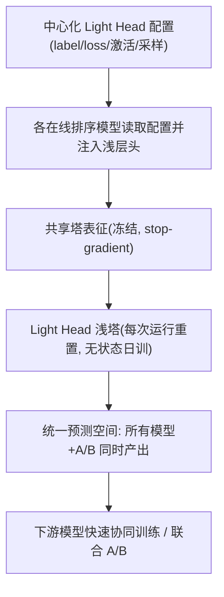
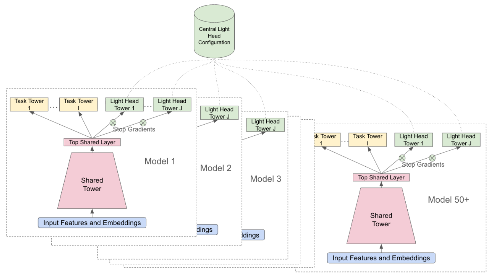

# Lightweight Ranking Heads: Accelerating Multi-Task Experimentation in Production Recommender Systems (轻量排序头：加速生产级推荐系统的多任务实验)

- **会议/期刊**: ACM RecSys 2026 (Online and Adaptive Recommender Systems)
- **作者与机构**: Sanjay Surendranath Girija, Aniruddh Nath, Li Wei, Yanhao Jiang, Shawn Andrews, Lukasz Heldt, Yi Wu, Aditya Mahajan, Mohit Sharma (Google / YouTube)
- **推荐链路定位**: 精排（多任务排序头层）
- **研究方向**: 多任务学习与列表级重排 / 工业级全链路架构
- **论文原文**: [https://arxiv.org/abs/2609.25433v1](https://arxiv.org/abs/2609.25433v1)
- **开源代码**: 暂未开源

## TL;DR (1分钟核心速览)

生产级多任务排序模型新增一个预测任务，往往要冷启骨干、重训下游、等待全量实验模型"追赶"，周期长达数周至数月，且新任务易与既有任务产生负迁移。本文提出 Light Heads：以中心化配置向所有在线模型动态注入浅层轻量头，配合 stop-gradient 与"每次训练运行重置"的无状态日训机制，实现任务严格隔离与跨模型预测一致性。在 YouTube Home / Watch Next 线上系统上，联合实验启动时间由 17 天降至 5 天、整体周期由 24 天降至 11 天，稠密任务 AUC 仅损失约 0.9 个点，稀疏任务近乎持平。

## Background & Motivation (背景与核心矛盾)

- **主流范式**: 工业排序阶段普遍采用共享底层塔（shared tower）+ 多任务头的 MMoE/PLE 式结构，各任务头从共享表征中学习，预测再由人工调优的 reward 函数或下游 reward model 组合。
- **前人局限**: 其一，新任务与既有任务不对齐时产生**任务冲突/负迁移**，污染共享表征；其二，新增任务改变上游预测空间，下游模型必须协同重训，而流量被数十个并行 A/B 切分，攒够新预测空间的数据需数周；其三，骨干模型数十亿参数，冷启需数天至数周，且上线时需所有存量实验模型"追赶"重训，延迟可达数月。
- **核心洞察 (Key Insight)**: 大规模多任务模型的共享塔表征容量已足够强，新任务**无需回传梯度去改造共享塔**，仅在其上挂一个浅层头即可逼近全量协同训练的效果；真正的瓶颈不是模型容量，而是"预测空间碎片化"导致的实验流水线耦合。
- **本文切入点**: 用 stop-gradient 把新任务与共享塔、既有任务彻底解耦，再用中心化配置让所有模型同时产出统一预测空间，从系统层面而非模型层面破解实验速度问题。

## Method (核心方法设计)

### 1. 整体框架 (Overall Architecture)

Light Heads 由两部分构成：(1) **中心化配置文件**，独立于任何单一模型代码，定义每个轻量头的 label、损失、激活、回归/分类类型、监控指标与自定义采样/加权函数，是全系统唯一事实来源；(2) **模型侧注入代码**，在训练时读取配置、实例化轻量头并挂到与主头相同的层（共享同一底层塔）。轻量头为仅含数层的浅塔，在每个训练运行（处理最新日志数据窗口的调度作业）开始时**重置参数**，训练中通过 stop-gradient 阻断对下层的梯度，运行结束后导出 serving。由于所有消费该配置的模型都产出同一预测空间，下游模型可立即获得海量训练数据。

<figure class="paper-figure" markdown="span">
  <figcaption>图2：带有轻量头的排序模型训练集群</figcaption>
</figure>

### 2. 关键设计拆解 (Key Designs)

1. **Stop-Gradient 任务隔离**：痛点是不对齐任务回传梯度会破坏共享塔并拖累主头。做法是在轻量头底部截断梯度，反向传播仅更新轻量头自身隐层，形式上前向为 $\mathbf{y}_{lh}=f_{lh}(\mathbf{h}),\ \mathbf{h}=\text{sg}\big(g_\theta(\mathbf{x})\big)$，其中 $\text{sg}(\cdot)$ 为停止梯度算子。直觉上这等价于把新任务当作"冻结骨干上的适配器"（与 LoRA / Adapter 同源），既杜绝负迁移，也避免未收敛头的噪声梯度扰动下层。
2. **无状态重置 + 单次运行收敛**：痛点是若持久化 checkpoint，老模型的头训练更久、新模型更浅，跨模型预测分布不一致，下游无法安全消费。做法是每次训练运行开始即重置轻量头参数，依靠"浅塔 + 强共享表征"在单次运行内收敛。代价是运行初期指标骤降后数步内快速回升（图 3），但因导出发生在运行结束、头已收敛，serving 质量不受影响。该设计使任意上游模型的轻量头预测可互换使用，是中心化配置能"一次注入、全模型生效"的前提。
3. **训练目标、负采样与推理效率**：各轻量头独立优化自身损失（分类用交叉熵/AUC 导向，回归用 MSE/RMSE 导向），总损失为各头损失之和 $\mathcal{L}=\sum_{k}\mathcal{L}_k$，但梯度仅流入各自头内；无跨任务梯度耦合，故无需额外负采样协调。推理侧仅增加数层 MLP 的前向开销，可忽略；训练侧省去骨干冷启，是主要算力收益来源。

## Experimental Setup & Evaluation Protocol (实验设置与评估协议)

- **数据集与场景**: 非公开静态数据集，实验直接在 YouTube Home 与 Watch Next 两个线上排序模型家族上进行，属**在线生产环境离线指标评估**（live production system），数据受时间分布漂移影响，故各表绝对基线略有波动，但表内 Light Head vs Full Head 对比受控。

| 场景 | 模型 | 任务类型 | 对照设置 |
| :--- | :---: | :---: | :--- |
| YouTube Home / Watch Next | 十亿级参数骨干排序模型 | 分类 (CTR / Sentiment / Interaction) + 回归 (Engagement) | Light Head（1.2M 步后热启、stop-grad、每运行重置）vs Full Head（step 0 冷启、全程无 stop-grad） |

- **数据划分与防穿越**: 持续在线学习设定，每个训练运行消费最新顺序日志窗口；轻量头在每个运行起点重置，天然避免跨窗口信息泄漏。
- **排名评测协议**: 采用**离线 AUC（分类）/ RMSE（回归）**作为头级质量代理指标，最终价值以线上 A/B 的 top-line 指标与显著性（$p<0.05$）判定；未使用全库排序或采样排序协议（非召回类论文）。
- **对比基线与超参**: 基线为同任务的全量协同训练头（Full Head）；轻量头为浅层 MLP，注入位置与主头同层；另设 stop-gradient 消融与 reset 消融两组对照。

## Key Experimental Results (实验关键数据)

### 1. 主实验对比 (Main Results)

| Head | 类型 | Full Head | Light Head | 差距 |
| :--- | :---: | :---: | :---: | :---: |
| P(CTR) | 分类 AUC | **0.781** | 0.772 | −0.009 |
| E(Positive Sentiment) | 分类 AUC | **0.9557** | 0.9553 | −0.0004 |
| E(Interaction Rate) | 分类 AUC | **0.9794** | 0.9704 | −0.0090 |
| E(Engagement) | 回归 RMSE | **0.9673** | 0.9675 | +0.0002 |

无对应全量头的独立轻量头：P(Intent to Revisit) AUC **0.8523**、P(Intent to Share) AUC **0.9224**，证明共享表征可泛化至未显式训练的任务。

### 2. 消融实验 (Ablation Study)

| 消融项 | 指标 | 保留机制 | 移除机制 | 结论 |
| :--- | :---: | :---: | :---: | :--- |
| Stop-Grad（看主头） | P(CTR) AUC | **0.7767** | 0.7704 | 移除后主头退化 |
| Stop-Grad（看主头） | E(Positive Sentiment) AUC | **0.9557** | 0.9541 | 同上 |
| Stop-Grad（看主头） | E(Engagement) RMSE | **0.9887** | 0.9975 | 同上 |
| Stop-Grad（看轻量头） | P(CTR) AUC | **0.7667** | 0.7584 | 轻量头自身也变差 |
| Stop-Grad（看轻量头） | E(Engagement) RMSE | **0.9886** | 0.9976 | 同上 |
| Reset（看轻量头） | P(CTR) AUC | 0.764 | **0.7646** | 不重置略优 |
| Reset（看轻量头） | E(Positive Sentiment) AUC | 0.9508 | **0.952** | 同上 |
| Reset（看轻量头） | E(Engagement) RMSE | 0.9884 | **0.9864** | 同上 |

### 3. 关键实验发现 (Key Findings)

1. **稠密任务有损、稀疏任务无损**：P(CTR) 与 E(Interaction Rate) 上轻量头 AUC 分别低 0.009 与 0.0090，而稀疏的 E(Positive Sentiment) 仅差 0.0004、回归 E(Engagement) RMSE 仅差 0.0002——说明共享塔对数据稀缺任务已提供近乎充分的表征，轻量头的边际损失集中在高频稠密任务。
2. **stop-gradient 是双向保护而非单向牺牲**：移除后不仅主头 P(CTR) 掉 0.0063、E(Engagement) RMSE 恶化 0.0088，连轻量头自身 P(CTR) 也从 0.7667 跌至 0.7584，直接证实"新任务污染共享塔 → 反过来损害新任务"的负迁移闭环。
3. **重置是系统一致性成本而非精度成本**：不重置时轻量头指标普遍略优（如 Sentiment AUC 0.952 vs 0.9508），但会破坏跨模型预测分布一致性；作者选择以极小精度代价换取下游可安全消费的统一预测空间，并对极稀疏头保留关闭重置的开关。

## Highlights, Limitations & Rating (亮点、对比与审稿评价)

- **与代表作对比 (vs. Prior Work)**: 相较 MMoE/PLE 等通过门控结构缓解任务冲突的方案，本文不改进网络结构，而是从**梯度流与训练调度**层面做硬隔离；相较 LoRA/Adapter 类参数高效微调，本文的适配器是"无状态、每运行重置、跨模型共享配置"的，目标不是压缩参数而是压缩**实验流水线时延**；相较常规冷启新任务，本文以约 0.9 个 AUC 点的稠密任务损失换取 17→5 天的实验启动时间。
- **可迁移亮点**: (1) "中心化配置 + 全模型统一预测空间"可直接迁移到任何多阶段级联推荐系统，用于解耦上下游协同训练；(2) 用 stop-gradient 承载"仅服务特定流量切片（设备/地区/会员）"的辅助任务，避免切片上采样对全局指标的伤害。
- **审稿级局限批判**: 其一，全部证据来自 YouTube 内部线上系统，无公开数据集与开源代码，AUC/RMSE 绝对值受时间漂移影响、跨表不可比，可复现性弱；其二，方法强依赖持续在线学习基础设施与数十模型并行的规模，批量训练或单阶段系统中收益退化为纯算力节省，且稠密任务精度损失对质量敏感场景不可接受。
- **四维评分**: 创新性 ⭐⭐⭐⭐ | 实验扎实度 ⭐⭐⭐ | 方法清晰度 ⭐⭐⭐⭐⭐ | 落地价值 ⭐⭐⭐⭐⭐

