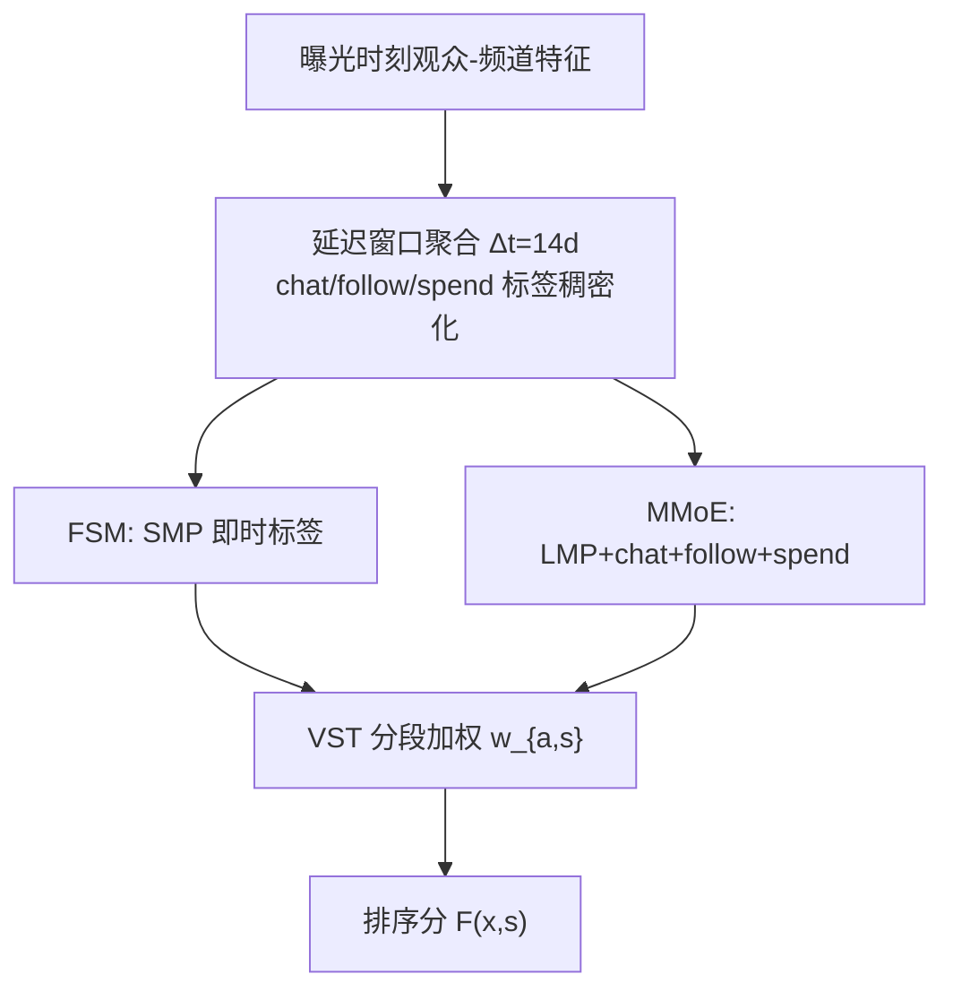
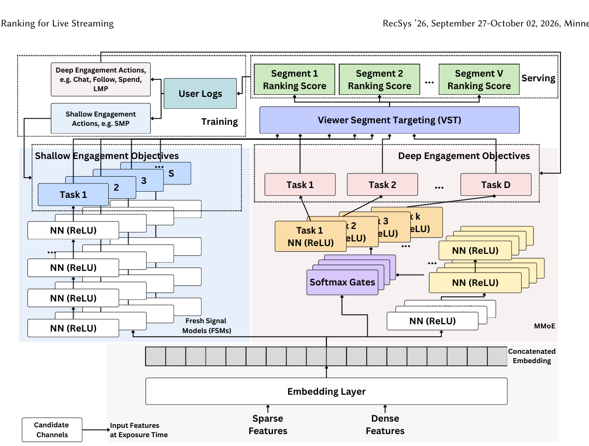

# Multi-Objective Ranking for Live-Streaming: Balancing Fresh and Delayed Signals with Segment-Aware Targeting (直播多目标排序：平衡新鲜与延迟信号的分段定向)

- **会议/期刊**: RecSys 2026 (Industry Track)
- **作者与机构**: Xiaoyi Gu, Julia Tavares, Eder Santana, Carlos Mendoza-Cardenas, Nikita Mishra, Saad Ali（Twitch Interactive；Mishra 现于 Amazon Prime Video）
- **推荐链路定位**: 精排（两阶段召回-精排中的实时排序阶段）
- **研究方向**: 多任务学习与列表级重排 / CTR 预估与特征交叉
- **论文原文**: [https://arxiv.org/abs/2608.04455v1](https://arxiv.org/abs/2608.04455v1)
- **开源代码**: 暂未开源

## TL;DR (1分钟核心速览)

直播场景的用户行为稀疏、延迟且存在用户分段偏差：短看、长看、聊天、关注、消费五类动作密度相差近 90 倍，且高价值动作常在曝光数天甚至数周后才发生。本文提出「延迟窗口聚合 + 新鲜/延迟信号双模型分离 + 推理期分段加权 (VST) + MMoE 联合建模」四步框架，在 Twitch 线上 14 天 A/B 中取得 DAV +0.09%、D 段封顶 ARPU +0.56%、新关注 +0.27%，同时延迟目标建模参数量下降 41.9%，p99 延迟仍低于 110ms。

## Background & Motivation (背景与核心矛盾)

- **主流范式**: 工业多目标推荐普遍采用 MMoE/PLE/Shared-Bottom 等 MTL 骨干共享底层表征，配合梯度平衡或帕累托优化来调和冲突目标；延迟反馈则多借用展示广告中的延迟模型、损失修正或多窗口方法。
- **前人局限**: 其一，广告/电商的延迟反馈方法几乎都假设「点击→购买」的**线性转化漏斗**（ESMM、AITM），而直播观众的五类动作是**并发且无序**发生的，无法套用序列依赖建模；其二，现有 MTL 工作默认各目标样本密度可比，未处理「稠密浅层信号淹没稀疏深层信号」的梯度支配问题，也未处理 D 段用户贡献约 4 倍训练样本带来的分段偏差。
- **核心洞察 (Key Insight)**: 作者用 100 万观众 7 天曝光数据量化出动作密度梯度——短看率约为 CTR 的 1/2.5、长看 1/3.4、聊天 1/20、关注 1/90，消费更低；同时发现仅用延迟标签会让特征在服务时「老去」Δt 天，错过近期兴趣漂移。因此**稀疏性与新鲜度是一对必须解耦的矛盾**，而非可用单一窗口调和的超参。
- **本文切入点**: 把「信号新鲜度」当作与「标签密度」并列的一等设计维度：稠密即时目标走新鲜模型，稀疏延迟目标走延迟窗口模型，二者在打分层线性融合，再叠加推理期分段权重。

## Method (核心方法设计)

### 1. 整体框架 (Overall Architecture)

输入为曝光时刻的观众-频道特征 $\mathbf{x}_{v_i,c_j}$（人口属性、频道特征、交互统计）。框架分四层递进：先用 $\Delta t=14$ 天延迟窗口把 chat/follow/spend 的稀疏标签聚合为稠密二值目标；再按目标密度拆成 FSM（仅 SMP，即时标签）与 DSM（chat/follow/spend，延迟标签）并行训练；随后用 VST 在推理期为 E/D 两段观众施加不同目标权重；最终把多个 DSM 合并为 MMoE（$K=4$ 专家）与 FSM 共同输出，经分段加权得到最终排序分。训练全部用 BCE，推理仅做加权求和，无额外参数。

<figure class="paper-figure" markdown="span">
  <figcaption>图2：FSM-MMoE-VST架构。FSM处理浅层互动（SMP）；MMoE联合建模深度互动任务，包括即时目标（LMP）和延迟目标（聊天、关注、消费），采用14天窗口聚合。VST在推理时对早期（E）和专用（D）观众应用分段条件权重。</figcaption>
</figure>

### 2. 关键设计拆解 (Key Designs)

1. **延迟窗口 (Delayed Window)**：痛点是非响应被过早标为负样本、而等待过久又使数据陈旧。作者将曝光后 $\Delta t$ 天内该观众对该频道的任一动作聚合为单一正标签：
$$y^{\text{delayed}}_{v_i,c_j}=\mathbb{I}\big[\,|\text{DW}_{v_i,c_j}(t,\Delta t)|>0\,\big]$$
直觉是「多次浅层回访本身就是深层转化的前置证据」，聚合把 chat 正样本密度提升约 12 倍（7 天约 9 倍），使稀疏目标首次具备可学习梯度。

2. **新鲜/延迟双模型分离 (Multi-Model)**：若所有目标共用延迟标签，服务时特征滞后 14 天。作者只对稀疏动作施加延迟窗口，SMP 保留即时标签训练独立 FSM，DSM 与 FSM 并行训练、推理时线性融合。其物理直觉是**梯度支配**：SMP 密度高出 follow 近两个数量级，联合训练时其梯度会压制稀疏任务——这一点在消融中被直接验证（单模型统一建模 LMP 掉 4.2%–4.7%）。

3. **分段定向 VST 与 MMoE 合并**：训练期对 E 段样本上采样/加权被实验证伪（无增益且增复杂度），故改为**零参数的推理期标量加权**：
$$F_{\text{VST}}(\mathbf{x},s)=\sum_{a\in\mathcal{A}} w_{a,s}\cdot p_a(\mathbf{x}),\quad s\in\{E,D\}$$
E 段偏向 SMP 以促留存，D 段平衡深层互动与变现。进一步把 4 个独立 DSM 合并为 MMoE（3 层共享底 1000 维、4 专家 512/256、任务门控 128），总损失为各任务 BCE 之和，负采样即全量曝光日志（无额外负采样），参数量由 26.7M 降至 15.5M。

## Experimental Setup & Evaluation Protocol (实验设置与评估协议)

- **数据集与预处理**: 工业日志，无公开数据集；训练用 600 万观众 7 天曝光，评估用 100 万观众 1 天曝光并配 35 天前向标签窗口（覆盖月度订阅类消费）。

| 数据集 | #Users | #Items | #Interactions | 稀疏度/密度 | 特征/场景说明 |
| :--- | :---: | :---: | :---: | :---: | :--- |
| Twitch 训练集 | 6.0M | 百万级频道 | 7 天全量曝光 | 极稀疏（follow 率≈CTR/90） | 观众人口属性+频道特征+交互统计 |
| Twitch 评估集 | 1.0M | 百万级频道 | 1 天曝光 + 35 天标签窗 | 同上 | 左侧导航默认展示 6 个频道 |

- **数据划分与防穿越 (Splitting Strategy)**: 全局时间戳切分——按曝光日切分训练/评估，评估标签用曝光后 35 天前向窗口收集，避免延迟标签穿越；延迟窗口训练数据须在曝光后 $\Delta t$ 天才可定稿，构成流水线依赖。
- **排名评测协议 (Ranking Protocol)**: 离线采用 NDCG@6（对应产品默认 6 槽位），在真实曝光候选集上排序，属**采样候选排序**而非全库 Full-Ranking；线上采用 14 天分层 A/B，指标经 CUPED 方差缩减，显著性 $p<0.05$ / $p<0.01$。
- **对比基线与超参设置**: 基线为单目标 YouTube DNN（仅 SMP + 变现启发式特征 MAR，且 MAR 是上一轮 A/B 优胜方案）；MTL 骨干对比 Shared-Bottom / MMoE / CGC。FSM 为 4 层×1000，DSM 为 4 层×300，ReLU；Adam，学习率 $\{0.001,0.005,0.01\}$，batch $\{1024,2048\}$，以验证集 NDCG 选模。ESMM/AITM 因假设序列漏斗被明确排除。

## Key Experimental Results (实验关键数据)

### 1. 主实验对比 (Main Results)

离线 NDCG@6（14 天延迟窗口，E/D/All 三段）：

| 模型 | LMP-E | LMP-D | LMP-All | Spend-E | Spend-D | Spend-All |
| :--- | :---: | :---: | :---: | :---: | :---: | :---: |
| YouTube DNN (基线) | 0.2090 | 0.2504 | 0.2459 | 0.0282 | 0.0780 | 0.0726 |
| MM + Delayed | 0.2071 | 0.2495 | 0.2448 | 0.0283 | **0.0797** | **0.0741** (+2.07%) |
| MM + Delayed + VST | 0.2090 | 0.2498 | 0.2453 | 0.0283 | 0.0795 | 0.0740 |
| Single MMoE (五目标) | 0.1961 | 0.2395 | 0.2347 (−4.6%) | 0.0276 | **0.0797** | **0.0741** |
| FSM + Shared-Bottom + VST | 0.2090 | **0.2509** | **0.2463** | 0.0283 | 0.0796 | 0.0740 |
| **FSM + MMoE + VST** | **0.2095** | 0.2507 | 0.2462 (+0.12%) | **0.0284** | 0.0794 | 0.0739 (+1.79%) |
| FSM + CGC + VST | **0.2095** | 0.2507 | 0.2462 | 0.0282 | 0.0794 | 0.0738 |

线上三阶段 A/B（CUPED 校正，* $p<0.05$，** $p<0.01$）：

| 实验 | 分段 | ARPU | DAV | LMP | Follow |
| :--- | :---: | :---: | :---: | :---: | :---: |
| Exp.1 MM+延迟窗口 | E | −0.72% | **+0.10%** | **+0.11%** | – |
| Exp.1 | D | **+0.56%*** | **+0.08%** | **+0.17%** | – |
| Exp.1 | All | +0.34% | **+0.09%** | **+0.16%** | – |
| Exp.2 +VST | E | −0.66% | **+0.15%*** | **+0.25%** | – |
| Exp.2 | All | +0.23% | +0.03% | +0.07% | – |
| Exp.3 +MMoE | E | +1.45% | +0.09% | +0.12% | +0.16% |
| Exp.3 | D | −0.35% | +0.06% | +0.05% | **+0.44%** |
| Exp.3 | All | −0.01% | **+0.08%*** | **+0.10%*** | **+0.27%** |

### 2. 消融实验 (Ablation Study)

MMoE 任务分组消融（均含 VST，延迟目标 14 天）：

| 架构 | LMP-E | LMP-D | LMP-All | Spend-E | Spend-D | Spend-All |
| :--- | :---: | :---: | :---: | :---: | :---: | :---: |
| Single MMoE（全部五目标） | 0.1961 | 0.2395 | 0.2347 | 0.0276 | **0.0797** | **0.0741** |
| FSM(SMP) + MMoE(仅延迟) | 0.2091 | 0.2501 | 0.2456 | 0.0280 | 0.0791 | 0.0736 |
| MMoE(SMP+LMP) + MMoE(延迟) | 0.2094 | 0.2505 | 0.2460 | 0.0282 | 0.0794 | 0.0739 |
| **FSM(SMP) + MMoE(LMP+延迟)** | **0.2095** | **0.2507** | **0.2462** | **0.0284** | 0.0794 | 0.0739 |

### 3. 关键实验发现 (Key Findings)

1. **信号分离比 MTL 骨干选择更重要**：三种骨干（MMoE/Shared-Bottom/CGC）配上独立 FSM 后离线 NDCG 差异在 0.0001 量级（LMP-All 0.2462–0.2463），而所有「五目标统一建模」变体无论骨干多复杂，LMP 一律掉 4.2%–4.7%——稠密 SMP 的梯度支配是主因，工程上应优先做信号层拆分而非换骨干。
2. **延迟窗口存在 14 天的甜点，且分段收益方向相反**：chat 正样本在 7 天增约 9 倍、14 天增约 12 倍；E 段在 1 天窗口下 LMP/Spend NDCG 最差、7–21 天显著改善，而 D 段短窗（1–7 天）LMP 更好、长窗 Spend 更好，超过 14 天后 D 段互动指标反降（噪声归因），故 14 天兼顾密度与新鲜度。
3. **VST 与 MMoE 的收益是分段互补而非叠加**：Exp.2 中 VST 把 E 段 DAV 从 +0.10% 推到 +0.15%、LMP +0.25%，但 D 段 DAV 转为 −0.01%，整体仅 +0.03%；Exp.3 的 MMoE 则把整体 DAV 拉回 +0.08%、新关注 +0.27%（$p<0.01$），同时参数量降 41.9%（26.7M→15.5M），说明分段加权需与联合建模配合才能兼顾总量与增量人群。

## Highlights, Limitations & Rating (亮点、对比与审稿评价)

- **与代表作对比 (vs. Prior Work)**: 相较 ESMM/AITM 的序列漏斗假设，本文面向**并发无序多动作**场景，用延迟窗口替代序列依赖建模；相较标准 MMoE/PLE 工作，本文的核心结论恰恰是「骨干不如信号分离」，对工业实践是反直觉但可复用的判断；相较 Fu 等人的非活跃用户重排，本文把分段公平性做成零参数推理期标量加权，部署成本极低。
- **可迁移亮点**: ①「稠密浅层目标独立建模 + 稀疏深层目标联合建模」的任务分组范式，可直接迁移到短视频（完播 vs. 关注/打赏）与电商（点击 vs. 复购）；②推理期分段标量加权替代训练期样本加权，零参数、可在线快速迭代权重。
- **审稿级局限批判**: ①离线评估仅在真实曝光候选集上算 NDCG@6，非全库 Full-Ranking，且无公开数据集与代码，复现性受限；②14 天窗口使训练数据滞后两周定稿，流水线依赖强，且 E/D 分段阈值 $M,N$ 与权重均为专有超参，跨业务迁移需重新调优；③Exp.2 整体 DAV 仅 +0.03% 未达显著，VST 的净收益高度依赖分段结构，细粒度分段与权重自动化仍是开放问题。
- **四维评分**: 创新性 ⭐⭐⭐⭐ | 实验扎实度 ⭐⭐⭐⭐ | 方法清晰度 ⭐⭐⭐⭐⭐ | 落地价值 ⭐⭐⭐⭐⭐

