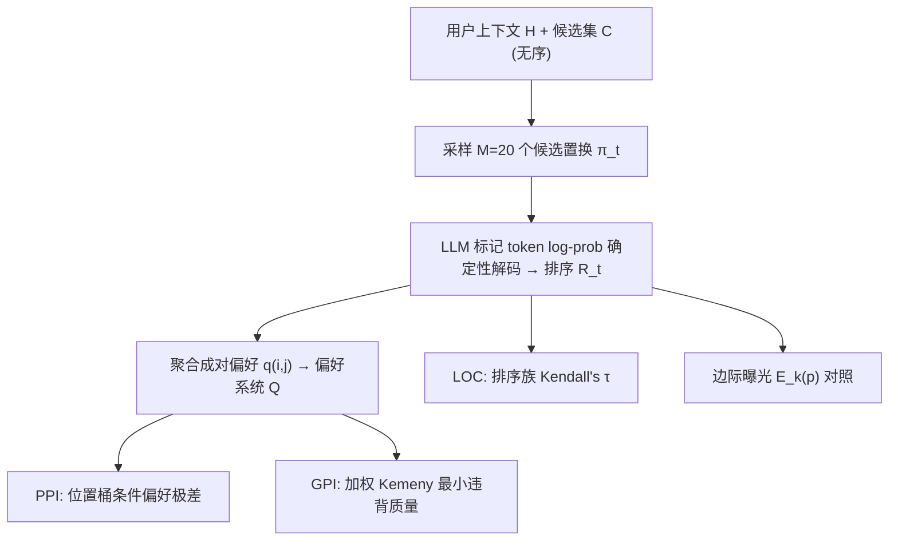

# Position Bias Undermines Preference Consistency in Listwise LLM-Based Reranking (位置偏置破坏列表级 LLM 重排的偏好一致性)

- **会议/期刊**: RecSys 2026 (20th ACM Conference on Recommender Systems, Short Paper)
- **作者与机构**: Ethan Bito, Yongli Ren, Estrid He (RMIT University)
- **推荐链路定位**: 重排 (LLM Listwise Re-ranking)
- **研究方向**: 多任务学习与列表级重排 / 大语言模型推荐
- **论文原文**: [https://arxiv.org/abs/2608.03091v1](https://arxiv.org/abs/2608.03091v1)
- **开源代码**: [https://github.com/ejbito/InvariRank](https://github.com/ejbito/InvariRank)

## TL;DR (1分钟核心速览)

推荐候选本质是无序集合，但 decoder-only LLM 重排器对候选序列化顺序敏感。本文不再只看最终列表变化，而是把同一候选集在 $M$ 个置换下的排序视为一个**诱导偏好系统**，提出成对偏好不稳定度 PPI、全局偏好不一致度 GPI、列表输出一致性 LOC 三层度量。在 MovieLens-32M / Amazon Books、3 个 LLM、$K\in\{15,25,50\}$ 上发现：三层度量高度同向，却与 HR@5 及边际位置曝光偏置**系统性背离**——STELLA$_{LW}$ 的 HR@5 最高但 PPI/GPI 最差、LOC 低于 0.13。

## Background & Motivation (背景与核心矛盾)

- **主流范式**: 两阶段流水线中 LightGCN 等一阶段召回 top-$K$ 候选，LLM 以自然语言 prompt 做列表级联合打分重排；位置偏置缓解手段包括置换聚合 (Bootstrapping/Borda)、顺序选择 (SGS)、校准修正 (STELLA)。
- **前人局限**: ① 现有评测只看**最终列表一致性**或**边际曝光曲线**，无法刻画"排序函数本身是否有效"；② 缓解方法以 HR/nDCG 或曝光均衡为目标，隐含假设"相关性提升 ⇒ 排序更可靠"，但该假设从未在偏好结构层面被检验。
- **核心洞察 (Key Insight)**: 每个置换下的排序都隐含一组成对偏好 $c_i \succ_t c_j$；若重排器是合法的排序函数，则跨置换聚合出的偏好系统 $Q$ 应能被**单一全局排序**解释。位置偏置的真正危害是让 $Q$ 自相矛盾，而非仅仅让 top 位置曝光不均。
- **本文切入点**: 把"置换不变性"从输出层指标升级为**偏好系统有效性**问题，用局部 (PPI)、全局 (GPI)、输出 (LOC) 三级度量 + 边际曝光 $E_k(p)$ 做正交诊断。

## Method (核心方法设计)

### 1. 整体框架 (Overall Architecture)

给定用户上下文 $H$ 与无序候选集 $C=\{c_1,\dots,c_K\}$，采样 $M=20$ 个置换 $\pi_t$，每个置换下用候选标记 token 的 log-probability 做确定性解码得到排序 $R_t$，构成排序族 $\mathcal{R}(H,C)=\{R_1,\dots,R_M\}$。由排序族聚合出成对偏好矩阵 $q(i,j)=\frac{1}{M}\sum_t \mathbb{I}[c_i\succ_t c_j]$，即诱导偏好系统 $Q$。随后在 $Q$ 与 $\mathcal{R}$ 上分别计算 PPI（局部稳定性）、GPI（全局可解释性）、LOC（输出一致性），并与边际曝光 $E_k(p)$、HR@5/nDCG@5 做交叉对照，形成"有效性 vs. 一致性 vs. 曝光"三维诊断。

### 2. 关键设计拆解 (Key Designs)

1. **PPI：位置桶条件化的成对偏好极差**：直接按有序位置对条件化过于稀疏（$K(K-1)$ 个位置对仅 $M$ 次采样），故将位置粗化为 head/middle/tail 桶 $\mathcal{B}$。对候选对 $(c_i,c_j)$ 计算桶条件偏好概率 $q(i,j\mid b_i,b_j)$，取其在所有被观测桶对上的极差：
$$\mathrm{PPI}(i,j)=\max_{b_i,b_j\in\mathcal{B}} q(i,j\mid b_i,b_j)-\min_{b_i,b_j\in\mathcal{B}} q(i,j\mid b_i,b_j)$$
直觉：若偏好与输入位置无关，则同一候选对在不同位置区域应给出相同胜负概率，极差趋零；该量直接度量"局部偏好是否被序列化位置劫持"。

2. **GPI：加权 Kemeny 全局可解释性**：PPI 低不代表 $Q$ 能被单一排序解释（可能存在循环偏好）。定义排序 $\sigma$ 与 $Q$ 的违背质量 $D(\sigma)=\sum_{i<j}\big(\mathbb{I}[\sigma(i)<\sigma(j)](1-q(i,j))+\mathbb{I}[\sigma(j)<\sigma(i)]q(i,j)\big)$，取 $\sigma^*=\arg\min_\sigma D(\sigma)$，则 $\mathrm{GPI}=\binom{K}{2}^{-1}D(\hat\sigma)$。精确 Kemeny 需遍历全排列，故以聚合胜分 $s_i=\sum_{j\neq i}q(i,j)$ 降序初始化，再做最优成对交换的局部搜索至收敛。直觉：GPI 是"偏好系统距离任一全序的最小距离"，刻画全局一致性而非局部稳定。

3. **LOC 与训练/推理开销**：LOC 用排序族内平均 Kendall's $\tau$ 直接度量可观测输出的一致性，与 PPI/GPI 互补（前者在偏好系统上，后者在输出上）。本文为**诊断性评测框架**，无训练损失、无负采样；推理开销差异显著：Zero-shot 1 次前向、Bootstrapping 3 次、SGS 需 $K$ 次顺序前向（$K=25$ 即 25 次）、STELLA$_{LW}$ 最多 10 次带早停前向 + 一次性校准（150 个探测候选集 × 每位置 5 次重复）。

## Experimental Setup & Evaluation Protocol (实验设置与评估协议)

- **数据集与预处理**: MovieLens-32M 与 Amazon Books，按用户交互时间戳排序后**时间切分**为训练/评测；每个评测 query 用历史交互构造上下文，留出交互作为相关物品，候选集保证至少含 1 个留出相关物品。

| 数据集 | 规模/场景 | 候选构造 | 列表长度 $K$ |
| :--- | :---: | :---: | :---: |
| MovieLens-32M | 电影评分，稠密 | LightGCN top-$K$ 召回 | 15 / 25 / 50 |
| Amazon Books | 图书评论，稀疏长尾 | LightGCN top-$K$ 召回 | 15 / 25 / 50 |

- **数据划分与防穿越**: 全局时间戳切分（chronological split），用户历史仅取评测时点之前的交互，避免未来信息泄漏。
- **排名评测协议**: 两阶段流水线下的 **Sampled Ranking**（每 query 候选集为 LightGCN top-$K$，非全库 Full-Ranking）；一致性评测对每 query 采样 $M=20$ 个候选置换，排序由候选标记 token 的 log-prob 确定性解码获得，排除解码随机性与格式解析失败干扰。
- **对比基线与超参**: Zero-shot 列表重排 vs. Bootstrapping (Borda, 3 次洗牌)、SGS (顺序选择)、STELLA$_{LW}$ (列表版校准 + 贝叶斯后验更新，最多 10 次更新带早停)；模型为 Llama-3.2-3B-Instruct、Mistral-7B-Instruct-v0.3、Qwen2.5-7B-Instruct，统一 prompt 模板。

## Key Experimental Results (实验关键数据)

### 1. 主实验对比 (Main Results, $K=25$)

| 模型 | 方法 | ML HR@5↑ | ML nDCG@5↑ | ML PPI↓ | ML GPI↓ | ML LOC↑ | Books HR@5↑ | Books PPI↓ | Books LOC↑ |
| :--- | :--- | :---: | :---: | :---: | :---: | :---: | :---: | :---: | :---: |
| Llama-3B | Zero-shot | 0.5560 | 0.2301 | 0.4775 | 0.1149 | 0.6358 | 0.2145 | 0.3853 | 0.6986 |
| Llama-3B | Bootstrapping | 0.5480 | 0.2256 | 0.2992 | 0.0827 | 0.7475 | 0.2302 | 0.2387 | 0.7981 |
| Llama-3B | STELLA$_{LW}$ | **0.5922** | **0.2318** | 0.8331 | 0.3648 | 0.1181 | **0.2345** | 0.8337 | 0.1201 |
| Llama-3B | SGS | 0.5634 | 0.2324 | **0.1972** | **0.0586** | **0.8268** | 0.2117 | **0.1876** | **0.8332** |
| Mistral-7B | Zero-shot | 0.4794 | 0.1778 | 0.4726 | 0.1195 | 0.6290 | 0.2325 | 0.4329 | 0.6367 |
| Mistral-7B | Bootstrapping | 0.4790 | 0.1771 | 0.2970 | 0.0831 | 0.7481 | 0.2320 | 0.2787 | 0.7523 |
| Mistral-7B | STELLA$_{LW}$ | **0.5490** | **0.1917** | 0.8902 | 0.3861 | 0.0616 | **0.2435** | 0.8452 | 0.1087 |
| Mistral-7B | SGS | 0.4840 | 0.1753 | **0.2150** | **0.0643** | **0.8107** | 0.2335 | **0.1956** | **0.8205** |
| Qwen-7B | Zero-shot | 0.5344 | 0.2136 | 0.5408 | 0.1372 | 0.5799 | 0.2530 | 0.4496 | 0.6189 |
| Qwen-7B | Bootstrapping | 0.5450 | 0.2166 | 0.3288 | 0.0938 | 0.7198 | 0.2535 | 0.2844 | 0.7444 |
| Qwen-7B | STELLA$_{LW}$ | **0.5528** | 0.2086 | 0.8328 | 0.3615 | 0.1230 | **0.2594** | 0.8291 | 0.1245 |
| Qwen-7B | SGS | 0.5366 | 0.2152 | **0.2654** | **0.0804** | **0.7641** | 0.2460 | **0.2202** | **0.7989** |

### 2. 消融/敏感性分析 (列表长度 $K$ 敏感性, Llama-3B / MovieLens-32M)

| $K$ | 方法 | PPI↓ | GPI↓ | 曝光曲线形态 |
| :--- | :--- | :---: | :---: | :---: |
| 15 | Zero-shot | 高 | 高 | 早期位置曝光显著偏低 |
| 15 | SGS | 最低 | 最低 | 较平坦 |
| 25 | STELLA$_{LW}$ | 0.8331 | 0.3648 | 最平坦 |
| 50 | STELLA$_{LW}$ | 仍最高 | 仍最高 | 最平坦 |
| 50 | SGS | 仍最低 | 仍最低 | 较平坦 |

（图 2 显示 PPI/GPI 的方法排序在 $K\in\{15,25,50\}$ 上完全保持；图 1 显示 Zero-shot 早期位置 top-5 曝光低于后段位置，Bootstrapping 削弱但未消除偏斜。）

### 3. 关键实验发现 (Key Findings)

1. **有效性 ≠ 一致性**：STELLA$_{LW}$ 在 6 个模型-数据集组合中 HR@5 全部最高（如 Llama-3B/ML 0.5922 vs. Zero-shot 0.5560），但 PPI/GPI 全部最差（0.8331/0.3648 vs. 0.4775/0.1149），LOC 全部低于 0.13——相关性提升与偏好结构稳定性可完全反向。
2. **曝光均衡 ≠ 置换一致**：STELLA$_{LW}$ 在 MovieLens-32M 上给出最平坦的 top-5 曝光曲线，却同时拥有最高 PPI/GPI 与最低 LOC，说明"压平边际曝光"不足以恢复排序函数有效性；SGS 则同时改善曝光与三层一致性，证明二者可同向但非等价。
3. **三层度量高度同向、与有效性背离**：PPI、GPI、LOC 在全部 6 个组合与 3 种 $K$ 下方法排序完全一致（SGS < Bootstrapping < Zero-shot < STELLA$_{LW}$ 的稳定性序），表明候选顺序敏感性在局部、全局、输出三层被一致捕获；而 HR@5 的最优方法随设置漂移（SGS/STELLA$_{LW}$/Bootstrapping 各占部分最优），单一有效性指标无法替代一致性诊断。

## Highlights, Limitations & Rating (亮点、对比与审稿评价)

- **与代表作对比 (vs. Prior Work)**: 与 Bootstrapping [13]、SGS [2]、STELLA [17] 等**缓解方法**不同，本文不提出新重排器，而是提出诊断框架；相较以往只看最终列表一致性（如 Kendall $\tau$ 单指标）或边际曝光曲线，本文首次把置换下的排序提升为"诱导偏好系统"，用 Kemeny 违背质量刻画全局可解释性，从而能识别"输出看似稳定但偏好系统自相矛盾"的隐性失效。
- **可迁移亮点**: ① PPI 的"位置桶条件偏好极差"可直接迁移到任何对输入顺序敏感的生成式/列表式模型（如生成式检索的语义 ID 序列、多模态列表打分）；② GPI 的加权 Kemeny + 胜分初始化局部搜索是评估任意打分器"是否诱导全序"的轻量工具，可嵌入离线评测流水线作为上线前门禁。
- **审稿级局限批判**: ① 仅两个数据集、三个 3B–7B 指令模型、$M=20$ 置换，统计功效有限，且未覆盖微调式 order-robust 重排器（如 [3,4]），结论外推性待验证；② 候选集来自 LightGCN top-$K$ 的 Sampled Ranking，未做 Full-Ranking，且 PPI 的位置桶粗化与 GPI 的局部搜索近似均引入超参/近似误差，缺少对桶划分与 $M$ 的敏感性分析；③ 未给出可操作的训练侧正则（如置换一致性损失）来直接优化 PPI/GPI，诊断与干预之间仍缺闭环。
- **四维评分**: 创新性 ⭐⭐⭐⭐ | 实验扎实度 ⭐⭐⭐ | 方法清晰度 ⭐⭐⭐⭐⭐ | 落地价值 ⭐⭐⭐⭐

