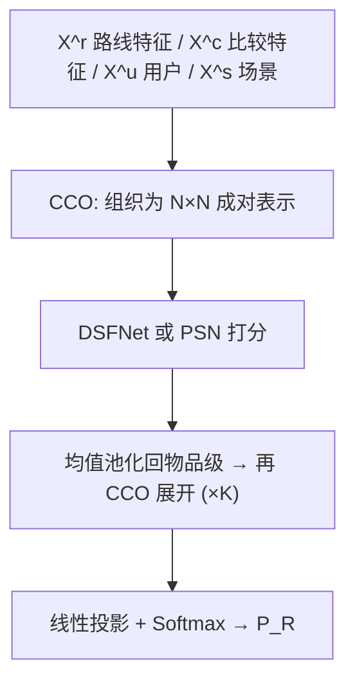
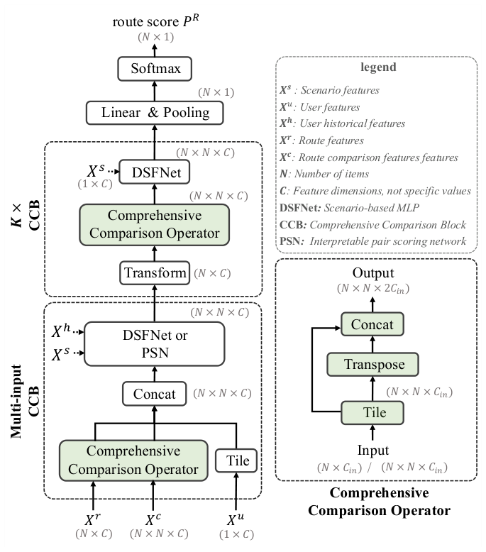

# Towards Full Candidate Interaction: A Comprehensive Comparison Network for Better Route Recommendation (面向全候选交互的综合比较网络：更好的路线推荐)

- **会议/期刊**: RecSys 2026 (Industry Track)
- **作者与机构**: Hanyu Guo, Chao Chen, Longfei Xu, Chengzhang Wang, Kaikui Liu, Xiangxiang Chu（高德/阿里巴巴）
- **推荐链路定位**: 精排（最终排序阶段）
- **研究方向**: 多任务学习与列表级重排 / 时空轨迹与 POI 本地生活推荐
- **论文原文**: [https://arxiv.org/abs/2508.08745v3](https://arxiv.org/abs/2508.08745v3)
- **开源代码**: 暂未开源（数据集已公开于 HuggingFace `GD-ML/CCN`）

## TL;DR (1分钟核心速览)

路线推荐的本质是**比较判断**：用户选某条路线是因为它在某些方面优于替代路线，而这一信息藏在两条路线**非重叠路段**的空间差异中，被物品级特征聚合不可逆地丢弃。本文提出 CCN，将信息流反转为"比较优先"：用非重叠路段构造 $N\times N\times F$ 显式比较张量，配合综合比较块（CCB）实现上下文感知的成对推理，并用成对打分网络（PSN）将偏好分解为可解释物理字段。在自建 5.12 亿样本数据集上离线 CR 达 85.70%，线上 CR +1.2%、偏航率 -0.8%，已在高德生产环境服役两年以上。

## Background & Motivation (背景与核心矛盾)

- **主流范式**: 导航平台采用"召回—粗排—精排"级联，精排阶段将每条路线表示为固定长度特征向量（总距离、ETA、红绿灯数等），再用注意力模型（DSFNet-SA）或成对/列表排序方法（BPR、PRM、DLCM）打分。
- **前人局限**: 其一，物品级聚合只揭示粗粒度差异——图 1(b) 中路线 2 与路线 3 都比路线 1 长 1 km，聚合特征无法区分"空间多样性绕行"与"局部绕路"；其二，即便注意力机制让候选间交互，其他候选对成对偏好的影响也只是经由更新后的物品表示**隐式**传递，而非在比较空间中直接建模。
- **核心洞察 (Key Insight)**: 决策关键信息位于路线对**非重叠路段**（Route$_{i\text{-}j}$）的物理属性聚合中，该构造天然具备**非对称性**$X^c_{ij}\neq X^c_{ji}$与**成对依赖性**$X^c_{ij}\neq X^c_{ik}$，共编码$N(N-1)$ 个有向成对视角。
- **本文切入点**: 放弃路段级 ID 序列建模（路网数亿路段、长尾极端、变长对齐代价过高），改以非重叠路段聚合作为显式比较输入，直接在成对空间推理。

## Method (核心方法设计)

### 1. 整体框架 (Overall Architecture)

CCN 由 $K$个堆叠的综合比较块（CCB）构成。首个 CCB 接收路线特征$X^r$、用户画像$X^u$、历史偏好$X^h$与比较级特征$X^c$，经综合比较算子（CCO）组织为成对表示后由 DSFNet（或可解释的 PSN）打分；后续 CCB 先将成对输出按比较伙伴均值池化回物品级，再经 CCO 重新展开并打分，使每对比较都被"双方与全体候选的比较结果"所调制。最终经线性投影与 softmax 得到路线分数$P_R$。

<figure class="paper-figure" markdown="span">
  <figcaption>图2：CCN的架构。左侧：𝐾个堆叠的CCB通过CCO和DSFNet逐步细化路线表示；第一个CCB接受多级输入，并可选地使用PSN以提升可解释性。右侧：CCO算子。</figcaption>
</figure>

### 2. 关键设计拆解 (Key Designs)

1. **比较级特征构造（Comparison-level Features）**：对有序路线对 $(i,j)$，在 Route$_{i\text{-}j}$（属于$i$但不属于$j$的路段）上聚合 ETA、距离、道路等级等 27 维物理属性，得到$X^c_{ij}\in\mathbb{R}^{F}$，全体构成$X^c\in\mathbb{R}^{N\times N\times F}$。与特征差分$X^r_i-X^r_j$ 的本质区别在于：差分对全路线聚合后丢失了"额外距离发生在何处"的空间位置信息，而本构造保留了它，同时规避了路段级序列的变长对齐与稀疏性问题。

2. **综合比较算子 CCO 与堆叠 CCB**：CCO 将物品级输入组织为 $\mathrm{CCO}(X)_{ij}=[X_i\Vert X_j]\in\mathbb{R}^{2C}$，成对输入则为$\mathrm{CCO}(X)_{ij}=[X_{ij}\Vert X_{ji}]\in\mathbb{R}^{2C}$；首层拼接为$X^E_{ij}=[\mathrm{CCO}(X^r)_{ij}\Vert\mathrm{CCO}(X^c)_{ij}\Vert X^u]$。堆叠层通过$X^k_i=\frac{1}{N}\sum_j O^{k-1}_{ij}$、$O^k=\mathrm{DSFNet}(\mathrm{CCO}(X^k),X^s)$实现跨候选上下文传播——这是"全候选交互"的核心，使$i$与$j$ 的比较被二者相对所有其他候选的竞争态势所修正。

3. **成对打分网络 PSN 与训练目标**：PSN 按物理语义将 $X^E$切分为$M$个字段（ETA、收费、路况等），每字段由独立 DSFNet 打分并计算反对称相对分$S^E_{ij,m}=\hat{X}_{ij,m}-\hat{X}_{ji,m}$，最终$P^E_{ij}=\sigma(\sum_m S^E_{ij,m})$。总损失$\mathcal{L}=\mathcal{L}_R+\lambda\mathcal{L}_P$，其中$\mathcal{L}_R=-w_l Y_R\log P_R$为$N$路分类损失，$w_l$为候选路线与真实轨迹的重叠率（用作标签置信度降噪）；$\mathcal{L}_P$仅监督涉及最高重叠路线$l$ 的成对关系。无负采样，全候选 softmax 训练。

## Experimental Setup & Evaluation Protocol (实验设置与评估协议)

- **数据集与预处理**: 自建高德数据集（370 城、1.75 亿用户、5.12 亿样本、60 亿路线，训练集每样本 $N<30$，从 100+ 候选中过滤保留多样性路线）；公开基准 MSDR（5900 万样本、8 城）。标签由真实导航轨迹与各候选路线的重叠率构造，取最高者为正例。

| 数据集 | #Users | #Items(路线) | #Interactions | 特征/场景说明 |
| :--- | :---: | :---: | :---: | :--- |
| Amap (Ours) | 175M | 6B | 512M | 62 维路线特征 + 27 维比较特征 + 77 维历史偏好 |
| MSDR | — | — | 59M | 8 城，导航偏航重规划点击预测 |

- **数据划分与防穿越 (Splitting Strategy)**: 按样本划分训练/测试集（原文未显式声明时间戳切分，工业场景下标签来自事后真实轨迹）。
- **排名评测协议 (Ranking Protocol)**: 离线用覆盖率 CR $=\frac{|R\cap T|}{|R\cup T|}$（推荐路线与真实轨迹的 IoU）；MSDR 上沿用 DSFNet 的 AUC 与 RelaImpr，并按样本频次划分场景区间计算子集 AUC。线上用 CR 与偏航率 DR（需实时导航数据，仅线上可得）。PSN 另用成对分数准确率 ACC 评估。
- **对比基线与超参设置**: 多任务/多场景基线 ShareBottom、MMOE、PLE、STAR、M2M、APG、HiNet、MuSeNet、DSFNet、DSFNet-SA；$K=3$、$\lambda=1.0$、Adam、lr=0.001、batch=128、8×H20。

## Key Experimental Results (实验关键数据)

### 1. 主实验对比 (Main Results)

MSDR 测试集（AUC %，RelaImpr 相对 Vanilla MLP）：

| 方法 | AUC$_{11}^{1}$| AUC$_{36}^{12}$| AUC$_{61}^{37}$| AUC$_{72}^{62}$ | 总体 AUC | RelaImpr |
| :--- | :---: | :---: | :---: | :---: | :---: | :---: |
| Vanilla MLP | 73.55 | 73.71 | 73.70 | 72.09 | 73.62 | 0.00% |
| PLE | 74.21 | 73.93 | 73.87 | 68.43 | 74.16 | 0.74% |
| STAR | 74.18 | 74.01 | 73.72 | 69.54 | 74.13 | 0.70% |
| HiNet | 74.35 | 74.65 | 74.46 | 70.41 | 74.41 | 1.08% |
| MuSeNet | 74.56 | 74.23 | 75.08 | 71.40 | 74.52 | 1.23% |
| DSFNet | 74.96 | 75.72 | 75.86 | 72.20 | 75.04 | 1.94% |
| DSFNet-SA | 75.27 | 75.91 | 75.76 | 75.39 | 75.87 | 3.06% |
| **CCN (w/o PSN, $X^c$)** | **76.67** | **76.32** | **76.40** | **75.40** | **76.72** | **4.21%** |

自建数据集（CR$_{off}$ 与线上指标相对 DSFNet）：

| 方法 | CR$_{off}$(%) | CR$_{on}$ (%) | DR (%) |
| :--- | :---: | :---: | :---: |
| SD（最短距离） | 64.34 | -20.49 | +10.26 |
| ST（最短时间） | 73.80 | -10.72 | +4.72 |
| Recall（专家分最高） | 75.63 | -9.11 | +4.20 |
| DSFNet | 83.70 | +0 | +0 |
| DSFNet-SA | 84.27 | +0.8 | -0.02 |
| **CCN (Ours)** | **85.70** | **+1.2** | **-0.8** |

### 2. 消融实验 (Ablation Study)

| $X^c$| CCO | PSN | CR$_{off}$(%) | ACC (%) | CR$_{on}$ (%) | DR (%) |
| :---: | :---: | :---: | :---: | :---: | :---: | :---: |
| × | × | × | 83.70 | — | +0 | +0 |
| × | × | ✓ | 83.20 | 91.71 | -4.96 | +3.64 |
| ✓ | × | ✓ | 84.94 | 93.13 | +0.36 | +0.12 |
| × | ✓ | ✓ | 84.71 | 93.39 | +0.08 | +0.2 |
| ✓ | ✓ | × | 85.67 | — | +1.08 | -0.4 |
| ✓ | ✓ | ✓ | **85.70** | **93.66** | **+1.2** | **-0.8** |

堆叠层数 $K$：CR 在$K=3$达峰 85.70%，$K=4\sim6$微降至 85.68/85.66/85.65（固定候选集上过拟合）；ACC 在$K\ge3$稳定于 93.66–93.67。$\lambda\in[0,1]$ 全区间 CR 波动仅 0.08%、ACC 波动 0.03%，超参不敏感。

### 3. 关键实验发现 (Key Findings)

1. **性能增益主要来自比较输入与 CCO，而非 PSN**：去掉 PSN 后 CR$_{off}$ 仍达 85.67%（vs. 基线 83.70%），线上 CR +1.08%，说明显式比较张量 + 上下文成对推理贡献了绝大部分收益。
2. **PSN 的可解释性依赖比较信号支撑**：单独使用 PSN 时 ACC 仅 91.71% 且线上 CR 暴跌 -4.96%；补入 $X^c$ 后 ACC 升至 93.13%，再加 CCO 升至 93.39%，证明字段级打分需要结构化比较信息才能具备判别力。
3. **PSN 的增量价值体现在线上行为对齐**：完整模型与无 PSN 版本离线 CR 几乎持平（85.70% vs. 85.67%），但偏航率从 -0.4% 改善到 -0.8%，说明字段级推理在离线指标之外进一步贴合真实导航行为。

## Highlights & Limitations (亮点、对比与审稿批判)

- **与代表作对比 (vs. Prior Work)**: 相比 DSFNet（物品级 + 场景参数分解）与 DSFNet-SA（自注意力做候选交互），CCN 的根本差异是把比较关系从"事后由分数差/注意力权重推断"变为"作为主输入显式构造"；相比 BPR 等成对学习，CCN 的成对表示受全体候选竞争态势调制，而非独立打分后相减。
- **可迁移亮点**: ①"非重叠部分聚合"这一构造可迁移到任何具有共享子结构的候选比较场景（如多段航班/多程物流路径/组合套餐）；②用重叠率 $w_l$ 作为标签置信度加权，是工业弱标签降噪的通用技巧。
- **审稿级局限批判**: ①比较特征的理论信息容量低于路段级序列表示，作者亦承认这是"表达力与可部署性的折中"，在路网结构差异极大的城市可能失效；②$O(N^2)$ 复杂度虽与注意力方案持平，但相对 DSFNet 约 3 倍算力、模型 2 MB，候选集超 100 时需额外粗排过滤，且 PSN 字段划分依赖人工物理语义设计，跨场景迁移需重新定义字段。

## Rating (四维评分)

- **方法创新性 (Novelty)**: ⭐⭐⭐⭐ （"比较优先"范式反转信息流，非重叠路段构造兼具非对称性与成对依赖性，思路清晰且工业验证充分）
- **评估协议与实验扎实度 (Protocol & Experiments)**: ⭐⭐⭐⭐ （公开基准 + 5.12 亿样本自建集 + 两年线上 A/B，消融与超参敏感性完整；但自建集划分方式描述略简）
- **写作与数学规范度 (Clarity & Rigor)**: ⭐⭐⭐⭐ （CCO/CCB/PSN 公式紧凑、符号一致，复杂度分析到位；比较特征信息容量的理论讨论偏定性）
- **工业落地与复现价值 (Industrial & Practical Value)**: ⭐⭐⭐⭐⭐ （高德生产环境服役两年、15 ms/200–300 QPS 实测、数据集开源，工业参考价值极高）

