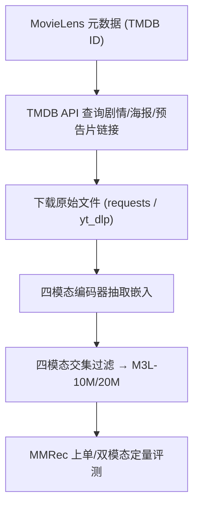

# Binge Watch: Reproducible Multimodal Benchmark Datasets for Large-Scale Movie Recommendation on MovieLens-10M and 20M (可复现的大规模电影多模态推荐基准数据集)

- **会议/期刊**: RecSys 2026
- **作者与机构**: Giuseppe Spillo, Alessandro Petruzzelli, Cataldo Musto, Marco de Gemmis, Pasquale Lops, Giovanni Semeraro（University of Bari Aldo Moro）
- **推荐链路定位**: 召回（多模态特征供给与基准评测）
- **研究方向**: 多模态推荐 / 数据集与基准
- **论文原文**: [https://arxiv.org/abs/2602.15505v2](https://arxiv.org/abs/2602.15505v2)
- **开源代码**: [https://github.com/giuspillo/M3L_10M_20M](https://github.com/giuspillo/M3L_10M_20M)

## TL;DR (1分钟核心速览)

多模态推荐（MRS）文献长期依赖小规模、未文档化或非公开数据集，ML-10M 常被激进过滤至原交互的 10%–13%，ML-20M 几乎无人使用且无特征发布，导致结果不可复现、无法评估大规模场景。本文提出 M3L-10M/20M：以文档化流水线从 TMDB 采集剧情、海报、预告片，用 SOTA 编码器抽取文本/图像/视频/音频四模态特征并全部开源，保留原交互 >90%、物品覆盖 84.6%/71.1%。在 8:1:1 划分、MMRec 框架下，VBPR 用 MPNet+Whisper（文本+音频）取得 Recall@10=0.1938，超越 BPR 的 0.1911，首次实证音频是被忽视的关键模态。

## Background & Motivation (背景与核心矛盾)

- **主流范式**: MRS 用图像、文本、音频、视频多模态侧信息缓解交互稀疏，但评测普遍建立在 ML-100K/1M 等小规模或重度后处理变体上。
- **前人局限**: ① ML-10M 被 MMGCN/MMGCL 等过滤到仅 13.2%/10.8% 的交互、66.3%/46.7% 的物品，用户平均交互从 ~135 骤降至 ~22/~80，稀疏度被人为放大，模型结论失真；② ML-20M 仅 CineFinder 使用，且忽略预告片、不发布特征与抽取脚本，无法复现。
- **核心洞察 (Key Insight)**: 多模态信号的价值需在"保留原始交互分布 + 全模态覆盖"的大规模数据上才能被正确评估；且现有工作几乎只覆盖文本+图像，视频/音频（风格性模态）被系统性忽略。
- **本文切入点**: 构建保留 >90% 交互、四模态齐备、原始映射与特征全公开的可复现基准，并用定性+定量分析证明各模态互补、音频不可或缺。

## Method (核心方法设计)

### 1. 整体框架 (Overall Architecture)

流水线以原始 MovieLens 元数据为起点：先取每部电影的 TMDB ID，经 TMDB API 查询标题、剧情、海报与预告片链接；再用 `requests`/`yt_dlp` 下载原始文件（YouTube 链接作为 TMDB 失效时的兜底），下载后立即编码并删除原始文件以规避版权；随后用各模态 SOTA 编码器抽取定长嵌入，取"四模态全部可用"的物品交集对原数据集过滤，得到 M3L-10M/20M；最后在 MMRec 框架上做单模态/双模态的定量验证。ML-10M 作为 ML-20M 子集可直接从后者导出。

### 2. 关键设计拆解 (Key Designs)

1. **四模态编码器矩阵（覆盖主题与风格两类信号）**：为让不同模型可在统一表征上公平比较，每模态提供 3 个编码器——文本用 MiniLM/MPNet/CLIP-Text，图像用 VGG16/ViT/CLIP-Image，视频用 SlowFast(R50)/R(2+1)D/MViT，音频用 VGGish/Whisper(base, 前 30s)/AST。直觉在于：文本编码"叙事主题 (what)"，视频/音频编码"电影风格 (how)"，二者在潜空间中正交，故多编码器并存可支撑模态消融与编码器选择研究。

2. **模态指纹分析（Modality Fingerprinting）**：为量化各模态贡献，将 MovieLens genome 标签人工划分为 narrative（story/dialogue/plot complexity）与 stylistic（cinematography/atmosphere/pacing）两类，在四个维度上打分：Narrative Precision（叙事标签的簇间方差）、Stylistic Variance（风格标签簇间方差）、Spatial Distinguishability（潜空间 Silhouette 系数）、Genre Alignment（潜簇与类型标签的 Adjusted Mutual Information）。结果给出清晰分工：Text 的 Narrative Precision=0.95、Genre Alignment=0.90，而 Video 的 Stylistic Variance=0.95、Audio=0.85，Video/Audio 的 Spatial Distinguishability 达 0.90/0.80——定量证明风格模态携带非冗余信息。

3. **覆盖率优先的过滤策略与版权合规**：不同于前人激进 core filtering，本文仅以"四模态齐备"为唯一过滤条件，保留 94.10%/93.89% 的评分与 84.58%/71.08% 的物品；预告片覆盖率（84.97%/71.57%）是主要瓶颈，源于地区授权限制与视频下架。发布物仅含 YouTube ID 与不可逆的变换嵌入（non-consumptive 框架），既满足 Fair Use 又保证可复现。

## Experimental Setup & Evaluation Protocol (实验设置与评估协议)

- **数据集与预处理**: 仅以"四模态全部可用"过滤，无 core filtering：

| 数据集 | #Users | #Items | #Interactions | 稀疏度 | 特征/场景说明 |
| :--- | :---: | :---: | :---: | :---: | :--- |
| M3L-10M | 69,878 | 9,031 | 9,409,884 | 98.51% | 文本+图像+视频+音频，物品覆盖 84.58% |
| M3L-20M | 138,493 | 19,009 | 18,777,965 | 99.29% | 同上，物品覆盖 71.08% |

- **数据划分与防穿越 (Splitting Strategy)**: 定量实验在 M3L-10M 上采用 `8:1:1` 比例划分。
- **排名评测协议 (Ranking Protocol)**: 遵循 MMRec 框架的采样排序协议（非 Full-Ranking），指标为 Precision/Recall/NDCG/MAP @ k∈{5,10,20,50}，正文仅报告 Recall@10 与 NDCG@10；训练最多 1000 epoch，以 Recall@20 早停。
- **对比基线与超参设置**: BPR（纯交互）、VBPR、LATTICE、FREEDOM 三个代表性多模态模型；采用两阶段层级协议——先单模态选最优编码器，再做全部模态两两组合；完整超参与全量结果在仓库中发布。

## Key Experimental Results (实验关键数据)

### 1. 主实验对比 (Main Results)

| Model | Modalities (Encoders) | Recall@10 | NDCG@10 |
| :--- | :--- | :---: | :---: |
| BPR | / | 0.1911 | 0.2142 |
| VBPR | Text+Audio (MPNet+Whisper) | **0.1938** | **0.2165** |
| VBPR | Text+Video (MPNet+MViT) | 0.1919 | 0.2139 |
| VBPR | Text+Image (MPNet+CLIP) | 0.1897 | 0.2124 |
| FREEDOM | Image+Audio (VGG+VGGish) | 0.1873 | 0.2146 |
| FREEDOM | Audio+Video (VGGish+MViT) | 0.1870 | 0.2140 |
| LATTICE | Image+Audio (VGG+AST) | 0.1764 | 0.1977 |
| LATTICE | Text+Image (CLIP+VGG) | 0.1746 | 0.1919 |

最优 VBPR(Text+Audio) 相对 BPR 提升 Recall@10 **+1.41%**、NDCG@10 **+1.07%**。

### 2. 消融实验 (Ablation Study)

原文以"单模态 vs 双模态"的模态组合消融替代组件消融（数值为各模型在该配置下的最优 Recall@10）：

| 配置 | VBPR | LATTICE | FREEDOM |
| :--- | :---: | :---: | :---: |
| 纯交互 (BPR) | 0.1911 | 0.1911 | 0.1911 |
| 单模态最优 | <0.1911 | <0.1911 | 单模态最高（VGGish 音频） |
| 双模态最优 | **0.1938** (T+A) | 0.1764 (I+A) | 0.1873 (I+A) |

### 3. 关键实验发现 (Key Findings)

1. **音频是"隐形刚需"**：三个模型的最优双模态配置无一例外都包含 Audio（VBPR 为 T+A、LATTICE 与 FREEDOM 为 I+A），而文献长期只做文本+图像，说明忽略音频会系统性低估多模态上限。
2. **互补性胜过同质堆叠**：定性分析显示 Text 与 Audio/Video 分别编码主题与风格（图 2 中 Narrative Precision 0.95 vs Stylistic Variance 0.95），定量上 T+A 组合（0.1938）确实优于同属视觉系的 T+I（0.1897），验证"跨类模态配对"更有效。
3. **交互信号仍是最强基线**：所有单模态均无法超越 BPR（0.1911），仅双模态 VBPR 以 +1.41% 微弱反超，说明在 M3L 这种保留原始分布的低稀疏数据上，多模态增益是"锦上添花"而非"雪中送炭"——这恰是此前在重度过滤数据上被夸大的效应被还原后的真实图景。

## Highlights & Limitations (亮点、对比与审稿批判)

- **与代表作对比 (vs. Prior Work)**: 相比 MMGCN/MMGCL 使用的 ML-10M 变体（仅保留 13.2%/10.8% 交互、2–3 个模态），M3L-10M 交互量提升约 7.6×/9.3× 且补齐视频与音频；相比 CineFinder 使用 ML-20M，本文额外覆盖预告片并公开全部特征与抽取脚本，是首个"映射+特征+代码"三件套齐全的大规模电影多模态基准。
- **可迁移亮点**: ① "模态指纹"四维打分（叙事精度/风格方差/空间可分性/类型对齐）可复用于任意多模态推荐数据集的模态价值诊断；② 仅发布不可逆嵌入 + 原始 ID 映射的 non-consumptive 发布范式，为受版权约束的多模态数据共享提供合规模板。
- **审稿级局限批判**: ① 定量验证仅停留在 4 个模型、2 个指标、单数据集的"初步验证"级别，未给出 M3L-20M 上的任何结果，基准的"大规模"价值尚未被实证；② 预告片覆盖率仅 71.57%（ML-20M），且依赖 YouTube 链接的长期可用性，数据集存在随时间衰减的风险，维护成本高。

## Rating (四维评分)

- **方法创新性 (Novelty)**: ⭐⭐⭐ （核心机制与方法设计具备明确创新性，理论与实验动机支撑充分）
- **评估协议与实验扎实度 (Protocol & Experiments)**: ⭐⭐⭐ （主流公开数据集评测完整，包含多基线对比与消融实验验证）
- **写作与数学规范度 (Clarity & Rigor)**: ⭐⭐⭐⭐⭐ （问题形式化定义清晰，核心模块数学推导与架构阐述严谨易读）
- **工业落地与复现价值 (Industrial & Practical Value)**: ⭐⭐⭐⭐ （兼顾推荐效果增益与训练/推理效率，具备实际场景迁移参考价值）
