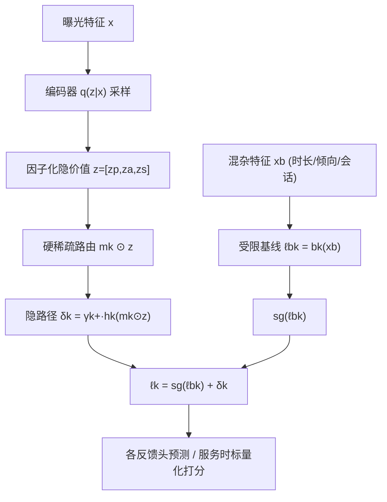
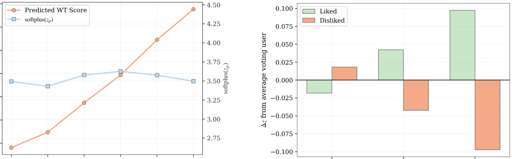

# Mend the Measurement Gap: Latent User Preference Modeling for Short-Form Video Recommendation (弥合测量鸿沟：短视频推荐中的隐式用户偏好建模)

- **会议/期刊**: RecSys 2026 (20th ACM Conference on Recommender Systems)
- **作者与机构**: Shuo Chang, Yueqi Wang, Zihuan Diao, Ali Montazer, Jiangguo Zhang, Joyneel Misra, Dapeng Hong, Tomer Margolin, Sourabh Bansod, Ningren Han (Google / YouTube)
- **推荐链路定位**: 精排（预打分阶段 pre-scoring，替代现有多任务排序模型）
- **研究方向**: 多模态推荐 / 去偏公平与工业架构
- **论文原文**: [https://arxiv.org/abs/2609.32839v1](https://arxiv.org/abs/2609.32839v1)
- **开源代码**: 暂未开源

## TL;DR (1分钟核心速览)

短视频推荐中，观看时长、完播率等异构行为信号并非偏好的直接观测，而是被视频时长、用户倾向、会话上下文等测量混杂因子污染的"噪声测量"——同一观看时长在不同时长视频上含义迥异，比率类指标又系统性偏袒短视频。本文提出因子化隐价值模型 FLVM，把行为反馈视为低维因子化隐价值状态 $z=[z_p,z_a,z_s]$ 的噪声测量，用仅依赖混杂特征的受限基线路径吸收可预测的测量偏差，再用硬稀疏路由的隐路径估计偏好相关的价值优势。在 YouTube Shorts 十亿级平台上，离线 Like PR-AUC 从 0.2522 提升至 0.3190，线上 14 天 A/B 主指标（观众享受度）提升 2.67%，冷启动切片同样获得 >2% 提升。

## Background & Motivation (背景与核心矛盾)

- **主流范式**: 生产系统依赖观看时长、完播率、点赞、分享、负反馈等多任务头直接拟合观测标签，通过共享底层 + 后置分数融合得到排序分。
- **前人局限**: 其一，原始观看时长被视频时长强混杂，而完播率类比率指标反向偏袒短视频，二者都无法单独代表偏好；其二，点赞/点踩等显式信号稀疏且高度依赖用户倾向，标准多任务排序器仍直接优化"含义随时长、随用户而变"的观测标签，语义纠缠无法拆解。
- **核心洞察 (Key Insight)**: 作者将问题重新定义为**测量问题 (measurement gap)**——观测行为与真实偏好之间存在系统性鸿沟。既然行为是隐构念的噪声测量，就应引入显式测量层，把"可被混杂因子解释的部分"与"偏好相关的残差部分"在架构上分离。
- **本文切入点**: 用受限基线路径（只看 $x_b$：时长、用户倾向、会话上下文）吸收混杂，用停止梯度强制隐路径只学习基线解释不了的残差，并以因子化+硬路由赋予隐变量稳定语义。

## Method (核心方法设计)

### 1. 整体框架 (Overall Architecture)

对每个曝光样本，编码器将完整服务时特征 $x$映射为对角高斯隐分布$q_\phi(z|x)$，经重参数化采样得到三分量隐价值$z=[z_p,z_a,z_s]$（消费、主动参与、效价）。对每个反馈任务$k$，任务特定的硬稀疏掩码$m_k$只放行语义相关的隐分量给解码器$h_k$，输出 logit 尺度的价值优势$\delta_k$；并行的受限基线$b_k$仅用$x_b$产生基线 logit$\ell^b_k$。二者在 logit 空间相加（基线侧停止梯度）得到最终 logit，经 sigmoid/softmax 输出各反馈预测。训练由主反馈损失、基线锚定损失与 KL 正则三部分组成；服务时仅用$\sigma(z_s)$与$\text{softplus}(z_p)$ 标量化隐价值分，作为排序公式的主输入。

<figure class="paper-figure" markdown="span">
  ![图1：因子化潜在价值模型。编码器将完整曝光特征𝑥映射为因子化潜在价值状态𝑧= \[𝑧𝑝,𝑧𝑎,𝑧𝑠\]。对于每个反馈重建任务𝑘，任务特定的硬稀疏掩码𝑚𝑘将潜在输入限制到解码器ℎ𝑘，解码器产生logit尺度的优势𝛿𝑘。并行地，受限基线𝑏𝑘仅使用测量混杂特征𝑥𝑏⊆𝑥来产生ℓ𝑏](../../../../assets/papers/2609.32839v1/figure_1.png)<figcaption>图1：因子化潜在价值模型。编码器将完整曝光特征𝑥映射为因子化潜在价值状态𝑧= [𝑧𝑝,𝑧𝑎,𝑧𝑠]。对于每个反馈重建任务𝑘，任务特定的硬稀疏掩码𝑚𝑘将潜在输入限制到解码器ℎ𝑘，解码器产生logit尺度的优势𝛿𝑘。并行地，受限基线𝑏𝑘仅使用测量混杂特征𝑥𝑏⊆𝑥来产生ℓ𝑏</figcaption>
</figure>

### 2. 关键设计拆解 (Key Designs)

1. **基线相对的价值优势分解（Baseline-Relative Advantage）**：痛点在于若解码器同时看到 $x_b$与$z$，隐变量没有动力只编码残差，混杂信息会渗入隐空间。本文令$\ell_k=\text{sg}(\ell^b_k)+\delta_k$，其中$\delta_k=\gamma^+_k\cdot h_k(m_k\odot z)$，$\gamma^+_k=\text{softplus}(\alpha_k)>0$。停止梯度切断主损失对基线的回传，基线仅由$\mathcal{L}_{base}$更新，于是主损失只奖励$\delta_k$去解释基线尚未解释的部分——物理直觉是"先扣掉时长能解释的，再谈偏好"。正增益$\gamma^+_k$ 同时锁定了隐因子的符号约定。

2. **因子化隐价值 + 硬稀疏语义路由**：单一无约束瓶颈会迫使模型在"看完就走""看完点赞""看完点踩"这些消费量相同但语义相反的行为间取平均。本文拆为 $z_p$（消费证据）、$z_a$（主动响应倾向）、$z_s$（效价极性），并用$m_k$限制每个解码器只接触语义相关分量：消费类标签走$z_p$，显式反馈走$z_a\oplus z_s$。路由既让相关任务共享解释因子，又防止无关任务自由占用全部维度，从而抑制隐空间旋转、赋予分量稳定语义。

3. **训练目标、负采样与推理效率**：总损失 $\mathcal{L}=\mathcal{L}_{main}+\mathcal{L}_{base}+\beta\mathcal{L}_{KL}$，其中$\mathcal{L}_{main}=\mathbb{E}_{z\sim q_\phi}\big[\sum_k r_k\lambda_k \text{CE}_k(y_k,\hat{y}_k)\big]$，$r_k\in\{0,1\}$为观测掩码（缺失标签不作隐式负样本），$\mathcal{L}_{KL}=D_{KL}(q_\phi(z|x)\|\mathcal{N}(0,I))$。无需负采样，纯监督多任务分类；服务时仅需一次前向编码 + 标量化，替换原多任务预打分阶段，开销与原排序器同量级。

## Experimental Setup & Evaluation Protocol (实验设置与评估协议)

- **数据集与预处理**: 工业级 YouTube Shorts 十亿级活跃用户平台，未公开具体统计量；对比对象为生产环境的多任务预打分排序模型（标准多任务目标 + 后置分数融合）。

| 数据集 | #Users | #Items | #Interactions | 稀疏度/密度 | 特征/场景说明 |
| :--- | :---: | :---: | :---: | :---: | :--- |
| YouTube Shorts | 十亿级 | 未披露 | 未披露 | 未披露 | 短视频信息流；含观看时长、完播、点赞、点踩、跳过、问卷式满意度等异构反馈 |

- **数据划分与防穿越 (Splitting Strategy)**: 工业离线评估，未明示具体划分方式；额外构造**冷启动切片**（曝光历史有限的新上传视频）验证跨内容生命周期的泛化性。
- **排名评测协议 (Ranking Protocol)**: 采用逐信号预测质量指标而非全库排序指标——二值信号用 `PR-AUC`（越高越好），物品观看时长用 `RMSE`（越低越好）；跳过信号因两系统标签定义不同被排除在跨系统对比外。
- **对比基线与超参设置**: 基线为生产多任务排序器；FLVM 编码器为共享主干 + 分离输出投影的 MLP，隐空间为对角高斯，$\beta$控制 KL 权重，$\lambda_k$ 为任务权重；语义分离性在三个独立从零训练的模型上验证（1.7–2.0 标准差间隔），线上 A/B 为期 14 天、标准流量分配。

## Key Experimental Results (实验关键数据)

### 1. 主实验对比 (Main Results)

| 信号 | 指标 | Production 基线 | FLVM | 变化 |
| :--- | :---: | :---: | :---: | :---: |
| 物品观看时长 | RMSE↓ | 24.47 | **23.35** | −1.12 |
| 完播 Completion | PR-AUC↑ | **0.6898** | 0.6722 | −0.0176 |
| 点赞 Like | PR-AUC↑ | 0.2522 | **0.3190** | +26.5% |
| 点踩 Dislike | PR-AUC↑ | 0.0038 | **0.0054** | +42.1% |

按时长切片后：FLVM 在长视频（>60s）上全面占优，完播 PR-AUC 平均 +0.0032；短视频（<60s）平均 −0.0053。线上 A/B：主指标观众享受度 **+2.67%**，护栏指标中性；冷启动切片 **>2%** 提升。

### 2. 消融实验 (Ablation Study)

| 信号 | Baseline-only $o_k(\ell^b_k)$| Latent-only$o_k(\delta_k)$| Full$o_k(\ell_k)$ |
| :--- | :---: | :---: | :---: |
| Completion | 0.3065 | 0.6617 | **0.6722** |
| Like | 0.1860 | 0.0715 | **0.3190** |
| Skip | 0.1840 | 0.5016 | **0.5100** |
| Dislike | 0.0035 | 0.0035 | **0.0054** |

### 3. 关键实验发现 (Key Findings)

1. **两路径严格互补，且协同效应集中在显式行为上**：Like 任务上基线单独 0.1860、隐路径单独仅 0.0715，合并后跃升至 0.3190，远超两者之和——说明点赞被用户倾向等混杂特征严重遮蔽，只有先在基线中扣除混杂，隐路径才能恢复偏好相关信号。
2. **去偏效果体现在"难内容"上而非总量指标**：完播整体 PR-AUC 略降 0.0176，但长视频（>60s）全面 +0.0032、短视频 −0.0053，表明基线原本靠短视频高完播率虚增指标，FLVM 把预测能力迁移到了更难消费的长内容上，这正是偏好测量的真实改进方向。
3. **隐因子语义稳定且可复现**：三个独立从零训练的模型中，点赞与点踩曝光在效价因子 $z_s$上分离达 1.7–2.0 个标准差，在$z_a$上分离较小、在$z_p$上近似不变；同时图 2(a) 显示预测观看时长随时长桶单调上升（基线吸收了混杂），而投放分$\text{softplus}(z_p)$ 在各时长桶间基本持平，直接验证了去偏机制生效。

<figure class="paper-figure" markdown="span">
  <figcaption>图2：两个主要设计选择的实证验证。(a) 基线路径吸收了时长混杂：预测的项目观看时间随视频时长增加，而投放的消费分数softplus(𝑧𝑝)在不同时长分桶间大致保持平稳。(b) 三个潜在因子在语义上分离：喜欢和不喜欢曝光在效价因子𝑧𝑠上分离最大，在主动参与因子𝑧𝑎上分离较小，在消费因子𝑧𝑝上近似不变。</figcaption>
</figure>

## Highlights & Limitations (亮点、对比与审稿批判)

- **与代表作对比 (vs. Prior Work)**: 与 Relative Advantage Debiasing 相比，本文将"相对优势"从单一观看时长目标推广到异构反馈的联合残差建模；与 CVRDD/CWM 等因果去偏方法相比，本文不构造反事实截断，而是用架构性的受限基线 + 停止梯度实现分离，工程侵入性更低；与 Multi-Behavior Alignment / BVAE 等隐变量多行为模型相比，本文的关键增量是**硬稀疏语义路由 + 正增益符号锚定**，为隐因子提供了可辨识性的结构归纳偏置（呼应 Locatello 关于无结构假设下解耦不可恢复的结论）。
- **可迁移亮点**: ①"受限基线 + 停止梯度 + 残差隐路径"这一模式可直接迁移到任何存在强混杂特征的场景（如电商中的价格/品类混杂、本地生活中的距离混杂）；②用观测掩码 $r_k$ 处理稀疏标签缺失、避免误当负样本，是工业多任务排序的实用细节。
- **审稿级局限批判**: ①评估以逐信号 PR-AUC/RMSE 为主，缺少全库排序指标（如 NDCG/Recall@K）与公开数据集复现，工业黑盒性质使结论难以外部验证；②隐因子语义依赖人工预设的路由掩码与标签极性，掩码配置未做敏感性分析，若任务集合变化需重新设计路由，且 $z_a$ 在服务时被弃用，其训练期辅助价值缺乏定量剥离实验。

## Rating (四维评分)

- **方法创新性 (Novelty)**: ⭐⭐⭐⭐ （把偏好学习重构为测量问题，基线相对残差 + 因子化硬路由的组合有清晰的结构归纳偏置支撑，但各组件在去偏文献中均有前身）
- **评估协议与实验扎实度 (Protocol & Experiments)**: ⭐⭐⭐⭐ （十亿级平台 14 天线上 A/B + 冷启动切片 + 路径分解消融颇具说服力，但缺公开数据集与全库排序指标，划分细节未披露）
- **写作与数学规范度 (Clarity & Rigor)**: ⭐⭐⭐⭐ （测量视角的叙事线清晰，公式简洁且对可辨识性有专门论证，但部分符号如 $f_k$与$o_k$ 的具体形式着墨偏少）
- **工业落地与复现价值 (Industrial & Practical Value)**: ⭐⭐⭐⭐ （直接替换生产预打分阶段、开销同量级、线上收益确证，但未开源且强依赖平台内部特征与标签体系，外部复现门槛高）
