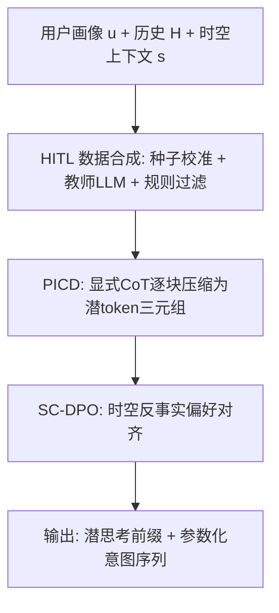
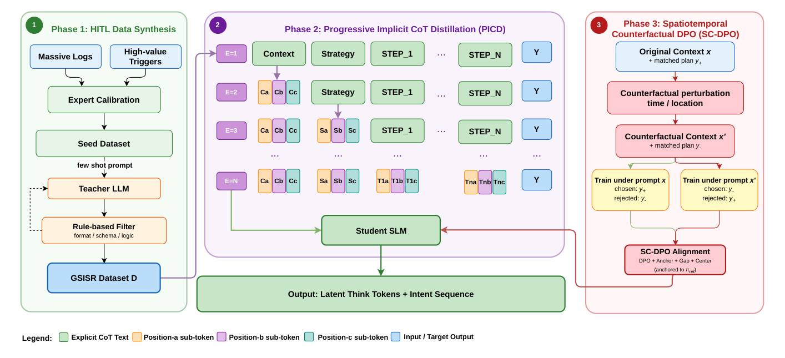

# Generative Spatiotemporal Intent Sequence Recommendation via Implicit Reasoning in Amap (高德：基于隐式推理的生成式时空意图序列推荐)

- **会议/期刊**: RecSys 2026 (Proceedings of the 20th ACM Conference on Recommender Systems, pp. 1119-1127)
- **作者与机构**: Sicong Wang, Ruiting Dong, Yue Liu, Bowen Zheng, Jun Meng, Jie Li, Shuaijun Guo, Yu Gu, Fanyi Di, Xin Li（AMAP, Alibaba Group）
- **推荐链路定位**: 端到端生成式（首页 Agent 卡片序列生成）
- **研究方向**: 时空轨迹与 POI 本地生活推荐 / 生成式推荐
- **论文原文**: [https://arxiv.org/abs/2605.28888v2](https://arxiv.org/abs/2605.28888v2)
- **开源代码**: [https://github.com/alibaba/GPlan](https://github.com/alibaba/GPlan)

## TL;DR (1分钟核心速览)

现有序列推荐只做 next-item 预测，无法保证长意图序列的全局逻辑连贯与物理可执行；直接部署 LLM 做 CoT 推理又面临延迟超限与时空幻觉两大瓶颈。本文定义 GSISR 任务并提出 GPlan：用渐进式隐式 CoT 蒸馏（PICD）把教师显式推理压缩为位置特定的潜 token 三元组，再用时空反事实 DPO（SC-DPO）对齐上下文敏感性。在 Amap 10 万条工业数据上，GPlan-4B 相对 TIGER 的 Acc@1 提升 18.5 个百分点（62.7 vs. 44.2），线上跨城场景 UV-CTR 提升 +1.04%。

## Background & Motivation (背景与核心矛盾)

- **主流范式**: 序列推荐以 SASRec/BERT4Rec 的 next-item 预测为主，生成式推荐（P5、TIGER、HSTU）则把输出重写为文本或语义 ID 的自回归解码。
- **前人局限**: 其一，next-item 目标不约束全局连贯性，长序列易出现逻辑倒置与重复循环；其二，显式 CoT 解码延迟（4B 模型达 1.85s）远超生产要求，且通用 LLM 缺乏应用侧时空约束，会产出物理不可行的行程。
- **核心洞察 (Key Insight)**: 真实行为是受时空依赖支配的"意图流"（如跨城出差：[打车]→[酒店入住]→[附近餐饮]→[返回酒店]），后续动作的参数依赖前序动作的产出（如"酒店附近"必须以"到达酒店"为锚点重定位）。
- **本文切入点**: 把 LLM 级规划能力"内化"进轻量学生模型——推理过程不生成文本而生成潜 token，同时用反事实偏好对显式教会模型"上下文变了，计划就该变"。

## Method (核心方法设计)

### 1. 整体框架 (Overall Architecture)

GPlan 分三阶段闭环：先由 HITL 流水线合成数据——从海量日志抽取高价值触发模式，专家校准 1,000 条"意图–环境–逻辑"种子三元组，再用 Qwen3-235B-A22B few-shot 扩增，经格式/模式/逻辑三层规则过滤（淘汰 28.9%），得到 10 万训练 + 1,000 测试样本。随后 PICD 在 13 个 epoch 内按前向顺序把 `<CONTEXT>`、`<STRATEGY>`、`<STEP_i>` 逐块替换为潜 token 三元组，学生模型最终只输出潜思考前缀再接 JSON 意图序列。最后 SC-DPO 以时间/地点扰动构造双向偏好对做后训练对齐。

<figure class="paper-figure" markdown="span">
  <figcaption>图1：三阶段GPlan流水线。(1) HITL数据合成使用专家校准的种子、教师LLM和基于规则的过滤来构建GSISR数据集。(2) PICD逐步将上下文级、策略级和步骤级CoT块替换为位置特定的潜在token三元组，得到一个先输出潜在思考token再输出意图序列的学生模型。(3) SC-DPO通过扰动时间或位置来创建双向匹配/不匹配的上下文–计划偏好，并以参考锚定目标对齐学生模型。</figcaption>
</figure>

### 2. 关键设计拆解 (Key Designs)

1. **潜多 token 推理脚手架（Latent Multi-Token Scaffold）**：显式 CoT 的每个语义块文本长度不定且解码昂贵。PICD 将每个块替换为固定 $K=3$个保留词表 token，完整潜前缀写作$\Phi(R)=\texttt{<THOUGHT>}\,C\,S\,T_1\cdots T_{|Y|}\,\texttt{</THOUGHT>}$，其中$C=(c_a,c_b,c_c)$、$S=(s_a,s_b,s_c)$、$T_i=(t_{i,a},t_{i,b},t_{i,c})$为位置特定三元组。取$K=3$的直觉是：单个 `<STEP_i>` 块需同时编码工具选择、参数赋值与前序意图链接三方面信息。块总数$B=2+|Y|$ 随计划长度动态变化，短计划样本更早进入全潜阶段。

2. **压缩感知学习率 CALR（Compression-Aware LR）**：课程学习中预测目标是非平稳的——随着 $b$增长，越来越多 CoT 前缀变为潜 token，学生需重新学习这些 token 的语义编码。标准余弦衰减会在潜结构尚未习得时就压低学习率，导致三元组重复、token 缺失、顺序错乱；恒定学习率虽保住结构却缺少精修 JSON 计划的低 LR 阶段。CALR 以$B^\star=9$（训练集$B$ 的 p90）为切换点：
$$\eta(t)=\begin{cases}\eta_{\text{struct}} & g(t)\le B^\star\\ \eta_{\text{polish}}\cdot\text{cosine}(t-t^\star) & g(t)>B^\star\end{cases}$$
其中 $\eta_{\text{struct}}=5\times10^{-6}>\eta_{\text{polish}}=1\times10^{-6}$。同时采用分段归一化损失$\mathcal{L}=\frac{1}{2}(\mathcal{L}_{\text{cot}}+\mathcal{L}_{\text{json}})$，避免 CoT token 数随压缩进程缩减而导致 JSON 监督权重漂移。

3. **时空反事实 DPO（SC-DPO）**：SFT 是静态监督，无法强制计划对时空上下文的条件依赖。SC-DPO 对每个锚点样本构造仅时间/地点/城市/工作日/节假日不同的反事实上下文 $x'$，并双向物化偏好对：在$x$下$y^+$胜$y^-$，在$x'$下反转。关键在于$y^-$ 并非全局劣质，只是"对当前上下文错配"，因此标准 DPO 会把它压到任意低并损害 SFT 能力。为此在 DPO 项外加入参考锚定、有界间隔与中心漂移三项：
$$\mathcal{L}_{\text{SC-DPO}}=\mathcal{L}_{\text{DPO}}+\lambda_a\max(0,\delta-r^+)^2+\lambda_{g,\ell}\max(0,\gamma_\ell-\text{gap})^2+\lambda_{g,h}\max(0,\text{gap}-\gamma_h)^2+\lambda_c(\text{center}-m)^2$$
其中 $r^\pm=\beta_{\text{DPO}}[\log\pi_\theta(y^\pm|x)-\log\pi_{\text{ref}}(y^\pm|x)]$，$\text{gap}=r^+-r^-$，$\text{center}=\frac{1}{2}(r^++r^-)$。锚定项保证匹配响应不弱于 SFT 策略，间隔项要求偏好为正但有上界，中心项令对级奖励漂移贴近参考策略，从而学到"局部条件偏好"而非"全局厌恶$y^-$"。

4. **训练目标与推理效率**：PICD 阶段用 token 级交叉熵（分段归一化），SC-DPO 阶段在反事实语料上训练 1 epoch，学习率 $2\times10^{-7}$，$\beta_{\text{DPO}}=0.20$，$[\gamma_\ell,\gamma_h]=[0.10,0.20]$，$\lambda_a=5,\lambda_{g,\ell}=10,\lambda_{g,h}=2,\lambda_c=3$。推理时学生仅生成潜 token 前缀（无长文本），4B 规模平均响应时间 503ms，较 CoT-SFT 的 1.85s 加速 3.7 倍，接近 Direct-SFT 的 437ms。

## Experimental Setup & Evaluation Protocol (实验设置与评估协议)

- **数据集与预处理**: Amap 工业数据集，经 HITL 合成与三层规则过滤（格式 JSON 可解析、模式工具库与参数合法、逻辑参数引用可解析且互斥行程类意图受限），最大意图序列长度设为 9。

| 数据集 | #Users | #Items | #Interactions | 稀疏度/密度 | 特征/场景说明 |
| :--- | :---: | :---: | :---: | :---: | :--- |
| Amap-GSISR (train) | 未披露 | 工具库 $\mathcal{E}$ | 100,000 条意图序列 | — | 用户画像 + 历史 + 时空上下文，含参数槽 |
| Amap-GSISR (test) | 未披露 | 同上 | 1,000 条意图序列 | — | 同分布，评估时复用规则过滤器 |

- **数据划分与防穿越 (Splitting Strategy)**: 采用独立训练/测试集划分（100k / 1k），测试目标由教师模型生成并经确定性规则过滤，与学生学习过程独立；评估时对所有模型输出重新施加同一过滤器作为最低有效性检查。
- **排名评测协议 (Ranking Protocol)**: 序列级生成评估，非全库排序。指标为 Acc@1（首个意图准确率，对应首页 UI 优先级）、NDCG@3、归一化编辑相似度 NES $=1-\frac{D(\hat{Y},Y^*)}{\max(|\hat{Y}|,|Y^*|)}$，其中$D$ 为加权 Levenshtein 距离（工具级替换代价 1.0，参数级替换代价 0.3）。另设 Latent-Valid 诊断指标检查潜前缀结构合法性。
- **对比基线与超参设置**: 传统序列模型 SASRec、BERT4Rec、ReaRec；生成式模型 P5、TIGER。GPlan 使用 Qwen3-1.7B 与 4B 骨干，PICD 训练 13 epoch，$K=3$，$B^\star=9$。所有基线在工具级比较（因其不生成参数槽）。

## Key Experimental Results (实验关键数据)

### 1. 主实验对比 (Main Results)

| Method | Acc@1 (↑) | NDCG@3 (↑) |
| :--- | :---: | :---: |
| SASRec | 36.1 | 0.5865 |
| BERT4Rec | 37.4 | 0.5973 |
| ReaRec | 42.9 | 0.6442 |
| P5 | 43.5 | 0.6581 |
| TIGER | 44.2 | 0.6647 |
| **GPlan-1.7B** | **60.5** | **0.7450** |
| **GPlan-4B** | **62.7** | **0.7759** |
| Improv. (vs. TIGER) | +18.5 pt | +16.7% |

### 2. 消融实验 (Ablation Study)

| 配置 | Acc@1 | NDCG@3 | NES | Latent-Valid | Judge ST | Judge Overall |
| :--- | :---: | :---: | :---: | :---: | :---: | :---: |
| Direct-SFT | 61.2 | 0.7591 | 0.6210 | — | 3.49 | 3.43 |
| CoT-SFT | 62.3 | 0.7785 | 0.6354 | — | 3.64 | 3.60 |
| PICD (Cosine-LR) | 62.4 | 0.7652 | 0.6259 | 0.0 | — | — |
| PICD (Constant-LR) | 62.1 | 0.7575 | 0.6216 | 1.0 | — | — |
| PICD (CALR) | 62.6 | 0.7726 | 0.6290 | 1.0 | 3.69 | 3.62 |
| PICD + Vanilla DPO | 62.1 | 0.7484 | 0.6158 | — | 3.60 | 3.51 |
| **PICD + SC-DPO** | **62.7** | **0.7759** | **0.6365** | — | **3.75** | **3.64** |

### 3. 关键实验发现 (Key Findings)

1. **潜 token 压缩几乎无损精度但大幅降延迟**：PICD 在标签指标上接近 CoT-SFT（Acc@1 62.6 vs. 62.3），LLM 评委三维度还略高，而 4B 规模延迟从 1.85s 降至 503ms（3.7× 加速），证明推理能力可被压缩进潜表示而不必生成推理文本。
2. **CALR 是"接口保真"的关键**：余弦 LR 虽取得 62.4 的竞争性 Acc@1，但 Latent-Valid 为 0.0——模型绕过了潜接口直接恢复 JSON 计划；恒定 LR 保住结构（1.0）却损失精度；CALR 同时达成 1.0 与最优标签指标，说明学习率切换点必须与压缩课程状态绑定。
3. **朴素 DPO 会反噬 SFT 能力，SC-DPO 才带来净增益**：Vanilla DPO 在所有轴上全面下滑（Acc@1 62.1、Judge Overall 3.51，均低于 PICD 的 62.6/3.62），而 SC-DPO 将时空维度评委分从 3.69 提至 3.75 且 Overall 升至 3.64，验证了"反事实负例是上下文错配而非全局劣质"这一建模前提的必要性。线上 A/B 中，通用流量 UV-CTR +0.87%，跨城切片 +1.04%，说明收益集中在序列级规划价值最高的场景。

## Highlights & Limitations (亮点、对比与审稿批判)

- **与代表作对比 (vs. Prior Work)**: 相较 TIGER 的语义 ID 自回归检索，GPlan 生成的是带参数槽的异构工具调用序列，且后续动作参数依赖前序产出；相较 Coconut/CODI 等潜推理蒸馏，PICD 引入类型化、位置特定的 token 三元组与随计划长度变化的压缩课程；相较标准 DPO 与 S-DPO，SC-DPO 处理的是"双向有效"的反事实对，必须用锚定与有界间隔防止全局压制。
- **可迁移亮点**: 其一，"分段归一化损失 + 课程状态绑定学习率"的组合可直接迁移到任何逐步移除监督信号的蒸馏流程；其二，双向物化反事实偏好对（在 $x$与$x'$ 下互换 chosen/rejected）是训练上下文敏感性的通用技巧，适用于任何条件生成推荐。
- **审稿级局限批判**: 其一，离线标签指标衡量的是与教师生成目标的一致性，而非真实用户满意度，作者自己也承认需依赖 LLM 评委与线上 A/B 补足，而 LLM 评委可能奖励"表面提及上下文"的计划；其二，SC-DPO 仅扰动时间/地点等少数变量，未覆盖天气、交通拥堵、服务库存等更细粒度的物理约束，且潜 token 的语义可解释性完全缺失，调试与故障归因困难。

## Rating (四维评分)

- **方法创新性 (Novelty)**: ⭐⭐⭐⭐ （潜 token 三元组脚手架与压缩感知学习率的耦合设计新颖，SC-DPO 对"反事实负例非全局劣质"的洞察有理论说服力）
- **评估协议与实验扎实度 (Protocol & Experiments)**: ⭐⭐⭐⭐ （10 万级工业数据 + 标签指标 + LLM 评委 + 14 天线上 A/B 三层验证完整，但离线目标为教师生成、缺乏人工标注的真实偏好）
- **写作与数学规范度 (Clarity & Rigor)**: ⭐⭐⭐⭐ （损失各项动机与消融一一对应，CALR 与 Latent-Valid 诊断设计严谨；部分符号如 $g(t)$与$b(e)$ 的映射交代略简）
- **工业落地与复现价值 (Industrial & Practical Value)**: ⭐⭐⭐⭐⭐ （代码与匿名数据集开源，503ms 延迟满足生产要求，线上 UV-CTR 正向收益，是少见的全链路闭环工业论文）

