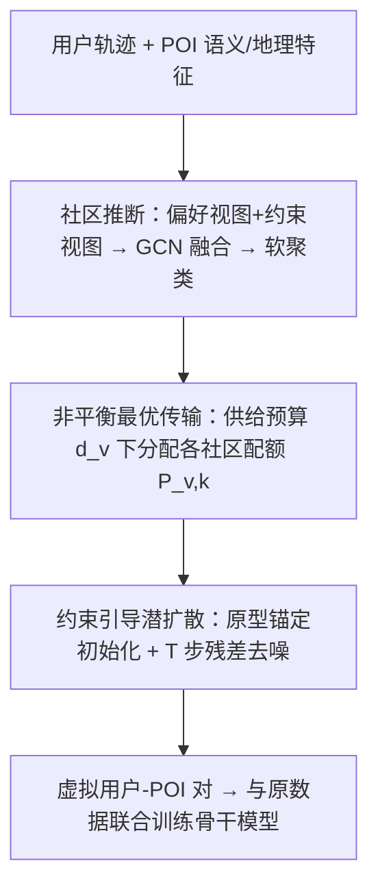
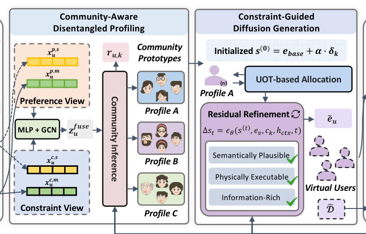

# Give the Long-tail More SPACE: Promoting Provider Fairness in Next POI Recommendation (给长尾更多 SPACE：面向下一 POI 推荐的提供方公平性提升)

- **会议/期刊**: RecSys 2026
- **作者与机构**: Anran Zhang, Jiaqi Jiang, Jiahui Jin (东南大学)；Yuhan Zhao (香港浸会大学)
- **推荐链路定位**: 召回（训练数据增强，模型无关插件）
- **研究方向**: 时空轨迹与 POI 本地生活推荐 / 去偏公平与可信推荐
- **论文原文**: [https://arxiv.org/abs/2608.07998v1](https://arxiv.org/abs/2608.07998v1)
- **开源代码**: [https://github.com/Anniran1/SPACE-main](https://github.com/Anniran1/SPACE-main)

## TL;DR (1分钟核心速览)

下一 POI 推荐模型把曝光集中在少数热门 POI 上，长尾商户被系统性压制；而现有提供方公平技术直接迁移会失效，因为 POI 场景存在**用户执行约束**（物理可达半径）与 **POI 供给约束**（容量上限）。本文提出 SPACE：先推断反映异质移动约束的用户社区，再用非平衡最优传输在供给预算下为每个长尾 POI 分配"从哪些社区来多少虚拟用户"，最后用约束引导的潜扩散生成 POI 条件化、社区一致的虚拟用户嵌入，作为训练数据增强插件。在 NYC/TKY/CA 三数据集上，公平性指标最高提升 94.11%，同时精度普遍不降反升（GETNext 在 CA 上 HR@10 提升 54.85%）。

## Background & Motivation (背景与核心矛盾)

- **主流范式**: 下一 POI 推荐以序列模型（FPMC/LSTPM）、图增强 Transformer（GETNext）、生成式（MTNet/DiffuRec）为主，优化目标几乎纯粹是用户侧精度，导致"富者愈富"的曝光反馈回路。
- **前人局限**: 现有提供方公平方法（重排、正则化、后处理）假设推荐是"数字行为"，可任意提升长尾曝光；但在 POI 场景下 (i) 用户受时间/金钱/交通方式约束，推荐不可达 POI 只产生"虚假曝光"；(ii) POI 有硬性容量上限，盲目提升曝光会造成拥堵与运营过载。
- **核心洞察 (Key Insight)**: 作者从理论上证明——带异质执行预算 $\{B_u\}$与 POI 容量$\{S_v\}$的公平分配问题是 NP-hard（归约自带容量指派问题），且忽略可行性时**公平代价 PoF 无界**：若长尾 POI 对所有用户都不可达，强制分配$\tau$比例曝光会使$U_{\text{FAIR}}^{\text{Physical}}=(1-\tau)M$，$\text{PoF}=1/(1-\tau)\to\infty$。因此"软惩罚 + 端到端优化"无法保证离散 top-$K$ 分配的可行性。
- **本文切入点**: 不操纵排序，而是**在训练阶段合成尊重双重约束的虚拟用户–POI 交互**，从数据侧修正曝光偏置，天然保持模型架构不变。

## Method (核心方法设计)

### 1. 整体框架 (Overall Architecture)

SPACE 是三阶段的模型无关插件：输入用户轨迹后，(1) 社区推断模块从偏好视图与约束视图双视角学习用户约束潜表征，经 GCN 融合协同信号后软聚类为 $K$个社区原型；(2) 非平衡最优传输模块在 POI 供给预算$d_v$下决定每个长尾 POI 从各社区获取多少虚拟用户；(3) 约束引导潜扩散模块以"POI 表征 + 社区原型"为锚点初始化，沿真实社区内偏差方向扰动，再经$T$ 步残差去噪生成虚拟用户嵌入。生成的虚拟用户–POI 对与原数据联合训练任意骨干推荐器，推理阶段不引入任何额外开销。

<figure class="paper-figure" markdown="span">
  <figcaption>图2：我们提出的SPACE示意图。</figcaption>
</figure>

### 2. 关键设计拆解 (Key Designs)

1. **解耦式社区推断（Disentangled Community Inference）**：痛点是把"偏好相似"与"约束相似"混在一个表征里，导致生成的虚拟用户物理不可行。作者用偏好视图 $\mathbf{x}^p_u$（POI 类别直方图、访问数、探索多样性）与约束视图$\mathbf{x}^c_u$（小时/星期活动直方图、地理统计、平均轨迹长度）共同编码为$\mathbf{z}^c_u=\text{MLP}_c([\mathbf{x}^c_u;\mathbf{x}^p_u])$，再与 GCN 协同信号$\mathbf{g}^c_u$融合得$\mathbf{z}^{\text{fuse}}_u$，用余弦相似度对可学习原型软分配$r_{u,k}$。辅助损失同时最大化用户–原型紧致度并用$\text{KL}(\tilde{\mathbf{r}}\,\|\,\mathcal{U}(1/K))$ 防止社区坍缩——只约束边缘分布而非硬分配，保证下游配额分配有足够社区覆盖。

2. **供给约束下的非平衡最优传输配额分配**：若对每个长尾 POI 固定生成 $M$个虚拟用户，会把长尾变成"假头部"，扭曲分布。作者构造传输计划$\mathbf{P}\in\mathbb{R}^{|V_{tail}|\times K}_+$，以 POI 嵌入与社区原型的距离为代价矩阵，求解
$$\min_{\mathbf{P}\geq 0}\ \langle \mathbf{P},\text{Cost}\rangle+\text{KL}(\mathbf{P}\mathbf{1}\,\|\,\mathbf{d})$$
第一项让配额流向与 POI 语义相关的社区（小众美术馆不会被硬塞给"风景偏好游客"），第二项以 KL 软约束把每个 POI 的总配额拉回供给预算 $d_v$（如历史日最大访问量），允许偏离但偏离越大惩罚越重，从而避免"假头部"。

3. **约束引导潜扩散生成 + 执行正则**：直接从各向同性噪声采样难以同时满足语义合理、信息丰富、物理可行。作者以 $\mathbf{e}_{\text{base}}=\text{MLP}_{\text{base}}([\mathbf{h}_v;\mathbf{c}_k])$为锚，采样同社区真实用户偏差$\boldsymbol{\delta}_k=\mathbf{z}^c_u-\bar{\mathbf{z}}^c_k$得$\mathbf{s}^{(0)}=\mathbf{e}_{\text{base}}+\alpha\cdot\boldsymbol{\delta}_k$，再迭代$\mathbf{s}^{(t+1)}=\mathbf{s}^{(t)}+\frac{1}{T}\epsilon_\theta(\mathbf{s}^{(t)},\mathbf{e}_v,\mathbf{c}_k,\mathbf{h}_{\text{ctx}},t)$。执行正则$\mathcal{L}_{\text{exec}}=\text{ReLU}(\|\tilde{\mathbf{e}}_u-\mathbf{e}_u\|_2^2-R_k^2)$以社区半径分位数$R_k$为界，把生成样本拉回社区流形。总损失$\mathcal{L}=\sum_{\mathcal{D}}L_{\text{rec}}+\lambda_{\text{rec}}\sum_{\tilde{\mathcal{D}}}L_{\text{rec}}$，无需负采样改造，推理零额外开销。

## Experimental Setup & Evaluation Protocol (实验设置与评估协议)

- **数据集与预处理**: 三个真实 LBSN 数据集，按频次排序取前 20% 为热门 POI、后 80% 为长尾：

| 数据集 | #Users | #Items(POI) | #Interactions | 特征/场景说明 |
| :--- | :---: | :---: | :---: | :--- |
| NYC | 1,075 | 5,099 | 104,074 | 318 类别，14,160 条轨迹 |
| TKY | 2,281 | 7,844 | 361,430 | 291 类别，44,692 条轨迹 |
| CA | 4,318 | 9,923 | 250,780 | 301 类别，32,920 条轨迹 |

- **数据划分与防穿越 (Splitting Strategy)**: 沿用 GETNext 的 POI 推荐标准设定（按轨迹序列划分训练/验证/测试），预处理与划分脚本统一以保证可比性。
- **排名评测协议 (Ranking Protocol)**: top-$K$ 全候选排序，精度用 HR@1/HR@10/NDCG@10；公平性用冷热组公平 CGF@K（越低越公平）、冷 POI 曝光 CE@K（越高越好）、长尾覆盖率 LTC（越高越好），补充 NC@K 与 GINI。
- **对比基线与超参设置**: 5 个骨干 FPMC、LSTPM、GETNext、MTNet、DiffuRec，逐一对比 w/o 与 w/ SPACE；所有超参在验证集调优，报告 $p\leq 0.05$ 显著性。

## Key Experimental Results (实验关键数据)

### 1. 主实验对比 (Main Results)

| 数据集 | 指标 | FPMC(w/o→w) | LSTPM | GETNext | MTNet | DiffuRec |
| :--- | :--- | :---: | :---: | :---: | :---: | :---: |
| NYC | HR@10↑ | 0.4922→0.4983 | 0.5574→0.5544 | 0.5676→**0.6638** | 0.5381→0.5537 | 0.5378→0.5358 |
| NYC | LTC↑ | 0.5469→0.5858 | 0.5303→0.5339 | 0.7306→**0.7686** | 0.3730→0.4234 | 0.6913→0.7284 |
| NYC | 精度/公平提升 | 7.53%/7.32% | 0.10%/1.77% | **21.55%/15.40%** | 4.30%/12.06% | -0.01%/9.52% |
| TKY | HR@10↑ | 0.4482→0.4437 | 0.5599→0.5622 | 0.3950→0.4274 | 0.5068→0.5150 | 0.4807→**0.4959** |
| TKY | LTC↑ | 0.3700→0.3798 | 0.7417→0.7451 | 0.2144→**0.3432** | 0.2361→0.2441 | 0.6824→0.7176 |
| TKY | 精度/公平提升 | -1.79%/2.61% | 0.40%/2.52% | 7.07%/**57.66%** | 1.01%/9.44% | 12.73%/9.62% |
| CA | HR@10↑ | 0.2682→0.2653 | 0.2975→0.3024 | 0.3613→**0.6059** | 0.3001→0.3084 | 0.3599→0.3662 |
| CA | LTC↑ | 0.3126→0.3443 | 0.6192→0.6444 | 0.3120→**0.4672** | 0.1740→0.2103 | 0.5594→0.6081 |
| CA | 精度/公平提升 | 2.52%/13.50% | 2.30%/3.50% | **54.85%/94.11%** | 6.10%/31.85% | 8.64%/8.17% |

### 2. 消融实验 (Ablation Study)

| 变体 (GETNext) | HR@1 | HR@10 | CE@10 | LTC (NYC / CA) |
| :--- | :---: | :---: | :---: | :---: |
| w/o comm | 0.2656 | 0.6093 | 0.0600 | 0.5341 / 0.4217 |
| w/o gen | 0.2710 | 0.6281 | 0.0645 | 0.5577 / 0.4021 |
| w/o $\mathcal{L}_{\text{infer}}$ | 0.2647 | 0.6160 | 0.0480 | 0.4671 / 0.4270 |
| w/o $\mathbf{s}^{(0)}$ | 0.2697 | 0.6221 | 0.0515 | 0.4824 / 0.4190 |
| **SPACE** | **0.2791** | **0.6638** | **0.1100** | **0.7686 / 0.4672** |

### 3. 关键实验发现 (Key Findings)

1. **公平性提升幅度与数据稀疏度正相关**：CA 最稀疏、长尾偏置最严重，GETNext 的公平性提升达 94.11%（LTC 0.3120→0.4672），而稠密的 NYC 仅 15.40%；说明虚拟用户生成对极端稀疏场景的补信号价值最大。
2. **社区原型与物理锚点是稠密数据上的关键先验**：NYC 上移除 $\mathcal{L}_{\text{infer}}$使 LTC 从 0.7686 暴跌至 0.4671（降 39%），移除$\mathbf{s}^{(0)}$ 降至 0.4824，远大于移除生成模块的影响，证明"约束感知的初始化"比"生成器本身"更决定可行性。
3. **公平与精度并非零和**：5 个骨干中 4 个精度同步提升，仅 FPMC 在 TKY 上小幅下降 1.79%；LSTPM 提升最弱（0.10%~2.30%），因其长短期兴趣建模本身已部分缓解曝光偏置。补充指标上 NC@1 提升 62.46%、GINI 从 0.9236 降至 0.9083，且训练时间仅增加约 3%（如 GETNext 128.1s→135.8s）。

## Highlights & Limitations (亮点、对比与审稿批判)

- **与代表作对比 (vs. Prior Work)**: 相比重排/正则化类公平方法（如 Fairness-aware 后处理、FairAgent 的 RL 奖励），SPACE 不改排序、不改架构，从训练数据侧注入可行性约束；相比纯扩散推荐（DiffuRec/Diff-POI）只建模用户兴趣分布，SPACE 的扩散是**条件化于 POI 与社区原型**且带执行半径正则，生成的是"可执行"而非"高似然"样本。
- **可迁移亮点**: (i) 用非平衡 OT 的 KL 软约束做"配额预算"控制，可迁移到任何需要限制增强样本总量的长尾/冷启动数据增强；(ii) "原型锚定 + 真实社区内偏差扰动"的初始化策略，比从噪声起步的扩散生成更易满足流形约束，适用于任何条件生成式数据合成。
- **审稿级局限批判**: (i) 供给预算 $d_v$依赖历史日最大访问量等代理量，真实容量（票额、座位）难以获取，预算设定偏差会直接影响公平性与精度的平衡；(ii) 社区数$K$、探索强度$\alpha$、$\lambda_{\text{rec}}$ 均需逐数据集调优，且实验仅在离线全排序协议下验证，缺少线上 A/B 与真实用户对"被推荐长尾 POI"的接受度反馈。

## Rating (四维评分)

- **方法创新性 (Novelty)**: ⭐⭐⭐⭐ （首次将 POI 提供方公平形式化为约束耦合问题并给出 NP-hard 与无界 PoF 的理论刻画，OT 配额 + 条件扩散的组合新颖）
- **评估协议与实验扎实度 (Protocol & Experiments)**: ⭐⭐⭐⭐ （三数据集 × 五骨干 × 五类公平指标 + 消融 + 效率分析齐全，但缺线上验证与冷启动划分）
- **写作与数学规范度 (Clarity & Rigor)**: ⭐⭐⭐⭐ （定理证明简洁有力，三阶段模块边界清晰；部分符号如 $\lambda_{\text{virtual}}$与$\lambda_{\text{rec}}$ 在正文与图中命名略有不一致）
- **工业落地与复现价值 (Industrial & Practical Value)**: ⭐⭐⭐⭐⭐ （模型无关插件、推理零开销、训练仅增约 3%、代码已开源，可直接挂载到现有 POI 推荐管线）

