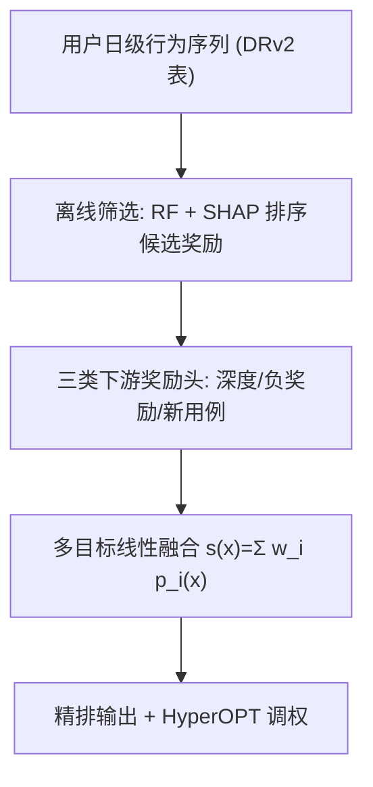

# Long-term User Engagement Optimization through Model-agnostic Downstream Rewards Learning (通过模型无关的下游奖励学习优化长期用户参与)

- **会议/期刊**: RecSys 2026
- **作者与机构**: Dingsu Wang, Filip Ryzner, Kelly He, Armando Ordorica, David Woo 等（Pinterest）
- **推荐链路定位**: 精排（多目标排序头）
- **研究方向**: 强化学习与动态探索推荐 / 多任务学习与列表级重排
- **论文原文**: [论文原文链接](https://arxiv.org/abs/2607.14192v3)
- **开源代码**: 暂未开源

## TL;DR (1分钟核心速览)

直接优化留存面临标签稀疏、延迟与归因困难三大障碍，而 RL 方案又需重度奖励工程且难以跨场景迁移。本文提出模型无关的下游奖励（DR）框架：先用离线筛选框架从数百候选会话行为中筛出"早期可观测且增量预测留存"的信号，再构造三类代理奖励——P2P 兔子洞深度折扣累积奖励、浅层关闭负奖励、新用例采纳奖励，作为辅助头接入任意排序模型。Pinterest Homefeed/Search/Related Pins/Notifications 四周线上 A/B 中 SS 提升 +0.10%~+0.36%、WAU +0.1%，负奖励使失败会话下降 −0.40%。

## Background & Motivation (背景与核心矛盾)

- **主流范式**: 工业推荐以点击、关闭、保存等短期行为为多目标精排标签；长期留存优化则多走 RL/Contextual Bandit 路线，显式优化折扣累积回报。
- **前人局限**: ① 留存标签稀疏、延迟且难以归因到具体某次推荐，直接监督几乎不可训；② RL 需大量交互数据、超大动作空间与逐场景定制奖励函数，Homefeed 与 Search 的产品目标不同，奖励无法干净迁移。
- **核心洞察 (Key Insight)**: 作者在 Pinterest 十亿级行为上做离线筛选，发现一条经验链条——**更深动作 ⇒ 更长会话 ⇒ 更快回访 ⇒ 留存↑**。具体地，Homefeed 上 save+closeup 状态的期望后续 feedview 为 7.80，而仅停留 Homefeed 表面只有 4.45；会话时长超过 5 分钟的用户中位回访间隔比短会话早约 2.2 小时（9 个阈值下 $p<10^{-43}$）。反之，浅层高量浏览在曝光归一化后符号翻转为负，是误导性噪声。
- **本文切入点**: 不做 RL 策略优化，而是把"可早期观测、高覆盖"的下游行为轨迹直接当作监督式代理奖励，以模型无关方式挂到任意排序模型上。

## Method (核心方法设计)

### 1. 整体框架 (Overall Architecture)

框架分三层闭环：**离线筛选**——以"枢轴日"为单位构造低活跃用户样本（前两周活跃天数 $\le 1$，后两周各 $\ge 3$ 天为正例，约占 4%），提取 174 个基础特征交叉为约 103 个候选，用随机森林（AUC 0.65–0.70）结合 SHAP 与单变量相关性排序候选奖励；**奖励构造**——将筛选出的信号形式化为三类可微代理奖励，作为额外预测头接入 Pinnability 排序模型；**服务融合**——各头预测线性加权 $s(x)=\sum_i w_i p_i(x)$，权重用 HyperOPT 在排序器外调优，负奖励头权重取负。标签侧由 DRv2 基础设施在 Ray dataloader 内按 UDF 即时派生。

### 2. 关键设计拆解 (Key Designs)

1. **深度会话奖励（折扣累积下游参与）**：单次高意图动作不足以刻画价值，需奖励"延续一串下游交互"。对轨迹 $\mathcal{S}_{u,t}$ 定义逐步奖励 $r^{eng}_{u,t+i}=\sum_{a\in\mathcal{A}_{eng}} w_a \mathbb{I}[A_{u,t+i}=a]$（$\mathcal{A}_{eng}$ 含 save/download/screenshot），折扣求和 $\mathcal{R}^{eng}(\mathcal{S}_{u,t})=\sum_{i=1}^{n_{u,t}}\gamma^{i-1} r^{eng}_{u,t+i}$。折扣让靠近原始推荐的参与获得更高信用，缓解长轨迹的归因弥散。

2. **浅层关闭负奖励（用户状态自适应阈值）**：浅层关闭（<1s 即放弃且无后续高意图动作）体量与 save 相当但预示会话即刻终止。指示函数 $\mathrm{ISC}=\mathbb{I}[A=\text{closeup}\wedge d<\delta_{state(u)}\wedge \mathbb{I}^{pos}=0]$，负奖励 $\mathcal{R}^{neg}=-\lambda_{SC}\sum_i \mathrm{ISC}$。关键增量在于阈值按用户状态分档：核心用户 $\delta=1$s、非核心 $0.5$s——动作概率曲线的拐点在不同人群确实不同，统一阈值会在非核心用户上造成跨场景蚕食。

3. **新用例采纳奖励与训练目标**：留存不仅靠强化既有兴趣，还需帮用户建立新连接。以预计算兴趣簇 $\{c_{u,i}\}$ 判定 $\mathrm{new}(u,x)=\mathbb{I}[\max_i \cos(e_x,c_{u,i})<\eta]$（$\eta=0.6$），奖励为合取信号 $\mathcal{R}^{UCA}=\mathbb{I}[\text{engaged}\wedge \text{new}]$，实现上对满足条件的正样本权重翻倍。总目标即多任务联合：$\mathcal{L}=\sum_i \mathrm{BCE}(y_i,p_i)$ 加样本重加权，无额外负采样设计；推理开销仅为多几个 MLP 头，DRv2 使新奖励变体的想法到实验周期从约 3 周压缩到约 2 天，增量训练成本 <5%。

## Experimental Setup & Evaluation Protocol (实验设置与评估协议)

- **数据集与预处理**: 全部基于 Pinterest 生产数据，作者明确不在公开数据上评测（公开集缺少派生全部奖励所需的动作信号，且不能反映真实在线参与模式）。Homefeed 线上实验占 1.5% 总流量，持续 3–4 周。

| 数据集 | 规模 | 场景说明 |
| :--- | :---: | :--- |
| Pinterest 全站行为日志 | 十亿级用户行为 | 跨 Homefeed/Search/Related Pins/Notifications 的日级事件序列 |
| 离线筛选样本 | 数十万枢轴日样本 | 低活跃用户留存转化预测，RF AUC 0.65–0.70 |

- **数据划分与防穿越 (Splitting Strategy)**: 离线筛选采用枢轴日 $t=0$ 前后切分——特征仅取 $t=0$ 当日及之前两周基线，标签取 $t=+1,+2$ 周活跃天数，天然防穿越；线上为随机分流 A/B。
- **排名评测协议 (Ranking Protocol)**: 无离线全库排序指标，评测完全依赖线上 A/B 的相对提升，所有报告指标均通过统计显著性检验。
- **对比基线与超参设置**: 对照组为仅优化即时参与预测的生产排序模型（Pinnability）；实验组加挂 DR 头。关键超参：$\gamma$ 折扣因子、$\lambda_{SC}$ 惩罚强度、$\delta_{core}=1$s / $\delta_{non-core}=0.5$s / $\delta_{P2P}=2$s、$\eta=0.6$（在 {0.5,0.6,0.7} 中调优），融合权重由 HyperOPT 搜索。

## Key Experimental Results (实验关键数据)

### 1. 主实验对比 (Main Results)

Homefeed 三类奖励按用户状态拆分（相对提升，均显著）：

| 下游奖励 | SS (核心) | SS (非核心) | 总时长 (核心) | 总时长 (非核心) |
| :--- | :---: | :---: | :---: | :---: |
| 深度会话奖励 | +0.24% | **+0.48%** | +0.09% | +0.10% |
| 负奖励（浅层关闭） | +0.16% | +0.16% | **+0.46%** | **+0.24%** |
| 新用例采纳 | +0.10% | +0.10% | +0.16% | +0.11% |

跨场景扩展（深度会话奖励，对照组仅优化即时参与）：

| 场景 | 指标 | 提升 |
| :--- | :--- | :---: |
| Search | Search Fulfillment Rate | **+0.25%** |
| Related Pins | Successful Sessions | +0.15% |
| Notifications | Successful Sessions | +0.14% |
| Related Pins（负奖励 $\delta=2$s） | SS / >5min 会话 | +0.14% / **+0.70%** |

### 2. 消融实验 (Ablation Study)

| 配置 | 关键结果 | 说明 |
| :--- | :--- | :--- |
| 深度奖励（download+screenshot） | SS +0.36%，时长 +0.10%，截图/下载各 +0.7% | 全用户口径 |
| 深度奖励（save） | SS +0.16%，WAU +0.1% | 换动作信号仍有效 |
| 负奖励·统一阈值 $\delta=1$s | 聚合指标升，但非核心用户留存转负 | 跨场景蚕食 |
| 负奖励·状态自适应阈值 | SS +0.16%，失败会话 −0.40%，时长 +0.35%，隐藏/举报下降 | 最终上线版 |
| 新用例奖励 $\eta=0.6$ | Homefeed save +0.42%，点击 +0.32%，下载 +1.28% | $\eta$ 三档中最优 |

### 3. 关键实验发现 (Key Findings)

1. **深度奖励的收益主要来自非核心用户**（SS +0.48% vs 核心 +0.24%），说明"奖励延续下游轨迹"对行为稀疏人群的边际价值更大，恰好对应留存优化的目标人群。
2. **负奖励的成败完全取决于阈值分档**：统一 1s 阈值虽提升聚合指标，却让非核心用户留存转负并造成 Homefeed→P2P 的跨场景蚕食；改为 0.5s/1s 分档后失败会话降 −0.40%、总时长升 +0.35%，证明用户异质性是负奖励设计的核心变量。
3. **同一奖励跨场景可零重工程迁移**：Search 履约率 +0.25%、Notifications SS +0.14% 且 WAU +0.11%，P2P 场景仅需把阈值调到 2s 即得 >5min 会话 +0.70%，验证了"模型无关"主张的工程含金量。

## Highlights, Limitations & Rating (亮点、对比与审稿评价)

- **与代表作对比 (vs. Prior Work)**: 相比 DT4IER 等 RL/bandit 留存优化，本文不做策略梯度、不端到端学融合权重，而以监督式代理奖励 + 外部调权换取跨场景可迁移性；相比 Netflix 的 bandit 反馈奖励设计，本文奖励族覆盖正/负/探索三类且由统一离线筛选框架导出；相比以"重复消费同一物品"定义高质量消费的工作，本文针对视觉灵感类平台改用 save/download/P2P 深度作为信息量更高的信号。
- **可迁移亮点**: ① "曝光归一化后的符号翻转"筛选准则可直接用于甄别其他平台上被量级掩盖的伪正信号；② DRv2 的"共享日级序列 + dataloader 内 UDF 派生标签"模式，是把奖励迭代周期从周级压到天级的通用工程范式。
- **审稿级局限批判**: ① 全部证据为线上 A/B 相对提升，缺乏公开数据与离线可复现基准，学术界难以独立验证；② 因果链条（深动作⇒长会话⇒快回访）明确自认为观察性而非因果，且融合权重靠 HyperOPT 外部调优，对产品约束与流量分布较敏感。
- **四维评分**: 创新性 ⭐⭐⭐⭐ | 实验扎实度 ⭐⭐⭐⭐ | 方法清晰度 ⭐⭐⭐⭐⭐ | 落地价值 ⭐⭐⭐⭐⭐

