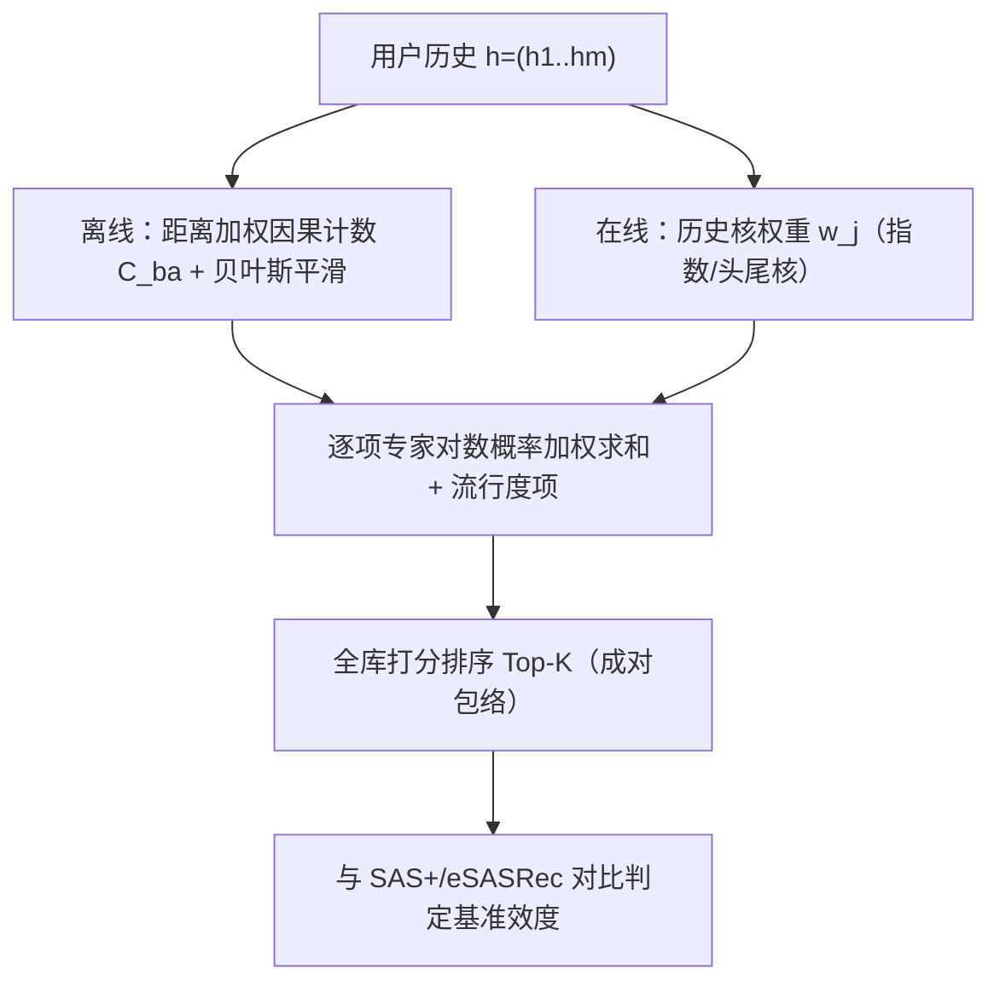

# Do Sequential Recommendation Benchmarks Really Require Higher-Order Sequence Modelling? (序列推荐基准真的需要高阶序列建模吗？)

- **会议/期刊**: RecSys 2026 (20th ACM Conference on Recommender Systems, extended abstract / work in progress)
- **作者与机构**: Aleksandr V. Petrov, Praveen Chandar, Paul N. Bennett, Hugues Bouchard, Mounia Lalmas（Spotify）
- **推荐链路定位**: 召回（Next-Item 全库排序）
- **研究方向**: 序列与会话推荐 / 评测基准与可信评估
- **论文原文**: [https://arxiv.org/abs/2608.19833v1](https://arxiv.org/abs/2608.19833v1)
- **开源代码**: [https://github.com/spotify-research/sequential-capacity-probes](https://github.com/spotify-research/sequential-capacity-probes)

## TL;DR (1分钟核心速览)

本文质疑"Transformer 序列推荐器在主流基准上的增益是否真来自高阶序列建模"。作者构造两个**不学习任何高阶联合表征**的近期加权成对探针——Sequential Rules (SeqRules) 与自研 Probabilistic Collaborative Transition Model (PCTM)，在 eSASRec 的 Full-Catalogue NDCG@10 协议下，二者构成的"成对包络"在 Beauty/Sports/Toys 上超 eSASRec 复现 21.3%/14.8%/38.4%，ML-1M 超 4.4%，仅在 ML-20M 落后 27.3%。结论：多数常用基准无法有效度量高阶建模的收益。

## Background & Motivation (背景与核心矛盾)

- **主流范式**: 序列推荐持续引入语言模型架构（Transformer 编码器、生成式检索如 TIGER），以"捕捉复杂上下文依赖"为默认叙事。
- **前人局限**: ①非序列推荐的复现研究显示 18 个神经方法仅 7 个可复现，其中 6 个常被简单启发式击败；②序列侧已有工作指出数据集–任务错配、时间穿越、采样负例等问题，MovieLens 更偏向"偏好诱导与曝光"而非自然消费；③最接近的工作通过打乱历史检验"顺序是否有信号"，但**顺序敏感 ≠ 需要高阶交互**。
- **核心洞察 (Key Insight)**: 一个基准可以"对顺序敏感"却"成对充分 (pairwise-sufficient)"——即长程但可逐项分解的成对证据已足够解释预测力，无需估计 $P(a\mid b,c)$ 这类不可分的联合项。
- **本文切入点**: 若一个只聚合成对转移的探针能追平甚至超过 Transformer，则该基准上的增益不能归因于高阶序列建模容量。

## Method (核心方法设计)

### 1. 整体框架 (Overall Architecture)

论文不提出新的推荐器，而是设计一组**容量探针 (capacity probes)** 作为"下界参照系"：从仅看最后一个物品的对照（MC / FMC / FMC+），到跨历史聚合成对转移的两个历史感知探针（SeqRules、PCTM）。对每个数据集取二者较优者定义为**成对包络 (pairwise envelope)**；若 Transformer 无法超越该包络，则基准无法证明高阶建模的价值，反之剩余差距即为高阶建模的真实增益。所有模型在 eSASRec 发布的数据划分与评测代码上做匹配协议复现。

### 2. 关键设计拆解 (Key Designs)

1. **PCTM：把每个历史物品当作独立"专家"（核心创新）**：痛点在于 Transformer 需从稀疏数据中隐式学出转移与近期偏置。PCTM 显式估计方向性下一物品分布，用距离加权因果计数 + Dirichlet 均匀先验平滑：
$$\hat{P}(a\mid b)=\frac{C_{ba}+\tau/|\mathcal{I}|}{C_{b\cdot}+\tau},\qquad C_{ba}=\sum_{d=1}^{W}\gamma_d N^{(d)}_{ba}$$
其中 $\gamma_1=1$固定计数尺度。直觉：高频源物品主要依赖观测转移，稀有源物品回退到先验，$\tau$ 控制"需要多少证据"。

2. **近期双阶段注入 + 对数域专家池化**：近期性同时作用于建表（近距转移权重更高）与打分（近历史物品权重更高），历史核为指数核 $E^{(r)}_j$或头尾核$H^{(k,\rho,r)}_j$（前$k$个新物品分得$\rho$质量，其余均分$1-\rho$）。最终打分是**对数概率加权和**（等价于逐项专家概率连乘）：
$$s_{\text{PCTM}}(a\mid h)=\sum_{j=1}^{L} w_j \log\hat{P}(a\mid h_{m-j+1})+\lambda\log p_{\text{pop}}(a)$$
关键：全程只做逐项证据求和，**从不估计联合项** $P(a\mid b,c)$——这正是"成对充分"的操作化定义。

3. **训练目标、负采样与推理效率**：PCTM 与 SeqRules **无嵌入、无序列编码器、无梯度训练**，仅离线一遍扫描统计稀疏转移矩阵 $C$与流行度$p_{\text{pop}}$（Alg.1），在线对$L\le L_{\max}$个历史物品的稀疏行做加权累加（Alg.2），复杂度约为$O(L\cdot\bar{K})$，天然免负采样；对照模型 FMC+ 则用全库 softmax 交叉熵（因已有工作证明 BCE 单负例显著劣于 softmax）。

## Experimental Setup & Evaluation Protocol (实验设置与评估协议)

- **数据集与预处理**: 直接复用 eSASRec 发布的处理后划分（Amazon 三域 + MovieLens 两规模），仓库重建全部五个划分并校验哈希：

| 数据集 | 规模量级 | 稀疏度/密度 | 特征/场景说明 |
| :--- | :---: | :---: | :--- |
| Beauty | Amazon 单域，万级用户/物品 | 极稀疏 | 美妆评论序列，短序列为主 |
| Sports | Amazon 单域，万级 | 极稀疏 | 户外运动，短序列为主 |
| Toys | Amazon 单域，万级 | 极稀疏 | 玩具，短序列为主 |
| ML-1M | 百万级交互 | 中等 | 电影评分，偏好诱导偏差 |
| ML-20M | 千万级交互 | 较稠密 | 大规模电影，长尾更充分 |

- **数据划分与防穿越 (Splitting Strategy)**: 沿用 eSASRec 的 `Leave-One-Out` 式划分（末位留出测试、次末位验证），超参在内层训练留出集上选择后，于完整训练集重训再评未触碰测试集。
- **排名评测协议 (Ranking Protocol)**: 无偏 `Full-Ranking`（全库未交互物品排序），已见物品过滤，**测试阶段不使用采样负例**；指标为 NDCG@10。等分平局按 UTF-8 外部物品 ID 的 SHA-256 摘要升序确定性打破。
- **对比基线与超参设置**: 基线含 MC（经验一阶马尔可夫）、FMC（SASRec 归约式方向转移 + 单负例 BCE）、FMC+（同架构改全库 softmax）、SAS+（sampled-softmax SASRec）、eSASRec。复现保真度：十个"模型–数据集"对的 NDCG 与原文报告差距均在 **0.0033** 以内。PCTM 关键超参：$W\in[10,20]$、$\tau\in[150,15000]$、$L_{\max}\in[50,500]$、$\lambda\in[-0.5,0.3]$，历史核在指数/头尾/逆衰减间选择。

## Key Experimental Results (实验关键数据)

### 1. 主实验对比 (Main Results)

Full-Catalogue NDCG@10（全部为作者匹配协议下的自跑结果）：

| 数据集 | MC | FMC | FMC+ | SAS+ | eSASRec | SeqRules | PCTM | 包络 vs eSAS |
| :--- | :---: | :---: | :---: | :---: | :---: | :---: | :---: | :---: |
| Beauty | .0492 | .0481 | .0531 | .0537 | .0524 | .0605 | **.0635** | **+21.3%** |
| Sports | .0251 | .0244 | .0271 | .0315 | .0324 | **.0371** | .0368 | **+14.8%** |
| Toys | .0548 | .0554 | .0588 | .0575 | .0533 | .0730 | **.0738** | **+38.4%** |
| ML-1M | .1240 | .1124 | .1206 | .1662 | **.1739** | .1505 | .1815 | **+4.4%** |
| ML-20M | .1050 | .0807 | .1034 | .1806 | **.1969** | .1115 | .1431 | −27.3% |

### 2. 消融实验 (Ablation Study)

原文为 4 页扩展摘要，**未提供正式消融表**；作者明确声明"需消融以分离贝叶斯平滑与加权对数池化的各自贡献"。可用的对照性证据如下：

| 对照维度 | 设置 | 结果（NDCG@10） | 说明 |
| :--- | :--- | :---: | :--- |
| 仅末位物品 | FMC+ (Beauty) | .0531 | 已接近 eSASRec .0524 |
| 加入历史成对聚合 | PCTM (Beauty) | **.0635** | 较最佳末位模型 +19.6% |
| 仅末位物品 | FMC+ (Sports) | .0271 | 达 eSASRec 的 84% |
| 加入历史成对聚合 | SeqRules (Sports) | **.0371** | 较 FMC+ +36.9% |
| 探针内部对比 | PCTM vs SeqRules | 4/5 数据集 PCTM 更优 | 平滑+对数池化更强，但未解耦 |
| 目标函数影响 | FMC → FMC+ | Beauty .0481→.0531 | 全库 softmax 显著优于单负例 BCE |

### 3. 关键实验发现 (Key Findings)

1. **末位物品已吃掉大部分信号，但历史仍有增量**：FMC+ 在 Beauty 上（.0531）已略超 eSASRec（.0524），在 Sports 上达其 84%；而成对包络较最佳末位模型再提升 20–46%，说明"多物品近期上下文"确有价值，但该价值可由成对证据线性叠加获得。
2. **四个基准上高阶建模无证据**：SeqRules/PCTM 在 Beauty/Sports/Toys/ML-1M 上分别超 eSASRec 21.3%/14.8%/38.4%/4.4%，且在两套 Transformer 复现（SAS+ 与 eSASRec）上均成立（对 SAS+ 为 9–28%），排除了单一复现偶然性。
3. **只有 ML-20M 保留真实容量优势**：eSASRec .1969 vs 包络 .1431，27.3% 的 NDCG 无法被成对转移解释——这是唯一可支撑"高阶序列建模有效"的基准，暗示数据规模/序列长度可能是高阶交互显现的必要条件。

## Highlights & Limitations (亮点、对比与审稿批判)

- **与代表作对比 (vs. Prior Work)**: 与"打乱历史"的顺序敏感性检验 [7] 本质不同——本文承认顺序有信号，但追问该信号是否**可分解为成对项**；与 SASRec 归约分析 [5] 相比，本文把"一阶归约"推进到"多物品成对聚合"，给出更强的下界；与 RSS [9,10] 共享近期性直觉，但将其作为探针而非增强手段。
- **可迁移亮点**: ①"成对包络"可作为任何序列/生成式推荐论文的**强制基线**，成本极低（无训练、无 GPU）；②对数域专家池化 + 贝叶斯平滑是稀疏转移统计的稳健工程配方，适合冷启动物品回退。
- **审稿级局限批判**: ①**无消融**，PCTM 的平滑、核函数、池化三者贡献未解耦，且超参在 5 个数据集上各自调优，存在探针侧过拟合风险；②仅 5 个数据集、单一 NDCG@10 指标、无时序切分与工业数据，作者自述为 work in progress；③"成对充分"的判定依赖探针强度，若探针调优不足则结论偏保守、调优过度则偏激进，缺少敏感性分析。

## Rating (四维评分)

- **方法创新性 (Novelty)**: ⭐⭐⭐⭐ （问题提法比方法更值钱）
- **评估协议与实验扎实度 (Protocol & Experiments)**: ⭐⭐⭐ （复现严谨但缺消融与规模）
- **写作与数学规范度 (Clarity & Rigor)**: ⭐⭐⭐⭐⭐ （问题形式化定义清晰，核心模块数学推导与架构阐述严谨易读）
- **工业落地与复现价值 (Industrial & Practical Value)**: ⭐⭐⭐⭐ （兼顾推荐效果增益与训练/推理效率，具备实际场景迁移参考价值）
