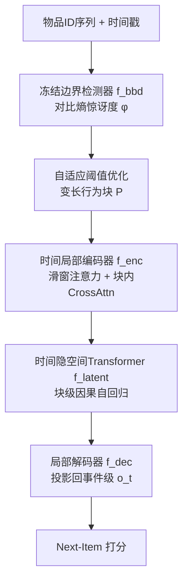
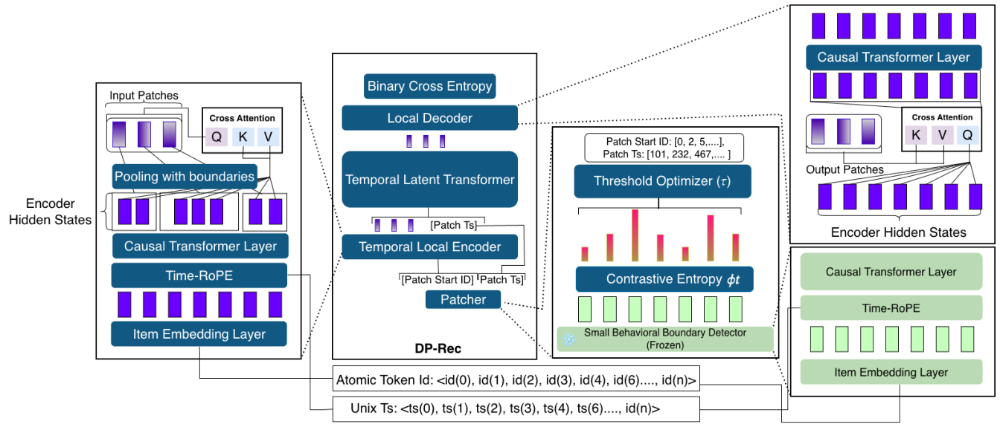

# DP-Rec: Towards Dynamic Patching for Efficient Long-Sequence Recommendation (面向高效长序列推荐的动态分块架构)

- **会议/期刊**: RecSys 2026 (20th ACM Conference on Recommender Systems)
- **作者与机构**: Dwipam Katariya, Thomas Caputo, Akshat Shreemali 等 (Capital One, AI Foundations)
- **推荐链路定位**: 召回 / 序列建模端到端
- **研究方向**: 序列与会话推荐 / 生成式推荐与离散语义 ID
- **论文原文**: [https://arxiv.org/abs/2609.32215v1](https://arxiv.org/abs/2609.32215v1)
- **开源代码**: 暂未开源

## TL;DR (1分钟核心速览)

标准 Transformer 序列推荐对每个历史物品分配等量计算，长序列下 $O(N^2d)$ 开销爆炸且对行为噪声敏感；现有压缩方案（截断、LONGER 固定分块）无法适配用户行为信息密度的非均匀分布。DP-Rec 借鉴 Byte Latent Transformer，用**对比熵惊讶度**在意图转变处自适应切分变长行为块，再以轻量局部编码器压缩、大隐空间 Transformer 建模块间依赖。在 ML-1M/ML-10M-L/KuaiRand 上，FLOPs 匹配预算下 NDCG@10 相对最强基线提升 **+11.0%~+21.1%**，且定义更优的 Pareto 前沿。

## Background & Motivation (背景与核心矛盾)

- **主流范式**: SASRec/HSTU 等因果 Transformer 逐物品建模，LONGER 用固定窗口 token merging 压缩序列，TWIN V2/SIM 等工业方案做上游两阶段压缩。
- **前人局限**: ① 固定速率压缩（LONGER、PerRec 可学习 token）假设行为信息密度均匀，无法对齐真实意图转变点；② 截断/上游压缩丢弃远端信号，且压缩与下游相关性目标不端到端联合优化。
- **核心洞察 (Key Insight)**: 用户行为存在"主题稳定期"与"意图突变点"的交替节奏——稳定期交互高度冗余可大幅压缩，突变点才承载关键信息。BLT 的熵驱动分块在字节词表（256）可行，但推荐百万级物品词表的全 softmax 熵计算不可承受。
- **本文切入点**: 用**对比式 next-item 惊讶度**（仅正样本 vs 单负样本的二分类熵）作为 Shannon 熵的可 tractable 代理，实现推荐场景下的动态分块。

## Method (核心方法设计)

### 1. 整体框架 (Overall Architecture)

输入原始物品 ID 序列与 Unix 时间戳，四阶段流水线：冻结的轻量边界检测器 $f_{\text{bbd}}$逐位置输出对比熵惊讶度$\phi_{u,t}$，经自适应全局阈值优化得到二值边界矩阵$\boldsymbol{\Gamma}$与变长块集合$\mathcal{P}$；时间局部编码器$f_{\text{enc}}$用滑窗注意力将每块压缩为隐向量$z_m$；时间隐空间 Transformer$f_{\text{latent}}$在块级自回归建模跨块依赖得$g_m$；局部解码器$f_{\text{dec}}$将块表示投影回事件级状态$o_t$做 next-item 打分。核心成本从$O(N^2)$降为随块数$M$而非原始长度$N$ 缩放。

<figure class="paper-figure" markdown="span">
  <figcaption>图 2：DP-Rec 的整体架构。冻结检测器计算对比熵分数，使自适应阈值优化器能够将序列划分为 𝑀 个可变长度行为分块。这些分块由时间局部编码器进行上下文化，并通过时间潜在变换器建模，随后由局部解码器将表示投影回项目空间以进行下一项预测。</figcaption>
</figure>

### 2. 关键设计拆解 (Key Designs)

1. **对比熵惊讶度 (Contrastive Entropy Surprise)**：全词表 softmax 熵在 $|\mathcal{V}|\sim 10^6$时不可行。改为用真值下一物品$v_{t+1}$与采样负例$v_t^-$构造二分类，检测器隐状态$b_t$（$d_{\text{bbd}}=8$）打分：
$$\phi_{u,t}=-p^+_{u,t}\log p^+_{u,t}-p^-_{u,t}\log p^-_{u,t},\quad p^+_{u,t}=\frac{\exp(b_t^\top e_{v_{t+1}})}{\exp(b_t^\top e_{v_{t+1}})+\exp(b_t^\top e_{v_t^-})}$$
直觉：当正负样本概率接近（$\phi$高）说明模型对下一步"不确定"，恰是意图转变边界；稳定期$\phi$ 低，块内交互可安全压缩。

2. **自适应全局阈值优化 (Algorithm 1)**：给定目标平均块数 $\hat{M}$，在 batch 内所有有效位置惊讶度中取第$\kappa=\text{round}((\min(\hat{M},\bar{N})-1)B)$大的值作为阈值$\tau$，$\Gamma_{u,t}=\mathbb{I}[\phi_{u,t}\geq\tau]\cdot\mu_{u,t}$。Lemma C.1 证明无并列时边界数精确等于预算，实现**计算预算的确定性控制**；训练用 batch 级分布（高熵序列可"借用"低熵序列容量），推理用逐序列阈值保证可复现。

3. **Time-RoPE 与训练目标**：将 RoPE 旋转角替换为绝对时间戳 $T_t$，使注意力分数成为时间差$(T_t-T_{t'})$ 的函数，赋予边界检测器/局部/隐空间 Transformer 连续的滞后感知；块级建模以块末事件时间戳为锚点。总损失为独立 sigmoid 二分类：
$$\mathcal{L}=-\sum_{(u,t):v_{t+1}\neq 0}\left[\log\sigma(o_t^\top e_{v_{t+1}})+\log\sigma(-o_t^\top e_{v_t^-})\right]$$
负采样为每位置单负样本；推理开销 $O(N w d_{\text{loc}}^2 + M^2 d^2)$，$n=200$ 时约为 SASRec 的 0.57×。

## Experimental Setup & Evaluation Protocol (实验设置与评估协议)

- **数据集与预处理**（`5-core` 过滤 + 时间排序）：

| 数据集 | #Users | #Items | #Interactions | 平均行为/用户 | 特征/场景说明 |
| :--- | :---: | :---: | :---: | :---: | :--- |
| KuaiRand | 27,285 | 13,222,181 | 122,052,626 | 4,473 | 短视频，仅保留点击隐式反馈 |
| ML-1M | 6,040 | 3,416 | 999,611 | 165 | 电影评分 |
| ML-10M-L | 3,683 | 10,632 | 3,114,710 | 844 | 自建长序列变体，仅保留 ≥500 交互用户 |

- **数据划分与防穿越**: `Leave-One-Out`，最后一条测试、倒数第二条验证。
- **排名评测协议**: `Sampled Ranking`——每个用户将留出目标物品与 **1,000 个均匀采样负例** 组成 1001 候选集排序，报告 NDCG@{10,20}、HR@{5,10,20}。
- **对比基线与超参**: GRU4Rec、SASRec、HSTU、LONGER 四类基线；$d\in\{16,32,64\}$，局部编码器$L_{\text{loc}}=1$、隐空间 Transformer$L_{\text{lat}}=3$，滑窗$w=32$，检测器$d_{\text{bbd}}=8$；10 个随机种子报告 95% CI；FLOPs 预算对齐至最佳验证 SASRec 配置（ML-1M$N_{\max}=50$，其余$N_{\max}=100$）。

## Key Experimental Results (实验关键数据)

### 1. 主实验对比 (Main Results)

FLOPs 匹配预算下测试集结果（10 种子均值）：

| 数据集 | 指标 | GRU4Rec | SASRec | HSTU | LONGER | **DP-Rec** | Rel Impr. |
| :--- | :--- | :---: | :---: | :---: | :---: | :---: | :---: |
| ML-1M | NDCG@10 | 0.1961 | 0.2176 | 0.2078 | 0.2022 | **0.2523** | +16.0% |
| ML-1M | HR@10 | 0.3545 | 0.3846 | 0.3696 | 0.3637 | **0.4430** | +15.2% |
| ML-10M-L | NDCG@10 | 0.1566 | 0.1474 | 0.1389 | 0.1661 | **0.2011** | +21.1% |
| ML-10M-L | HR@10 | 0.2788 | 0.2681 | 0.2534 | 0.2984 | **0.3547** | +18.9% |
| KuaiRand | NDCG@10 | 0.3842 | 0.3795 | 0.3825 | 0.3858 | **0.4284** | +11.0% |
| KuaiRand | HR@10 | 0.5562 | 0.5515 | 0.5429 | 0.5534 | **0.6125** | +10.1% |

### 2. 消融实验 (Ablation Study)

| 变体 | ML-1M | ML-10M-L | KuaiRand | 说明 |
| :--- | :---: | :---: | :---: | :--- |
| DP-Rec (base) | 0.2238 | 0.2051 | 0.4368 | $\hat{M}=2$ 极端压缩 |
| w/o Time-RoPE | 0.2018 (-9.83%) | 0.1933 (-5.75%) | 0.4281 (-1.99%) | 时间信号关键 |
| w/o cross-attn | 0.2424 (+8.31%) | 0.2026 (-1.22%) | 0.4444 (+1.74%) | 极低块数下 max-pool 更优 |
| $w=8$ | 0.1956 (-12.60%) | 0.1916 (-6.58%) | 0.4006 (-8.29%) | 局部上下文不足 |
| $d_{\text{loc}}=16$ | 0.1909 (-14.70%) | 0.1927 (-6.05%) | 0.4118 (-5.72%) | 局部容量下限 |
| 分块规则: Random | 0.2400 | 0.1946 | 0.4588 | $\hat{M}=50/100$ |
| 分块规则: Fixed | 0.2437 | 0.1982 | 0.4634 | 对齐 LONGER |
| 分块规则: **CE** | **0.2540** | **0.2029** | **0.4761** | 动态边界最优 |

### 3. 关键实验发现 (Key Findings)

1. **动态边界本身贡献显著**：在相同块预算下，仅替换边界规则（Random→Fixed→CE），CE 比 Fixed 再提升 +4.2%/+2.4%/+2.7%（ML-1M/ML-10M-L/KuaiRand），证明增益来自"对齐意图转变"而非单纯压缩。
2. **压缩鲁棒性极强**：$\hat{M}=2$ 的极端压缩仍保留峰值 NDCG@10 的 ~94%（ML-1M）、~98%（ML-10M-L）、~96%（KuaiRand），说明对比熵检测器把最显著的行为突变打包进极少块中。
3. **数据集结构决定压缩收益**：DP-Rec 相对 LONGER 的优势从 ML-1M 的 +24.8% 收窄至 KuaiRand 的 +11.0%——短视频高频流中近期上下文强预测，均匀压缩已能捕获大部分信号；而 MovieLens 长跨度稀疏交互中信息分散，自适应边界优势最大。

## Highlights & Limitations (亮点、对比与审稿批判)

- **与代表作对比 (vs. Prior Work)**: 相比 LONGER 的固定窗口 token merging，DP-Rec 用信息密度驱动变长分块；相比 BLT 的全词表熵分块，用二分类对比熵绕开百万词表 softmax；相比 TWIN V2/SIM 的上游两阶段压缩，DP-Rec 端到端可训练且保留全历史。
- **可迁移亮点**: ① 对比熵惊讶度可作为通用"信息密度探针"，迁移到 CTR 长行为序列的曝光/点击混合流压缩；② Time-RoPE 以时间差替代位置差，可直接用于任意带时间戳的序列编码器。
- **审稿级局限批判**: ① 理论 FLOPs 优势与实测吞吐存在差距，patch 聚合 kernel 未做底层优化，工业 serving 落地需额外工程；② 边界检测器预训练后冻结，未与推荐目标联合学习，且评测仅用 1000 负例采样排序（非 Full-Ranking），绝对数值可能偏乐观；③ 未验证 $N>500$ 的超长horizon，压缩收益上限未知。

## Rating (四维评分)

- **方法创新性 (Novelty)**: ⭐⭐⭐⭐ （首次将动态隐空间分块引入推荐，对比熵代理巧妙解决大词表熵不可算问题，但整体沿用 BLT/Perceiver 范式）
- **评估协议与实验扎实度 (Protocol & Experiments)**: ⭐⭐⭐⭐ （三数据集 + 10 种子 95% CI + Pareto 前沿 + 多组消融完整，但仅采样排序、缺 Full-Ranking 与线上验证）
- **写作与数学规范度 (Clarity & Rigor)**: ⭐⭐⭐⭐ （四阶段流水线清晰，Lemma C.1 给出阈值校准的理论保证，FLOPs 分解逐项可核）
- **工业落地与复现价值 (Industrial & Practical Value)**: ⭐⭐⭐⭐ （FLOPs 匹配下 4–5× 更长历史、0.57× 计算量极具吸引力，但未开源且 kernel 优化欠缺）
