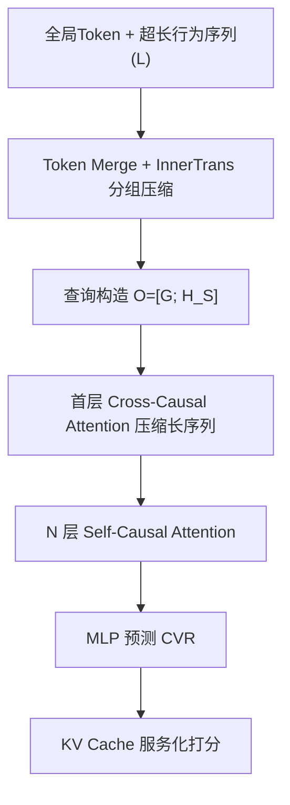
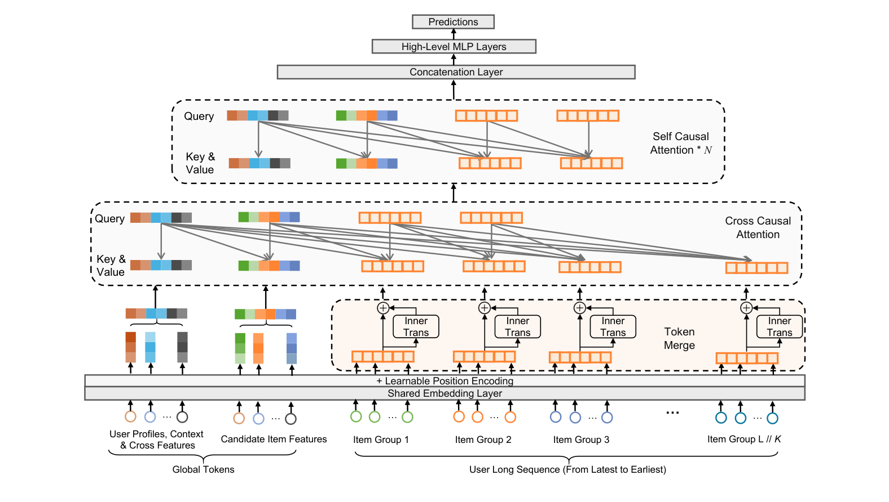

# LONGER: Scaling Up Long Sequence Modeling in Industrial Recommenders (面向工业推荐器的长序列优化 Transformer)

- **会议/期刊**: RecSys 2025
- **作者与机构**: Zheng Chai, Qin Ren, Xijun Xiao, Huizhi Yang, Bo Han 等（字节跳动，抖音/电商/广告团队）
- **推荐链路定位**: 精排（CVR/CTR 预估，端到端长序列建模）
- **研究方向**: 序列与会话推荐 / CTR 预估与特征交叉
- **论文原文**: [https://arxiv.org/abs/2505.04421v2](https://arxiv.org/abs/2505.04421v2)
- **开源代码**: 暂未开源

## TL;DR (1分钟核心速览)

工业推荐长期依赖「两阶段检索（SIM/TWIN）」或「预训练用户向量」间接建模超长行为序列，导致上下游不一致与算力浪费。LONGER 提出端到端长序列 Transformer：全局 Token 稳定注意力、Token Merge + InnerTrans 压缩二次复杂度、混合因果注意力 + KV Cache 服务化。在抖音广告 52 亿样本、130 天时间切分数据上，AUC 相对 Base 提升 1.57%、相对最强 Transformer 基线提升 0.21%，FLOPs 降约 50%，线上广告 ADSS 最高 +2.097%、电商 GMV/U 最高 +6.54%。

## Background & Motivation (背景与核心矛盾)

- **主流范式**: 工业界长序列建模分三派——两阶段检索（SIM/TWIN 从万级序列选 top-k 再短序列建模）、预训练用户 Embedding（源模型压缩后迁移）、记忆增强网络（MIMN/LMN/MARM 以存储换计算）。
- **前人局限**: ① 两阶段检索存在上游选择与下游任务的**目标不一致**，且 top-k 选择本身丢弃原始全序列信息；② 预训练 UE 与记忆网络是**间接感知**，信息有损且记忆槽命中率需长期训练积累。
- **核心洞察 (Key Insight)**: 推荐场景中序列长度 $L \gg d$（典型$L=2000, d=32$），注意力复杂度$O(L^2 d)$中$L^2$ 项主导；同时超长序列噪声大、存在「注意力汇聚 (attention sink)」使深层注意力过度聚焦早期 token。
- **本文切入点**: 借 LLM 的 scaling law 与 GPU 算力红利，用「压缩 + 锚点 + 因果混合注意力」把端到端长序列建模推到 $10^4$ 量级，并配套训练/服务系统工程优化。

## Method (核心方法设计)

### 1. 整体框架 (Overall Architecture)

输入由**全局 Token**（候选物品表征、UID embedding、可学习 CLS、高阶压缩特征，共 $m$个）与**原始行为序列 Token**（$L$个，附绝对时间差特征 + 可学习位置编码）拼接构成。序列先经 Token Merge 按组压缩为$L/K$个组表征（组内用轻量 InnerTrans 建模局部交互），再与全局 Token 拼接成查询矩阵$\mathbf{O}=[\mathbf{G};\mathbf{H}_S]$（$\mathbf{H}_S$为最近$k$个采样 token）。首层做**跨因果注意力**把长序列压缩进查询，后续$N$ 层**自因果注意力**建模高阶依赖，最终输出接 MLP 预测 CVR。训练侧全同步 GPU 稠密+稀疏参数更新、混合精度与激活重计算；推理侧 KV Cache 复用用户序列表征。

<figure class="paper-figure" markdown="span">
  <figcaption>图1：LONGER 模型架构。</figcaption>
</figure>

### 2. 关键设计拆解 (Key Designs)

1. **全局 Token（Global Tokens）——稳定长上下文注意力**：超长序列下深层注意力易塌缩到早期 token（attention sink）。本文将候选物品表征、UID、CLS 等 $m$ 个 token 赋予**全注意力感受野**，既作为信息锚点聚合全序列上下文，又反向影响所有序列 token，维持注意力多样性。直觉上相当于给注意力分布加了一组「公共参照系」，在稀疏/压缩注意力下防止长程依赖丢失。

2. **Token Merge + InnerTrans——把二次复杂度降一个量级**：直接截断丢长程信息，故将相邻 $K$个 token 分组合并，序列长度降为$L/K$。组内若简单拼接会损失细粒度交互，故引入轻量 InnerTrans：$\mathbf{M}_i=\text{TransformerBlock}([\mathbf{e}_i^1,\dots,\mathbf{e}_i^K])$。复杂度比值为
$$\frac{\text{FLOPs}_{\text{Merge}}}{\text{FLOPs}_{\text{vanilla}}}=\frac{6dK+L/K}{6d+L}$$
典型 $L=2048,d=32,K=4$时 FLOPs 从 587M 降至 336M（降 42.8%）；同时参数量$\Theta_{\text{merge}}=12K^2d^2+13Kd$ 反而增大，实现「降算力、增表达」的双赢。

3. **混合因果注意力 + 训练目标与推理效率**：首层用查询 $\mathbf{O}$对全序列$\mathbf{R}$做 cross-causal attention，掩码$\mathbf{M}_{i,j}=0$当$j\ge i$否则$-\infty$，保证序列对候选物品**不可见**，从而支持 KV Cache；后续$N$层 self-causal attention 精炼采样 token 内部依赖。总损失为标准 BCE：$\mathcal{L}=-\frac{1}{|\mathcal{D}|}\sum[y\log\hat{y}+(1-y)\log(1-\hat{y})]$，无额外负采样（精排二分类范式）。推理时用户序列 KV 预计算缓存，每个候选仅算其全局 token 与缓存的注意力，吞吐退化从$-40\%$收窄至$-6.8\%$。

## Experimental Setup & Evaluation Protocol (实验设置与评估协议)

- **数据集与预处理**: 抖音广告 CVR 场景，2024-10-16 至 2025-02-23 共 130 天、52 亿样本；特征含 UID/性别、超长行为序列（曝光/点击/转化多类型）、广告内容与展示上下文。

| 数据集 | #Users | #Items | #Interactions | 稀疏度/密度 | 特征/场景说明 |
| :--- | :---: | :---: | :---: | :---: | :--- |
| Douyin Ads (工业) | 十亿级 | 十亿级 | 5.2B 样本 | 极稀疏 | 130 天日志，CVR 任务，序列长度可达 $10^4$ |

- **数据划分与防穿越 (Splitting Strategy)**: **全局时间戳切分**——前 123 天训练、后 7 天离线评估，严格防未来信息泄漏。
- **排名评测协议 (Ranking Protocol)**: 精排二分类，报告 **AUC 与 LogLoss**（非全库排序/采样排序范式）；工业经验上 AUC 提升 0.1% 即具线上显著性。
- **对比基线与超参设置**: 短序列基线 TWIN、DIN(Recent50)；长序列基线 SumPooling、DIN、HSTU、Transformer。统一预处理与调参，48×A100 集群训练，Embedding 维度 $d=32$。

## Key Experimental Results (实验关键数据)

### 1. 主实验对比 (Main Results)

| 模型 | AUC↑ | LogLoss↓ | ΔAUC(%) | ΔLogLoss(%) |
| :--- | :---: | :---: | :---: | :---: |
| Base | 0.83968 | 0.48758 | - | - |
| SumPooling | 0.84201 | 0.48538 | +0.28 | -0.45 |
| TWIN | 0.84472 | 0.48168 | +0.60 | -1.21 |
| DIN (Recent50) | 0.84698 | 0.47830 | +0.87 | -1.90 |
| DIN | 0.84982 | 0.47452 | +1.21 | -2.68 |
| HSTU | 0.84994 | 0.47490 | +1.22 | -2.60 |
| Transformer | 0.85111 | 0.47293 | +1.36 | -3.00 |
| **LONGER** | **0.85290** | **0.47103** | **+1.57** | **-3.39** |

### 2. 消融实验 (Ablation Study)

| 配置 | FLOPs(×10⁹) | AUC↑ | LogLoss↓ | ΔAUC |
| :--- | :---: | :---: | :---: | :---: |
| w/o Merge, L=2000 | 3.73 | 0.85111 | 0.47293 | +1.36% |
| +TokenMerge4 (Concat, 500) | 2.13 | 0.85232 | 0.47145 | +1.51% |
| +TokenMerge8 (Concat, 250) | 3.03 | 0.85291 | 0.47062 | +1.58% |
| +InnerTrans (Merge8) | 3.52 | **0.85332** | **0.47052** | **+1.63%** |
| Query=100 (Recent) | 1.91 | 0.85290 | 0.47103 | +1.57% |
| Query=250 (Recent) | 3.52 | 0.85332 | 0.47052 | +1.63% |
| Query=100 (Learnable) | 1.91 | 0.84946 | 0.47523 | +1.17% |
| Query=100 (Uniform) | 1.91 | 0.85183 | 0.47215 | +1.45% |

### 3. 关键实验发现 (Key Findings)

1. **Token Merge 是「降本增效」而非「降本降效」**：Merge8 将 FLOPs 从 3.73×10⁹ 压到 3.03×10⁹（降约 19%），AUC 反而从 0.85111 升至 0.85291——压缩去噪 + 参数扩张共同作用，验证了「序列冗余远大于有效信息」的工业直觉。
2. **查询数量存在明显边际递减**：Query=100 仅用 54% FLOPs 即达到 Query=250 的 99.95% AUC（0.85290 vs 0.85332），说明最近 100 个行为已承载绝大部分意图信号，是精度-算力的甜点。
3. **查询初始化策略比数量更关键**：可学习查询最差（AUC 0.84946），Recent 100 最优（0.85290），差距达 0.34% AUC——远超 0.1% 的线上显著阈值，证明「用真实近期行为做锚」优于随机可学习压缩（与 Perceiver/Q-Former 式压缩形成反差）。

## Highlights & Limitations (亮点、对比与审稿批判)

- **与代表作对比 (vs. Prior Work)**: 相比 SIM/TWIN 的两阶段检索，LONGER 端到端消除上下游不一致；相比 HSTU 的纯堆叠自注意力，本文用 Token Merge + 混合因果注意力在同等算力下支持更长序列；相比 Perceiver/Q-Former 的可学习压缩查询，本文实证「真实近期行为作查询」显著更优。
- **可迁移亮点**: ① KV Cache 服务化——用户序列表征跨候选复用，是精排多候选打分的通用加速范式；② 「全局 Token 抗 attention sink」可迁移到任何长上下文推荐/序列模型。
- **审稿级局限批判**: ① 仅在字节内部数据验证，无公开数据集复现，且核心收益依赖 48×A100 与自研全同步训练框架，学术可复现性弱；② 序列长度 scaling 的幂律指数极小（$\beta\approx0.001$），AUC 增益随长度增长迅速饱和，且未报告推理延迟的绝对值与长序列冷启动用户的表现。

## Rating (四维评分)

- **方法创新性 (Novelty)**: ⭐⭐⭐⭐ （全局 Token + Token Merge + 混合因果注意力组合扎实，但各组件在 LLM/Perceiver 领域均有先例，属工程集成型创新）
- **评估协议与实验扎实度 (Protocol & Experiments)**: ⭐⭐⭐⭐ （52 亿样本 + 严格时间切分 + 双业务线线上 A/B，工业说服力强；但缺公开数据集与显著性检验细节）
- **写作与数学规范度 (Clarity & Rigor)**: ⭐⭐⭐⭐ （复杂度推导与 FLOPs 对比清晰，scaling law 拟合给出 $R^2$；部分符号与掩码定义略简）
- **工业落地与复现价值 (Industrial & Practical Value)**: ⭐⭐⭐⭐⭐ （已在字节 10+ 场景全量部署、服务十亿用户，KV Cache 与混合精度优化可直接借鉴；扣分项为未开源）

