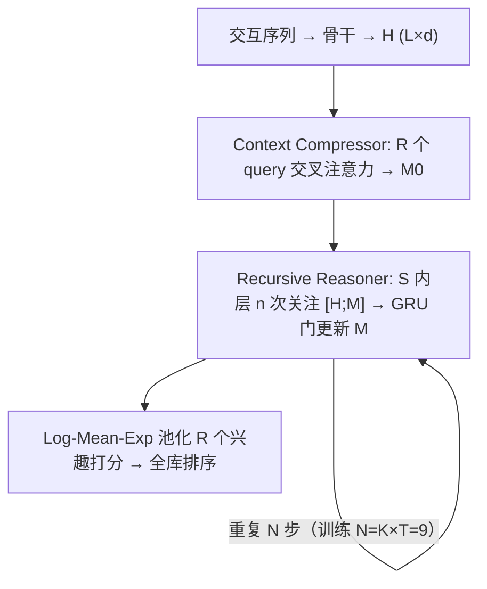

# RecRec: Latent Interests Recursive Reasoning for Sequential Recommendation (潜在兴趣递归推理序列推荐)

- **会议/期刊**: RecSys 2026
- **作者与机构**: Wenhao Deng, Junchen Fu, Joemon M. Jose 等 (University of Glasgow / Ohio State / Amazon / Telefónica / CMU / NUS)
- **推荐链路定位**: 精排（Next-Item 打分，可视为推理增强的端到端排序）
- **研究方向**: 序列与会话推荐 / 生成式推荐（潜在推理）
- **论文原文**: [https://arxiv.org/abs/2607.12945v1](https://arxiv.org/abs/2607.12945v1)
- **开源代码**: 暂未开源

## TL;DR (1分钟核心速览)

现有推理增强序列推荐（ReaRec、LARES）把"推理空间"与"预测空间"耦合在同一 $d$ 维状态上，推理深度受限且需 RL 多阶段训练。RecRec 借鉴 TRM 的双状态递归范式：Context Compressor 用 $R$ 个可学习 query 把骨干隐状态蒸馏为 $R$ 个潜在兴趣 $\mathbf{M}$，Recursive Reasoner 在独立的推理态 $\mathbf{S}$ 上"先想后写"地迭代精炼 $\mathbf{M}$，两阶段纯监督训练 + 深监督使推理深度可在推理时自由外推。四个数据集 Full-Ranking 下 NDCG@10 相对最优推理基线最高提升 14.8%（Steam），且三个数据集上增益可延伸至训练深度之外。

## Background & Motivation (背景与核心矛盾)

- **主流范式**: SASRec/BERT4Rec 单次前向编码历史、从末位隐状态一次性出分；ReaRec 把推理 token 拼进输入序列反复前向，LARES 用共享 block 迭代全部 $L$ 个隐状态并配 GRPO 强化学习后训练。
- **前人局限**: ① 三者最终预测都坍缩为单个 $d$ 维向量，推理算力再大也无法扩展预测态容量；② 推理态即预测态，中间计算直接扰动用于打分的表征；③ ReaRec 的推理位置编码固定步数，LARES 要突破训练深度必须引入 RL 阶段，训练链路重。
- **核心洞察 (Key Insight)**: 推理与预测应是两个空间——TRM 在组合任务上证明"共享权重 block + 双状态（scratchpad/answer）+ 逐步 detached 深监督"可让每步学会"改进任意输入"，从而外推到更多步数；该范式尚未被引入推荐。
- **本文切入点**: 把"答案态"换成 $R$ 个潜在兴趣（多向量预测态），"草稿态"换成专用推理态 $\mathbf{S}$，用注意力路由替代 TRM 的拼接 MLP，纯监督两阶段替代 RL。

## Method (核心方法设计)

### 1. 整体框架 (Overall Architecture)

骨干（SASRec/BERT4Rec）编码历史得 $\mathbf{H}\in\mathbb{R}^{L\times d}$；Context Compressor 以 $R$ 个无位置编码的可学习 query 经 cross-attn→self-attn→FFN 蒸馏出初始潜在兴趣 $\mathbf{M}^0\in\mathbb{R}^{R\times d}$。Recursive Reasoner 以单个共享权重 Transformer block 交替更新两个同形状状态：推理态 $\mathbf{S}$（只做中间计算、永不直接解码）与兴趣态 $\mathbf{M}$（唯一用于打分）。每个 reasoning step 先做 $n$ 次 $\mathbf{S}$ 内层传递（关注 $[\mathbf{H};\mathbf{M}]$），再经 GRU 门把候选更新写入 $\mathbf{M}$。训练分两阶段：阶段 1 联合训练骨干+Compressor（含 IDR）；阶段 2 冻结前两者、只训 Reasoner，采用 $K$ 轮深监督、每轮 $T$ 步、仅末步反传（1-step BPTT），训练总深度 $N=K\times T=9$。推理时 $N$ 可任意设定。

<figure class="paper-figure" markdown="span">
  <figcaption>图 1：RecRec 的训练流程。阶段 1：主干网络与 Context Compressor 联合训练，用 𝑅 个可学习查询将隐藏状态 H 蒸馏为潜在兴趣 M0，并据此产生下一项预测。阶段 2：主干网络与 Context Compressor 冻结，仅训练 Recursive Reasoner。图中展示第一轮深度监督，其中 S 从 S0 出发、M 从 M0 出发。在该轮内，Reasoner 执行 𝑇 个推理步骤。每一步通过 𝑛 次内层传递（关注 H 与当前 M）更新 S（中部，紫色），随后对 M 提交一次更新（底部，</figcaption>
</figure>

### 2. 关键设计拆解 (Key Designs)

1. **双状态解耦 + 注意力路由的 Reasoner（打破单 $d$ 维瓶颈）**：痛点是推理态与预测态共享表征、互相掣肘。核心算子为
$$\mathbf{S}\leftarrow\text{Reasoner}(\mathbf{S},[\mathbf{H};\mathbf{M}])\ \text{重复 } n \text{ 次};\quad \hat{\mathbf{M}}=\text{Reasoner}(\mathbf{M},\mathbf{S}),\ \mathbf{M}\leftarrow\text{GRU}(\hat{\mathbf{M}},\mathbf{M}_{\text{prev}})$$
其中 Q 与外部 KV 使用独立 LayerNorm，注意力输出投影与 FFN 输出零初始化使 Reasoner 起步为恒等映射。直觉：$\mathbf{S}$ 不参与打分，故其表征幅度可自由演化以承载"深度思考"，而 $\mathbf{M}$ 必须与 item embedding 保持点积兼容；GRU 门（借鉴 Slot Attention）控制每步承诺多少推理成果，避免大步跳跃。$\mathbf{S}^0$ 取固定截断正态随机张量而非可学习参数——因为每轮前 $T-1$ 步无梯度，可学习初值永远拿不到更新信号。

2. **Interest Diversity Regularizer (IDR)（防止多兴趣坍缩）**：所有 query 关注同一 $\mathbf{H}$，无约束时互相余弦相似度实测达 0.82–0.90，$R$ 个兴趣退化为同一方向。IDR 最小化 $\mathbf{M}^0$ 兴趣间平均非对角余弦：
$$\mathcal{L}_{\text{IDR}}=\frac{1}{R(R-1)}\sum_{r\neq r'}\hat{\mathbf{m}}_r^\top\hat{\mathbf{m}}_{r'}$$
启用后相似度降至 0.14–0.75，Reasoner 才有"可分辨的多个兴趣"可精炼。

3. **Log-Mean-Exp 池化与训练目标**：$R$ 个兴趣各自与 item embedding 内积除以温度 $\tau=0.07$ 得 $s_r(v)$，用 $s(v)=\log\frac{1}{R}\sum_r\exp(s_r(v))$ 聚合——软最大值让最相关兴趣主导排序，同时梯度仍流向全部 $R$ 个兴趣（对比 max 池化会饿死其余槽位）。总损失 $\mathcal{L}^{(k)}_2=-\log\hat{y}_{v^+}(\mathbf{M}^{(k)})+\lambda_{\text{IDR}}\mathcal{L}_{\text{IDR}}$，阶段 1 同式作用于 $\mathbf{M}^0$。**负采样**：全库 softmax 交叉熵，无显式负采样；**推理开销**：每步仅 1 层 block、$n=3$ 次内层传递，$N$ 可调，$N=0$ 即退化为阶段 1 基线。

## Experimental Setup & Evaluation Protocol (实验设置与评估协议)

- **数据集与预处理**: 全部 `5-core` 过滤；S-Shop/V-Shop 仅保留评分 >3 的正反馈并按时间戳排序；Steam 对同一用户同一游戏去重保留首条；另剔除训练集交互 <5 的用户。

| 数据集 | #Users | #Items | #Interactions | Avg.L | 稀疏度 | 场景说明 |
| :--- | :---: | :---: | :---: | :---: | :---: | :--- |
| S-Shop | 89,284 | 15,552 | 384,741 | 12.64 | 99.97% | 软件电商 |
| V-Shop | 54,005 | 21,439 | 249,505 | 14.77 | 99.98% | 视频游戏电商 |
| MicroLens | 98,133 | 16,959 | 502,561 | 5.12 | 99.97% | 短视频隐式点击 |
| Steam | 157,998 | 7,960 | 1,292,442 | 25.97 | 99.90% | 游戏评论 |

- **数据划分与防穿越**: S-Shop/V-Shop 用官方**全局时间戳切分**；MicroLens/Steam 无绝对时间戳，采用每用户序列 80%/90% 位置的**相对时间比例切分**。
- **排名评测协议**: 无偏 **Full-Ranking**（全库未交互物品排序），报告 NDCG@{10,20} 与 Recall@{10,20}。
- **对比基线与超参**: 非推理基线 SASRec、BERT4Rec；推理增强基线 ERL(B/S)、PRL(B/S)（ReaRec 两变体）、LARES。统一 $d=256$、batch 2048、AdamW lr $10^{-3}$、patience 10、$\tau=0.07$；RecRec 取 $R=8$、Compressor/Reasoner 各 1 层 2 头、FFN 512、$T=3,K=3,n=3$；显著性用 paired $t$-test $p<0.05$。

## Key Experimental Results (实验关键数据)

### 1. 主实验对比 (Main Results)

| 数据集 | 指标 | SASRec | BERT4Rec | PRL (S) | LARES | RecRec (S) | Improv.% |
| :--- | :--- | :---: | :---: | :---: | :---: | :---: | :---: |
| S-Shop | N@10 | 0.0737 | 0.0734 | 0.0818 | 0.0809 | **0.0853** | +4.3% |
| S-Shop | N@20 | 0.0952 | 0.0950 | 0.1015 | 0.1009 | **0.1058** | +4.2% |
| V-Shop | N@10 | 0.0158 | 0.0153 | 0.0173 | 0.0182 | **0.0197** | +8.2% |
| V-Shop | R@20 | 0.0479 | 0.0476 | 0.0571 | 0.0488 | **0.0651** | +8.3% |
| MicroLens | N@10 | 0.0428 | 0.0428 | 0.0453 | 0.0460 | **0.0503** | +9.3% |
| MicroLens | N@20 | 0.0533 | 0.0523 | 0.0562 | 0.0564 | **0.0611** | +8.3% |
| Steam | N@10 | 0.0347 | 0.0343 | 0.0408 | 0.0419 | **0.0481** | +14.8% |
| Steam | R@20 | 0.1126 | 0.1158 | 0.1308 | 0.1330 | **0.1536** | +15.5% |

（Improv.% 相对最强推理增强基线；全部最优值均通过 $p<0.05$ 显著性检验。）

### 2. 消融实验 (Ablation Study)

| 变体 (SASRec 骨干, $N=9$) | S-Shop N@20 | S-Shop R@20 | Steam N@20 | Steam R@20 |
| :--- | :---: | :---: | :---: | :---: |
| Full RecRec | **0.1058** | 0.2432 | **0.0621** | **0.1536** |
| w/o Reasoner（=阶段1） | 0.0966 | 0.2408 | 0.0496 | 0.1219 |
| Frozen S ($n=0$) | 0.1007 | 0.2318 | 0.0581 | 0.1394 |
| w/o IDR | 0.0980 | 0.2412 | 0.0538 | 0.1338 |
| w/o GRU gate | 0.1033 | **0.2483** | 0.0603 | 0.1513 |
| 原始 SASRec 骨干 | 0.0952 | 0.2399 | 0.0454 | 0.1126 |

$R$ 扫描（N@20）：$R=1$ 在四数据集全面垫底（S-Shop 0.0990 / Steam 0.0520）；最优 $R$ 依数据集而异（V-Shop、MicroLens 取 4，Steam 取 8，S-Shop 取 16 得 0.1095），默认 $R=8$ 距各数据集最优在 5% 以内。

### 3. 关键实验发现 (Key Findings)

1. **推理态解耦是主要增益来源，而非"多算几步"**：Steam 上 w/o Reasoner 仅 0.0496，Full 达 0.0621（+25%），而 Frozen S 已能拿回 0.0581——说明让 $\mathbf{S}$ 真正迭代演化（而非仅靠 $\mathbf{M}$ 自身更新）贡献了大部分收益；GRU 门只调节吸收幅度，去掉后 Steam 仅掉 0.0018。
2. **IDR 是"多兴趣"生效的前提条件**：去掉 IDR 后 Steam N@20 从 0.0621 跌至 0.0538（−13%），兴趣间余弦进入 >0.8 坍缩区；图 5 显示 NDCG 增益与余弦下降幅度同步，即 Reasoner 的收益依赖"有可分辨的兴趣可精炼"。
3. **深监督带来推理深度外推，但收益呈强边际递减**：$N$ 从 0→1 一步即拿下主要增益（S-Shop 0.0966→0.103，Steam 0.0496→0.058）；S-Shop/V-Shop/Steam 的最优 $N$ 分别为 15/12/16，均超过训练深度 9（如 Steam 0.0621→0.0622），而 MicroLens 在 $N\approx4$ 饱和后回落，说明短序列场景（Avg.L=5.12）过度推理反而引入噪声。

## Highlights, Limitations & Rating (亮点、对比与审稿评价)

- **与代表作对比 (vs. Prior Work)**: 与 ReaRec 的本质区别是推理不再寄生在输入序列上（避免推理 token 累积导致注意力开销增长、且位置编码锁死步数）；与 LARES 的区别是推理只作用于 $R$ 个压缩兴趣而非全部 $L$ 个隐状态，且完全免去 GRPO 强化学习阶段；与多兴趣推荐（ComiRec 类）的区别是兴趣由递归推理动态精炼而非静态聚类产出。
- **可迁移亮点**: ① "零初始化 + 恒等起步"的 Reasoner block 可直接插入任何序列骨干做即插即用增强；② Log-Mean-Exp 池化兼顾"软最大主导 + 全槽位梯度"的技巧可迁移到任意多向量召回/打分场景。
- **审稿级局限批判**: ① 推理时 $N$ 需人工扫描（图 3 显示最优 $N$ 数据集相关，MicroLens 还会退化），缺少 halting 机制，线上需为每场景调参；② 阶段 2 冻结骨干与 Compressor，Reasoner 无法反向影响历史编码，且 $R$ 的最优值随数据集漂移（4/8/16），默认 $R=8$ 在 S-Shop 上损失约 3.4% NDCG，泛化到新场景需额外搜索。
- **四维评分**: 创新性 ⭐⭐⭐⭐ | 实验扎实度 ⭐⭐⭐⭐ | 方法清晰度 ⭐⭐⭐⭐⭐ | 落地价值 ⭐⭐⭐⭐

