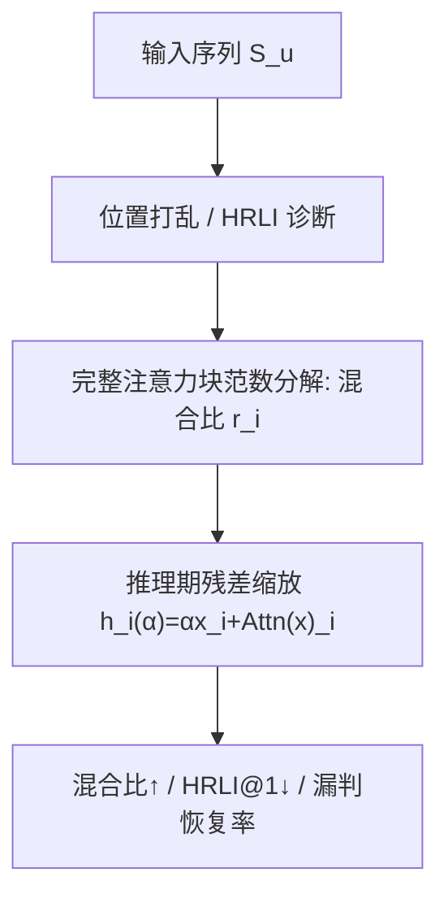

# Residual Dominance as a Structural Account of Last-Item Reliance in Causal Self-Attention Recommenders (因果自注意力推荐器中末项依赖的残差主导结构性解释)

- **会议/期刊**: RecSys 2026
- **作者与机构**: Keito Kozaki, Keigo Sakurai, Ren Togo, Takahiro Ogawa, Miki Haseyama（北海道大学）
- **推荐链路定位**: 精排（序列下一项预测）
- **研究方向**: 序列与会话推荐 / 去偏与可信推荐
- **论文原文**: [https://arxiv.org/abs/2608.14021v1](https://arxiv.org/abs/2608.14021v1)
- **开源代码**: [https://github.com/keito0329/Residual](https://github.com/keito0329/Residual)

## TL;DR (1分钟核心速览)

SASRec 类因果自注意力推荐器在推理时高度依赖序列末项，但此前仅停留在"注意力权重/近因偏差"的描述层面。本文用范数分解分析**完整注意力块**，发现注意力输出本身混合比高达 0.72–0.96，而残差相加后骤降至 0.12–0.40，即"残差主导"（同位置信息被强烈保留）；再以推理期残差缩放 $\alpha$作受控探针，证明$\alpha$与上下文混合、末项依赖呈单调关系，并在$\alpha\approx0.1$–$0.3$ 时恢复部分末位置漏判。评估采用 Global Time Split + Full-Catalog Ranking，覆盖 9 个数据集。

## Background & Motivation (背景与核心矛盾)

- **主流范式**: SASRec 类因果自注意力模型以末位置表示做下一项预测，隐式假设该表示聚合了全历史信号。
- **前人局限**: ① 位置打乱实验显示"仅保留末项"几乎不掉点、"全打乱"才崩，说明存在不连续的末位置特权，但无法解释其来源；② 注意力权重随位置平滑衰减，与观察到的"断崖式"末项依赖不匹配，说明"注意力放在哪"≠"信息实际被用了多少"。
- **核心洞察 (Key Insight)**: 注意力输出确实聚合了大量上下文（混合比高），但残差相加把整块输出拉回同位置贡献，形成"残差主导"；由于预测接口只取末位置，这一自信息保留结构恰好锚定在最近交互上。
- **本文切入点**: 不做新模型，而是把"完整注意力块 + 推理期残差缩放"作为机制探针，给出末项依赖的结构性解释。

## Method (核心方法设计)

### 1. 整体框架 (Overall Architecture)

论文是分析型工作，流程为：先用位置打乱与 HRLI 诊断刻画末项依赖现象；再对完整注意力块做范数分解，量化各位置贡献与混合比；最后在推理期对残差分支施加缩放因子 $\alpha$（参数冻结、不重训），观察混合比、HRLI@1 与排序精度的联动，并统计"末位置漏判但非末位置已命中"的序列在缩放下的恢复率。

### 2. 关键设计拆解 (Key Designs)

1. **范数分解与混合比 (Mixing Ratio)**：注意力权重无法反映信息存活量。将块输出按输入位置分解 $\tilde{x}_i=\mathrm{LN}(\mathrm{Attn}(x_i,X)+x_i)=\sum_j F_i(x_j)$，定义$r_i=\frac{\sum_{j\neq i}\|F_i(x_j)\|}{\sum_j\|F_i(x_j)\|}$。$r_i$ 越低说明同位置自信息保留越强。该量同时计入 value 向量范数差异、残差与 LN，比单看注意力权重更贴近"实际用了什么"。
2. **残差主导的定位**：表 2 显示 Attn 阶段 $r$为 0.72–0.96，加残差后跌至 0.12–0.40，再加 LN 几乎不变——残差相加是混合比骤降的主因，LN 贡献可忽略。表 3 进一步表明该现象在$L,L-1,L-2$ 各位置与两层中普遍存在（位置间最大差仅 0.003–0.019），并非末位置特有；末项特权是"普遍自保留倾向 × 仅末位置预测接口"的乘积效应。
3. **推理期残差缩放探针**：将 $h_i=x_i+\mathrm{Attn}(x)_i$改为$h_i(\alpha)=\alpha x_i+\mathrm{Attn}(x)_i$，$\alpha$越小则同位置保留越弱、上下文相对贡献越大。该干预是一维、免训练、可复现的敏感性分析（非因果识别、非新方法），并配合验证集选参$\alpha^*=\arg\max_\alpha \mathrm{Recovery}_{val}(\alpha)$s.t.$\mathrm{HR@10}_{val}(\alpha)\geq(1-\varepsilon)\mathrm{HR@10}_{val}(1)$。

## Experimental Setup & Evaluation Protocol (实验设置与评估协议)

- **数据集与预处理**: 9 个公开数据集，统一 `5-core` 过滤并去除序列内连续重复项：

| 数据集 | #Users | #Items | #Interactions | 平均长度/密度 | 场景说明 |
| :--- | :---: | :---: | :---: | :---: | :--- |
| Beauty | 22,363 | 12,101 | 198,502 | 8.9 / 0.07% | 稀疏电商 |
| Sports | 35,598 | 18,357 | 296,337 | 8.3 / 0.05% | 稀疏电商 |
| Toys | 19,412 | 11,924 | 167,597 | 8.6 / 0.07% | 稀疏电商 |
| Diginetica | 61,279 | 25,593 | 485,903 | 7.9 / 0.03% | 弱序列性、允许重复消费 |
| Steam | 281,349 | 11,961 | 3,550,272 | 12.6 / 0.11% | 弱序列性 |
| ML-1M | 6,040 | 3,416 | 999,611 | 165.5 / 4.84% | 稠密长历史 |
| BeerAdvocate | 14,635 | 22,074 | 1,475,412 | 100.8 / 0.46% | 长历史评论 |
| Zvuk | 19,267 | 150,206 | 8,087,953 | 419.8 / 0.28% | 大规模、允许重复消费 |

- **数据划分与防穿越**: `Global Time Split (GTS)`，GTS-Last 目标 + GT-based 验证划分（训练+验证占 90%，其余测试），严格按时间隔离，规避 Leave-One-Out 的未来信息泄漏。
- **排名评测协议**: 无偏 `Full-Catalog Ranking`（全库排序），报告 HR@10 与 NDCG@10；默认 `filter-seen`，但 Diginetica 与 Zvuk 因重复消费特性不做过滤。诊断指标 HRLI@K / HRL2I@K 在所有数据集上均**不**做 filter-seen（否则指标无定义），取 $K=1$。
- **对比基线与超参**: GRU4Rec（RNN）、SASRec（因果自注意力）、BERT4Rec（双向）、DuoRec（对比学习增强）、BSARec（频域注意力），均采用单序列级表示预测接口以便横向比较；实现细节见仓库。

## Key Experimental Results (实验关键数据)

### 1. 主实验对比 (Main Results)

本文主表为结构性诊断而非精度竞赛，核心数值为混合比与 HRLI 诊断（表 2、表 4 摘录）：

| 数据集 | SASRec Attn | SASRec +Res | SASRec +LN | DuoRec +LN | HR@10 at $L$| HR@10 at$L-1$且$L$ 漏判 |
| :--- | :---: | :---: | :---: | :---: | :---: | :---: |
| Beauty | 0.776 | 0.119 | **0.119** | 0.115 | 0.0381 | 0.0116 |
| Toys | 0.772 | 0.123 | **0.123** | 0.121 | 0.0574 | 0.0185 |
| Video | 0.798 | 0.169 | **0.169** | 0.170 | 0.0403 | 0.0171 |
| Diginetica | 0.721 | 0.150 | **0.149** | 0.151 | 0.2900 | 0.1153 |
| ML-1M | 0.856 | 0.395 | **0.386** | 0.359 | 0.1588 | 0.0347 |
| Steam | 0.794 | 0.317 | **0.276** | 0.277 | 0.0639 | 0.0235 |
| BeerAdvocate | 0.959 | 0.301 | **0.287** | 0.307 | 0.0389 | 0.0150 |
| Zvuk | 0.941 | 0.267 | **0.265** | 0.271 | 0.2416 | 0.0583 |

### 2. 消融实验 (Ablation Study)

以"逐组件拆解 + 缩放干预"替代常规消融：

| 配置 | 混合比 $r$ 趋势 | HRLI@1 | HR@10 | 说明 |
| :--- | :---: | :---: | :---: | :--- |
| Attn only | 高（0.72–0.96） | — | — | 上下文聚合充分 |
| +Residual | 骤降（0.12–0.40） | — | — | 残差主导出现 |
| +LayerNorm | 几乎不变 | — | — | LN 非主因 |
| $\alpha=1$（标准） | 基准 | 基准 | 基准 | 末项依赖最强 |
| $\alpha\downarrow$ | 单调↑ | 单调↓ | 单调↓ | 混合–依赖权衡 |
| $\alpha\approx0.1$–$0.3$ | 较高 | 较低 | 略降 | 漏判恢复峰值 |

### 3. 关键实验发现 (Key Findings)

1. **残差是混合比崩塌的唯一主因**：Attn→+Res 使 $r$ 从 0.72–0.96 跌至 0.12–0.40（Beauty 0.776→0.119，降幅约 85%），而 +LN 前后差值普遍 <0.01（Steam 例外 0.317→0.276），说明"信息用在哪"由残差通路而非归一化决定。
2. **末项特权是接口效应而非位置效应**：表 3 中 $L$与$L-1,L-2$ 的混合比差异仅 0.003–0.019，ML-1M 上末位置甚至略高；残差主导在所有位置普遍存在，只因 SASRec 仅取末位置表示预测，才表现为断崖式末项依赖。
3. **非末位置已含可用信号且可被恢复**：表 4 中"末位置漏判但 $L-1$命中"的比例达标准 HR@10 的约 24%–46%（Diginetica 0.1153 vs 0.2900 最显著），残差缩放在$\alpha\approx0.1$–$0.3$ 恢复其中一部分，且验证集选参可复现该精度–恢复权衡，说明误差部分源于"信息如何表达"而非"信息是否存在"。

## Highlights & Limitations (亮点、对比与审稿批判)

- **与代表作对比 (vs. Prior Work)**: 相比 HRLI 指标工作（仅量化末项排名频率）与近因偏差研究（将末项依赖视为任务级经验属性），本文首次把解释下沉到完整注意力块的范数结构；相比 BSARec 等改造注意力模块的工作，本文不改结构、只做推理期受控干预，定位为机制诊断而非性能优化。
- **可迁移亮点**: ① 混合比 $r_i$可作为任意残差+LN 结构的 Transformer 推荐器的通用"信息存活"探针；② 推理期$\alpha$ 缩放是零训练成本的鲁棒性/敏感性测试手段，可用于诊断其他序列模型（如 Mamba/线性注意力）的表示坍缩。
- **审稿级局限批判**: ① 残差缩放会普遍降低 HR@10，恢复仅覆盖子集且需验证集调参，缺乏在线效用证据，HRLI 与业务指标的联系仍是开放问题；② 分析仅限"末位置预测接口"的因果模型，BERT4Rec 的 [MASK] 位置残差输入为虚拟占位符，混合比语义不对齐，跨架构推广性受限；③ 未与训练期正则（如近因去偏损失）做对照，无法排除数据分布本身对末项依赖的贡献。

## Rating (四维评分)

- **方法创新性 (Novelty)**: ⭐⭐⭐⭐ （以范数分解 + 推理期缩放给出"残差主导"这一结构性解释，视角新颖，但属分析型贡献而非新模型）
- **评估协议与实验扎实度 (Protocol & Experiments)**: ⭐⭐⭐⭐ （9 数据集、GTS + Full-Catalog 协议严谨，诊断指标设计合理；但缺在线 A/B 与训练期对照）
- **写作与数学规范度 (Clarity & Rigor)**: ⭐⭐⭐⭐ （混合比定义与分解推导清晰，明确声明非因果识别，边界界定诚实）
- **工业落地与复现价值 (Industrial & Practical Value)**: ⭐⭐⭐ （代码开源、干预零训练成本，但直接部署收益有限，主要价值在诊断与调优启发）
