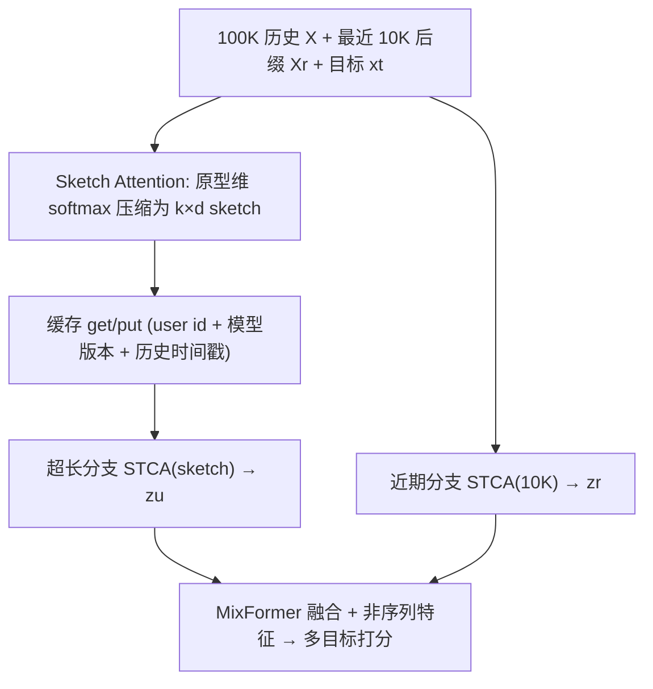

# SequenceO1: End-to-End Ultra-Long (100K) Sequence Modeling in Recommendation with Low-Rank Caching (面向推荐的 100K 超长序列端到端建模与低秩缓存)

- **会议/期刊**: RecSys 2026 (Industry Track, Long Oral)
- **作者与机构**: Lin Guan, Jia-Qi Yang, Zhishan Zhao, Jiaqi Huang 等, ByteDance（抖音）
- **推荐链路定位**: 精排（Fine-Ranking），端到端序列建模
- **研究方向**: 序列与会话推荐 / 工业架构与系统
- **论文原文**: [arXiv:2609.08443v1](https://arxiv.org/abs/2609.08443v1)
- **开源代码**: 暂未开源

## TL;DR (1分钟核心速览)

抖音精排要在严格时延下利用长达 100K 的用户行为历史，但 100K 规模的瓶颈是系统性的：原始序列特征要被反复存储、传输与计算，而非单纯的注意力复杂度。本文提出 SequenceO1，用可学习原型 + 原型维归一化的 Sketch Attention 把 100K 历史压成定长、与目标无关、可缓存的用户 sketch，再与最近 10K 后缀做双时间尺度 STCA 推理，并配套训练侧 local KVCache、多请求用户级批处理（MRLB）、pipeline lift 与 FlashSA 融合核。在抖音全量线上 A/B 中，相对 STCA 10K + TWIN V2 基线 Finish 提升 +2.33%（Douyin）/ +3.49%（Lite），训练与推理 FLOPs 分别降低 49.9× 与 63.9×。

## Background & Motivation (背景与核心矛盾)

- **主流范式**: 工业精排处理长历史主要有三条路——截断最近 1K–10K；两阶段检索（TWIN V2 离线层次聚类 + 在线 GSU 检索约 100 条目标相关行为）；以及长度外推（HSTU 随机长度采样、STCA 稀疏训练/稠密推理）。
- **前人局限**: ① 截断与两阶段检索把长历史压缩/检索与最终排序目标解耦，损失端到端优化并增加系统复杂度；② 外推路线仍与训练长度强耦合（STCA 约 2–2.5K 训练支撑 10K 服务，约 4–5 倍），到 100K 仍需巨大训练上下文，特征存储、通信与算力开销随长度线性增长；③ STCA 虽把每层复杂度降到 $O(L)$，但其 target-to-history 交叉注意力是 query 相关的，跨目标几乎无可复用计算。
- **核心洞察 (Key Insight)**: 超长历史部分应当**既可压缩又可复用**——若存在一个只依赖用户侧信号、定长、可微的表示，就能算一次、缓存、在多个训练样本、多个候选目标与连续请求间复用，昂贵的 target-conditioned 模块便无需再直接作用于原始 100K 序列。
- **本文切入点**: 以「先压缩、后推理（compress-then-reason）」替代「检索/外推」，把 100K 路径变成缓存命中时对原始长度 $O(1)$ 的路径。

## Method (核心方法设计)

### 1. 整体框架 (Overall Architecture)

输入为长度 $n\le 100\text{K}$的历史嵌入$X\in\mathbb{R}^{n\times d}$与候选目标$x_t$。超长分支先经堆叠 Sketch Attention 压成定长 sketch$\tilde{X}\in\mathbb{R}^{k\times d}$（$k\approx 512$–$1024$，与$n$无关），经宽度适配后做 STCA 得到超长兴趣$z_u$；最近$L_r=10\text{K}$后缀直接做 STCA 得到近期兴趣$z_r$；二者与目标、非序列特征一起送入下游 MixFormer 融合打分。系统侧，用户侧 sketch 在训练与推理共用同一 get/put 缓存接口，命中即跳过原始 100K 特征的物化、传输与 sketch 计算。

### 2. 关键设计拆解 (Key Designs)

1. **Sketch Attention 与原型维归一化（核心压缩算子）**：痛点是用 latent query 做 token 维 softmax 会「提前选 token」，压缩结果偏向少数显著行为，难以支撑多样目标复用。SA 学习 $k$个全局共享原型$P^{(0)}\in\mathbb{R}^{k\times d}$，计算亲和度$S=(P^{(0)}W_Q)(XW_K)^\top/\sqrt{d}\in\mathbb{R}^{k\times n}$，但**沿原型维归一化**：$A_{j,i}=\exp(S_{j,i})/\sum_{j'}\exp(S_{j',i})$，即每个历史 token 把质量分配到各原型上（token-to-prototype allocation），再聚合$\tilde{X}=AX$。直觉：这等价于一个数据驱动、与最大长度无关的「长度维低秩投影」，强制覆盖全历史而非选择，且输出只依赖用户侧信号，天然可缓存。堆叠$N_{sa}=2$ 层带残差 + SwiGLU FFN 精化。
2. **双时间尺度 STCA 推理**：近期分支保留 10K 原始后缀捕捉时近性，超长分支在定长 sketch 上做 STCA，$z_u=\text{STCA}(\phi_t(x_t),\tilde{X}W_A)$，一旦 sketch 就绪该分支成本与$n$ 无关；两路表示交由下游骨干（部署为 MixFormer）轻量融合，不绑定特定融合结构。
3. **训练目标、缓存与推理效率**：总损失即生产多目标排序损失（Finish/Skip/Like/Share 等），sketch 与排序目标联合端到端优化，无额外对比/重构辅助损失。系统侧四件套：训练 local KVCache（key = user id + 模型版本 + 历史时间戳 + sketch 配置，TTL 3h，命中率约 0.5）；MRLB 把同一用户短窗口内多请求分组、只算一次 sketch（请求级 mask 防泄漏）；pipeline lift 把用户侧 sketch 计算上提到召回阶段并行；FlashSA 分块流式计算，避免物化 $k\times n$ 亲和度矩阵。推理侧同接口 TTL 1h，命中率约 0.6。

## Experimental Setup & Evaluation Protocol (实验设置与评估协议)

- **数据集与预处理**: 抖音生产离线数据（未公开），历史统一截断至 $n_{\max}=100\text{K}$；轻量消融设置使用简化 dense 组件，基线为 STCA(512)，主指标 Finish AUC，诊断指标多任务 UAUC。

| 数据集 | #Users | #Items | #Interactions | 稀疏度/密度 | 特征/场景说明 |
| :--- | :---: | :---: | :---: | :---: | :--- |
| Douyin 生产离线集 | 未披露 | 未披露 | 未披露（单用户年消费可达 $10^5$ 量级） | 未披露 | 短视频精排，多目标（Finish/Skip/Like/Share/Comment/Dislike 等） |
| Douyin / Douyin Lite 线上 | 全量流量 | — | — | — | 30 天 A/B，替换 TWIN V2 模块 |

- **数据划分与防穿越 (Splitting Strategy)**: 工业离线回放式评估（按生产日志时间顺序构造样本），未采用公开数据集式 Leave-One-Out；线上为 30 天随机分流 A/B。
- **排名评测协议 (Ranking Protocol)**: 采用 AUC / UAUC 的**逐样本二分类排序评估**（非 Full-Ranking 全库排序，亦非采样负例排序），与工业精排 CTR/CVR 评估惯例一致。
- **对比基线与超参设置**: 基线包括 STCA(512)/STCA 10K + TWIN V2、TWIN V2 KMeans 聚类、chunk mean pooling、position-bucket queries、Lightning-Attention 压缩器、最近行为 query 初始化；最终配置 $k=1\text{K}$、$N_{sa}=2$、$d=128$，action 侧 SwiGLU 融合 item 与行为类型嵌入。

## Key Experimental Results (实验关键数据)

### 1. 主实验对比 (Main Results)

**生产离线（全量 ranker，基线 = STCA 10K + lifelong TWIN V2，SequenceO1 移除 TWIN V2）**：

| 指标 | Finish | Skip | Head | Like | Follow | Comment | Share | Favourite | Dislike |
| :--- | :---: | :---: | :---: | :---: | :---: | :---: | :---: | :---: | :---: |
| ΔAUC | **+0.29%** | +0.23% | +0.18% | +0.09% | +0.05% | +0.04% | +0.18% | +0.30% | +1.29% |
| ΔUAUC | **+0.40%** | +0.43% | +0.46% | +0.72% | +0.58% | +0.43% | +0.94% | +1.47% | +3.63% |

**线上 A/B（30 天，全量流量，均显著）**：

| 平台 | 30-Day Act.↑ | Duration↑ | Finish↑ | Comment↑ | Like↑ | Dislike↓ |
| :--- | :---: | :---: | :---: | :---: | :---: | :---: |
| Douyin | +0.1968% | +1.4999% | **+2.3256%** | +3.5910% | +2.3617% | -6.9829% |
| Douyin Lite | +0.2335% | +1.6655% | **+3.4872%** | +8.6132% | +2.9399% | -5.9972% |

**同预算（$1\text{K}\times128$）压缩方法对比（相对 STCA(512) 的 Finish AUC 增益）**：

| 压缩方法 | Gain vs. STCA(512) |
| :--- | :---: |
| Base (STCA(512)) | 0.00% |
| TWIN V2 KMeans 聚类 | +0.30% |
| Chunk mean pooling | +0.46% |
| Position-bucket queries | +0.72% |
| Recent-behavior query init. | +0.78% |
| Lightning-Attention 压缩 | +0.83% |
| **SA (final)** | **+1.07%** |

### 2. 消融实验 (Ablation Study)

| 变体 | 相对最终 SA 的变化 |
| :--- | :---: |
| Final SA ($k=1\text{K}$,$N_{sa}=2$,$d=128$) | 0.00% |
| $k$: 1K→512 | -0.04% |
| $k$: 1K→2K | +0.03% |
| $N_{sa}$: 2→3 | +0.02% |
| $d$: 128→64 | -0.10% |
| w/o action-side SwiGLU fusion | -0.20% |
| w/o per-layer Add&Norm + SwiGLU FFN | -0.10% |

### 3. 关键实验发现 (Key Findings)

1. **压缩质量而非容量是收益来源**：同为 $1\text{K}\times128$预算，SA 比 Lightning-Attention 压缩器高 +0.24%、比 position-bucket 高 +0.35%，而把$k$ 从 1K 加到 2K 仅 +0.03%、层数 2→3 仅 +0.02%——说明原型维归一化的「分配式覆盖」比单纯扩容量更关键，也暗示推荐历史不像语言那样局部结构化（相关行为可相距很远）。
2. **定长 sketch 保留了直接扩长的绝大部分收益**：100K 截断（平均 85K）下 SequenceO1 取得 +1.07%，直接扩 STCA 为 +1.29%，保留 83%；同时训练/推理 FLOPs 在 100K 处分别便宜 49.9×/63.9×（$R=40,p_{hit}=0.5$与$R=300,p_{hit}=0.6$ 工作点）。
3. **端到端 100K 分支可整体替代两阶段 lifelong 模块**：在移除 TWIN V2 的严格对比下，全部 10 个目标 AUC/UAUC 均提升，偏好敏感目标增益最大（Favourite UAUC +1.47%、Dislike UAUC +3.63%），线上 Dislike 下降约 6–7%、低活跃用户 30 日活跃 +0.55%/+0.66%，说明长周期个性化同时带来再激活与体验改善。

## Highlights & Limitations (亮点、对比与审稿批判)

- **与代表作对比 (vs. Prior Work)**: 相比 TWIN V2（离线聚类 + 在线 GSU 检索，压缩与排序目标解耦），本文把超长路径与最终 ranker 联合优化；相比 STCA/HSTU 的长度外推（训练长度仍与 100K 强耦合、跨目标无可复用计算），本文用定长可缓存 sketch 把成本与 $n$ 解耦；相比 LLaTTE/SOLARIS 的异步表示迁移（存在表示瓶颈与目标错配，上游增益仅 42%–53% 传导到下游），本文保留端到端梯度路径。
- **可迁移亮点**: ①「目标无关、用户侧可缓存中间表示」这一思路可直接迁移到多场景/多目标精排的共享底座；② 原型维 softmax 的分配式压缩可替代 mean pooling / 位置分桶，用于任何需要定长摘要的长行为序列；③ MRLB + pipeline lift 的摊销范式对训练样本重复率高的场景普遍有效。
- **审稿级局限批判**: ① 全部证据来自抖音内部数据与线上 A/B，无公开数据集与开源代码，AUC 增益（+0.29%）虽在工业尺度显著但缺乏可复现的第三方验证；② 缓存命中率（训练 0.5 / 推理 0.6）是收益的核心前提，低命中或历史高频变更场景下收益会显著缩水，论文未给出命中率敏感性曲线；③ sketch 为定长 $k$，对行为极稀疏或极稠密用户的容量自适应缺失，作者亦将「分层/多分辨率 sketch 与自适应容量」列为未来工作。

## Rating (四维评分)

- **方法创新性 (Novelty)**: ⭐⭐⭐⭐ （原型维归一化 + 可缓存低秩 sketch 的组合在工业长序列建模中属清晰增量，理论深度有限但工程洞察扎实）
- **评估协议与实验扎实度 (Protocol & Experiments)**: ⭐⭐⭐⭐ （离线全量 + 30 天双端线上 A/B + 同预算压缩方法横评完整，但缺公开数据集与命中率敏感性分析）
- **写作与数学规范度 (Clarity & Rigor)**: ⭐⭐⭐⭐ （SA/STCA 公式与系统摊销的 FLOPs 分析清晰，缓存与复杂度假设交代明确；部分诊断图自承不可作强证据）
- **工业落地与复现价值 (Industrial & Practical Value)**: ⭐⭐⭐⭐⭐ （抖音全量流量部署、49.9×/63.9× 算力节省与 +2.33% Finish 的线上实证，是长序列工业落地的强参考，唯代码未开源）
