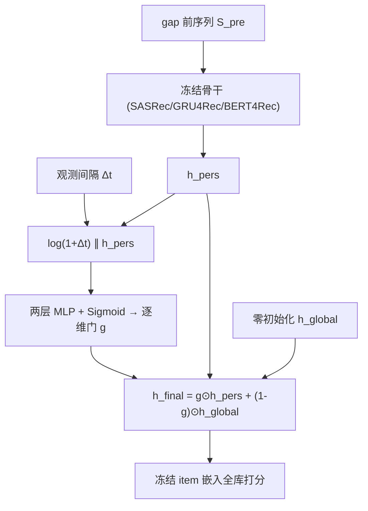

# Zero-Observation User Reactivation with Gap-Driven Dimensional Gating (零观测用户唤醒与间隔驱动的逐维门控)

- **会议/期刊**: RecSys 2026
- **作者与机构**: Jiandong Ding (复旦大学), Tianying Liu / Fuyuan Liu / Huijie Qin / Tiandeng Wu (华为)
- **推荐链路定位**: 精排（输出表征层插件，可挂接召回/排序共享的序列编码器）
- **研究方向**: 序列与会话推荐 / 冷启动与长尾推荐
- **论文原文**: [arXiv:2607.19802v1](https://arxiv.org/abs/2607.19802v1)
- **开源代码**: [jdding/DeltaGate](https://github.com/jdding/DeltaGate)

## TL;DR (1分钟核心速览)

现有序列推荐把"最后一次观测状态"当作当前状态，但回流用户可能已静默数月乃至数年，历史表征可靠性未知。本文定义 **Zero-Observation Reactivation** 问题：用户有 gap 前历史，平台在宏观间隔 $\Delta t$ 内零观测。作者提出 **DeltaGate**——冻结骨干、仅训练 66K 参数的输出层逐维门控，以 $\log(1+\Delta t)$ 与个性化历史联合决定每个隐维在"历史"与"零初始化全局先验"间的插值权重。在三个 Amazon 类目、用户级 Leave-One-Out + 自然 gap 分桶、全库 Full-Ranking 协议下，>365d 桶 DG-SASRec 的 Hit@10 从 0.031 升至 0.047（+51.6%），DG-BERT4Rec 从 0.025 升至 0.046（+84%）。

## Background & Motivation (背景与核心矛盾)

- **主流范式**: SASRec/GRU4Rec/BERT4Rec 等序列模型编码观测到的有序历史，取末位隐状态作为用户表征直接打分；TiSASRec 等时间感知模型只建模**序列内部**的 item 间间隔。
- **前人局限**: ① 所有基线均未对"最后一次交互之后的无观测间隔"做任何重校准，导致 gap 越长、表征越陈旧，性能单调下滑；② 序列内时间建模（TiSASRec）在宏观 gap 下几乎无效——Movies & TV 的 >365d 桶仅 0.025 vs SASRec 0.021，无法弥合与短 gap 桶（0.067）的鸿沟。
- **核心洞察 (Key Insight)**: 表征的不同维度可能编码**时间稳定性不同**的兴趣。作者做受控诊断：固定 $h_{pers}$ 只变 $\Delta t$，训练后的门控呈现维度特异响应——维度 115 的历史权重从 0.00 升至 0.97，维度 37 从 1.00 降至 0.49（图 2）。这说明"整体衰减"是错误假设，应做**逐维路由**。
- **本文切入点**: 不改骨干、不重训，只在输出层加一个由 $\Delta t$ 与 $h_{pers}$ 共同条件化的逐维门，把不可靠维度平滑地交给全局先验。

## Method (核心方法设计)

### 1. 整体框架 (Overall Architecture)

输入用户 gap 前序列 $\mathcal{S}_{pre}$，经任一冻结骨干（SASRec 因果注意力 / GRU4Rec 循环 / BERT4Rec 双向 + 末尾追加 `[MASK]` 取末层隐状态）得到 $h_{pers}\in\mathbb{R}^d$；同时独立观测到间隔 $\Delta t$（天）。二者拼接送入两层 MLP 生成逐维门 $g\in(0,1)^d$，与零初始化的可学习全局先验 $h_{global}$ 做 Hadamard 插值得 $h_{final}$，再用**冻结的** item 嵌入矩阵打分。训练仅更新门 MLP 与 $h_{global}$，骨干完全不动。

### 2. 关键设计拆解 (Key Designs)

1. **间隔条件化的逐维门控（Gap-Driven Dimensional Gating）**：痛点是把陈旧表征整体丢弃或整体保留都过于粗暴。核心算子为
$$g=\sigma\big(\mathrm{MLP}([\log(1+\Delta t)\,\|\,h_{pers}])\big),\quad h_{final}=g\odot h_{pers}+(1-g)\odot h_{global}$$
用 $\log(1+\Delta t)$ 而非原始天数，是为把 30 到 2000+ 天的跨度压缩到可比区间。由于 $h_{pers}$ 也进入门控输入，**相同 gap 的两个用户可得到不同门向量**，实现用户条件化保留。
2. **零初始化全局先验作为"安全回退端点"**：$h_{global}$ 初始化为 $\mathbf{0}$ 并在插件训练中与门同步更新，充当所有用户共享的兜底画像。作者在 §4.3 给出理论对比：标量门 $g\in(0,1)$ 只能让输出落在 $h_{pers}$ 与 $h_{global}$ 连成的一维线段上，无法"保留一部分维度、替换另一部分"；线性拼接 $W[h_{pers}\|\log(1+\Delta t)]+b$ 只给隐状态加一个加性方向，不直接参数化逐维保留系数。Hadamard 混合是唯一能表达逐维路由的形式。
3. **训练目标、负采样与推理效率**：插件以**全库交叉熵**训练（非采样 softmax），
$$\mathcal{L}=-\sum_u \log\frac{\exp(\hat{y}_{u,i_u})}{\sum_{j\in\mathcal{I}}\exp(\hat{y}_{u,j})},\quad \hat{y}_j=h_{final}^\top e_j+b_j$$
即**免负采样**、直接在全 item 词表上归一化。推理开销 $O(d^2)$（门 MLP）+ $O(d)$（Hadamard），与序列长度 $N$、层数 $L$ 无关；参数量 66,304（$d=128$，隐层 $2d=256$），相对 1.7M–3.0M 的骨干仅 2–4% 开销。

## Experimental Setup & Evaluation Protocol (实验设置与评估协议)

- **数据集与预处理**: Amazon Product Reviews (2018) 三个类目，迭代 `5-core` 过滤后按 Gap-Synthesize 协议构造：

| 数据集 | #Users | #Items | #Train Interactions | #Test Targets | 场景说明 |
| :--- | :---: | :---: | :---: | :---: | :--- |
| Video Games | 55,220 | 17,408 | 387,125 | 55,220 | 宏观 gap 占比最高（>365d 达 19.2%） |
| CDs & Vinyl | 112,319 | 73,713 | 1,218,826 | 112,319 | 物品数最多、最稀疏 |
| Movies & TV | 297,498 | 60,175 | 2,814,911 | 297,498 | 用户与交互量最大 |

- **数据划分与防穿越 (Splitting Strategy)**: **用户级时序 Leave-One-Out**——每用户时间上最后一次交互为目标 $i_{target}$，之前为 $\mathcal{S}_{pre}$，要求 $|\mathcal{S}_{pre}|\ge 5$；$\Delta t=t_{target}-t_k$ 由自然间隔确定，预测时不可得的交互被屏蔽。随后按 $\Delta t$ 分五桶：`<30d / 30–90d / 90–180d / 180–365d / >365d`。**注意**：该协议不做全局时间戳切分，因此无法消除多年跨度内的目录漂移（作者在 §6 自认此局限）。
- **排名评测协议 (Ranking Protocol)**: 无偏 **Full-Ranking**，在完整 item 词表 $\mathcal{I}$ 上排序，明确规避采样指标对负采样协议的敏感性。指标 Hit@10 与 NDCG@10，5 个随机种子取均值 ± 标准差。
- **对比基线与超参设置**: SASRec、GRU4Rec、BERT4Rec、TiSASRec 四个序列基线，外加 **TimeConcat**（把 $\log(1+\Delta t)$ 拼进 SASRec 输入、端到端重训全部 ~2.6M 参数）作为端到端对照。统一 $d=128$、batch 128、最大序列长 50、Adam lr $10^{-3}$、dropout 0.2；插件模式下先训骨干再冻结。显著性用配对检验，$p<0.01$ 标 `**`。**需警惕**：checkpoint 按留出集四个非活跃桶的平均 Hit@10 选取，而该留出集同时被报告，故结果属"历史协议下的描述性估计"而非无偏终测。

## Key Experimental Results (实验关键数据)

### 1. 主实验对比 (Main Results)

聚焦时间两端（短 gap 30–90d 与宏观 gap >365d），Hit@10 / NDCG@10：

| 模型 | VG 30–90d | VG >365d | CDs 30–90d | CDs >365d | Movies 30–90d | Movies >365d |
| :--- | :---: | :---: | :---: | :---: | :---: | :---: |
| SASRec | 0.091 / 0.046 | 0.031 / 0.015 | 0.050 / 0.026 | 0.022 / 0.011 | 0.067 / 0.040 | 0.021 / 0.011 |
| GRU4Rec | 0.100 / 0.049 | 0.028 / 0.013 | 0.071 / 0.036 | 0.029 / 0.014 | 0.097 / 0.054 | 0.022 / 0.011 |
| TiSASRec | 0.110 / 0.054 | 0.031 / 0.014 | 0.086 / 0.042 | 0.035 / 0.017 | 0.102 / 0.056 | 0.025 / 0.012 |
| BERT4Rec | 0.098 / 0.050 | 0.025 / 0.012 | 0.071 / 0.037 | 0.026 / 0.013 | 0.091 / 0.050 | 0.024 / 0.012 |
| **DG-SASRec** | 0.104 / 0.053 | **0.047 / 0.023** | 0.076 / 0.039 | **0.040 / 0.021** | 0.092 / 0.052 | **0.034 / 0.018** |
| **DG-GRU4Rec** | 0.101 / 0.050 | 0.032 / 0.014 | 0.071 / 0.036 | 0.029 / 0.014 | 0.097 / 0.054 | **0.034 / 0.017** |
| **DG-BERT4Rec** | **0.111 / 0.057** | **0.046 / 0.023** | 0.076 / **0.040** | **0.041 / 0.021** | 0.094 / 0.052 | **0.035 / 0.018** |
| *Improv. (vs 同骨干, >365d)* | — | *+51.6% / +53.3%* | — | *+81.8% / +90.9%* | — | *+61.9% / +63.6%* |

### 2. 消融实验 (Ablation Study)

**路由组件控制（>365d 桶，Hit@10）**：

| 变体 | Video Games | CDs & Vinyl | Movies & TV |
| :--- | :---: | :---: | :---: |
| SASRec（仅历史端点） | 0.031±0.002 | 0.022±0.006 | 0.021±0.003 |
| Ablation-Prior（$g\equiv 0$，仅共享先验） | 0.008±0.001 | 0.005±0.000 | 0.007±0.000 |
| **DG-SASRec（学习到的逐维路由）** | **0.047±0.002** | **0.040±0.003** | **0.034±0.002** |

**适配策略对比（Video Games，>365d）**：

| 策略 | Hit@10 | 可训参数 | 嵌入漂移 | Gain/1M | 门饱和率 |
| :--- | :---: | :---: | :---: | :---: | :---: |
| SASRec（无 $\Delta t$） | 0.031 | — | — | — | — |
| TimeConcat E2E | **0.080** | 2.6M | 139.7% | 0.018 | N/A |
| DeltaGate E2E | 0.057 | 2.6M | 103.4% | 0.010 | 82.0% |
| DeltaGate Plugin | 0.047 | **66K** | **0%** | **0.245** | — |

### 3. 关键实验发现 (Key Findings)

1. **增益来自"路由"而非"去个性化"**：仅用共享先验（$g\equiv0$）时 Hit@10 崩至 0.005–0.008，远低于骨干本身；而学习到的逐维路由在三个数据集上同时优于历史端点与先验端点，证明收益来自**逐维选择性保留**，而非用单一全局向量替换个性化。
2. **冻结骨干是门控可解释性的前提**：DeltaGate E2E 虽绝对精度更高（0.057），但 82.0% 的门值饱和到 >0.9——骨干自己吸收了时间信息，门退化为恒等映射；冻结骨干后门才成为唯一的时间适配通道，维度 115/37 的反向轨迹才可观测。同时插件以 1/40 参数换来 0.245 的 Gain/1M，是 TimeConcat（0.018）的 13.6 倍。
3. **不塌缩为流行度推荐器**：目录覆盖率在三个数据集上全面上升（VG 43.97%→59.75%，CDs 46.71%→67.73%，Movies 51.63%→73.37%）；>365d 桶的独占命中数分别为 278/581/1019，均多于 SASRec 的 106/129/403，且独占命中的平均训练频次在 CDs 与 Movies 上更低（更偏长尾），说明唤醒的是被旧表征压制的物品而非热门头部。

## Highlights, Limitations & Rating (亮点、对比与审稿评价)

- **与代表作对比 (vs. Prior Work)**: 与 **TiSASRec** 的本质区别在于建模对象——TiSASRec 建模序列**内部** item 间间隔，本文建模**末次交互之后**的无观测 gap，二者正交且可叠加；与 **TimeConcat** 的区别在于参数与副作用——后者端到端重训 2.6M 参数并造成 139.7% 嵌入漂移，本文 66K 参数、零漂移；与 **SIM/TWIN/Mamba4Rec** 等长序列模型相比，本文不追求"用更多历史"，而追问"历史还剩多少可信度"。
- **可迁移亮点**: ① "冻结骨干 + 零初始化先验 + 逐维门"是极轻量的**分布漂移适配模板**，可直接迁移到季节性商品回流、跨场景切换、模型版本升级后的表征校准；② 用"固定表征、只变单一标量输入"的受控诊断来验证门控敏感性，是一种低成本、可复用的可解释性实验范式。
- **审稿级局限批判**: ① **评估协议存在乐观偏差**——checkpoint 依据被报告的留出集选取，且自然 gap 分桶无法剥离多年跨度内的目录/流行度漂移，缺少真正的全局时间戳切分或线上 A/B 验证；② **单一共享先验容量不足**，无法为偏好稳定性不同的用户群提供差异化兜底画像，且 $h_{global}$ 训练后固定，快速换代的目录下需周期性刷新；③ 仅 ID-only 特征，稀疏历史用户的 $h_{pers}$ 质量差会与陈旧性叠加放大误差。
- **四维评分**: 创新性 ⭐⭐⭐⭐ | 实验扎实度 ⭐⭐⭐ | 方法清晰度 ⭐⭐⭐⭐⭐ | 落地价值 ⭐⭐⭐⭐

