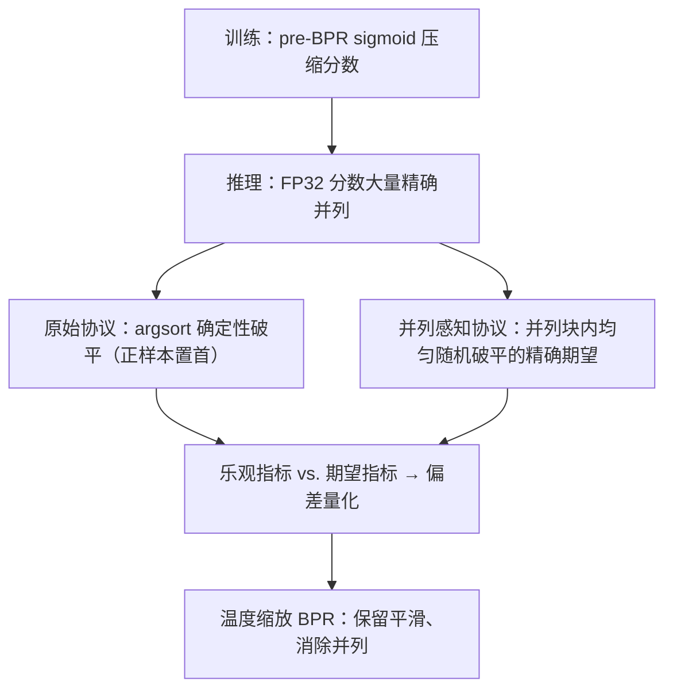

# Are We Really Making Progress in Group Recommendation? Unmasking the Tie-Breaking Illusion (我们真的在群组推荐上取得进展了吗？揭开破平幻觉)

- **会议/期刊**: RecSys 2026
- **作者与机构**: Song-Duo Ma, Pu-Jen Cheng（台湾大学）
- **推荐链路定位**: 评测协议 / 排序评估（跨召回-精排全链路的指标可信度问题）
- **研究方向**: 社交与群组推荐 / 去偏与可信评估
- **论文原文**: [https://arxiv.org/abs/2608.11190v1](https://arxiv.org/abs/2608.11190v1)
- **开源代码**: [https://github.com/songduoma/TieAwareGroupRec](https://github.com/songduoma/TieAwareGroupRec)

## TL;DR (1分钟核心速览)

本文指出近期群组推荐（ConsRec 系代码库及其衍生基线）在 BPR 损失前多加了一层逐项 sigmoid，把分数压缩到 (0,1) 并制造大量**最高分并列**；而评估代码用 `np.argsort` 确定性排序、且把正样本置于候选列表首位，使并列时正样本总被排到最有利位置，从而系统性高估 HR@K/NDCG@K。作者提出**并列感知（tie-aware）评估**——在均匀随机破平下计算指标的精确期望，在 CAMRa2011 与 Mafengwo 的群组/用户双任务上重评 5 个 SOTA 方法，发现 DHMAE 的 HR@1 从 0.9782 崩至 0.0002（-99.98%），ITR 在 Mafengwo 群组任务从 0.8144 跌至 0.0084（-98.97%），方法相对排名被彻底改写。

## Background & Motivation (背景与核心矛盾)

- **主流范式**: 群组推荐以 ConsRec/AlignGroup/DHMAE/ITR/DGGVAE 为代表，用超图/成员聚合建模共识，统一以单正样本 + 100 负采样的 HR@K/NDCG@K 汇报。
- **前人局限**: ① 复现类研究已警示神经推荐方法的增益在严格复现下会消失，但多归因于基线弱或调参不足；② 无人检查**评估实现细节**——并列分数如何破平。
- **核心洞察 (Key Insight)**: 作者发现这些代码库在 BPR 前额外套一层 $\tilde{s}=\sigma(s)$，把分数压进饱和区，FP32 下大量候选分数**精确相等**；而评估时正样本被放在候选列表首位、`argsort` 稳定排序使其在并列块中占据最优位置，形成"乐观破平"。表 1 显示同一模型同一分数，仅改破平规则（First vs. Last），AlignGroup 的 HR@1 从 0.7890 跌至 0.0028（-99.65%）。
- **本文切入点**: 不做新模型，而是把"并列"从实现细节提升为一等评估对象，用期望指标剥离破平偏差，并顺带解释额外 sigmoid 的训练价值。

## Method (核心方法设计)

### 1. 整体框架 (Overall Architecture)

论文是"诊断—度量—归因—缓解"四段式：先定位分数压缩源（pre-BPR sigmoid），再定义并列感知指标，然后在同一份模型输出上并行跑原始协议与并列感知协议以隔离评估侧效应，最后用温度缩放 BPR 解耦"训练平滑收益"与"评估失真代价"。核心闭环是：**同一 checkpoint → 同一分数 → 两种评估 → 差值即偏差**。

### 2. 关键设计拆解 (Key Designs)

1. **并列感知 HR@K / NDCG@K（把破平不确定性写成闭式期望）**：痛点是对正样本所在并列块，确定性排序只采样了一个可行秩。设 $a_x$为分数严格高于正样本的候选数、$b_x$为正样本所在并列块大小（含自身），则正样本秩在$\{a_x+1,\dots,a_x+b_x\}$ 上均匀分布，于是

$$\mathrm{HR@}K^{\text{tie}}_x=\frac{\max(0,\min(K,a_x+b_x)-a_x)}{b_x},\quad \mathrm{NDCG@}K^{\text{tie}}_x=\frac{1}{b_x}\sum_{r=a_x+1}^{a_x+b_x}\frac{\mathbb{I}[r\le K]}{\log_2(r+1)}$$

直觉：$b_x=1$时退化为标准指标，$b_x>1$ 时把"运气"平均掉，得到与实现无关的无偏估计。这是全文最可直接复用的算子。

2. **并列统计量作为诊断签名（让偏差可观测）**：定义最高分并列集 $\mathcal{T}_x=\{i:\hat{y}_{x,i}=\max_j \hat{y}_{x,j}\}$、并列规模$m_x=|\mathcal{T}_x|$，并报告平均并列规模$\mathbb{E}[m_x]$、并列比$\mathbb{E}[m_x/|\mathcal{I}_x|]$、并列频率$P(m_x>1)$。三者互补：DHMAE 在 Mafengwo 用户任务并列频率 98.57% 但并列比仅 0.87%（全库排序候选集大），说明单看频率会误判严重程度。

3. **温度缩放 BPR（解耦平滑与失真）**：额外 sigmoid 的隐性收益是压缩成对 margin、起到隐式 margin smoothing；直接在损失层平滑即可保留收益而不压分数：

$$\mathcal{L}_{\tau\text{-BPR}}=-\log\sigma\!\left(\frac{s_{x,i^+}-s_{x,i^-}}{\tau}\right),\ \tau>1$$

训练仍用 BPR 负采样（1 正 + 采样负），推理零额外开销；$\tau$ 越大平滑越强，且不改变分数序关系，故不制造并列。

## Experimental Setup & Evaluation Protocol (实验设置与评估协议)

- **数据集与预处理**（沿用各方法官方划分，未额外过滤）：

| 数据集 | #Users | #Items | #Groups | U-I 交互 | G-I 交互 | 说明 |
| :--- | :---: | :---: | :---: | :---: | :---: | :--- |
| Mafengwo | 5,275 | 1,513 | 995 | 39,761 | 3,595 | 旅游 POI 群组规划 |
| CAMRa2011 | 602 | 7,710 | 290 | 116,344 | 145,068 | 家庭电视观看 |

- **数据划分与防穿越**: 直接采用各官方仓库给定的 train/test 划分（单正样本留出），全部模型**从零重训**，主结果 3 个随机种子平均。
- **排名评测协议**: 双协议对照——(1) 原始协议：ConsRec/AlignGroup/ITR/DGGVAE 为 **1 正 + 100 负采样排序**，DHMAE 为其原版 **全库排序**（故其绝对值不可跨方法比较，仅做方法内对照）；(2) 并列感知协议：同一分数上计算均匀随机破平的精确期望。并列定义为**严格浮点相等、无容差**，全程 FP32 无混合精度。
- **对比基线与超参**: 5 个近期方法 + ConsRec 仓库发布的 AGREE/HyperGroup/HCR/GroupIM/S²-HHGR/CubeRec 基线；温度扫描 $\tau\in\{1,2,4,8,16,32,64\}$ 仅作诊断而非测试集选参。

## Key Experimental Results (实验关键数据)

### 1. 主实验对比 (Main Results)

原始协议 vs. 并列感知协议（群组推荐任务，3 种子均值，括号为相对变化）：

| 数据集 | 指标 | ConsRec | AlignGroup | DHMAE† | ITR | DGGVAE |
| :--- | :--- | :---: | :---: | :---: | :---: | :---: |
| CAMRa2011 | HR@1 原→并列 | 0.2228→0.2209 (-0.82%) | 0.7400→0.1094 (-85.22%) | 0.9782→**0.0002** (-99.98%) | 0.6057→0.1420 (-76.56%) | 0.9320→0.0611 (-93.45%) |
| CAMRa2011 | NDCG@5 | 0.4315→0.4305 (-0.23%) | 0.7514→0.3065 (-59.21%) | 0.9782→0.0005 (-99.94%) | 0.6424→0.3554 (-44.68%) | 0.9320→0.1801 (-80.68%) |
| Mafengwo | HR@1 | 0.6328→0.6152 (-2.79%) | 0.7357→0.5007 (-31.94%) | 0.9454→0.0018 (-99.81%) | 0.8144→0.0084 (-98.97%) | 0.7119→0.5558 (-21.93%) |
| Mafengwo | NDCG@10 | 0.7810→0.7650 (-2.06%) | 0.8770→0.5962 (-32.02%) | 0.9454→0.0083 (-99.12%) | 0.8868→0.0433 (-95.12%) | 0.8018→0.7361 (-8.19%) |

用户推荐任务同样普遍缩水（如 Mafengwo 上 ConsRec HR@1 0.5967→0.2408，-59.64%；DHMAE NDCG@5 0.6295→0.1741，-72.35%）。

### 2. 消融实验 (Ablation Study)

移除 pre-BPR sigmoid 后的并列感知结果（CAMRa2011 群组任务，括号为相对原并列感知分数的变化）：

| 变体 | HR@1 | HR@5 | NDCG@5 | NDCG@10 |
| :--- | :---: | :---: | :---: | :---: |
| AlignGroup 原实现 | 0.1094 | 0.5091 | 0.3065 | 0.3939 |
| AlignGroup w/o sigmoid | **0.2153** (+96.78%) | 0.6137 (+20.54%) | 0.4173 (+36.14%) | 0.4777 (+21.28%) |
| ITR 原实现 | 0.1420 | 0.5714 | 0.3554 | 0.4328 |
| ITR w/o sigmoid | 0.2128 (+49.86%) | 0.6215 (+8.77%) | 0.4196 (+18.07%) | 0.4810 (+11.14%) |
| DGGVAE 原实现 | 0.0611 | 0.3054 | 0.1801 | 0.2716 |
| DGGVAE w/o sigmoid | **0.2269** (+271.49%) | **0.6408** (+109.84%) | **0.4342** (+141.12%) | **0.4936** (+81.74%) |
| ConsRec（Mafengwo 群组）原实现 | 0.6152 | 0.8677 | 0.7575 | 0.7650 |
| ConsRec w/o sigmoid | 0.4901 (-20.33%) | 0.7531 (-13.20%) | 0.6264 (-17.31%) | 0.6570 (-14.12%) |
| ConsRec + $\tau$-BPR ($\tau$=64) | 0.6221 (+1.12%) | 0.8521 (-1.79%) | 0.7512 (-0.84%) | 0.7648 (-0.02%) |

### 3. 关键实验发现 (Key Findings)

1. **偏差与并列规模强正相关，且跨设置稳定**：图 1 中平均最高分并列规模（对数轴）与平均相对指标跌幅的 Pearson 相关在四个任务-数据集设置下为 0.92–0.99；DHMAE 在 CAMRa2011 群组任务平均并列规模高达 5524.47、并列频率 100%，对应 HR@1 跌幅 99.98%，而几乎无并列的 ConsRec（并列规模 1.00、频率 0.37%）跌幅仅 0.82%——偏差几乎完全由并列驱动。
2. **修正后"新方法优势"消失，强基线反超**：去掉额外 sigmoid 后，CAMRa2011 群组任务上 CubeRec 的 HR@1 达 0.2248、NDCG@10 达 0.5001，均高于修正后的 AlignGroup（0.2153/0.4777）与 ITR（0.2128/0.4810）；Mafengwo 群组任务上 DGGVAE 修正后 HR@5 0.8666 与 CubeRec 0.8653 基本持平，说明原文献中"新方法持续领先"的结论不成立。
3. **额外 sigmoid 确有训练收益，但可被温度缩放无损替代**：ConsRec 在 Mafengwo 群组任务上直接删除 sigmoid 导致 HR@1 掉 20.33%、NDCG@5 掉 17.31%；而 $\tau=64$ 的温度缩放 BPR 在 HR@1 反超原实现 1.12%、HR@10 提升 0.33%、NDCG@10 仅差 0.02%，且几乎不产生并列——证明收益来自 margin 平滑而非分数压缩。

## Highlights & Limitations (亮点、对比与审稿批判)

- **与代表作对比 (vs. Prior Work)**: 与 Dacrema 等"复现怀疑论"不同，本文不质疑模型容量或基线强度，而是精确定位到**评估代码的破平实现**这一更隐蔽的层面；与 ConsRec/AlignGroup 等被检方法相比，本文不提出更强共识建模，而是证明其增益部分来自 $\sigma$压缩 + 正样本置首的联合 artifact；相较常规全库排序评估，并列感知协议在$b_x=1$ 时严格退化为标准指标，兼容性极强。
- **可迁移亮点**: ① 任何单正样本 top-K 评估（含 LLM 生成式推荐的 sampled 评测）都应默认报告并列感知指标与 $\mathbb{E}[m_x]$；② "训练期变换需同时审计推理期分数分布"这一检查项可直接写入论文投稿 checklist。
- **审稿级局限批判**: ① 仅覆盖 ConsRec 系代码库与两个数据集，未验证全库排序下并列更普遍的场景（如大规模 item 库、量化/低精度推理），外推性受限；② 修正实验仅作诊断、未做充分调参，$\tau$ 扫描在测试集上进行，温度缩放的普适最优值与其他模型族（如超图方法）的适用性仍待验证。

## Rating (四维评分)

- **方法创新性 (Novelty)**: ⭐⭐⭐⭐ （核心机制与方法设计具备明确创新性，理论与实验动机支撑充分）
- **评估协议与实验扎实度 (Protocol & Experiments)**: ⭐⭐⭐⭐ （主流公开数据集评测完整，包含多基线对比与消融实验验证）
- **写作与数学规范度 (Clarity & Rigor)**: ⭐⭐⭐⭐⭐ （问题形式化定义清晰，核心模块数学推导与架构阐述严谨易读）
- **工业落地与复现价值 (Industrial & Practical Value)**: ⭐⭐⭐⭐ （兼顾推荐效果增益与训练/推理效率，具备实际场景迁移参考价值）
