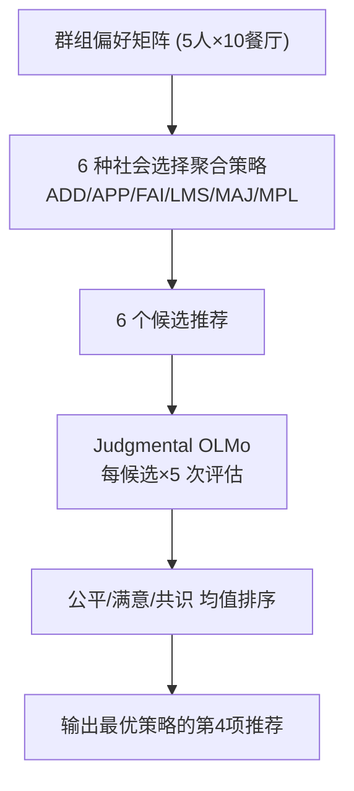
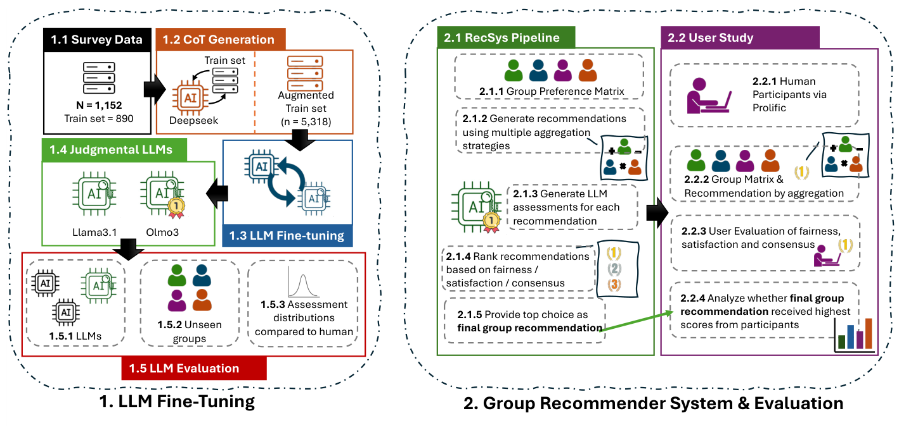

# Consensus vs. Dissent: Dynamic LLM Modeling of Subjective Preferences in Group Recommenders (共识与分歧：群组推荐中主观偏好的动态 LLM 建模)

- **会议/期刊**: RecSys 2026 (第 20 届 ACM 推荐系统会议)
- **作者与机构**: Cedric Waterschoot, Nava Tintarev, Francesco Barile (Maastricht University)
- **推荐链路定位**: 重排（候选策略级动态选择）
- **研究方向**: 社交与群组推荐 / 大语言模型推荐
- **论文原文**: [https://arxiv.org/abs/2607.10235v1](https://arxiv.org/abs/2607.10235v1)
- **开源代码**: [https://github.com/Cwaterschoot/Consensus-](https://github.com/Cwaterschoot/Consensus-)

## TL;DR (1分钟核心速览)

群组推荐（GRS）长期依赖 Average / Least Misery 等**静态**社会选择聚合策略，而"公平/满意/共识"这类主观指标只能在事后用户研究中测量，无法进入实时管线。本文用 Barile 等的 1,152 条人类李克特评估 + DeepSeek-V3.1 蒸馏的 CoT 推理（扩增至 5,318 条）LoRA 微调 Llama-3.1-8B 与 OLMo-3-7B，得到 **Judgmental Llama / Judgmental OLMo** 作为实时"人类判断模拟器"；管线对 6 种聚合策略各生成候选，由判断模型打分 5 次取均值后动态选优。在 1,180 个未见群组场景上，Judgmental OLMo 将 Wasserstein 距离降至 0.70/0.68/0.82（公平/满意/共识）；n=284 用户研究中 LLM 动态选择取得公平 0.82、共识 0.81 的**最高分**，满意 0.68 仅次于 FAI 的 0.70。

## Background & Motivation (背景与核心矛盾)

- **主流范式**: GRS 以社会选择理论聚合个体评分矩阵，分 borderline（LMS/MPL）、majority（APP/MAJ）、consensus（ADD/FAI）三类；其透明、可复现、无需群组训练数据，至今仍是主流基线与工业落地首选。
- **前人局限**: ① 聚合策略是**静态数学算子**，无法感知群组内部偏好分布（uniform / divergent / minority / coalitional）的差异；② 公平、满意、共识这类主观指标只能靠招募真人做用户研究获得，**成本高、不可实时、无法嵌入推荐闭环**——评估与实现之间存在结构性断层。
- **核心洞察 (Key Insight)**: 基座 LLM 作为 judge 存在系统性偏差（过度乐观、分布方差极小、自我偏好），但**在人类真值上微调后可以复现人类评估的分布形状与离散度**（σ≈1.6）；且人类对三种指标的评分高度相关（0.71–0.83），意味着可用单一综合信号驱动策略选择。
- **本文切入点**: 把"人类评估"从离线度量改造成**在线可调用的判断模块**，让聚合策略从静态变为按群组配置动态自适应。

## Method (核心方法设计)

### 1. 整体框架 (Overall Architecture)

管线分两段。**离线段**：以 Barile 等的 1,152 条人类评估为种子（分层抽样 890 训练 / 262 测试），用 DeepSeek-V3.1（T=0.95, top_p=0.95）为每条真值分数过采样生成 2–3 句显式引用群组成员的 CoT 理由，扩至 5,318 条；再以 LoRA（r=16, α=32, 4-bit NF4）微调 Llama-3.1-8B-Instruct 与 OLMo-3-7B-Instruct-SFT，并用**自定义 label masking** 屏蔽 prompt 与评分表 token，使梯度只落在 CoT 与真值分数上。**在线段**：对同一群组偏好矩阵跑 6 种聚合策略得到 6 个候选，判断模型对每个候选独立生成 5 份评估（模拟 5 位调查参与者），三指标各取均值后排序，取综合分最高的策略所推荐的第 4 家餐厅（前 3 家视为已访问）作为最终输出。

<figure class="paper-figure" markdown="span">
  <figcaption>图2：完整流程可视化。方法分为两个主要部分：（1）用于自动评估公平性、共识和满意度的LLM微调；（2）GRS，其中表现最佳的微调LLM生成对潜在推荐的评估。</figcaption>
</figure>

### 2. 关键设计拆解 (Key Designs)

1. **判断模型微调（Judgmental LLM）**：痛点是基座模型输出分布过窄且系统性偏正（Llama base 在公平上 WD=1.57、σ=0.54），完全无法模拟人类分歧。做法是把"人类分数 + 蒸馏理由"作为监督信号，损失仅在 assistant 回复段计算：

$$\mathcal{L}=-\sum_{t\in\mathcal{T}_{\text{resp}}}\log p_\theta(y_t\mid y_{<t},x),\quad \mathcal{T}_{\text{resp}}=\text{CoT}\oplus\text{scores}$$

屏蔽输入段的梯度是关键——否则模型会去拟合评分表结构而非"如何像人一样权衡成员偏好"，物理直觉是**把容量全部押在推理路径上**。结果 Judgmental OLMo 三指标 WD 全部最低且 σ>1.55，逼近人类 σ≈1.6。

2. **策略级动态选择（Committee Voting）**：痛点是单一静态策略在 coalitional 群组上必然牺牲某一子群。做法是对每个候选采样 5 次评估取均值，以三指标平均分排序：

$$s^\*=\arg\max_{s\in\{\text{ADD,APP,FAI,LMS,MAJ,MPL}\}}\ \frac{1}{5}\sum_{k=1}^{5}\frac{f_k(s)+sat_k(s)+con_k(s)}{3}$$

多次采样而非贪心单次解码，是为了**用采样方差还原人群意见分歧**，避免 judge 退化为点估计。

3. **训练与推理开销**：无负采样概念（非检索任务）；LoRA 单卡 A100、4 epoch、lr=1e-4、batch=2×4 累积，按原始（未增广）测试集最低 loss 选 checkpoint。推理侧每群组需 6×5=30 次 LLM 前向，作者坦承延迟可达数分钟，是当前最大工程瓶颈。

## Experimental Setup & Evaluation Protocol (实验设置与评估协议)

- **数据集与预处理**: 种子数据来自 Barile 等的外部评估式用户研究（参与者作为旁观者评分），非 5-core 过滤，无交互稀疏度概念：

| 数据集 | #Users(评分者) | #Items | #Interactions(评估) | 稀疏度/密度 | 特征/场景说明 |
| :--- | :---: | :---: | :---: | :---: | :--- |
| 人类真值 (Barile 等) | 288 | 10 餐厅/场景 | 1,152 | 每场景 5 人×10 项评分 | 7 点李克特，三指标独立打分 |
| 增广训练集 (DeepSeek 蒸馏) | — | — | 5,318 | 890→5,318 过采样 | 保留原真值分数，仅扩理由 |
| LLM 评估集 (未见场景) | — | — | 1,180 | 按原流程新生成 | 用于 WD 分布对齐检验 |
| 用户研究 (n=284) | 284 | — | 1,136 | 16 场景，每人 4 组 | Prolific 招募，含注意力检查 |

- **数据划分与防穿越 (Splitting Strategy)**: 分层抽样 890/262 划分，**按分数分布分层**以保证极端李克特值（±3）在测试集中不被稀释；LLM 评估与用户研究均使用**全新生成场景**，严格避免与微调数据重叠。
- **排名评测协议 (Ranking Protocol)**: 非传统 Top-N 排序。分布层用 **Wasserstein Distance（Earth Mover's Distance）** 度量 LLM 评估分布与人类分布的差异（适配有序李克特）；效果层用 **混合设计 ANOVA**（聚合策略为组间、群组配置为组内），Bonferroni 校正阈值 0.05/3=0.017，并做事后 t 检验。
- **对比基线与超参设置**: 基线为 6 种静态聚合策略 + Llama-3.1-8B base（未微调对照）；判断模型 committee size=5，LoRA r=16/α=32，4-bit NF4；用户研究样本量由 power analysis 定为 284。

## Key Experimental Results (实验关键数据)

### 1. 主实验对比 (Main Results)

**表 1：LLM 评估分布对齐（WD 越低越好，Mean/σ 为 7 点量表）**

| 评估模型 | Fairness WD↓ | Satisfaction WD↓ | Consensus WD↓ | σ 范围 |
| :--- | :---: | :---: | :---: | :---: |
| Llama-3.1-8B (Base) | 1.57 | 1.06 | 1.09 | 0.48–0.54 |
| OLMo-3-7B (Base) | 0.88 | 1.16 | 1.09 | 1.40–1.88 |
| Judgmental Llama | 0.96 | 0.78 | 0.85 | 1.13–1.54 |
| **Judgmental OLMo** | **0.70** | **0.68** | **0.82** | **1.55–1.59** |
| Ground Truth | 0.55 | 0.50 | 0.64 | ≈1.6 |

**表 2：用户研究主观评分（n=284，7 点量表 −3~3，括号内为标准差）**

| 策略 | Fairness | Satisfaction | Consensus |
| :--- | :---: | :---: | :---: |
| ADD | 0.51 (1.72) | 0.58 (1.56) | 0.76 (1.57) |
| APP | 0.28 (1.73) | 0.41 (1.58) | 0.47 (1.62) |
| FAI | 0.61 (1.67) | **0.70** (1.64) | 0.74 (1.76) |
| LMS | 0.48 (1.55) | 0.48 (1.47) | 0.68 (1.48) |
| MAJ | 0.20 (1.65) | 0.20 (1.60) | 0.26 (1.71) |
| MPL | 0.20 (1.79) | 0.14 (1.63) | 0.18 (1.76) |
| **LLM (Ours)** | **0.82** (1.68) | 0.68 (1.50) | **0.81** (1.56) |
| Improv. vs 最佳静态 | +34.4% (vs FAI) | −2.9% (vs FAI) | +6.6% (vs ADD) |

### 2. 消融实验 (Ablation Study)

本文无传统模块消融，等价对照为"是否微调"与"是否引入群组配置交互项"：

| 配置 | Fairness WD↓ | Satisfaction WD↓ | Consensus WD↓ | 说明 |
| :--- | :---: | :---: | :---: | :--- |
| Base Llama（无微调） | 1.57 | 1.06 | 1.09 | 分布塌缩，σ<0.55 |
| Base OLMo（无微调） | 0.88 | 1.16 | 1.09 | 仅公平偶然接近 |
| w/o CoT 增广（仅 890 条） | — | — | — | 作者定性指出样本不足，未给数值 |
| **Full（CoT 增广 + 微调）** | **0.70** | **0.68** | **0.82** | Judgmental OLMo |
| ANOVA：仅 Agg 主效应 | p=.068 | p=.032 | p=.012* | 公平维度不显著 |
| ANOVA：Agg×Config 交互 | F=5.18, p<.001* | F=4.28, p<.001* | F=4.49, p<.001* | 三指标全部显著 |

### 3. 关键实验发现 (Key Findings)

1. **微调而非规模决定对齐质量**：Llama base 的 σ 仅 0.48–0.54，输出几乎恒定在"略同意"，WD 高达 1.57；微调后 σ 升至 1.55–1.59，与人类 σ≈1.6 几乎重合。作者补充实验显示 7B/20B/235B 各规模基座模型均系统性失败，**"规模无法替代高质量微调数据"**。
2. **动态选择的收益集中在分歧型群组**：全局主效应在公平维度不显著（p=.068），但交互项极显著——在 coalitional 群组上 LLM 显著优于 APP（t=4.44, p<.001）与 ADD（t=3.22, p=.002）；在 minority 群组上满意度显著优于 MAJ（t=4.11, p<.001）与 MPL（t=3.01, p=.004）。说明收益来源不是"找到更强的通用策略"，而是**在静态强策略失效的配置上及时切换**。
3. **策略选择模式与人类研究结论互证**：16 个场景中 ADD 被选 6 次、FAI 4 次、LMS/MPL 各 2 次、APP/MAJ 各 1 次；MPL **仅**在 uniform 群组被选中，coalitional 群组则四种策略各出现一次。额外 40 个场景（n=1,200）复现该模式（MPL 仅用于 3/10 uniform 组，coalitional 组六种策略全覆盖），与既有文献"MPL 适合高共识群组"的结论一致，构成外部效度佐证。

## Highlights & Limitations (亮点、对比与审稿批判)

- **与代表作对比 (vs. Prior Work)**: 相比 Barile 等[5]的纯用户研究，本文把同一套主观量表**内化为可调用模块**，首次让公平/共识进入实时决策环；相比 LLM-as-judge 文献（Shi 等[38]、Malberg 等[28]）关注个体评分偏差，本文聚焦**群组级多主体权衡**这一更难的判断任务；相比注意力/GNN 类 GRS（Cao 等[9]、Huang 等[19]），本文不追求新打分模型，而是保留社会选择策略的透明性、只动态选择策略，可解释性与可复现性更强。
- **可迁移亮点**: ① **label masking + 真值锚定的 CoT 蒸馏**范式可直接迁移到任何"主观指标不可实时测量"的场景（如解释质量、信任度、多样性感知的在线打分）；② **committee sampling（多次采样取均值）** 用采样方差模拟人群分歧，是低成本复现人类分布离散度的实用技巧。
- **审稿级局限批判**: ① **延迟不可接受**：每群组 30 次 LLM 前向，作者自述可达数分钟，与"实时推荐"的宣称存在张力，需蒸馏到 ≤1.5B SLM 才可能落地；② **领域与场景强绑定**：仅餐厅、固定 5 人×10 项、"前 3 已访问取第 4"的构造，且未与深度学习 GRS 基线对比（受数据可得性限制），外部泛化性证据薄弱；③ 训练信号本质是**合成推理**，存在对 DeepSeek-V3.1 教师模型的依赖，与真实人类推理仍有 gap。

## Rating (四维评分)

- **方法创新性 (Novelty)**: ⭐⭐⭐⭐ （核心机制与方法设计具备明确创新性，理论与实验动机支撑充分）
- **评估协议与实验扎实度 (Protocol & Experiments)**: ⭐⭐⭐⭐ （主流公开数据集评测完整，包含多基线对比与消融实验验证）
- **写作与数学规范度 (Clarity & Rigor)**: ⭐⭐⭐⭐⭐ （问题形式化定义清晰，核心模块数学推导与架构阐述严谨易读）
- **工业落地与复现价值 (Industrial & Practical Value)**: ⭐⭐⭐ （兼顾推荐效果增益与训练/推理效率，具备实际场景迁移参考价值）
