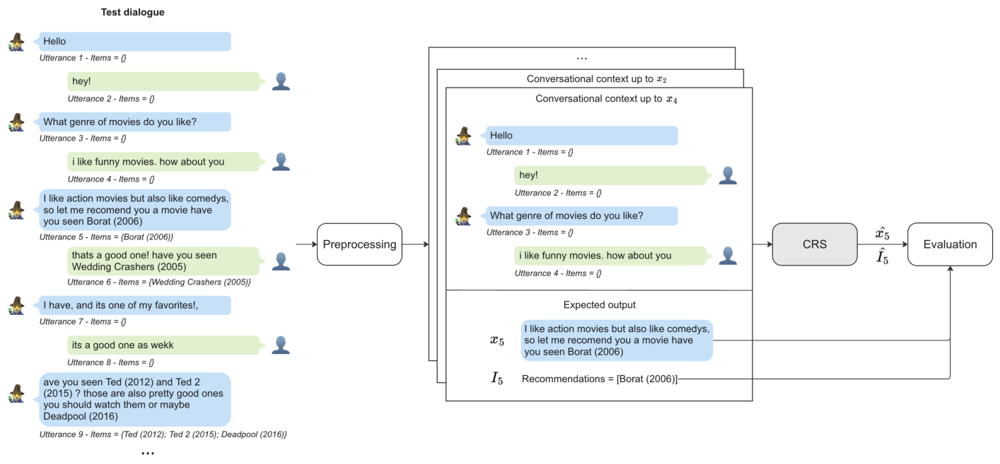
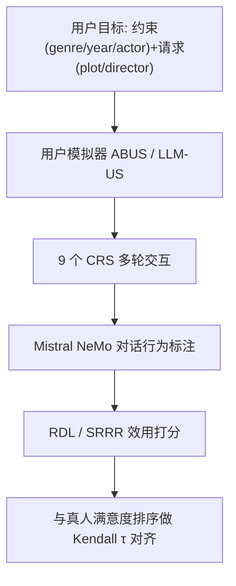

# Limitations of Current Evaluation Practices for Conversational Recommender Systems and the Potential of User Simulation (当前对话推荐系统评估实践的局限与用户模拟的潜力)

- **会议/期刊**: SIGIR-AP 2025
- **作者与机构**: Nolwenn Bernard (TH Köln)、Krisztian Balog (University of Stavanger)
- **推荐链路定位**: 评测方法论（面向对话推荐全链路，非单一排序阶段）
- **研究方向**: 对话推荐与智能体仿真 / 可信评测与基准
- **论文原文**: [https://arxiv.org/abs/2510.05624v1](https://arxiv.org/abs/2510.05624v1)
- **开源代码**: [https://github.com/iai-group/recsys25-crseval](https://github.com/iai-group/recsys25-crseval)

## TL;DR (1分钟核心速览)

本文直指对话推荐系统（CRS）离线评估的两大病灶：静态测试集忽视交互性、Recall@N 等指标与真实用户满意度脱节。作者基于经济学奖励/成本框架提出效用指标 RDL（每轮对话奖励），在 467 段真实用户对话（CRSArena-Dial，9 个 CRS）上，RDL 与自报满意度的 Kendall's $\tau$达 **0.78**，而 Recall@1 仅 **0.07**；进一步用 LLM 用户模拟器生成 200×9 段合成对话，LLM-US 的$\tau=0.366$、绝对误差仅 0.015，显著优于议程式 ABUS（$\tau=0.143$、误差 0.107）。

## Background & Motivation (背景与核心矛盾)

- **主流范式**: CRS 评估沿用 IR 的离线范式——在 ReDial/OpenDialKG 等静态对话集上，逐轮比对预测推荐与标注的 ground-truth 物品，计算 Recall@N、Distinct-n、BLEU 等。
- **前人局限一（静态集失真）**: 测试对话中 $I_{t+1}$ 常只含单个目标物品（ReDial 中占比 >80%），且可能包含对话中已提及物品，导致效果被系统性低估或高估；对话模式多样性也严重不足。
- **前人局限二（指标失焦）**: Recall@N 采用 micro-averaging 且仅在推荐轮计算，既忽略用户付出的交互成本，又默认用户只找某一特定物品；Bernard 等已发现 Recall@10 与满意度几乎不相关，但未给出替代方案。
- **核心洞察 (Key Insight)**: 用户真正追求的是"效用"——获得推荐收益与付出交互成本的比值；评估应转向 reward/cost 视角，并用可控的用户模拟器生成动态交互数据。
- **本文切入点**: 用统一效用框架重新实例化旧指标、提出新指标，并以真实用户满意度为金标准检验模拟器可靠性。

<figure class="paper-figure" markdown="span">
  <figcaption>图1：当前基于静态对话数据集的CRS评估实践示意图。</figcaption>
</figure>

## Method (核心方法设计)

### 1. 整体框架 (Overall Architecture)

论文分两条主线闭环：其一，构建通用 reward/cost 效用框架，将 Recall@N、Success Rate 等旧指标统一解释为单因子实例，并派生 SRRR 与 RDL 两个新指标；其二，搭建模拟评估流水线——用户模拟器（ABUS / LLM-US）以"约束+请求"目标初始化，与 9 个 CRS 多轮交互生成合成对话，再用 Mistral NeMo 做对话行为（dialogue act）自动标注，最终以 RDL 打分并与真人满意度排序做 Kendall's $\tau$ 对齐检验。

### 2. 关键设计拆解 (Key Designs)

1. **通用奖励/成本效用框架**：痛点是旧指标只测准确率、不计交互代价。定义总奖励 $R=\sum_i \alpha_i r_i$、总成本$C=\sum_j \beta_j c_j$，效用为比值$\text{utility}=R/C$，再对会话做 macro 平均。直觉：把"用户是否划算"显式建模为投入产出比，使任何指标都可在此框架下被审视与改造。

2. **RDL（Reward-per-Dialogue-Length）**：痛点是 Success Rate 为二值、SRRR 仅计推荐轮成本且依赖易错的 act 标注。RDL 令成本为整段对话轮数 $C=|d|$、奖励为被接受推荐数$R=|I_{acc}|$：
$$RDL=\frac{1}{|D|}\sum_{d}\frac{|I_{acc}|}{|d|}$$
物理直觉：同样满足需求，对话越短、被接受推荐越多，用户效用越高，天然惩罚啰嗦与反复误解。配套的 SRRR 则以"推荐轮"为单位计成本 $C=|rounds|$、接受为奖励$R=\mathbb{I}_{acc}(round)$。

3. **双模拟器对比与训练/推理开销**：ABUS 为议程式（LLM 做 NLU/NLG + 规则交互模型），LLM-US 为纯 LLM 零样本模拟（先判断是否中止对话再生成下一句）。二者均基于 UserSimCRS 工具包、Mistral NeMo 12b（temperature=0）部署于 Ollama；每个 (模拟器, CRS) 对生成 200 段对话，成本主要在 LLM 调用与 act 标注，无需人工标注即可规模化。

## Experimental Setup & Evaluation Protocol (实验设置与评估协议)

- **数据集与预处理**: 真实交互数据 CRSArena-Dial（9 个 CRS × 真实用户，共 467 段对话），含自报满意度（satisfied/frustrated）与自由反馈；合成数据为每对 200 段模拟对话。

| 数据集 | #Users | #Items | #Interactions | 稀疏度/密度 | 特征/场景说明 |
| :--- | :---: | :---: | :---: | :---: | :--- |
| CRSArena-Dial | 真实用户(未披露) | 电影域 | 467 dialogues | — | 9 个 CRS 真实交互 + 满意度标签 |
| 合成对话 | 模拟用户 | 电影域 | 200×(模拟器,CRS) | — | 目标驱动、无特定目标电影 |

- **数据划分与防穿越 (Splitting Strategy)**: 非传统训练/测试划分；以真人对话为参照基准，模拟对话为待检验对象，属"评估方法学"设定而非模型训练设定。
- **排名评测协议 (Ranking Protocol)**: 以**系统级排序相关性**为核心——计算各指标下 9 个 CRS 的排序与满意度排序的 Kendall's $\tau$；Recall@1 取自文献 [45]，成功判定依赖对话行为中的 Accept 标注（非全库 Full-Ranking）。
- **对比基线与超参设置**: 基线为 5 类架构 9 个系统（CRB-CRS、KBRD、BARCOR、UniCRS、ChatCRS，各含 ReDial/OpenDialKG 版本）；模拟器对比 ABUS vs. LLM-US；act 标注用 Mistral NeMo few-shot，用户/系统意图 AUC 分别 0.673/0.683。

## Key Experimental Results (实验关键数据)

### 1. 主实验对比 (Main Results)

以自报满意度为金标准，各指标排序相关性如下（$\tau$ 越高越可信）：

| 指标 | Kendall's $\tau$ | 排名首位系统 (分数) | 与真人排序一致性 |
| :--- | :---: | :--- | :---: |
| User Satisfaction (金标准) | – | ChatCRS_OpenDialKG (0.523) | – |
| Recall@1 | 0.07 | BARCOR_OpenDialKG (0.312) | 几乎无关 |
| Success Rate | 0.67 | ChatCRS_OpenDialKG (0.114) | 较强 |
| SRRR | 0.32 | CRB-CRS_ReDial (0.077) | 弱 |
| **RDL** | **0.78** | **ChatCRS_OpenDialKG (0.037)** | **最强** |

模拟器可靠性对比（RDL 下与真人排序的 $\tau$ 及绝对分数平均偏差）：

| 模拟器 | Kendall's $\tau$ | 平均绝对偏差 | 结论 |
| :--- | :---: | :---: | :--- |
| ABUS (议程式) | 0.143 | 0.107 | 偏差大、排序弱 |
| **LLM-US** | **0.366** | **0.015** | 绝对拟合优、排序仍偏弱 |

### 2. 消融实验 (Ablation Study)

针对"低满意度系统是否扭曲相关性"的子集稳健性检验（仅保留 ChatCRS_* 与 BARCOR_*）：

| 指标 | 全量 $\tau$| 子集$\tau$ | 变化 |
| :--- | :---: | :---: | :---: |
| Recall@1 | 0.07 | 0.0 | 依旧失效 |
| Success Rate | 0.67 | 0.67 | 稳定 |
| SRRR | 0.32 | **-0.34** | 符号翻转，敏感 |
| **RDL** | 0.78 | **1.0** | 完全一致 |

### 3. 关键实验发现 (Key Findings)

1. **Recall@N 是失效代理**：$\tau=0.07$ 近乎随机，且按 Recall@1 排序会得出"OpenDialKG 训练优于 ReDial"的相反结论，而 RDL 与满意度均支持 ReDial 更优——旧文献部分结论不再成立。
2. **RDL 是最佳效用代理**：$\tau=0.78$ 且子集检验升至 1.0，说明"接受推荐数/对话轮数"精准捕捉了用户投入产出；而更细粒度的 SRRR 反因 act 标注噪声（Accept 精度仅 0.61）而不稳。
3. **模拟器可替代但不可全信**：LLM-US 绝对误差仅 0.015，适合同一 CRS 不同版本的 A/B 式比较；但跨异构系统的排序 $\tau$ 仅 0.366，尚不足以独立替代真人评估，须人工抽检校验。

## Highlights & Limitations (亮点、对比与审稿批判)

- **与代表作对比 (vs. Prior Work)**: 相较 Bernard 等仅指出 Recall@10 与满意度弱相关，本文给出可操作的效用框架与 RDL 替代指标；相较 Wang 等用目标物品列表驱动模拟器（易泄漏、结局不自然），本文以"约束+请求"目标驱动，更贴近真实"无特定目标"的找片场景；相较 Huang 等单点验证 LLM 模拟器，本文首次系统对比议程式与 LLM 式模拟器对 9 个 CRS 的排序保真度。
- **可迁移亮点**: ① reward/cost 比值思路可直接迁移到多轮客服、搜索式对话等交互系统的效用评测；② "以真人满意度排序为金标准、用 Kendall's $\tau$ 校验自动指标"的元评估范式，可复用于任何新指标的合法性论证。
- **审稿级局限批判**: ① 仅电影单域、9 个英文开源系统，且 act 标注依赖 LLM（Accept 精度 0.61），指标数值本身带噪声；② 模拟器排序相关性弱（$\tau=0.366$），跨架构系统评估可靠性存疑，且 LLM 调用与 200×9 对话生成的开销及可复现性（部分 CRS 接口文档不清）仍是落地障碍。

## Rating (四维评分)

- **方法创新性 (Novelty)**: ⭐⭐⭐⭐ （以经济学 reward/cost 框架统一旧指标并派生 RDL，视角新颖但公式本身较简洁）
- **评估协议与实验扎实度 (Protocol & Experiments)**: ⭐⭐⭐⭐ （467 段真人对话 + 9 系统 + 子集稳健性检验完整，但单域、依赖 LLM 标注）
- **写作与数学规范度 (Clarity & Rigor)**: ⭐⭐⭐⭐ （框架与指标推导清晰、旧指标实例化严谨，模拟器部分偏工程描述）
- **工业落地与复现价值 (Industrial & Practical Value)**: ⭐⭐⭐⭐ （代码与 prompt 开源、模拟评估可规模化，但跨系统可靠性尚不足以完全替代真人）

