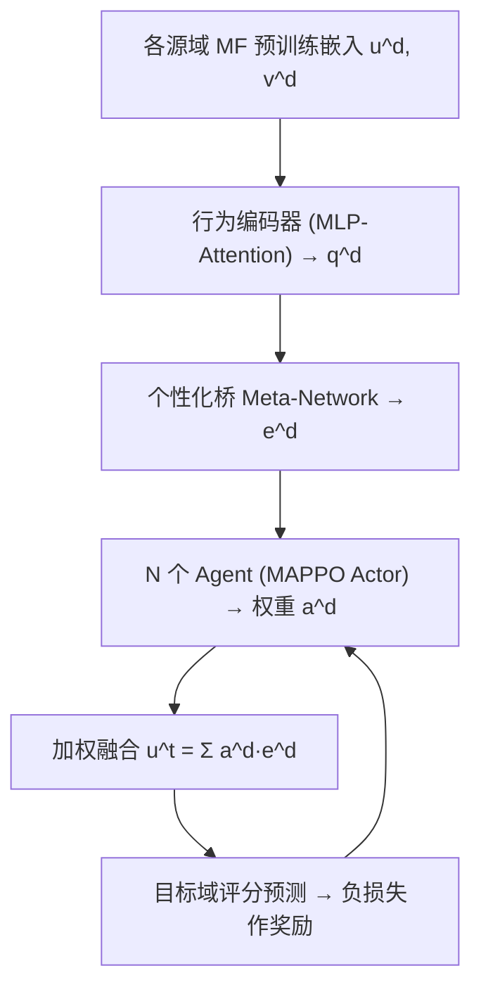
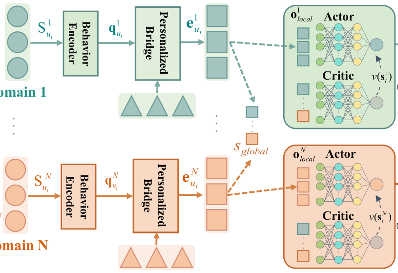

# MARCO: A Cooperative Knowledge Transfer Framework for Personalized Cross-domain Recommendations (面向个性化跨域推荐的协作式知识迁移框架)

- **会议/期刊**: SIGIR-AP 2025
- **作者与机构**: Lili Xie, Yi Zhang, Ruihong Qiu, Jiajun Liu, Sen Wang（昆士兰大学 / CSIRO DATA61）
- **推荐链路定位**: 召回（冷启动用户初始表征构建）
- **研究方向**: 跨域与多场景推荐 / 冷启动与长尾推荐
- **论文原文**: [https://arxiv.org/abs/2510.04508v1](https://arxiv.org/abs/2510.04508v1)
- **开源代码**: [https://github.com/xiewilliams/MARCO](https://github.com/xiewilliams/MARCO)

## TL;DR (1分钟核心速览)

多源跨域推荐（CDR）中，单智能体 RL（如 REMIT）用一个策略统一估计所有源域贡献，导致贡献被系统性高估/低估，引发负迁移。MARCO 将每个源域交给一个独立 Agent，用 MAPPO 协作学习各域对目标域的权重，并引入跨域联合动作熵惩罚抑制探索噪声。在 Amazon 四域、20%/50%/80% 三档冷启动率下，MAE 相对最优基线最高降 32.6%（CD 域 50% 冷启动），且源域数量减少时仍保持鲁棒。

## Background & Motivation (背景与核心矛盾)

- **主流范式**: 多源 CDR 主流走"桥函数映射"路线（EMCDR、PTUP 用 MLP 把源域用户嵌入映射到目标域），近期 REMIT 引入单智能体 RL 动态估计多源偏好。
- **前人局限**: ① 单 Agent 无法做跨域 credit assignment——估计域 1 偏好时会连带高估域 1 贡献、低估真正有用的域 2（图 1 左）；② 各源域数据分布稀疏且异质，单策略在分布差异下训练极不稳定。
- **核心洞察 (Key Insight)**: 源域贡献本质是一个"多主体协作分配"问题，而非单一策略的回归问题；把每个源域视为一个独立决策主体，用全局状态（目标域物品 + 各域变换嵌入）做联合优化，可天然完成 credit assignment。
- **本文切入点**: 用协作式 MARL（MAPPO）替代单 Agent RL，并加一项联合动作熵惩罚，让 Agent 学会"有区分度地"分配域权重。

## Method (核心方法设计)

### 1. 整体框架 (Overall Architecture)

先用 MF 在各域独立预训练用户/物品嵌入；行为编码器以 MLP-attention 聚合用户历史物品得到域表征 $q^d_{u_i}$；个性化桥（meta-network 以$q^d_{u_i}$为输入生成逐用户映射矩阵$W^d_{u_i}$）把源域用户嵌入变换为$e^d_{u_i}$；随后 N 个 Agent 各自输出一个权重$a^d$，加权求和得到目标域冷启动用户初始嵌入$u^t_i$，送入目标域 MF 做评分预测，预测损失取负作为全局奖励回传更新 Actor/Critic。

<figure class="paper-figure" markdown="span">
  <figcaption>图 2：MARCO 的概览。域特定的用户嵌入 u𝑑</figcaption>
</figure>

### 2. 关键设计拆解 (Key Designs)

1. **协作式多智能体贡献估计（Credit Assignment）**：单 Agent 的痛点是把多域贡献耦合进一个策略。MARCO 令 Agent $i$的局部观测为$o^i_{local}=[e^d_{u_i}\|v^t\|e^d_{u_i}\cdot v^t]$，全局状态用目标感知注意力聚合$s_{global}=\sum_{d}\alpha_d e^d_{u_i}$，动作即域权重且满足$\sum_i a^i_t=1$。Critic 输入$[o^i_{local}\|s_{global}]$ 评估状态值，使每个 Agent 在"看到全局"的前提下只为自己那一路负责——这正是单 Agent 缺失的协作视角。

2. **跨域联合动作熵惩罚**：MAPPO 自带的熵奖励是鼓励探索（最大化熵），而本文反其道而行，在 Actor 损失中**减去**联合动作熵：
$$\mathcal{L}(\theta_i)=\frac{1}{m}\sum_{i}\hat{\mathbb{E}}_t\Big[\min\big(r^i_t(\theta_i)\hat{A}^i_t,\ \text{clip}(r^i_t,1-\epsilon,1+\epsilon)\hat{A}^i_t\big)-\beta H_{joint}\Big],\quad H_{joint}=-\sum_{i=1}^{m}a^i_t\log a^i_t$$
物理直觉：动作即域权重、天然构成概率分布，低熵意味着权重分布"有区分度"（把权重集中到真正有用的源域），从而抑制均匀分配带来的负迁移；$\beta$ 随冷启动率升高而增大（20%→0.0001，80%→1.5），因为数据越少越需要强正则来聚焦关键域。

3. **训练目标、负采样与推理效率**：目标域回归损失 $\min\frac{1}{|\mathcal{W}^t|}\sum(u^t_i\cdot v^t-w_{u_i})^2$，奖励为其负值；无负采样（显式评分回归任务）。Actor/Critic 跨 Agent 共享参数，总参数 106.86M（REMIT 73.06M），训练 14 GPU-h vs 13 GPU-h，单样本推理 0.06ms vs 0.04ms——开销增幅很小。

## Experimental Setup & Evaluation Protocol (实验设置与评估协议)

- **数据集与预处理**: Amazon review 四子类，均按 `5-core` 过滤，通过共享用户 ID 对齐（重叠用户 2,166）：

| 数据集 | #Users | #Items | #Interactions | 说明 |
| :--- | :---: | :---: | :---: | :--- |
| CD | 75,258 | 64,443 | 1,097,592 | cds_and_vinyl |
| MV | 123,960 | 50,052 | 1,697,533 | movies_and_tv |
| Book | 603,668 | 367,982 | 8,898,041 | 最稠密 |
| Elec | 725,523 | 63,001 | 1,689,188 | 用户最多 |

- **数据划分与防穿越**: 冷启动划分——从目标域重叠用户中随机抽取 20%/50%/80% 作为冷启动测试用户，其余重叠用户数据训练；四域轮流作目标域，其余为源域。
- **排名评测协议**: 非排序评测，采用显式评分回归指标 **MAE / RMSE**（评分 0–5），在冷启动测试集上直接预测。
- **对比基线与超参设置**: MF（仅目标域）、CMF（多矩阵联合分解）、EMCDR / PTUP（桥函数）、REMIT（单 Agent RL）；嵌入维度 $\{5,10,20\}$，学习率$\{0.001,0.01,0.1\}$，MLP 隐层$\{20,50,80,128\}$，$\beta\in\{0.0001,0.001,0.15,1.5\}$，报告 5 次随机运行均值±标准差。

## Key Experimental Results (实验关键数据)

### 1. 主实验对比 (Main Results)

50% 冷启动率（最具代表性档位，MAE / RMSE）：

| Target | MF | CMF | EMCDR | PTUP | REMIT | **MARCO** | Improv. |
| :--- | :---: | :---: | :---: | :---: | :---: | :---: | :---: |
| CD | 4.473 | 2.280 | 1.397 | 1.151 | 1.141 | **0.769** | 32.6% |
| MV | 4.097 | 1.300 | 1.050 | 1.038 | 1.065 | **0.884** | 14.8% |
| Book | 4.299 | 1.932 | 1.178 | 1.123 | 1.394 | **0.952** | 15.2% |
| Elec | 4.326 | 2.191 | 1.255 | 1.158 | 1.270 | **0.941** | 18.8% |

20% 冷启动率下 CD 域 MAE 从 REMIT 的 1.056 降至 **0.823**（22.0%）；80% 冷启动率下 CD 域 MAE 从 1.223 降至 **0.850**（29.8%）。值得注意的是 REMIT 在冷启动率升高时性能急剧劣化（Book 域 50% 时 MAE 1.394 甚至差于 PTUP 的 1.123），暴露单 Agent 对训练数据量的强敏感性。

### 2. 消融实验 (Ablation Study)

50% 冷启动率，MAE（越低越好）：

| Target | w/o MPB | REMIT | w/o MARL | w/o Ent | **MARCO** |
| :--- | :---: | :---: | :---: | :---: | :---: |
| CD | 1.052 | 1.141 | 1.127 | 0.924 | **0.769** |
| MV | 0.943 | 1.065 | 1.006 | 0.900 | **0.884** |
| Book | 1.027 | 1.394 | 1.237 | 1.089 | **0.952** |
| Elec | 1.033 | 1.270 | 1.234 | 1.062 | **0.941** |

熵正则专项对比（20% 冷启动，CD 域 MAE）：PPO 1.088 → PPO w/Ent 0.922 → MAPPO 0.936 → MAPPO w/Ent 0.830 → **MARCO 0.823**。

### 3. 关键实验发现 (Key Findings)

1. **多 Agent 是主要增益来源，个性化桥是次要但不可省**：去掉 MARL（退化为单 Agent PPO）在 CD 域 50% 冷启动下 MAE 从 0.769 升至 1.127（+46.6%），而去掉个性化桥（w/o MPB）仅升至 1.052，说明 credit assignment 机制比映射函数个性化更关键。
2. **熵惩罚必须"反向用"**：MAPPO 自带探索熵奖励（MAPPO w/Ent）在 MV 域 20% 冷启动下 MAE 0.934 反而差于无熵的 MAPPO 0.916，而 MARCO 的联合动作熵惩罚降至 0.858——鼓励探索会稀释域权重区分度，抑制熵才有效。
3. **源域越少，MARCO 相对优势越明显**：图 5 显示从 3 源域降到 1 源域时，REMIT 的 MAE 显著抬升而 MARCO 曲线平缓，说明协作式权重分配在信息稀缺时更能避免对单一源域的过度依赖。

## Highlights & Limitations (亮点、对比与审稿批判)

- **与代表作对比 (vs. Prior Work)**: 相比 EMCDR/PTUP 的"固定映射函数"路线，MARCO 把域权重变成可学习的动态策略；相比 REMIT 的单 Agent REINFORCE，MARCO 用 MAPPO 的 Actor-Critic + clip 机制 + 全局状态观测，把"多域贡献估计"从回归问题重构为协作博弈问题。
- **可迁移亮点**: ① "每源域一个 Agent + 全局状态注意力聚合"的 credit assignment 模板可直接迁移到多场景/多业务线联合建模；② 联合动作熵惩罚（对权重分布做低熵约束）可复用到任何需要"稀疏化域权重"的融合模块。
- **审稿级局限批判**: ① 评测仅用 MAE/RMSE 回归指标，未做 Top-K 排序评测（HR/NDCG），与当前 CDR 主流评测范式脱节，且冷启动用户随机抽取而非按时间切分，存在信息泄漏风险；② 熵系数 $\beta$ 需按冷启动率手工分档调参（0.0001/0.001/1.5），缺乏自适应机制，实际部署时冷启动率漂移会导致超参失配。

## Rating (四维评分)

- **方法创新性 (Novelty)**: ⭐⭐⭐⭐ （把多源 CDR 重构为协作 MARL 问题视角新颖，联合动作熵惩罚的"反向使用"有清晰物理直觉，但 MAPPO 本身为现成框架）
- **评估协议与实验扎实度 (Protocol & Experiments)**: ⭐⭐⭐ （四域三档冷启动 + 消融 + 泛化 + 鲁棒性 + 敏感性较完整，但仅回归指标、随机冷启动划分、缺少排序评测与显著性检验）
- **写作与数学规范度 (Clarity & Rigor)**: ⭐⭐⭐⭐ （Dec-POMDP 五要素与公式定义清晰，算法伪代码完整，复杂度对比表到位；部分符号如 $p^d_{u_i}$与$a^i_t$ 混用略欠统一）
- **工业落地与复现价值 (Industrial & Practical Value)**: ⭐⭐⭐⭐ （代码已开源，推理延迟仅 0.06ms/样本、训练开销与 REMIT 相当，工程可落地性强；但需为每个源域维护独立 Agent 与预训练 MF，域数量扩展时参数线性增长）

