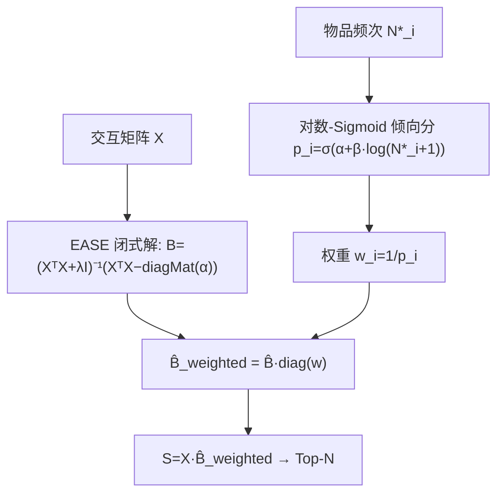

# Accurate and Diverse Recommendations via Propensity-Weighted Linear Autoencoders (基于倾向加权的线性自编码器的准确且多样化推荐)

- **会议/期刊**: SIGIR-AP 2025 (pp. 153–159)
- **作者与机构**: Kazuma Onishi (北海道大学)、Katsuhiko Hayashi (东京大学)、Hidetaka Kamigaito (NAIST)
- **推荐链路定位**: 召回 (Item-based CF 打分)
- **研究方向**: 去偏公平与工业架构 / 协同过滤
- **论文原文**: [https://arxiv.org/abs/2512.20896v1](https://arxiv.org/abs/2512.20896v1)
- **开源代码**: [https://github.com/cars1015/IPS-LAE](https://github.com/cars1015/IPS-LAE)

## TL;DR (1分钟核心速览)

隐式反馈数据 MNAR 导致推荐向热门物品塌缩、覆盖率低。本文指出主流"幂律倾向分 + 取倒数"的 IPS 权重在 log 尺度上单调递减，对热门物品**过度惩罚**，且热门物品之间也被拉开巨大权重差，反而损伤精度。作者将倾向分重定义为观测频次对数的 Sigmoid 函数 $p_i=\sigma(\alpha+\beta\log(N_i^*+1))$，使权重有界、边际效用递减，并以闭式解$\hat{\mathbf{B}}_{weighted}=\hat{\mathbf{B}}\,\mathrm{diag}(\mathbf{w})$ 注入 EASE 类线性自编码器。在 ML-20M 上 Coverage@100 相对提升 **+280%**、Netflix 上 **+150%**，Recall/NDCG 不降反微升。

## Background & Motivation (背景与核心矛盾)

- **主流范式**: 隐式反馈推荐用 IPS 去偏，倾向分普遍建模为物品频次的幂律 $p_i\propto (N_i^*)^\gamma$，权重取倒数后乘到损失或目标值上。
- **前人局限一（过度惩罚）**: 幂律倾向分的边际效用 $\frac{dp_i}{dN_i^*}\propto\gamma (N_i^*)^{1-\gamma}$在$\gamma<1$ 时虽递减，但"频次翻倍→倾向分同比例增长"对热门与冷门物品一视同仁，违背边际效用递减律，导致热门物品被过度压制。
- **前人局限二（热门内部失衡）**: 热门物品已被充分曝光，其观测数差异更多反映偏好人群规模而非曝光概率差异；幂律权重却在热门物品之间也制造巨大权重差，直接损害精度。
- **核心洞察 (Key Insight)**: EASE 的 SVD 分解 $\hat{\mathbf{B}}_{EASE}=\mathbf{V}\mathrm{diag}(\frac{\sigma_k^2}{\sigma_k^2+\lambda})\mathbf{V}^\top-\cdots$ 表明，L2 正则与零对角约束共同压制小奇异值主成分（对应冷门物品），因此高维 EASE 天然偏向热门物品——这恰是加权可以发挥作用的空隙。
- **本文切入点**: 用"对数 + Sigmoid"替换"幂律"，让倾向分有界于 $[0,1]$、热门物品权重不再无限缩小，同时保留幂律式的简洁性。

## Method (核心方法设计)

### 1. 整体框架 (Overall Architecture)

流程极简：先由交互矩阵 $\mathbf{X}$按 EASE 闭式解学到全秩物品相似度$\hat{\mathbf{B}}$（含零对角约束与 L2 正则）；再统计各物品观测频次$N_i^*$，经对数-Sigmoid 得到倾向分$p_i$与权重$w_i=1/p_i$；最后将权重作为列缩放直接乘到已学好的相似度矩阵上，得到加权打分$\mathbf{S}=\mathbf{X}\hat{\mathbf{B}}\mathrm{diag}(\mathbf{w})$并 Top-N 排序。关键工程优势是**权重与相似度解耦**：流行度漂移时只需重算$\mathbf{w}$ 并做一次矩阵乘法，无需重训。

### 2. 关键设计拆解 (Key Designs)

1. **对数-Sigmoid 倾向分（替代幂律，抑制过度惩罚）**：痛点在于幂律权重在 log 尺度单调下降且无上界约束。本文定义
$$p_i=\frac{1}{1+\exp\left(-\alpha-\beta\cdot\log(N_i^*+1)\right)},\qquad \alpha=-\beta\cdot\frac{\log(\min_i N_i^*+1)+\log(\max_i N_i^*+1)}{2}$$
其中 $\beta\in[0.1,0.9]$控制斜率、$\alpha$使中位频次处$p_i=0.5$。由于$\frac{d}{dN_i^*}\log(N_i^*+1)=\frac{1}{N_i^*+1}$，冷门物品的边际效用大、热门物品小，**显式内嵌边际效用递减律**；Sigmoid 又保证$p_i\in[0,1]$（幂律分可能 >1 的概率语义错误），且热门物品$p_i\to 1$使$w_i$ 不会过小，热门内部权重差被压缩。图 1 直观对比了两类权重曲线。

2. **闭式加权解（零重训成本）**：将权重作用于目标值而非损失重加权，目标为 $\arg\min_{\mathbf{B}}\|\mathbf{X}\mathrm{diag}(\mathbf{w})-\mathbf{X}\mathbf{B}\|_F^2+\lambda\|\mathbf{B}\|_F^2$，s.t.$\mathrm{diag}(\mathbf{B})=0$。由 [26] 的结论，其解为
$$\hat{\mathbf{B}}_{weighted}=\hat{\mathbf{B}}\,\mathrm{diag}(\mathbf{w})$$
即"先学无权重相似度、再右乘对角权重"，与 EASE/EDLAE/RDLAE/SANSA 全部兼容，是本文能低成本横扫四个基线的核心原因。

3. **训练目标、负采样与推理效率**：模型为全库隐式反馈的平方误差回归，**无负采样**（所有未交互项即 0 目标），因此不存在采样偏差；训练即一次矩阵求逆（$O(|I|^3)$，SANSA 用 Cholesky 稀疏化降到目标密度$d\%$）。推理为一次稀疏矩阵乘$\mathbf{X}\hat{\mathbf{B}}_{weighted}$，加权仅增加$|I|$ 次标量乘法，开销可忽略。

## Experimental Setup & Evaluation Protocol (实验设置与评估协议)

- **数据集与预处理**（沿用 [13] 的预处理）：

| 数据集 | #Users | #Items | #Interactions | 稀疏度/密度 | 特征/场景说明 |
| :--- | :---: | :---: | :---: | :---: | :--- |
| ML-20M | 136,677 | 20,108 | ~10M | 密度约 0.36% | 电影评分二值化 |
| Netflix | 463,435 | 17,769 | ~56.9M | 密度约 0.69% | 电影观看二值化 |
| MSD | 571,355 | 41,140 | ~34M | 密度约 0.14% | 音乐播放，覆盖率基线已很高 |

- **数据划分与防穿越 (Splitting Strategy)**: 采用**用户不相交划分**（训练/验证/测试用户集合互斥）的强泛化协议，而非 Leave-One-Out，避免同一用户信息泄漏。
- **排名评测协议 (Ranking Protocol)**: 无偏 **Full-Ranking**（对全库未交互物品排序），指标为 Recall@20/50、NDCG@100、Coverage@100（全体用户推荐去重物品占比）。
- **对比基线与超参设置**: 基线为 EASE、EDLAE、RDLAE、SANSA（$d\%\in\{0.5,1,5\}$），另加 Clipped IPS 与 SVD 降维对照；$\beta$网格搜索于$\{0.1,\dots,0.9\}$，选择准则为"Coverage@100 提升且 NDCG@100 不显著下降"。

## Key Experimental Results (实验关键数据)

### 1. 主实验对比 (Main Results)

| 数据集 / 方法 | Recall@20 | Recall@50 | NDCG@100 | Coverage@100 |
| :--- | :---: | :---: | :---: | :---: |
| **ML-20M** EASE | 0.3913 | 0.5210 | 0.4203 | 0.2134 |
| EASE + 本文 | **0.3924** | **0.5239** | **0.4217** | **0.7133** (+234%) |
| EDLAE | 0.3925 | 0.5242 | 0.4240 | 0.2152 |
| EDLAE + 本文 | **0.3954** | **0.5264** | **0.4253** | **0.7585** (+252%) |
| RDLAE | 0.3933 | 0.5265 | 0.4252 | 0.2685 |
| RDLAE + 本文 | 0.3943 | **0.5270** | **0.4257** | **0.7423** (+176%) |
| SANSA (d%=5) | 0.3906 | 0.5205 | 0.4200 | 0.2140 |
| SANSA (d%=5) + 本文 | **0.3924** | 0.5203 | **0.4212** | **0.7347** (+243%) |
| **Netflix** EASE | 0.3617 | 0.4451 | 0.3934 | 0.4933 |
| EASE + 本文 | **0.3623** | **0.4454** | **0.3938** | **0.8491** (+72%) |
| RDLAE | **0.3658** | **0.4496** | **0.3982** | 0.5707 |
| RDLAE + 本文 | 0.3649 | 0.4494 | 0.3977 | **0.8437** (+48%) |
| **MSD** EASE | 0.3331 | 0.4281 | 0.3893 | 0.9773 |
| EASE + 本文 | **0.3332** | 0.4281 | **0.3904** | **0.9832** (+0.6%) |

### 2. 消融与对照实验 (Ablation & Controlled Study)

| 配置 (ML-20M) | Recall@20 | NDCG@100 | Coverage@100 | 说明 |
| :--- | :---: | :---: | :---: | :--- |
| EASE (无权重) | 0.3913 | 0.4203 | 0.2134 | 基线 |
| EASE + 本文权重 | **0.3924** | **0.4217** | **0.7133** | 精度与覆盖双升 |
| EASE + 幂律 IPS ($\gamma$=0.5) | 0.2930 | 0.3137 | 0.9886 | 覆盖极高但精度崩塌 |
| + Clipped IPS $C$=0.01 | 0.2955 | 0.3181 | 0.8102 | 裁剪后覆盖降、精度仍低 |
| + Clipped IPS $C$=0.1 | 0.3110 | 0.3384 | 0.3150 | 覆盖回落至基线水平，精度仍远逊 |
| SVD 降维至 2048 维 | 0.3905 | 0.4189 | 0.1851 | 低维表达受限 |
| SVD + 本文权重 | 0.3900 | 0.4187 | 0.4685 | 低维下增益被压缩 |

### 3. 关键实验发现 (Key Findings)

1. **"覆盖暴涨、精度不掉"是本文与幂律 IPS 的本质分水岭**：幂律 IPS 把 Coverage@100 推到 0.9886 的代价是 Recall@20 从 0.3913 跌到 0.2930（-25%）；本文在 Coverage 0.7133 时 Recall 反升至 0.3924，说明其增益来自"修正热门内部失衡"而非"牺牲精度换长尾"。
2. **Clipped IPS 无法替代本文**：即便把裁剪阈值提到 $C=0.1$，Recall@20 仅回到 0.3110、Coverage 已跌回 0.3150，证明问题不在"冷门权重过大"这一单点，而在幂律权重对热门物品**内部**的过度区分，裁剪只能治标。
3. **高维表达是加权生效的前提**：SVD 降到 2048 维后，本文权重仅把 Coverage 从 0.1851 提到 0.4685，远低于全秩 EASE 的 0.7133，印证"EASE 的高维表达力 + 权重纠偏"是互补组合；MSD 上覆盖率基线已达 0.9773，增益仅 +0.6%，说明方法收益与数据长尾程度正相关。

## Highlights & Limitations (亮点、对比与审稿批判)

- **与代表作对比 (vs. Prior Work)**: 与 Steck 的幂律 IPS 相比，本文把"倾向分必须单调幂律"这一假设换成"边际效用递减的有界 Sigmoid"，从概率语义（$p_i\le 1$）与精度保持两方面同时修正；与 RDLAE（放松对角约束去偏）相比，本文是**正交的后处理**，可叠加在 RDLAE 之上（ML-20M 上 Coverage 0.2685→0.7423）；与 Clipped IPS 相比，本文不是截断尾部而是重塑整条权重曲线。
- **可迁移亮点**: (1) "先学无权重表征、再右乘对角权重"的闭式解范式，可迁移到任何可分解为 $\hat{\mathbf{B}}\mathrm{diag}(\mathbf{w})$的线性/浅层召回模型，实现流行度漂移的零重训适配；(2) 用$\log(N+1)$ 的 Sigmoid 替代幂律，是处理频次偏置的通用权重模板，作者已指出可推广到图链接预测。
- **审稿级局限批判**: (1) 倾向分假设用户无关 $p_{ui}=p_i$，忽略同一物品在不同用户群体间曝光差异，且$\beta$需按"覆盖升、NDCG 不降"人工网格搜索，缺乏理论选参准则；(2) 仅在三个电影/音乐数据集、且全部为线性自编码器上验证，未涉及深度模型与 Sampled Ranking 协议，EASE 的$O(|I|^3)$求逆在千万级物品上不可行（依赖 SANSA 稀疏近似，而 SANSA 在$d\%=0.5$ 时 Coverage 仅 0.2746，增益明显缩水）。

## Rating (四维评分)

- **方法创新性 (Novelty)**: ⭐⭐⭐ （洞察扎实——用边际效用递减律批判幂律 IPS 并给出有界替代，但本质是权重函数的工程替换，理论深度有限）
- **评估协议与实验扎实度 (Protocol & Experiments)**: ⭐⭐⭐⭐ （用户不相交划分 + Full-Ranking 无偏协议规范，三数据集四基线 + Clipped IPS/SVD 对照完整，唯缺显著性检验）
- **写作与数学规范度 (Clarity & Rigor)**: ⭐⭐⭐⭐ （从 EASE 的 SVD 分解推导流行度偏置来源，公式链清晰、闭式解推导完整，符号定义克制）
- **工业落地与复现价值 (Industrial & Practical Value)**: ⭐⭐⭐⭐ （权重与相似度解耦、流行度更新零重训，代码已开源；但受限于 $|I|^3$ 求逆，仅适合中等规模物品库的召回层）

