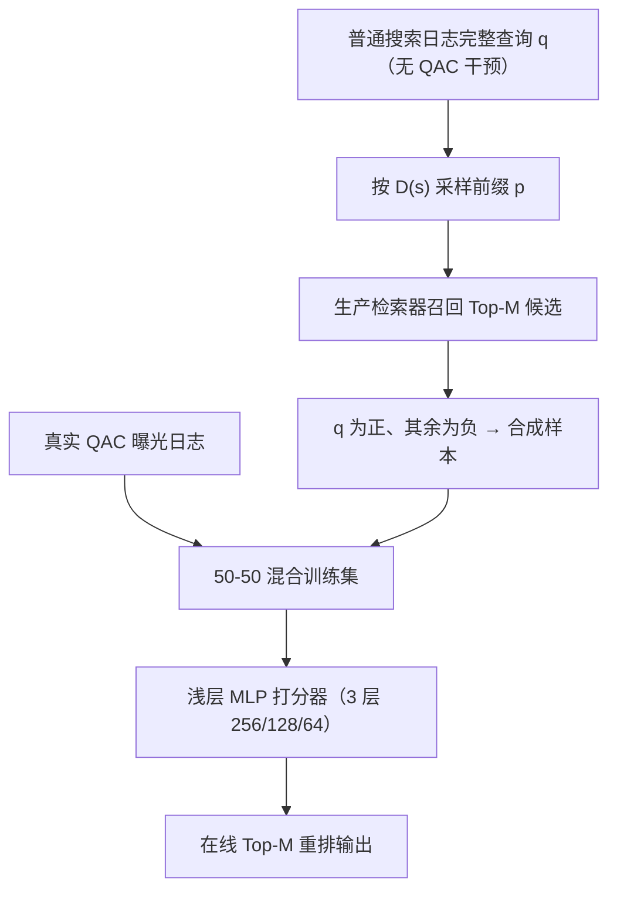
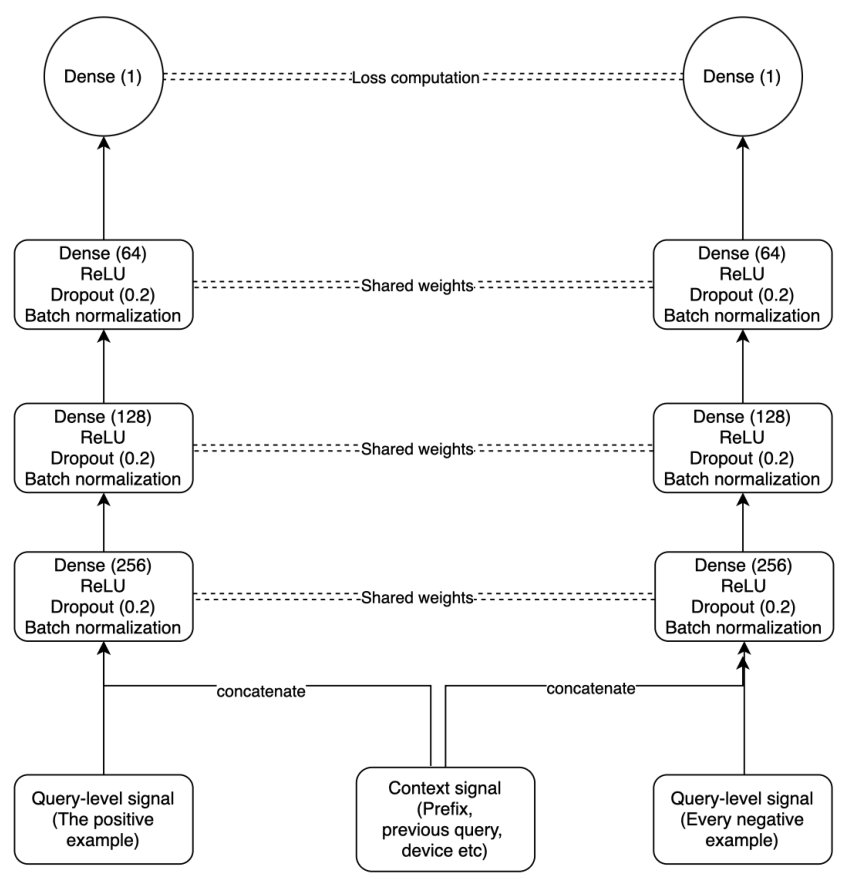

# Synthetic Prefixes to Mitigate Bias in Real-Time Neural Query Autocomplete (利用合成前缀缓解实时神经查询自动补全中的偏差)

- **会议/期刊**: SIGIR-AP 2025（Walmart Global Technology 工业实践论文）
- **作者与机构**: Adithya Rajan, Xiaoyu Liu, Prateek Verma, Vibhu Arora（Walmart Global Technology）
- **推荐链路定位**: 重排（QAC 候选召回后的实时精排）
- **研究方向**: 去偏公平与工业架构 / CTR 特征交叉
- **论文原文**: [https://arxiv.org/abs/2510.01574v1](https://arxiv.org/abs/2510.01574v1)
- **开源代码**: 暂未开源

## TL;DR (1分钟核心速览)

实时查询自动补全（QAC）的日志天然带**展示偏差**：用户只点模型已排在前面的建议，形成反馈闭环，训练数据分布被旧排序器"污染"。本文提出**合成前缀（Synthetic Prefixes）**：从**未开启自动补全**的普通搜索会话中取完整查询，按真实前缀长度分布 $D(s)$反推前缀，再走生产检索链路构造"无偏"训练样本，与真实 QAC 日志按 50-50 混合训练。同时利用"每个前缀仅一个正样本"的结构，将列表级损失近似为$O(n)$成对损失。离线 50-50 混合在$\text{MRR}_{QAC}$与$\text{MRR}_{general}$ 上同时为正，线上 A/B 各平台 MRR 提升 0.92%–1.49%，p99 延迟仍为两位数毫秒。

## Background & Motivation (背景与核心矛盾)

- **主流范式**: QAC 采用"流行度基线打分 → 前缀索引/模糊匹配召回 Top-$M$ → 线性重排"三段式；近期工作（如 DeepPLTR）开始用上下文感知的神经成对 LTR 替代线性打分。
- **前人局限**: ① 线性打分无法刻画设备、会话上下文、类目对齐等特征的非线性交互，特征空间扩张后表达能力见顶；② 直接用 QAC 曝光日志训练会继承**展示偏差**——历史排得高的建议被点击概率更大，模型学到的是"旧排序器的偏好"而非真实相关性。
- **核心洞察 (Key Insight)**: 偏差的根源是**训练样本的采集过程被模型干预**。而在**未触发自动补全**的普通搜索会话中，用户完整敲出的查询不受任何建议影响，是"无偏意图"的天然样本源；只需按真实用户的前缀长度分布反推前缀，即可把这类无偏查询转化为合法的 QAC 训练事件。
- **本文切入点**: 以数据为中心（data-centric）而非损失加权（propensity/counterfactual）来去偏——用合成前缀扩充候选分布，再与真实日志混合，兼顾"去偏"与"行为保真"。

## Method (核心方法设计)

### 1. 整体框架 (Overall Architecture)

系统分两段：**离线数据构造**与**在线重排**。离线侧，先从线上 QAC 日志统计前缀长度分布 $D(s)$（$s$为完整查询字符长度），再对普通搜索日志中的每条完整查询$q$依$D(s)$采样一个前缀$p$，把$p$送入与生产完全一致的检索器取 Top-$M$候选，将$q$标为正、其余候选标为负，得到合成样本集$T$；与真实 QAC 曝光日志按比例混合后训练浅层前馈网络。在线侧，用户输入前缀后召回$M=50$ 候选，拼接查询级特征（流行度、季节性、模糊匹配、类目 one-hot、长度）与上下文特征（上一查询类目/垂直对齐、设备类型、前缀长度），经 3 层 MLP 输出标量分数并排序。

<figure class="paper-figure" markdown="span">
  <figcaption>图1：Neural Ranker 的模型架构</figcaption>
</figure>

### 2. 关键设计拆解 (Key Designs)

1. **合成前缀生成（Synthetic Prefix Generation）**：痛点是无偏样本稀缺且前缀长度不能随意截断（截太短候选歧义大、截太长失去补全意义）。核心算子是**数据驱动的前缀长度分布** $D(s)$：从真实 QAC 日志中记录所有 (prefix, suggestion) 交互对，估计用户在查询长度$s$时实际开始使用补全的前缀长度分布；对每条无偏查询$q$采样$p\sim D(s)$，同一$q$ 可生成多个不同长度的前缀样本。直觉上，这既复刻了真实打字节奏，又让候选集由**检索器**而非**旧排序器**决定，从源头切断反馈闭环。

2. **列表级损失的 $O(n)$成对近似**：标准 listwise 损失需排序/置换操作，复杂度$O(n^2)$甚至$O(n\log n)$，在百万级样本上不可承受。本文利用 QAC 的结构性事实——**每个前缀事件恰有一个用户选择**——把列表级目标退化为正样本对全部$M-1$ 个未点击负样本的成对损失之和：

$$\mathcal{L}=\sum_{(q^{+},q^{-})} l\big(f(p,q^{+},c;\theta),\,f(p,q^{-},c;\theta)\big)$$

其中 $l$为 hinge 或 logistic 损失。由于负样本全部来自**已曝光未点击**的建议（显式负样本，而非随机采样），该近似在保留列表级"全局对比"语义的同时把每事件复杂度降到$O(n)$。

3. **训练配置与推理效率**：Adam 优化器，batch size 1280，层间 dropout + L2 权重衰减；不使用任何学习型 embedding，类别/布尔特征一律 one-hot 或二值直入，标量特征标准化。推理侧单 pod 每分钟处理 2 万+ 请求（每次排 50 个候选），p99 延迟为两位数毫秒，远低于系统阈值；作者明确指出即便优化过的 XGBoost 在该场景延迟也高于同等预测力的浅层网络，故刻意选择紧凑架构。

## Experimental Setup & Evaluation Protocol (实验设置与评估协议)

- **数据集与预处理**: 取自某大型电商平台 30 天搜索日志与 QAC 交互日志，按设备类型均匀采样构造 **1200 万** QAC 事件；无 5-core 过滤，无公开数据集，属纯工业私有数据。

| 数据集 | #Users | #Items | #Interactions | 稀疏度/密度 | 特征/场景说明 |
| :--- | :---: | :---: | :---: | :---: | :--- |
| 工业 QAC 日志（30 天） | 未披露 | 候选池为索引全库 | 12M 事件 | 未披露 | 查询级 + 上下文特征；4 类设备 |

- **数据划分与防穿越 (Splitting Strategy)**: **比例划分** 80% 训练 / 20% 测试；三种训练集配置对照：(i) 100% 真实 QAC、(ii) 50-50 混合、(iii) 100% 合成。
- **排名评测协议 (Ranking Protocol)**: 双指标互补——$\text{MRR}_{QAC}$在留出 QAC 曝光日志上计算（贴近线上但受展示偏差影响），$\text{MRR}_{general}$在普通搜索日志派生的前缀-补全对上计算（偏差小但含非真实 QAC 用法）。均为**列表级 MRR**，候选为生产检索器返回的 Top-$M$（$M=50$），非全库 Full-Ranking。
- **对比基线与超参设置**: 主基线为线上**线性打分器**（生产系统）；离线另设三种数据策略互为对照。网络隐层 256/128/64，sigmoid 激活，无 embedding 维度可调；线上 A/B 为等流量分流、共享同一索引与召回逻辑，仅重排不同。

## Key Experimental Results (实验关键数据)

### 1. 主实验对比 (Main Results)

离线三策略对照（相对生产线性基线的 Δ 值）：

| 训练策略 | $\Delta\text{MRR}_{QAC}$|$\Delta\text{MRR}_{general}$ |
| :--- | :---: | :---: |
| 仅真实 QAC 数据 | **+1.5%** | -1.6% |
| 仅合成前缀数据 | -2.7% | **+1.2%** |
| 50-50 混合 | +0.6% | +0.2% |

线上 A/B（神经排序器 vs. 线性基线，各平台 MRR 相对提升）：

| 平台 | iOS | Android | 桌面 Web | 移动 Web |
| :--- | :---: | :---: | :---: | :---: |
| ΔMRR | +0.92% | +0.79% | **+1.49%** | +1.25% |

线上整体 MRR 提升区间 **+0.92% ~ +1.49%**，平均点击位置改善 **+0.89% ~ +1.40%**，Android 端 QAC 使用率 **+0.36%**；护栏指标（每次搜索点击数、转化率）保持中性。

### 2. 消融实验 (Ablation Study)

按平台与上下文切分的 50-50 混合模型离线增益：

| 切分维度 | 子群 | $\Delta\text{MRR}_{QAC}$|$\Delta\text{MRR}_{general}$ |
| :--- | :--- | :---: | :---: |
| 平台 | 桌面 | +0.98% | +0.79% |
| 平台 | 移动 Web | **+3.29%** | **+1.16%** |
| 平台 | iOS | +0.62% | +0.37% |
| 平台 | Android | +1.32% | +0.19% |
| 上下文 | 无上一查询 | +0.97% | +0.07% |
| 上下文 | 有上一查询 | +1.22% | +0.70% |

### 3. 关键实验发现 (Key Findings)

1. **纯真实数据是"偏差陷阱"**：仅用 QAC 日志训练在 $\text{MRR}_{QAC}$上拿到最高 +1.5%，但$\text{MRR}_{general}$ 反而 **-1.6%**——说明它拟合的是旧排序器的曝光分布，泛化到无偏查询时退化；纯合成数据则完全相反（-2.7% / +1.2%），二者构成清晰的偏差-保真权衡。
2. **50-50 混合是唯一双正解**：+0.6% / +0.2% 虽单项不最高，但同时在两个互补指标上为正，证明"去偏"与"行为保真"可通过数据配比调和，而非必须牺牲一方。
3. **上下文信号确有增量**：有上一查询时 $\Delta\text{MRR}_{general}$ 从 +0.07% 升至 +0.70%（近 10 倍），说明类目/垂直对齐特征在会话内才真正发挥作用；移动 Web 的 +3.29% 则暗示低带宽、少输入场景对补全质量更敏感。

## Highlights & Limitations (亮点、对比与审稿批判)

- **与代表作对比 (vs. Prior Work)**: 相比 DeepPLTR 等神经 QAC 排序器，本文的差异不在模型结构（甚至更浅），而在**训练数据采集机制**——首次把"未触发补全的搜索日志"作为去偏样本源；相比 counterfactual LTR / propensity scoring 一类损失侧校正，本文绕开了强假设与复杂权重估计，工程可落地性显著更高。
- **可迁移亮点**: ① "从无干预日志反推干预场景样本"这一思路可直接迁移到相关搜索、查询推荐、搜索联想等同样受展示偏差困扰的低延迟排序任务；② "单正样本 ⇒ listwise 退化为 $O(n)$ pairwise"的复杂度论证简洁有力，适用于任何每请求仅一次选择的排序场景。
- **审稿级局限批判**: ① 全部实验基于单一电商平台私有日志，无公开数据集与开源代码，**可复现性弱**，50-50 配比的最优性缺乏跨域验证；② $\text{MRR}_{general}$本身承认含非真实 QAC 用法的前缀，作为"无偏"代理指标其效度存疑；③ 合成前缀假设用户打字节奏可由$D(s)$ 刻画，忽略了输入法、粘贴、语音输入等异质行为，且未报告延迟与模型容量的定量权衡曲线。

## Rating (四维评分)

- **方法创新性 (Novelty)**: ⭐⭐⭐ （数据侧去偏视角新颖且直觉干净，但模型与损失均为成熟组件的场景化组合，理论贡献有限）
- **评估协议与实验扎实度 (Protocol & Experiments)**: ⭐⭐⭐⭐ （离线双指标互补设计巧妙，线上大规模 A/B 含护栏指标与分平台分析，唯缺公开数据与显著性检验细节）
- **写作与数学规范度 (Clarity & Rigor)**: ⭐⭐⭐⭐ （工业论文写作清晰、算法伪代码完整，但公式较简、缺少复杂度与配比敏感度的定量分析）
- **工业落地与复现价值 (Industrial & Practical Value)**: ⭐⭐⭐⭐⭐ （真实生产部署、2 万 QPM/pod、两位数毫秒 p99，方法论可直接复用，落地价值极高）

