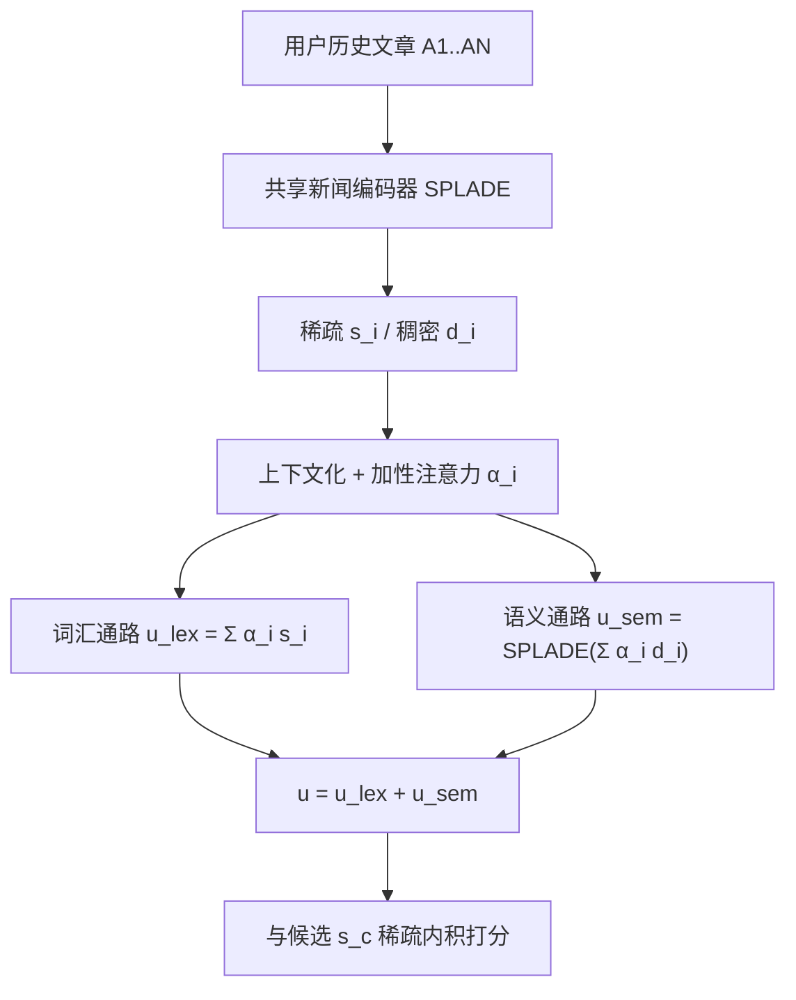
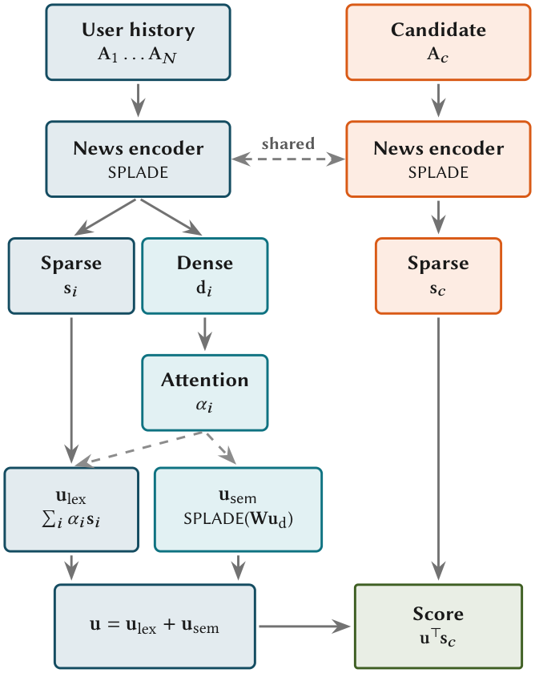

# LSNR: Learned Sparse News Recommendations with Attentive User Modeling (基于注意力用户建模的稀疏新闻推荐)

- **会议/期刊**: SIGIR-AP 2026
- **作者与机构**: David Vos (University of Amsterdam), Andrew Yates (Johns Hopkins University), Maarten de Rijke (University of Amsterdam)
- **推荐链路定位**: 召回
- **研究方向**: 协同过滤与双塔召回 / 序列与会话推荐
- **论文原文**: [https://arxiv.org/abs/2610.23510v1](https://arxiv.org/abs/2610.23510v1)
- **开源代码**: [https://github.com/davidvos/learned-sparse-news-recs](https://github.com/davidvos/learned-sparse-news-recs)

## TL;DR (1分钟核心速览)

新闻推荐中，现有学习稀疏检索推荐器 STAR 将用户历史拼接为单一查询串，导致两个瓶颈：多兴趣被压平为无差别查询，且长文新闻迅速撑爆语言模型上下文窗口被迫截断。LSNR 改为**独立编码每篇文章**，再用加性注意力加权聚合各文章稀疏向量（词汇通路）并叠加稠密投影的 SPLADE 扩展（语义通路），构成稀疏用户向量。在 MIND/EBNeRD 的 impression 级排序协议下，NDCG@10 较 STAR 分别提升 11% 与 10%，短历史（N=1）场景反超 NRMS/NAML 等稠密 SOTA，且索引体积比未压缩稠密基线小一个数量级。

## Background & Motivation (背景与核心矛盾)

- **主流范式**: 新闻推荐以内容驱动的双塔稠密编码为主（NRMS/NAML/LSTUR），用户侧用注意力聚合历史；学习稀疏检索（SPLADE 系）在 ad hoc 检索中已证明可与稠密检索抗衡，但仅 STAR 将其引入推荐。
- **前人局限**: STAR 把历史拼成一个字符串，(i) 无法区分各交互的重要性，多兴趣坍缩为扁平查询；(ii) 新闻为长文，拼接数篇即超出 512 token 上下文，截断严重损伤质量。EBNeRD 上 STAR 的 NDCG@10 仅比无监督 BM25 高不到 1 个点，MRR 甚至更低（0.3459 vs. 0.3503），说明拼接机制在长文场景近乎失效。
- **核心洞察 (Key Insight)**: 两个瓶颈同源——STAR 缺乏"从文章集合构造用户"的专用机制。若改为逐篇独立编码，则候选文章表示与用户无关、可离线预计算，且用户建模粒度回到单篇文章。
- **本文切入点**: 用"独立编码 + 学习式注意力聚合 + 双通路稀疏构造"替换历史拼接，同时解决兴趣坍缩与上下文窗口两个问题。

## Method (核心方法设计)

### 1. 整体框架 (Overall Architecture)

共享新闻编码器（BERT + 一层可训练 Transformer + SPLADE 投影）将每篇文章映射为稀疏向量 $\mathbf{s}$，历史文章额外产出均值池化稠密向量$\mathbf{d}$。用户编码器先对历史稠密向量做一层无位置编码的上下文化，再用加性注意力得到权重$\alpha_i$；随后双通路构造稀疏用户向量：词汇通路按$\alpha_i$加权求和各文章稀疏向量，语义通路对注意力加权后的稠密用户表示施加 SPLADE 投影。最终用户向量$\mathbf{u}=\mathbf{u}_{lex}+\mathbf{u}_{sem}$，候选文章仅用稀疏向量$\mathbf{s}_c$与$\mathbf{u}$ 做内积打分，经倒排索引检索。候选表示可离线预计算，推理时仅需用户侧聚合。

<figure class="paper-figure" markdown="span">
  <figcaption>图1：LSNR 架构。共享新闻编码器将每篇文章映射为稀疏表示 s，并对历史条目映射为稠密表示 d。对稠密历史向量做加性注意力得到权重 𝛼𝑖。稀疏用户向量 u 是两条路径之和：词汇路径 ulex 使用注意力权重聚合每篇文章的稀疏向量，语义路径 usem 对注意力加权后的稠密用户表示施加 SPLADE 投影。候选文章使用稀疏内积 u⊤s𝑐 打分。</figcaption>
</figure>

### 2. 关键设计拆解 (Key Designs)

1. **双通路稀疏用户构造（核心创新）**：痛点在于单一通路要么只有逐篇词项信号、要么只有聚合语义。词汇通路 $\mathbf{u}_{lex}=\sum_{i=1}^{N}\alpha_i\mathbf{s}_i$保留可追溯到具体文章的词项证据；语义通路$\mathbf{u}_{sem}=\log(1+\mathrm{ReLU}(\mathbf{W}_{vocab}\sum_i\alpha_i\tilde{\mathbf{d}}_i))$激活任何单篇文章扩展中都不存在、但聚合兴趣指向的词项。两通路共享同一注意力权重与词表投影$\mathbf{W}_{vocab}$，**不引入额外可学习参数**，却编码互补信号（消融显示单通路性能几乎相同，合并后提升 11%+）。

2. **加性注意力聚合（替代拼接与池化）**：$e_i=\mathbf{q}^\top\tanh(\mathbf{W}_a\tilde{\mathbf{d}}_i+\mathbf{b}_a)$，$\alpha_i=\exp(e_i)/\sum_j\exp(e_j)$。关键在于用稠密表示判断"哪次交互重要"、用稀疏表示承载"交互内容"，二者解耦；且刻意省略位置编码——实验证明加入 PE 反而掉点（MIND 0.4234→0.4086），与"新闻中严格时序是弱信号"的既有结论一致。

3. **训练目标、负采样与推理效率**：以稀疏内积 $\mathbf{u}^\top\mathbf{s}_c$为打分、softmax 交叉熵为损失，并施加 LFLOPS 正则（$\lambda_n=0.005$作用于文章、$\lambda_u=0.0005$作用于用户向量）。稀疏模型采样 16 个负例（稠密模型 4 个即饱和）。文章稀疏度仅 22.8/31.6 NNZ，用户向量 722/563 NNZ（<3% 词表），推理时按 top-$K$ 剪枝；用户编码 0.97 ms，端到端较 STAR 快 2.3×（MIND）/10×（EBNeRD）。

## Experimental Setup & Evaluation Protocol (实验设置与评估协议)

- **数据集与预处理**: 均用官方 "small" 版本；因官方测试集无公开标签，采用惯例以官方验证集作测试、从训练集末 10% 采样做调参。

| 数据集 | #Users (Train/Val/Test) | #Items | #Interactions | 平均历史长 | 文章平均词数 |
| :--- | :---: | :---: | :---: | :---: | :---: |
| MIND | 48,052 / 11,995 / 50,000 | 49,476–65,238 | 212,481 / 15,697 / 73,152 | 32–39 | 45.0 (标题+摘要) |
| EBNeRD | 14,834 / 6,637 / 15,342 | 7,317–9,985 | 210,402 / 23,289 / 244,647 | 46–47 | 465.9 (含正文) |

- **数据划分与防穿越 (Splitting Strategy)**: 沿用数据集官方时间序划分（训练/验证/测试按时间切分），测试用官方验证 split，超参用训练集末 10%。
- **排名评测协议 (Ranking Protocol)**: **Impression 级排序**——在每个曝光日志内对共同展示的文章排序，点击为正、同屏未点击为负，按用户平均；**非全库 Full-Ranking**。全库检索仅用于索引体积与延迟测量，不用于精度。
- **对比基线与超参设置**: 稀疏侧 BM25、STAR（按 recency 选历史填满 512 token）；稠密侧 NRMS、NAML、LSTUR（均换 BERT 骨干）。英文用 `bert-base-uncased`，丹麦文用 `danish-bert-botxo`；冻结 12 层中前 9 层；AdamW，学习率网格 $\{10^{-6},10^{-5},10^{-4}\}$；指标 NDCG@10/5、MRR，双尾配对 t 检验$p<0.01$。

## Key Experimental Results (实验关键数据)

### 1. 主实验对比 (Main Results)

**vs. 稀疏基线（全历史）**

| Method | MIND N@10 | MIND N@5 | MIND MRR | EBNeRD N@10 | EBNeRD N@5 | EBNeRD MRR |
| :--- | :---: | :---: | :---: | :---: | :---: | :---: |
| BM25 | 0.3142 | 0.2541 | 0.2480 | 0.4639 | 0.3868 | 0.3503 |
| STAR | 0.3815 | 0.3191 | 0.2973 | 0.4704 | 0.3925 | 0.3459 |
| **LSNR** | **0.4234** | **0.3620** | **0.3310** | **0.5200** | **0.4547** | **0.4027** |
| Improv. vs STAR | +11.0% | +13.4% | +11.3% | +10.5% | +15.8% | +16.4% |

**vs. 稠密 SOTA（全历史 / 短历史 N=1，NDCG@10）**

| Method | MIND Full | EBNeRD Full | MIND N=1 | EBNeRD N=1 |
| :--- | :---: | :---: | :---: | :---: |
| NRMS | **0.4256** | **0.5290** | 0.3536 | 0.4880 |
| NAML | 0.4247 | 0.5312 | 0.3301 | 0.4889 |
| LSTUR | 0.3794 | 0.5114 | 0.2806 | 0.4496 |
| **LSNR** | 0.4234 | 0.5200 | **0.3626** | **0.5022** |
| Improv. (N=1) | — | — | +2.5% vs NRMS | +2.7% vs NAML |

### 2. 消融实验 (Ablation Study)

**通路消融（NDCG@10）**

| 配置 | MIND Full | MIND Short | EBNeRD Full | EBNeRD Short |
| :--- | :---: | :---: | :---: | :---: |
| 仅 $\mathbf{u}_{lex}$ | 0.3784 | 0.3565 | 0.4734 | 0.4717 |
| 仅 $\mathbf{u}_{sem}$ | 0.3805 | 0.3578 | 0.4868 | 0.4848 |
| **双通路（完整）** | **0.4234** | **0.3626** | **0.5200** | **0.5022** |

**聚合函数消融（固定 $\mathbf{u}_{sem}$，NDCG@10）**

| 方法 | MIND Full | MIND Short | EBNeRD Full | EBNeRD Short |
| :--- | :---: | :---: | :---: | :---: |
| **加性注意力** | **0.4234** | **0.3626** | **0.5200** | **0.5022** |
| 注意力 + 位置编码 | 0.4086 | 0.3582 | 0.5120 | 0.4917 |
| 平均池化 | 0.4020 | 0.3513 | 0.5082 | 0.4895 |
| 时间衰减 | 0.3990 | 0.3516 | 0.5048 | 0.4920 |
| 最大池化 | 0.4138 | 0.3575 | 0.4996 | 0.4843 |

### 3. 关键实验发现 (Key Findings)

1. **增益并非来自"避免截断"**：在 N=1 的短历史设定下 STAR 与 LSNR 输入完全相同、无截断，LSNR 仍领先 3.6%（MIND）与 7%+（EBNeRD），说明收益源自逐篇表示的学习信号差异——STAR 优化单一拼接串，LSNR 让每篇文章表示直接接收用户向量梯度，数据稀缺时泛化更好。
2. **双通路互补而非冗余**：单通路之间差距 ≤0.014 NDCG@10，但合并后在 MIND 全历史较 $\mathbf{u}_{lex}$-only 提升 11.9%、较$\mathbf{u}_{sem}$-only 提升 11.3%，证明词汇证据与用户级语义扩展编码了不同侧面。
3. **稀疏度与数据集特性强耦合**：MIND 上剪枝越狠精度越低，EBNeRD 上反而越剪越准（长历史累积宽词表，剪枝起去噪作用）；同时 STAR 在 EBNeRD 上文档稀疏度达 440.4 NNZ（LSNR 仅 31.6），索引 33.55 MB vs. 2.41 MB，差约 14×，印证拼接训练信号会把文档编码器推向宽而散的表示。

## Highlights & Limitations (亮点、对比与审稿批判)

- **与代表作对比 (vs. Prior Work)**: 与 STAR 的本质区别是"用户表示的单位"——STAR 以整段拼接串为单位，LSNR 以单篇文章为单位再做学习式聚合；与 NRMS 的区别是聚合发生在稀疏词表空间而非稠密空间，因而获得倒排索引与词项可解释性；与 BM25 的区别是具备 SPLADE 式语义扩展能力。
- **可迁移亮点**: (i) "稠密定权重、稀疏载内容"的解耦聚合范式可迁移到任何长文本历史场景（如长视频、文档推荐）；(ii) 候选侧表示与用户无关、可离线预计算，是稀疏召回天然的工程优势。
- **审稿级局限批判**: (i) 全历史下 EBNeRD 仍落后 NRMS/NAML 2–3%，优势集中在短历史，适用边界较窄；(ii) 稠密基线未做量化压缩，索引体积对比并非公平下界，且 HNSW 在延迟上实际优于倒排检索，效率卖点仅在"索引小"而非"检索快"；(iii) MIND 上 STAR 用了检索预训练 checkpoint 而 LSNR 用原生 BERT，初始化不对称（虽有利于 STAR，但比较未完全受控）；(iv) 仅两个小规模、双语种基准，泛化性待验证。

## Rating (四维评分)

- **方法创新性 (Novelty)**: ⭐⭐⭐ （双通路稀疏用户构造思路清晰且参数零增量，但本质是 SPLADE+注意力聚合的合理组合，理论新意中等）
- **评估协议与实验扎实度 (Protocol & Experiments)**: ⭐⭐⭐⭐ （五阶段评估设计严谨，N=1 控制实验巧妙隔离截断混淆，消融完整，但仅 impression 级排序、缺全库排序精度）
- **写作与数学规范度 (Clarity & Rigor)**: ⭐⭐⭐⭐ （公式简洁、符号统一，通路互补性论证清楚，复杂度与稀疏度统计到位）
- **工业落地与复现价值 (Industrial & Practical Value)**: ⭐⭐⭐⭐ （代码开源、索引小一个数量级、用户编码毫秒级，短历史新用户场景直接契合新闻平台痛点）

