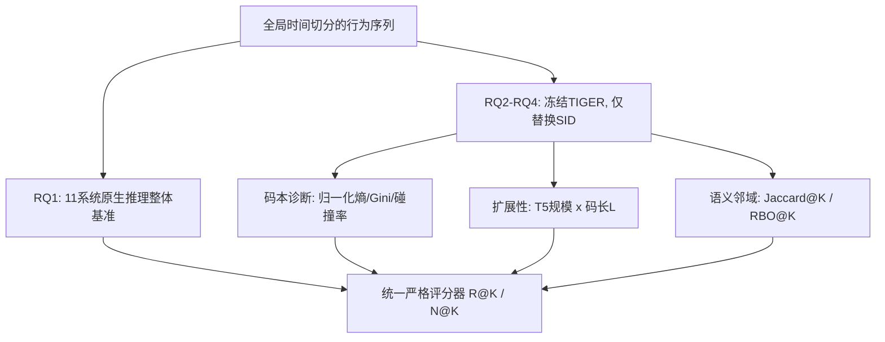

# What Makes a Good Semantic ID for Generative Recommendation? A Reproducibility Study (什么构成生成式推荐的优质语义ID？一项可复现性研究)

- **会议/期刊**: SIGIR-AP 2026
- **作者与机构**: Yufei Chen、Yukun Zhao（山东大学），Junchen Fu（格拉斯哥大学），Jujia Zhao、Zhaochun Ren（莱顿大学）
- **推荐链路定位**: 端到端生成式（召回/排序统一）
- **研究方向**: 生成式推荐与离散语义ID / 实验基准与可复现性
- **论文原文**: [https://arxiv.org/abs/2609.24430v1](https://arxiv.org/abs/2609.24430v1)
- **开源代码**: [https://github.com/layingfish/SID-Repro](https://github.com/layingfish/SID-Repro)

## TL;DR (1分钟核心速览)

生成式推荐普遍用语义ID（SID）替代原子物品ID，但各工作的分词器、码本组织与码长差异巨大，且数据集/骨干/训练配方各不相同，导致"SID设计到底贡献多少"无法归因。本文在统一预处理、全局时间切分与同一严格评分器下，先做11个系统的整体基准（RQ1），再固定TIGER骨干只变SID做受控分析（RQ2–RQ4）。结论是效果高度**非单调**：RPG整体最强但无普适赢家；一级码本归一化熵与NDCG@10相关性近零（Pearson $r=-0.02$）；骨干与码长扩展均非单调；OPQ擅长邻域集合召回、RQ-Kmeans擅长近邻序保持。

## Background & Motivation (背景与核心矛盾)

- **主流范式**: TIGER 起，物品被量化为 $L$级离散码$q(i)=(z_{i,1},\dots,z_{i,L})$，推荐被改写为对目标SID的从左至右自回归生成$p_\theta(q(i^{u}_{t+1})\mid Z^t_u)=\prod_{\ell=1}^{L}p_\theta(z_{i^{u}_{t+1},\ell}\mid Z^t_u,z_{i^{u}_{t+1},<\ell})$，解码后用码-物品字典回映。
- **前人局限**: ①SID构造族谱极散（RQ-VAE、OPQ、RQ-Kmeans、树结构、元数据索引、AE集合分词、端到端可学习分词），但各自在不同数据集/骨干/解码规则下评测，**标识符本身的效应被混淆**；②"码本利用率高即SID好"被广泛当作默认假设，却从未在统一协议下被检验。
- **核心洞察 (Key Insight)**: 作者把SID设计当作**唯一自变量**：RQ1保留各方法原生推理以测完整系统，RQ2–RQ4固定TIGER训练协议与trie约束前缀解码、只替换SID赋值，从而把"分词器效应"从"系统效应"中剥离。
- **本文切入点**: 用"整体基准 + 受控SID-only对比 + 跨数据集诊断（码本平衡、局部语义保持）"三层证据，区分哪些结论跨数据集稳定、哪些只是数据集/协议依赖的排名噪声。

## Method (核心方法设计)

### 1. 整体框架 (Overall Architecture)

本文不是新模型，而是一套**受控评测框架**。输入为按全局时间戳排序的用户行为序列；RQ1 层让 11 个系统各按官方超参与推理设置跑同一份预处理与同一评分器，得到完整系统排名；RQ2–RQ4 层把分词器替换为待比较的 SID 设计（TIGER/RQ-Kmeans/LETTER-div/LETTER-no-div/OPQ/SEATER/HowToIndex），骨干、损失、trie 约束解码与后处理（剔除训练历史物品、空位用训练期热门补齐以保证 top-$K$有效）全部冻结；最后在码本层（熵/Gini/碰撞率）、骨干与码长层（T5-small/base/large、$L\in\{2,3,4,6,8,12,16\}$）、语义邻域层（Jaccard@K、RBO@K）三个维度做诊断。

### 2. 关键设计拆解 (Key Designs)

1. **双层对照协议（系统级 vs. 标识符级）**：痛点是文献中"方法提升"混杂了骨干、解码与调参；本文用 RQ1 保留原生推理测上限、RQ2–RQ4 冻结 TIGER 只变 $q(\cdot)$，使差异可归因于 SID。代价是同一方法在两层间数值略有出入，作者明确将其视为协议差异而非矛盾。
2. **码本利用率诊断（归一化熵）**：针对"利用率即质量"的默认假设，定义一级归一化熵 $H^{\text{norm}}_1=-\sum_{c}p_{1,c}\log p_{1,c}/\log|\mathcal{C}_1|$，并辅以有效使用数、Gini、前缀利用率与物品级碰撞率。直觉是：熵只度量码空间占用，不度量码的语义连贯性与可生成性，因此只能作**故障诊断**而非优化目标。
3. **局部语义保持的双指标分解**：针对"离散码是否保住物品邻域结构"，在参考语义空间中取 top-$K$邻居，与 SID 空间 top-$K$ 比较：Jaccard@K 度量**集合召回**，RBO@K 度量**序保持**。两者刻意分离，因为集合覆盖与近邻排序是两种不同几何性质，单一指标会掩盖互补性。
4. **训练目标与开销**：受控实验沿用 TIGER 的负对数似然 $\mathcal{L}=-\sum_{\ell=1}^{L}\log p_\theta(z_{i,\ell}\mid Z^t_u,z_{i,<\ell})$，无额外负采样（全 softmax 于码本），推理用 trie 约束前缀解码保证生成合法SID；8×RTX 4090，按验证 NDCG@10 早停。

## Experimental Setup & Evaluation Protocol (实验设置与评估协议)

- **数据集与预处理**: 统一 `5-core` 过滤后按全局时间戳合并切分。

| 数据集 | #Users | #Items | #Interactions | 稀疏度/密度 | 特征/场景说明 |
| :--- | :---: | :---: | :---: | :---: | :--- |
| Video Games | 74,333 | 25,062 | 666,397 | 密度约 3.6e-4 | 亚马逊评论，品类集中 |
| Microlens-50K | 42,666 | 14,079 | 310,531 | 密度约 5.2e-4 | 短视频，默认基准 |
| Microlens-100K | 90,171 | 17,228 | 658,056 | 密度约 4.2e-4 | 仅用于利用率与扩展分析 |
| Yelp | 221,039 | 109,326 | 3,531,723 | 密度约 1.5e-4 | 本地生活，物品数最大 |

- **数据划分与防穿越 (Splitting Strategy)**: 全局时间戳切分，训练:验证:测试 = $70:13:17$，验证/测试交互在全局层面晚于训练期，降低未来信息泄漏；切分后每用户按时间排序构造序列。
- **排名评测协议 (Ranking Protocol)**: 多目标 **warm-only 全库排序**——每个用户在全局截断点只评测一次，其后所有 warm 交互均视为相关物品，冷物品从真值中剔除、无真值用户剔除；报告 Recall@5/10、NDCG@5/10，按用户均匀平均。**未使用采样负例**，因此指标绝对值偏低但可比性强。
- **对比基线与超参设置**: 传统序列 SASRec；生成式 10 个（TIGER、HowToIndex、RPG、LETTER-TIGER、LETTER-LC-Rec、SETRec、ETEGRec、SEATER、EAGER、DiffGRM、OneRec），覆盖 RQ-VAE/OPQ/RQ-Kmeans/树/元数据/AE/端到端七类构造。RQ1 沿用官方超参；RQ2–RQ4 固定 TIGER 与三级码本（每级 256 码）。作者明确声明 RQ1 以忠实复现为先、不做逐数据集精调，故小差距需谨慎解读。

## Key Experimental Results (实验关键数据)

### 1. 主实验对比 (Main Results)

统一切分与评分器、保留各方法原生推理（RQ1），NDCG@10 摘录：

| Model | Video Games R@10 | VG N@10 | Microlens R@10 | ML N@10 | Yelp R@10 | Yelp N@10 |
| :--- | :---: | :---: | :---: | :---: | :---: | :---: |
| SASRec | 0.0300 | 0.0152 | 0.0318 | 0.0156 | 0.0257 | 0.0177 |
| TIGER | 0.0468 | 0.0272 | 0.0157 | 0.0089 | 0.0230 | 0.0172 |
| HowToIndex | 0.0369 | 0.0232 | 0.0129 | 0.0070 | 0.0110 | 0.0086 |
| RPG (OPQ) | 0.0477 | **0.0301** | 0.0333 | 0.0173 | 0.0287 | 0.0207 |
| LETTER-TIGER | 0.0437 | 0.0257 | 0.0231 | 0.0121 | **0.0322** | **0.0232** |
| SETRec | 0.0256 | 0.0159 | 0.0217 | 0.0117 | 0.0279 | 0.0201 |
| ETEGRec | 0.0320 | 0.0189 | 0.0333 | 0.0173 | 0.0275 | 0.0197 |
| SEATER | 0.0330 | 0.0184 | **0.0356** | **0.0189** | 0.0277 | 0.0201 |
| EAGER | 0.0311 | 0.0183 | 0.0229 | 0.0126 | 0.0252 | 0.0183 |
| OneRec (RQ-Kmeans) | 0.0322 | 0.0191 | 0.0265 | 0.0147 | 0.0194 | 0.0152 |
| DiffGRM | 0.0228 | 0.0127 | 0.0192 | 0.0101 | 0.0233 | 0.0173 |

RPG 综合最强（VG 第一、ML 与 Yelp 第二），但三个数据集的最优方法各不相同（SEATER 赢 ML，LETTER-TIGER 赢 Yelp）；SASRec 在 ML 与 Yelp 上反超多数生成式方法。

### 2. 消融/受控分析 (Controlled Analyses)

| 受控维度 | 设置 | 关键数值 | 结论 |
| :--- | :--- | :--- | :--- |
| 码本平衡（RQ2） | RQ-Kmeans vs LETTER-no-div | $H^{\text{norm}}_1\approx1.00$vs$0.80$；L2/L3 全部$>0.98$，碰撞率 0.013–0.025 | 平衡性差异只在一级，且不转化为排序收益 |
| 多样性正则（RQ2） | LETTER-div vs no-div | $H^{\text{norm}}_1$提升约 0.11，NDCG@10 变化$\le0.002$ | 利用率可被显著改善而质量不动 |
| 骨干扩展（RQ3, VG） | T5-small→large | TIGER N@10 0.0272→0.0290；OPQ 0.0293→0.0239；RQ-Kmeans 0.0276→0.0166 | 大骨干对部分SID反而显著退化 |
| 骨干扩展（RQ3, ML-100K） | T5-base→large | LETTER N@10 0.0191→0.0186；RQ-Kmeans 0.0199→0.0192 | 数据变多后退化变缓，指向过拟合 |
| 码长扩展（RQ3, VG） | $L\in\{2,\dots,16\}$| RQ-Kmeans 最佳$L=3$（N@10 0.0276）；RQ-VAE 最佳 N@5 在$L=3$、N@10 在$L=12$（0.0277）；OPQ 最佳$L=6$（0.0321） | 不同量化族偏好不同码长，非单调 |
| 语义保持（RQ4, K=20） | Jaccard / RBO | OPQ Jaccard 0.164–0.174（最高）；RQ-Kmeans RBO 0.190–0.197（最高）；SEATER 两项均最低 | 集合召回与序保持由不同设计胜出 |

### 3. 关键实验发现 (Key Findings)

1. **利用率是诊断量而非优化目标**：RQ-Kmeans 一级归一化熵接近 1.0 且 Gini 仅 0.03，却在 VG 上 NDCG@10 仅 0.0276、在 T5-large 下崩至 0.0166；跨全部设置一级熵与 NDCG@10 的 Pearson $r=-0.02$、Spearman$\rho=-0.08$，说明"码用满了"与"码好用"是两件事。
2. **扩展性非单调且与数据量耦合**：VG 上 T5-large 让 OPQ 从 0.0293 掉到 0.0239、RQ-Kmeans 从 0.0276 掉到 0.0166，而 TIGER 反升至 0.0290；换到 ML-100K 后 base→large 的退化收窄（LETTER 0.0191→0.0186），支持"小数据下大骨干过拟合"的解释，而非"大模型无用"。
3. **语义保持存在互补而非支配**：OPQ 在四个数据集上 Jaccard@20 领先 RQ-Kmeans 0.0415–0.0448，RQ-Kmeans 在 RBO@20 领先 0.0060–0.0161，且该互补在 $K\in\{10,20,50\}$上稳定（唯一反转是 Yelp$K=10$ 时 OPQ 仅高 0.0004），说明"邻域覆盖"与"近邻排序"需分别选型。

## Highlights & Limitations (亮点、对比与审稿批判)

- **与代表作对比 (vs. Prior Work)**: 相较 TIGER（提出 RQ-VAE SID 但单数据集验证）、LETTER（以 CF 正则改进分词器）、OneRec（工业级 RQ-Kmeans 但缺跨设计对照），本文首次在同一预处理/切分/评分器下把 11 个系统与 6 种 SID 设计并置，把"哪个 SID 更好"从经验主张降级为可检验命题，并给出反例（利用率、扩展性）。
- **可迁移亮点**: ①"冻结骨干只换标识符"的受控消融范式可直接搬到多模态 tokenizer、物品标题生成等目标空间研究；②Jaccard/RBO 双指标分解可复用于任何离散码本（如 RQ-VAE 视觉 token）的语义保真评估。
- **审稿级局限批判**: ①RQ2–RQ4 全部绑定 TIGER 骨干与 trie 解码，结论对并行/无序解码（RPG、DiffGRM）是否成立未知；②评测为 warm-only 全库排序，未覆盖冷启动与采样排序，且 RQ1 明确未做逐数据集调参，方法间小差距（如 ML 上 RPG 与 ETEGRec 同为 0.0173）不足以支撑细粒度排名；③骨干仅扩到 T5-large、码本固定 256，规模外推性受限。

## Rating (四维评分)

- **方法创新性 (Novelty)**: ⭐⭐⭐ （无新模型，但"双层对照 + 利用率/扩展/语义三诊断"的问题重构本身有方法论价值，反例结论具纠偏意义）
- **评估协议与实验扎实度 (Protocol & Experiments)**: ⭐⭐⭐⭐⭐ （统一全局时间切分、warm-only 全库排序、11 系统 + 6 设计 + 4 数据集 + 3 邻域尺度，并显式声明证据边界）
- **写作与数学规范度 (Clarity & Rigor)**: ⭐⭐⭐⭐ （RQ 分解清晰、诊断量定义完整，但部分结论以"非单调"概括，缺少对退化机制的定量建模）
- **工业落地与复现价值 (Industrial & Practical Value)**: ⭐⭐⭐⭐⭐ （代码与数据全开源，直接给出"先比完整系统、再用利用率排障、最后按 Jaccard/RBO 选型"的工程决策链）

