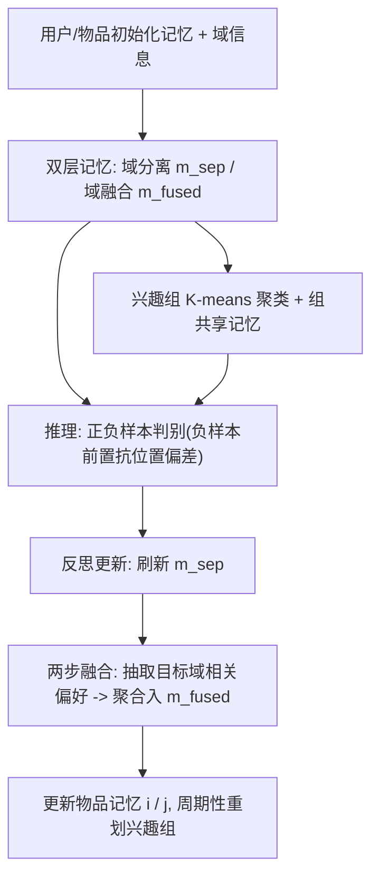

# AgentCF++: Memory-enhanced LLM-based Agents for Popularity-aware Cross-domain Recommendations (记忆增强的流行度感知跨域 LLM 智能体推荐)

- **会议/期刊**: SIGIR 2025
- **作者与机构**: Jiahao Liu, Shengkang Gu, Dongsheng Li, Guangping Zhang, Mingzhe Han, Hansu Gu, Peng Zhang, Tun Lu, Li Shang, Ning Gu（复旦大学、微软亚洲研究院）
- **推荐链路定位**: 端到端生成式（用户行为仿真，作为推荐系统的离线仿真/数据增强模块）
- **研究方向**: 对话推荐与智能体仿真 / 跨域与多场景推荐
- **论文原文**: [论文原文链接](https://arxiv.org/abs/2502.13843v2)
- **开源代码**: [开源代码仓库链接](https://github.com/jhliu0807/AgentCF-plus)

## TL;DR (1分钟核心速览)

AgentCF 式用户智能体把多域偏好混入单一记忆，既在目标域决策时引入大量无关噪声，又无法感知"他人行为/流行度"对用户的影响。本文提出 **双层记忆（域分离 + 域融合）+ 两步融合（注意力式抽取-聚合）** 抑制跨域噪声，并以 **兴趣组 + 组共享记忆** 显式传播流行度效应。在 5 个 Amazon 跨域数据集、1 正 9 负采样排序协议下，MRR 较 AgentCF 平均提升约 14.6%，较最强有监督基线 SASRec 平均提升约 3.5%。

## Background & Motivation (背景与核心矛盾)

- **主流范式**: 以 LLM 智能体同时扮演用户与物品，双方通过交互与反思（reflection）循环更新记忆，隐式复现协同过滤传播（AgentCF）。
- **前人局限**: ①跨域偏好全塞进单条记忆，目标域决策被无关域信息淹没，物品智能体亦丢失域特性；②记忆只在直接交互时更新，用户不活跃时记忆僵化，无法捕捉流行度/他人行为的外部影响。
- **核心洞察 (Key Insight)**: 用户行为 $Y$由偏好$X$与流行度因素$P$共同决定；在**行为仿真**任务中$P$ 不是要去偏的噪声，而是必须显式建模的信号（与去偏推荐目标相反）。
- **本文切入点**: 用域分离/域融合两层记忆解决"信息混叠"，用按兴趣（而非历史相似度）分组的共享记忆解决"流行度传播"。

## Method (核心方法设计)

### 1. 整体框架 (Overall Architecture)

每个用户智能体对每个域维护两条记忆：**域分离记忆** $m_d^{\text{sep}}$只存本域偏好，**域融合记忆**$m_d^{\text{fused}}$额外吸收从其他域抽取的相关偏好。推理时用户$u$收到正样本$i$与负样本$j$的物品记忆，结合本域双层记忆与可访问的组共享记忆，让 LLM 判别正样本并给出理由；随后进入反思更新：先以交互结果刷新$m_d^{\text{sep}}$，再用两步融合刷新$m_d^{\text{fused}}$，最后由$m_d^{\text{fused}}$反向更新物品记忆$i,j$，形成闭环自提升。全程无需梯度训练，靠"推理—反思—记忆改写"迭代逼近真实行为。

### 2. 关键设计拆解 (Key Designs)

1. **双层记忆 + 两步融合（注意力式）**：痛点起因是跨域单记忆噪声；核心算子是先抽取、后聚合——第一步对各其他域 $d'$仅保留与目标域$d$ 相关的偏好片段，第二步加权整合：

$$m_{d,t}^{\text{fused}} \leftarrow \text{LLM}_{\text{fuse}}\Big(m_{d,t-1}^{\text{fused}},\ \big\{\text{Extract}_{d}(m_{d',t}^{\text{sep}})\big\}_{d'\neq d}\Big)$$

其物理直觉与注意力一致：抽取≈注意力打分筛选，聚合≈加权求和，从而在保留跨域迁移的同时过滤无关信息。

2. **兴趣组与组共享记忆（流行度建模）**：痛点起因是流行度影响无法通过直接交互传递。作者先用 LLM 从域融合记忆生成兴趣标签，嵌入后 K-means 聚类并合成兴趣组名，仅保留覆盖多数兴趣的前若干组；每组维护固定大小的共享记忆，存放组内用户近期交互：

$$M_{g,t} = \text{Recent}\big(\{(u_k, i_k)\mid u_k \in g\},\ |M_g|\big)$$

用户 $u$ 的行为写入其所属组，间接影响兴趣相近者。关键在于**按兴趣而非历史相似度分组**，避免流行度噪声扩散到无关用户。

3. **训练目标、负采样与推理效率**：本文为 training-free 仿真框架，无梯度总损失，等价"目标"是使仿真行为与真实行为对齐的反思式记忆更新；负样本按同域随机采样（1 正 9 负，负样本故意置于正样本之前以抵消 LLM 位置偏差）。推理开销主要为每步多次 LLM 调用与周期性聚类，成本高于传统模型。

## Experimental Setup & Evaluation Protocol (实验设置与评估协议)

- **数据集与预处理**: Amazon Review，组合 Books/CDs/Movies/Games 构造 Cross-1~Cross-5（每组 3–4 域）；保留评分 $\geq 4$、时间窗 2021-10 至 2022-03 的记录，仅保留跨多域交互且总交互$\geq 10$ 的用户，随机采样 **100 用户**以控制 API 成本。

| 数据集 | #Users | #Domains | 时间窗 | 过滤/说明 |
| :--- | :---: | :---: | :---: | :--- |
| Cross-1~5 | 各 100 | 3–4 (Books/CDs/Movies/Games) | 2021.10–2022.03 | rating≥4, ≥10 交互, 跨多域用户 |

- **数据划分与防穿越 (Splitting Strategy)**: 按时间排序后 **比例划分 8:1:1**（train/valid/test），严格时序以防穿越。
- **排名评测协议 (Ranking Protocol)**: **Sampled Ranking**——每个正样本随机采 9 个同域未交互负样本构成 10 候选，指标 NDCG 与 MRR，取 **5 次运行均值**。
- **对比基线与超参设置**: 传统 BPR-MF、SASRec；training-free Pop、LLMSeqSim、LLMRank、AgentCF；消融变体 AgentCF+dual、AgentCF+shared、AgentCF++ w/o group。报告 MRR（NDCG 结论一致）。

## Key Experimental Results (实验关键数据)

### 1. 主实验对比 (Main Results)

| Method | Cross-1 | Cross-2 | Cross-3 | Cross-4 | Cross-5 |
| :--- | :---: | :---: | :---: | :---: | :---: |
| BPR-MF | 0.2949 | 0.2959 | 0.3114 | 0.3012 | 0.3127 |
| SASRec | 0.3463 | 0.3154 | 0.3828 | 0.3118 | 0.3687 |
| Pop | 0.2589 | 0.2817 | 0.3094 | 0.2954 | 0.3089 |
| LLMSeqSim | 0.2646 | 0.2549 | 0.3101 | 0.2959 | 0.3124 |
| LLMRank | 0.3268 | 0.2730 | 0.3106 | 0.2970 | 0.3308 |
| AgentCF | 0.3284 | 0.2681 | 0.3114 | 0.3032 | 0.3480 |
| **AgentCF++** | **0.3537** | **0.3176** | **0.3989** | **0.3321** | **0.3837** |
| Improv. vs SASRec | +2.1% | +0.7% | +4.2% | +6.5% | +4.1% |

### 2. 消融实验 (Ablation Study)

| Variant | Cross-1 | Cross-2 | Cross-3 | Cross-4 | Cross-5 |
| :--- | :---: | :---: | :---: | :---: | :---: |
| AgentCF | 0.3284 | 0.2681 | 0.3114 | 0.3032 | 0.3480 |
| + dual (仅双层记忆) | 0.3495 | 0.2962 | 0.3581 | 0.3139 | 0.3581 |
| + shared (仅兴趣组共享) | 0.3488 | 0.2777 | 0.3190 | 0.3147 | 0.3689 |
| ++ w/o group (全历史分组) | 0.3415 | 0.2724 | 0.3181 | 0.3126 | 0.3549 |
| **AgentCF++ (完整)** | **0.3537** | **0.3176** | **0.3989** | **0.3321** | **0.3837** |

### 3. 关键实验发现 (Key Findings)

1. **分工明确**：双层记忆在跨域噪声最重的 Cross-3 贡献最大（0.3581 vs 组共享 0.3190），而组共享在 Cross-4 反超（0.3147 vs 0.3139），说明二者分别覆盖"域过滤"与"流行度传播"两类瓶颈，完整模型在全部 5 数据集最优。
2. **分组方式决定成败**：`w/o group`（按全历史分组）在全部数据集均劣于 AgentCF+dual（如 Cross-3 0.3181 vs 0.3581），证明粗粒度分组会把流行度噪声扩散到无关用户。
3. **仿真仍受限于有监督模型**：单看 AgentCF 仅与 LLMRank 相当且低于 SASRec（Cross-3 0.3114 vs 0.3828），说明传统模型已在训练中隐式吃到流行度与跨域协同；AgentCF++ 靠显式建模才实现反超，平均 MRR 较 AgentCF 提升约 14.6%。

## Highlights & Limitations (亮点、对比与审稿批判)

- **与代表作对比 (vs. Prior Work)**: 相较 AgentCF，本文从"单记忆 + 仅直接交互更新"升级为"双层记忆 + 组共享传播"；相较 RecAgent/Agent4Rec 等仅用户侧智能体，保留用户-物品双向智能体与协同反思；相较去偏推荐刻意消除流行度，本文反向**显式保留并建模** $P$，目标不同、结论互补。
- **可迁移亮点**: ①"先抽取相关、再加权聚合"的两步融合可迁移为任意跨域 LLM 记忆压缩范式；②按兴趣聚类而非历史相似度分组建共享缓存，是可复用的流行度/趋势传播轻量设计。
- **审稿级局限批判**: ①仅采样 100 用户、1 正 9 负的 Sampled Ranking，规模与无偏性有限，未见 Full-Ranking 与显著性检验；②每步多次 LLM 调用 + 周期聚类推理成本高，且对聚类数 $k$、保留组数与共享记忆大小等超参敏感度未做分析。

## Rating (四维评分)

- **方法创新性 (Novelty)**: ⭐⭐⭐⭐ （双层记忆 + 注意力式两步融合 + 兴趣组流行度传播，针对"仿真而非去偏"的目标反转有新意）
- **评估协议与实验扎实度 (Protocol & Experiments)**: ⭐⭐⭐ （5 数据集与消融较完整，但仅采样 100 用户、1:9 采样排序、缺 Full-Ranking 与显著性检验）
- **写作与数学规范度 (Clarity & Rigor)**: ⭐⭐⭐⭐ （机制链路清晰、注意力类比讲得易懂，但公式偏概念化，缺复杂度与超参分析）
- **工业落地与复现价值 (Industrial & Practical Value)**: ⭐⭐⭐ （已开源、可作离线仿真/数据增强，但 LLM 调用与聚类开销大，线上直接部署成本高）

